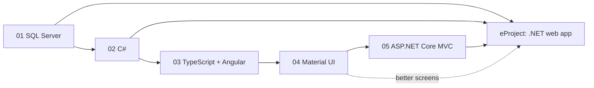

# Term 3: HDSE I (Higher Diploma in Software Engineering, Part I)

      

> ACCP in AI · Term 3 · 67 module sessions + a ~20-hour eProject · ⏱ ~2 hours per session

Term 3 starts your Higher Diploma in Software Engineering and moves you into the **Microsoft .NET world**. You design and query professional databases in SQL Server, learn object-oriented programming in C#, build typed front ends with TypeScript and Angular, learn the design thinking behind Material Design, and then put it all together in ASP.NET Core MVC web applications. The term ends with a team eProject: a complete data-driven **.NET web application**.

## Modules

| No | Module | Sessions | Link |
|---|---|---|---|
| 01 | Effective Data Solutions with SQL Server | 16 | [Open module](./01-Effective-Data-Solutions-with-SQL-Server/README.md) |
| 02 | Proficient Programming with C# | 18 | [Open module](./02-Proficient-Programming-with-CSharp/README.md) |
| 03 | Building Applications with TypeScript (Angular) | 12 | [Open module](./03-Building-Applications-with-TypeScript/README.md) |
| 04 | Material UI | 3 | [Open module](./04-Material-UI/README.md) |
| 05 | Building Robust Web Applications with ASP.NET Core MVC | 18 | [Open module](./05-Building-Robust-Web-Applications-with-ASPNET-Core-MVC/README.md) |
| — | eProject: .NET Web Application Development | ~10 (20 hours) | [Open eProject](./eProject/README.md) |

## Learning Outcomes

After completing Term 3 you will be able to:

- Turn messy data into well-designed, normalized tables and write T-SQL queries, joins, views, stored procedures, indexes, triggers and transactions in SQL Server 2022
- Write clean object-oriented C# programs: classes, inheritance, interfaces, records, exceptions, delegates, collections, generics and LINQ-style thinking
- Connect a C# application to SQL Server and see how .NET MAUI builds cross-platform apps
- Build single-page applications with TypeScript and Angular: components, directives, services, HTTP, pipes, forms, routing and Angular Material
- Apply Material Design ideas (tokens, colour roles, type scale, component states) to design clear and accessible screens
- Build ASP.NET Core MVC 8 applications with Entity Framework Core, tag helpers, filters, Web API, JWT, Identity and clean (onion) architecture
- Plan, build, test, document and present a real .NET web application as part of a team

## Suggested Study Order

SQL Server and C# are the foundation of everything else in this term, so do not rush them. Angular and Material UI teach you front-end and design skills; ASP.NET Core MVC joins the database, the C# logic and the user interface into one web application, which is exactly what the eProject asks for.

## eProject

A group project of **up to 4 students**, about **20 hours per student**: a data-driven web application built with ASP.NET Core MVC, C# and SQL Server in Visual Studio 2022. You submit the **source code** with a working application and a **project report**, then present it in a **viva** (marks: 80% source code and working application, 20% report and viva). Read the [eProject guide](./eProject/README.md) for phases, ideas, folder structure and tips.

## How to Study

1. **Set up once:** install Visual Studio 2022 (with the ASP.NET and web development workload), the .NET 8 SDK, SQL Server 2022 Developer edition with SQL Server Management Studio, Node.js 20 LTS, VS Code and Git. Each module README lists its tools with official links.
2. **One session at a time:** read the concepts, then type (do not copy-paste) and run every example in the session folder.
3. **Never skip the lab and review sessions:** they join several topics together, just like real work.
4. **Check yourself:** answer the quiz before opening the answers and practise the interview questions aloud.
5. **Grow one project:** design its database in Module 01, write its classes in Module 02 and build it as an MVC site in Module 05. It becomes a strong start for your eProject.
6. **Keep a SQL notebook:** save your useful queries in one `.sql` file; you will reuse them all year.
7. **Push to GitHub weekly** and keep connection strings and secrets out of your commits (use User Secrets or `appsettings.Development.json` in `.gitignore`).
8. **Ask early:** bring questions to class or open an Issue on this repository.

---

[🏠 Repository Home](../README.md) · [Start Module 01 ➡](./01-Effective-Data-Solutions-with-SQL-Server/README.md)

Prepared by Zeeshan Abbas · Aptech Learning North Nazimabad
