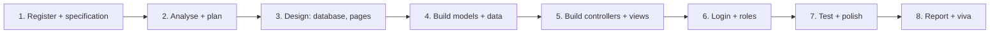

# Term 3 eProject: .NET Web Application Development

     

> Term 3 (HDSE I) · Group project (up to 4 students) · ~20 hours per student (about 10 sessions) · Build, document and present a complete .NET web application

## What is the eProject?

The eProject is your chance to prove you can build a **real web application from start to finish**, the way a small software team does. After your group registers, you receive a project specification. You then design a SQL Server database, write the business logic in C#, build the web pages and controllers with ASP.NET Core MVC, test everything, write a report and explain your work in a viva.

| Module | What you use from it |
|---|---|
| [01 Effective Data Solutions with SQL Server](../01-Effective-Data-Solutions-with-SQL-Server/README.md) | normalized tables, keys, joins, views, stored procedures, indexes |
| [02 Proficient Programming with C#](../02-Proficient-Programming-with-CSharp/README.md) | classes, interfaces, exceptions, collections, async code |
| [03 Building Applications with TypeScript](../03-Building-Applications-with-TypeScript/README.md) | typed client-side code, calling APIs (optional Angular front end) |
| [04 Material UI](../04-Material-UI/README.md) | consistent colours, type scale, component states, accessible forms |
| [05 Building Robust Web Applications with ASP.NET Core MVC](../05-Building-Robust-Web-Applications-with-ASPNET-Core-MVC/README.md) | MVC, EF Core, tag helpers, validation, Identity, layered architecture, deployment |

## Team rules

- Groups of **up to 4 students**; choose a **team leader** who talks to the faculty project guide.
- Your centre registers the group; the real **project specification** is shared only after registration. The ideas below are for practice.
- Plan for about **20 hours of work per student**. Every member must write code, not only documentation.
- Every member must be able to explain **any** part of the project in the viva.
- Use one GitHub repository and commit often; the history shows who did what.

## Technology stack

| Layer | Required | Version guide |
|---|---|---|
| IDE | Visual Studio 2022 (ASP.NET and web development workload) | 17.8 or later |
| Framework | ASP.NET Core MVC on .NET | .NET 8 (LTS) |
| Language | C# | 12 |
| Data access | Entity Framework Core (SQL Server provider) | 8.x |
| Database | SQL Server + SQL Server Management Studio | 2022 |
| UI | Razor views + Bootstrap | Bootstrap 5 |
| Login (recommended) | ASP.NET Core Identity | built into .NET 8 |

**Nice extras (only after the core works):** a small Web API endpoint used by JavaScript or TypeScript, charts on the admin dashboard, PDF or Excel export, email notifications, or an AI feature such as a simple FAQ helper.

## Phases (about 10 sessions)



| Session | Phase | Output |
|---|---|---|
| 1 | Kick-off: read the specification, split roles, create the GitHub repo and an empty ASP.NET Core MVC solution | repo, task list |
| 2 | Requirements: user roles, features, simple use-case list | requirements list |
| 3 | Design: ER diagram, normalized tables, page list and rough sketches of each screen | design document |
| 4 | Data layer: entity classes, `DbContext`, connection string, first migration, seed data | working database |
| 5 | CRUD: controllers and Razor views for the main entities, with validation messages | first working pages |
| 6 | Security: ASP.NET Core Identity, register/login, `[Authorize]` and an Admin role | protected pages |
| 7 | Features: search, filters, paging, image upload, dashboard numbers (a view or stored procedure) | complete features |
| 8 | Testing: test cases, fix bugs, friendly error pages, clean up the layout | tested app |
| 9 | Report: screenshots, database design, test table; optional deployment | report draft |
| 10 | Final submission and viva rehearsal | final package |

## Deliverables checklist

### 1. Source code and working application (80% of marks)
- [ ] The solution opens in Visual Studio 2022 and runs after `Update-Database` (or a provided SQL script)
- [ ] Every feature in the specification works end to end
- [ ] Clean MVC structure: thin controllers, models with data annotations, views using a shared layout and partial views
- [ ] Server-side **and** client-side validation on every form
- [ ] Login with ASP.NET Core Identity; admin pages protected by roles
- [ ] Database: correct keys and relationships, sensible indexes, seed data, at least one view or stored procedure
- [ ] No passwords or real connection strings in GitHub (use User Secrets or a sample `appsettings.json`)
- [ ] Friendly error handling (custom error page, `try`/`catch` around risky code)
- [ ] `README.md` with setup steps, default admin login for testing and the team member list

### 2. Project report and viva (20% of marks)
- [ ] Title page, acknowledgement, table of contents
- [ ] Problem definition, objectives and scope
- [ ] Requirements: functional, non-functional, user roles
- [ ] Architecture diagram (Browser ↔ ASP.NET Core MVC ↔ EF Core ↔ SQL Server)
- [ ] Database design: ER diagram, table list with columns and keys
- [ ] Screenshots of every page with a one-line description
- [ ] Test cases table (input, expected result, actual result, pass/fail)
- [ ] Task sheet (who did what), limitations and future enhancements
- [ ] References (official documentation only)
- [ ] Viva: a short live demo, and each member explains their part and answers questions on any layer

## Suggested project ideas

| Idea | Core features | Extra feature |
|---|---|---|
| **College Library System** | books, members, issue and return, fine calculation, overdue list | email reminder for overdue books |
| **Clinic Appointment Portal** | doctors, schedules, patient booking, appointment history, admin reports | printable appointment slip (PDF) |
| **Online Food Ordering** | menu with categories, cart, orders, order status, admin menu management | sales chart on the dashboard |
| **Student Result Management** | students, courses, marks entry, grade calculation, result cards | export results to Excel |
| **Hotel Room Booking** | rooms, availability check, bookings, check-in/check-out, invoices | room availability calendar |
| **Car Rental Service** | car catalogue, rental requests, approval by admin, return and billing | search and filter by price and type |
| **Job Board for Interns** | company and student roles, job posts, applications, CV upload | application status emails |
| **Complaint Tracking System** | submit complaints, assign to staff, status updates, history | dashboard with counts per status (stored procedure) |

## Suggested folder structure

```text
DotNetEProject/
├── DotNetEProject.sln
├── src/
│   └── DotNetEProject.Web/          # ASP.NET Core MVC project
│       ├── Controllers/             # HomeController.cs, BooksController.cs ...
│       ├── Models/                  # entity classes (Book.cs, Member.cs ...)
│       ├── ViewModels/              # data shaped for one view (BookListVM.cs ...)
│       ├── Data/
│       │   ├── AppDbContext.cs      # DbContext + DbSet<T> properties
│       │   └── SeedData.cs          # sample records
│       ├── Services/                # business logic (FineService.cs ...)
│       ├── Views/
│       │   ├── Shared/_Layout.cshtml
│       │   └── Books/Index.cshtml ...
│       ├── wwwroot/                 # css, js, images, uploads
│       ├── Migrations/
│       ├── appsettings.json         # sample connection string only
│       └── Program.cs
├── database/
│   └── create-and-seed.sql          # optional script for examiners
├── docs/
│   ├── Project-Report.docx
│   └── screenshots/
├── .gitignore                       # bin/, obj/, .vs/, appsettings.Development.json
└── README.md
```

Quick start for a new group (from a terminal; you can also use **File → New → Project** in Visual Studio):

```bash
dotnet new mvc -n DotNetEProject.Web -o src/DotNetEProject.Web --auth Individual
cd src/DotNetEProject.Web
dotnet add package Microsoft.EntityFrameworkCore.SqlServer
dotnet add package Microsoft.EntityFrameworkCore.Tools
dotnet tool install --global dotnet-ef
dotnet ef migrations add InitialCreate
dotnet ef database update
dotnet run
```

## Evaluation tips

1. **Specification first.** Turn every required feature into a checklist item; missing features cost more marks than missing decoration.
2. **Design the database before coding.** A good ER diagram saves hours of migrations and bug fixing later.
3. **Build one feature completely.** Model → migration → controller → views → test, then move to the next feature.
4. **Validate everything.** Required fields, ranges and formats on the model, plus clear messages on the form.
5. **Seed realistic data.** 20-50 believable records make the demo and your screenshots look professional.
6. **Keep secrets safe.** Examiners notice real passwords or connection strings committed to GitHub.
7. **Use SQL Server well.** Show at least one view, stored procedure or index and be ready to explain why you used it.
8. **Document as you go.** Take screenshots and write test cases during development, not the night before.
9. **Rehearse the viva.** Each member should explain the request flow (browser → controller → EF Core → SQL Server → view) and one feature they built.
10. **Test a fresh copy.** Clone the repo into a new folder, follow your own README and make sure it runs before you submit.

---

[⬅ Previous Module](../05-Building-Robust-Web-Applications-with-ASPNET-Core-MVC/README.md) · [🏠 Term Home](../README.md)

Prepared by Zeeshan Abbas · Aptech Learning North Nazimabad
