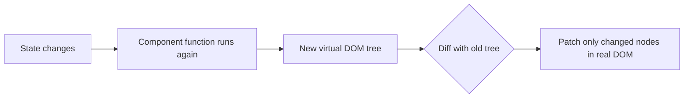

# Session 01: Introduction to React

> Module: Frontend Web Development with React · Term 4 (HDSE) · ⏱ ~2 hours

React is the most widely used library for building user interfaces on the web. In this first session we answer three questions: *what* React is, *why* companies use it, and *how* to set up a professional development environment on your own laptop.

## 🎯 Learning Objectives

- Describe what React is and the problem it solves in modern web development
- Name the main parts of the React ecosystem (Vite, React Router, state tools, UI kits, testing)
- Explain the core ideas: components, declarative UI, one-way data flow and the virtual DOM
- Set up Node.js, VS Code and a new React project with Vite
- Understand the legacy `create-react-app` tool and why new projects now prefer Vite

## 📖 Concepts Explained

### 1. What is React?

React is a **JavaScript library for building user interfaces**. It was created at Facebook (now Meta) and released as open source in 2013. React only cares about the *view* layer: what the user sees and interacts with. Routing, data fetching and styling are handled by companion libraries.

> **Analogy:** Think of a web page as a LEGO model. Instead of carving the whole model from one block of plastic, React lets you build small reusable bricks (components) and snap them together.

### 2. Why React?

| Problem with plain DOM code | How React helps |
|---|---|
| Lots of `document.querySelector` and manual updates | You describe the UI for a given state; React updates the DOM for you |
| Code for one widget is scattered across HTML, CSS and JS files | A component keeps markup and behaviour together |
| Hard to reuse UI pieces | Components are reusable like functions |
| Slow, buggy updates on big pages | React batches changes and updates only what changed |

### 3. Core concepts

- **Components** - independent, reusable pieces of UI written as JavaScript functions.
- **Declarative UI** - you say *what* the screen should look like; React works out *how* to get there.
- **One-way data flow** - data moves from parent to child through *props*. Children never change their parent's data directly.
- **State** - data that changes over time (a counter, a form value). When state changes, React re-renders.
- **Virtual DOM** - React keeps a lightweight copy of the UI in memory, compares the old and new copies (*diffing*) and applies only the minimum changes to the real DOM (*reconciliation*).



### 4. The React ecosystem

| Need | Popular choice |
|---|---|
| Build tool / dev server | **Vite** (recommended), Next.js for full frameworks |
| Page navigation | React Router |
| Global state | Context API, Redux Toolkit, Zustand |
| Server data | fetch, Axios, TanStack Query |
| UI components | Bootstrap, Material UI, Tailwind CSS |
| Testing | Vitest, React Testing Library |

### 5. Development environment

1. **Node.js 20 LTS** - gives you `node` and `npm` (React tools run on Node).
2. **VS Code** with the *ES7+ React snippets* and *Prettier* extensions.
3. **A modern browser** plus the **React Developer Tools** extension.

### 6. Create React App vs Vite

`create-react-app` (CRA) was the official starter for years (`npx create-react-app my-app`). It is now **deprecated** and no longer maintained. Vite starts in milliseconds, has fast hot reload and is what the React docs recommend for a plain single-page app. You may still meet CRA in older company projects, so it is good to recognise its folder structure (`public/`, `src/index.js`, `npm start`).

| | Create React App | Vite |
|---|---|---|
| Start command | `npm start` | `npm run dev` |
| Entry file | `src/index.js` | `src/main.jsx` |
| Speed | Slow on big projects | Very fast |
| Status | Deprecated | Actively maintained |

### 7. Anatomy of a Vite React project

```text
react-lab/
├── index.html        # the single HTML page, contains <div id="root">
├── package.json      # scripts and dependencies
└── src/
    ├── main.jsx      # mounts <App /> into #root
    ├── App.jsx       # your first component
    └── index.css
```

## 💻 Code Examples

### Example 1: The entry point

📄 File: [`main.jsx`](main.jsx)

```jsx
import { StrictMode } from "react";
import { createRoot } from "react-dom/client";
import App from "./App.jsx";
import "./index.css";

// Find the empty <div id="root"> in index.html and let React control it
createRoot(document.getElementById("root")).render(
  <StrictMode>
    <App />
  </StrictMode>
);
```

**How it works**

- `createRoot` (React 18+) connects React to one DOM element.
- `render(<App />)` tells React what to draw inside it.
- `StrictMode` runs extra checks in development only (for example, it calls some functions twice to reveal side-effect bugs). It does nothing in production.

### Example 2: Your first component

📄 File: [`App.jsx`](App.jsx)

```jsx
const skills = ["HTML", "CSS", "JavaScript", "React"];

function App() {
  const student = "Ayesha";
  const year = new Date().getFullYear();

  return (
    <main style={{ fontFamily: "system-ui", padding: 24 }}>
      <h1>Hello, {student}! 👋</h1>
      <p>Welcome to Frontend Web Development with React ({year}).</p>
      <h2>Skills you will use</h2>
      <ul>
        {skills.map((s) => (
          <li key={s}>{s}</li>
        ))}
      </ul>
    </main>
  );
}

export default App;
```

**How it works**

- A component is just a function whose name starts with a **capital letter** and returns JSX.
- `{student}` and `{year}` insert JavaScript values into the markup.
- `skills.map(...)` turns an array into a list of `<li>` elements; each needs a unique `key`.
- `export default App` makes the component available to `main.jsx`.

### Example 3: Checking your toolchain

📄 File: [`check-env.sh`](check-env.sh)

```bash
# Run these in a terminal to confirm your setup
node -v          # should print v20.x or newer
npm -v           # should print 10.x or newer
npm create vite@latest react-lab -- --template react
cd react-lab
npm install
npm run dev      # open http://localhost:5173
```

**How it works**

- `node -v` / `npm -v` confirm Node is installed and on your PATH.
- `npm create vite@latest` downloads the Vite starter and asks no questions because we pass `--template react`.
- `npm run dev` starts a development server with hot module replacement: save a file and the browser updates instantly.

### ▶️ How to run

1. One-time setup of a playground (Node 20+ required):
   ```bash
   npm create vite@latest react-lab -- --template react
   cd react-lab
   npm install
   ```
2. Copy the `.jsx` / `.css` files from this folder into `react-lab/src/` (replace `App.jsx` when asked).
3. Start the dev server with `npm run dev` and open the URL shown (usually http://localhost:5173).

## 🧪 Lab Practice

1. Install Node.js 20 LTS and VS Code, then run `node -v` and `npm -v` and take a screenshot of the output.
2. Create a Vite React project called `react-lab`, start it and open it in the browser.
3. Replace `App.jsx` with Example 2 and change the student name and skills to your own.
4. Install the React Developer Tools browser extension and inspect the `App` component tree.
5. Open `package.json` and write down what the `dev`, `build` and `preview` scripts do. Run `npm run build` and look inside the `dist/` folder.

## 📝 Assignment

Create a **"About Me" page** in a new Vite project. It must show your name, your batch, a short paragraph about why you joined the AI programme, and a list of at least five technologies you want to master. Store the technologies in an array and render them with `map()`. Push the project to a new GitHub repository and submit the link.

## ❓ Quick Quiz

**Q1.** React is best described as: (a) a database (b) a JavaScript library for building UIs (c) a CSS framework (d) a server

**Q2.** What does the virtual DOM allow React to do?

**Q3.** Which command starts a Vite development server?

**Q4.** Why must component names start with a capital letter?

**Q5.** Name one reason Vite is preferred over Create React App today.

<details>
<summary>Show answers</summary>

1. (b) A JavaScript library for building user interfaces.
2. Compare the old and new UI in memory and update only the parts of the real DOM that changed.
3. `npm run dev`
4. So JSX can tell a custom component (`<App />`) apart from a built-in HTML tag (`<div>`).
5. CRA is deprecated; Vite is actively maintained and much faster to start and reload.

</details>

## 💼 Interview Questions

**1. What is the difference between a library and a framework, and which is React?**

> A library is called by your code for a specific job; a framework calls your code and dictates structure. React is a UI library; frameworks such as Next.js build on top of it.

**2. Explain reconciliation in React.**

> When state changes React builds a new virtual tree, diffs it against the previous one and applies the smallest set of real DOM operations. Keys help it match list items between renders.

**3. What does one-way data flow mean?**

> Data travels down from parent to child through props. A child requests changes by calling a function passed from the parent, which keeps data changes predictable.

## ✅ Summary

- React builds UIs from small reusable components written as functions.
- You describe the UI for the current state; React updates the DOM efficiently through the virtual DOM.
- The ecosystem adds routing, state management, styling and testing around React.
- Use Node.js 20 + VS Code + Vite for new projects; recognise CRA in legacy code.
- `main.jsx` mounts `<App />` into `#root` using `createRoot`.

---

[⬅ Previous](../README.md) · [🏠 Module Home](../README.md) · [Next ➡](../Session-02-React-Components/README.md)

Prepared by Zeeshan Abbas · Aptech Learning North Nazimabad
