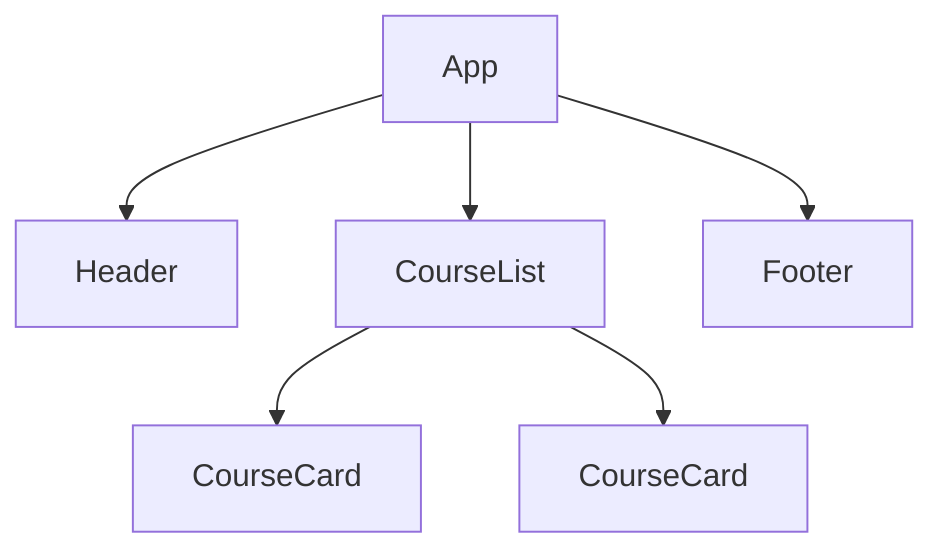
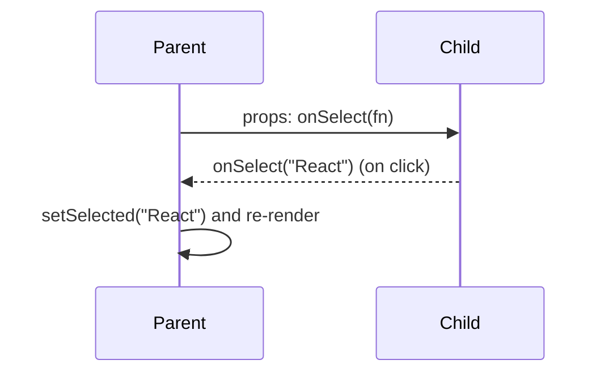

# Session 02: React Components

> Module: Frontend Web Development with React · Term 4 (HDSE) · ⏱ ~2 hours

Everything in React is a component: a button, a card, a whole page. This session shows you how to design components, pass data between them and display data that comes from an external API.

## 🎯 Learning Objectives

- Define a component and identify the two types: function and class components
- Compare function components with class components and know why function components are preferred
- Pass data from parent to child with props, including default values and `children`
- Send data from child to parent using callback props
- Fetch data from a public API and display it inside a component

## 📖 Concepts Explained

### 1. What is a component?

A component is a **reusable, self-contained piece of UI**. It receives inputs (props) and returns what should appear on screen.



### 2. Types of components

| Feature | Function component | Class component |
|---|---|---|
| Syntax | `function Card(props) { return ... }` | `class Card extends React.Component { render() { ... } }` |
| State | `useState` hook | `this.state` + `this.setState` |
| Lifecycle | `useEffect` hook | `componentDidMount`, `componentDidUpdate`, ... |
| `this` keyword | Not needed | Required everywhere |
| Status | **Recommended** for all new code | Legacy, still found in older apps |

### 3. Props: passing data down

Props are the **arguments** of a component. They are read-only: a component must never modify its own props.

```jsx
<CourseCard title="React" sessions={12} />
```

Inside the child you usually *destructure* props: `function CourseCard({ title, sessions })`.

- **Default values:** `function Badge({ color = "blue" })`
- **children:** whatever you put between opening and closing tags arrives as `props.children`. This is how layout components like `<Card>...</Card>` work.

### 4. Passing data up: callback props

A child cannot change parent data directly. Instead the parent passes a **function** as a prop and the child calls it.



### 5. Sharing data between siblings

Siblings cannot talk directly. **Lift the state up** to their closest common parent, then pass the value down to one sibling and a setter callback to the other.

### 6. Consuming external API data

A component can load data from a server when it first appears:

1. Keep the data, a loading flag and an error in state.
2. Start the request inside `useEffect` (covered in depth in Session 9).
3. Render a loading message, an error message or the data.

We will use the free test API **https://jsonplaceholder.typicode.com**.

## 💻 Code Examples

### Example 1: Props, defaults and children

📄 File: [`CourseCard.jsx`](CourseCard.jsx)

```jsx
export function Card({ children }) {
  return (
    <div style={{ border: "1px solid #ddd", borderRadius: 8, padding: 16, margin: 8 }}>
      {children}
    </div>
  );
}

export default function CourseCard({ title, sessions, level = "Beginner" }) {
  return (
    <Card>
      <h3>{title}</h3>
      <p>{sessions} sessions · {level}</p>
    </Card>
  );
}
```

**How it works**

- `Card` is a *layout* component: it renders whatever is placed inside it via `children`.
- `CourseCard` destructures its props and gives `level` a default value.
- Both are function components, exported so other files can import them.

### Example 2: Parent and child communication

📄 File: [`App.jsx`](App.jsx)

```jsx
import { useState } from "react";
import CourseCard from "./CourseCard.jsx";
import UserList from "./UserList.jsx";

const courses = [
  { id: 1, title: "React", sessions: 12 },
  { id: 2, title: "Node.js", sessions: 12, level: "Intermediate" },
  { id: 3, title: "MongoDB", sessions: 16 },
];

function CourseButton({ title, onSelect }) {
  return <button onClick={() => onSelect(title)}>Choose {title}</button>;
}

export default function App() {
  const [selected, setSelected] = useState("none yet");

  return (
    <main style={{ fontFamily: "system-ui", padding: 24 }}>
      <h1>Term 4 Courses</h1>
      {courses.map((c) => (
        <CourseCard key={c.id} title={c.title} sessions={c.sessions} level={c.level} />
      ))}

      <h2>Pick your favourite</h2>
      {courses.map((c) => (
        <CourseButton key={c.id} title={c.title} onSelect={setSelected} />
      ))}
      <p>Selected: <strong>{selected}</strong></p>

      <UserList />
    </main>
  );
}
```

**How it works**

- Data flows **down**: each `CourseCard` receives `title`, `sessions` and `level` as props.
- Data flows **up**: `CourseButton` calls `onSelect(title)`, which is really the parent's `setSelected`.
- When `selected` changes, `App` re-renders and shows the new value.

### Example 3: Displaying API data

📄 File: [`UserList.jsx`](UserList.jsx)

```jsx
import { useEffect, useState } from "react";

export default function UserList() {
  const [users, setUsers] = useState([]);
  const [loading, setLoading] = useState(true);
  const [error, setError] = useState(null);

  useEffect(() => {
    fetch("https://jsonplaceholder.typicode.com/users")
      .then((res) => {
        if (!res.ok) throw new Error(`HTTP ${res.status}`);
        return res.json();
      })
      .then((data) => setUsers(data))
      .catch((err) => setError(err.message))
      .finally(() => setLoading(false));
  }, []); // empty array = run once after the first render

  if (loading) return <p>Loading users...</p>;
  if (error) return <p style={{ color: "red" }}>Error: {error}</p>;

  return (
    <section>
      <h2>Users from an API</h2>
      <ul>
        {users.map((u) => (
          <li key={u.id}>{u.name} — {u.email}</li>
        ))}
      </ul>
    </section>
  );
}
```

**How it works**

- Three pieces of state cover the three possible screens: loading, error, success.
- `useEffect(..., [])` starts the request once, after the component appears.
- `res.ok` is checked because `fetch` does not throw on HTTP errors like 404.

### Example 4: The same card as a class component (legacy style)

📄 File: [`ClassCounter.jsx`](ClassCounter.jsx)

```jsx
import { Component } from "react";

export default class ClassCounter extends Component {
  state = { count: 0 };

  increment = () => {
    this.setState((prev) => ({ count: prev.count + 1 }));
  };

  render() {
    return (
      <button onClick={this.increment}>
        Clicked {this.state.count} times ({this.props.label})
      </button>
    );
  }
}
```

**How it works**

- Class components extend `Component` and must have a `render()` method.
- State lives in `this.state` and is changed with `this.setState`.
- Compare with the hook version you will write in Session 6: it is shorter and has no `this`.

### ▶️ How to run

1. One-time setup of a playground (Node 20+ required):
   ```bash
   npm create vite@latest react-lab -- --template react
   cd react-lab
   npm install
   ```
2. Copy the `.jsx` / `.css` files from this folder into `react-lab/src/` (replace `App.jsx` when asked).
3. Start the dev server with `npm run dev` and open the URL shown (usually http://localhost:5173).

## 🧪 Lab Practice

1. Create a `ProfileCard` component that accepts `name`, `role` and `city` props and shows them nicely.
2. Render three `ProfileCard`s from an array of objects using `map()` and a proper `key`.
3. Add a default value for `city` ("Karachi") and confirm it appears when the prop is not passed.
4. Make a `Panel` layout component that uses `children`, and wrap your cards inside it.
5. Change `UserList` to load `https://jsonplaceholder.typicode.com/posts?_limit=5` and show post titles.

## 📝 Assignment

Build a **Product Catalogue**: an `App` that holds an array of six products (name, price in PKR, category). Render each with a `ProductCard`. Add a `CategoryFilter` child component with buttons (All, Mobiles, Laptops, Accessories). When a button is clicked the child must inform the parent through a callback prop, and the parent shows only matching products.

## ❓ Quick Quiz

**Q1.** What are props?

**Q2.** How does a child send data to its parent?

**Q3.** Which type of component is recommended for new React code?

**Q4.** What is `props.children`?

**Q5.** Why do we check `res.ok` after `fetch`?

<details>
<summary>Show answers</summary>

1. Read-only inputs passed from a parent component to a child, like function arguments.
2. By calling a callback function that the parent passed down as a prop.
3. Function components (with hooks).
4. The content placed between a component's opening and closing tags.
5. `fetch` only rejects on network failure; HTTP errors such as 404/500 must be detected manually.

</details>

## 💼 Interview Questions

**1. Why should props be treated as immutable?**

> React relies on parents owning their data; mutating props breaks one-way data flow and can cause the UI to show stale or inconsistent values.

**2. What does 'lifting state up' mean?**

> Moving shared state to the closest common ancestor so that several children can read it via props and update it via callbacks.

**3. When might you still write a class component?**

> Mainly when maintaining older code, or for error boundaries, which still require a class with componentDidCatch/getDerivedStateFromError.

## ✅ Summary

- Components are reusable UI functions; name them with a capital letter.
- Function components with hooks have replaced class components in new code.
- Props pass data down, callback props pass events up.
- `children` lets you build flexible layout wrappers.
- Fetch API data in `useEffect` and handle loading, error and success states.

---

[⬅ Previous](../Session-01-Introduction-to-React/README.md) · [🏠 Module Home](../README.md) · [Next ➡](../Session-03-JSX-Elements/README.md)

Prepared by Zeeshan Abbas · Aptech Learning North Nazimabad
