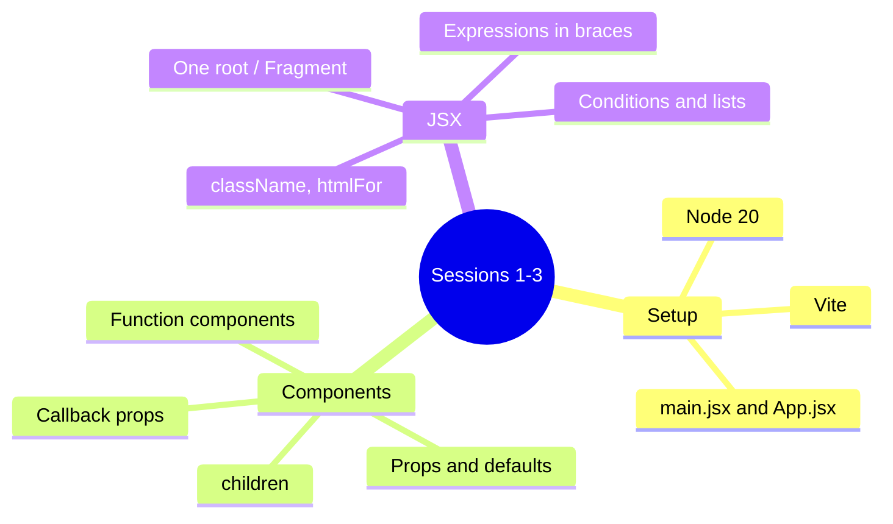

# Session 04: Practice Lab: Components and JSX

> Module: Frontend Web Development with React · Term 4 (HDSE) · ⏱ ~2 hours

This is a hands-on revision session for Sessions 1 to 3. There is no new theory: you will solve guided challenges, compare with the solutions in this folder and fix common mistakes.

## 🎯 Learning Objectives

- Revise the React project structure and the role of `main.jsx` and `App.jsx`
- Break a page design into a tree of components
- Pass props and callbacks confidently between components
- Write JSX with expressions, conditions and lists without errors
- Debug the most common beginner errors in React

## 📖 Concepts Explained

### 1. Quick revision map



### 2. Thinking in components

Before writing code, draw boxes around each part of the design and name them. A good component:

- does **one job** (displaying a product, a header, a search box),
- receives what it needs through **props**,
- is **small enough** to read in one screen.

| Design piece | Component | Props |
|---|---|---|
| Top bar with logo and title | `Navbar` | `title` |
| A single product tile | `ProductCard` | `name`, `price`, `inStock` |
| The grid of tiles | `ProductGrid` | `products`, `onAdd` |
| Cart counter | `CartBadge` | `count` |

### 3. Common errors and fixes

| Error message / symptom | Cause | Fix |
|---|---|---|
| *Adjacent JSX elements must be wrapped* | Two root elements returned | Wrap in `<>...</>` |
| *Each child in a list should have a unique "key"* | Missing `key` in `map()` | Add `key={item.id}` |
| Component shows nothing, no error | Lowercase name `<card />` | Rename to `Card` |
| *Objects are not valid as a React child* | Rendering an object `{user}` | Render a field: `{user.name}` |
| Button runs on page load | `onClick={handle()}` | `onClick={handle}` or `onClick={() => handle(id)}` |
| `0` appears on screen | `{list.length && ...}` | `{list.length > 0 && ...}` |

### 4. How to use this lab

1. Read each challenge in **Lab Practice** and try it yourself first (20-25 minutes each).
2. Only then open the solution files in this folder: `ProductCard.jsx`, `ProductGrid.jsx`, `App.jsx`.
3. Compare your answer line by line and note any differences in your notebook.

## 💻 Code Examples

### Example 1: Solution: ProductCard

📄 File: [`ProductCard.jsx`](ProductCard.jsx)

```jsx
export default function ProductCard({ name, price, inStock = true, onAdd }) {
  return (
    <article style={{ border: "1px solid #ccc", borderRadius: 8, padding: 12, width: 180 }}>
      <h3 style={{ margin: "4px 0" }}>{name}</h3>
      <p>Rs. {price.toLocaleString("en-PK")}</p>
      {inStock ? (
        <button onClick={() => onAdd(name)}>Add to cart</button>
      ) : (
        <span style={{ color: "gray" }}>Out of stock</span>
      )}
    </article>
  );
}
```

**How it works**

- Default prop `inStock = true` keeps the card working when the prop is omitted.
- A ternary swaps the button for a label when the product is unavailable.
- `onAdd(name)` is wrapped in an arrow function so it runs only on click.

### Example 2: Solution: ProductGrid

📄 File: [`ProductGrid.jsx`](ProductGrid.jsx)

```jsx
import ProductCard from "./ProductCard.jsx";

export default function ProductGrid({ products, onAdd }) {
  if (products.length === 0) return <p>No products found.</p>;

  return (
    <section style={{ display: "flex", gap: 12, flexWrap: "wrap" }}>
      {products.map((p) => (
        <ProductCard key={p.id} {...p} onAdd={onAdd} />
      ))}
    </section>
  );
}
```

**How it works**

- An early `return` handles the empty case before the main JSX.
- `{...p}` spreads `name`, `price` and `inStock` as props.
- The `onAdd` callback is passed through unchanged to each card.

### Example 3: Solution: App with cart badge

📄 File: [`App.jsx`](App.jsx)

```jsx
import { useState } from "react";
import ProductGrid from "./ProductGrid.jsx";

const products = [
  { id: 1, name: "Wireless Mouse", price: 2500 },
  { id: 2, name: "USB-C Hub", price: 6800 },
  { id: 3, name: "Mechanical Keyboard", price: 14500, inStock: false },
  { id: 4, name: "Laptop Stand", price: 4200 },
];

function Navbar({ title, count }) {
  return (
    <header style={{ display: "flex", justifyContent: "space-between", padding: 12, background: "#0d6efd", color: "white" }}>
      <strong>{title}</strong>
      <span>🛒 {count}</span>
    </header>
  );
}

export default function App() {
  const [cart, setCart] = useState([]);
  const addToCart = (name) => setCart((prev) => [...prev, name]);

  return (
    <>
      <Navbar title="Tech Bazaar" count={cart.length} />
      <main style={{ padding: 16, fontFamily: "system-ui" }}>
        <ProductGrid products={products} onAdd={addToCart} />
        {cart.length > 0 && <p>Last added: {cart[cart.length - 1]}</p>}
      </main>
    </>
  );
}
```

**How it works**

- `App` owns the cart state and passes `addToCart` down two levels.
- `setCart((prev) => [...prev, name])` creates a **new** array instead of mutating the old one.
- `Navbar` only receives what it shows: the title and the count.

### ▶️ How to run

1. One-time setup of a playground (Node 20+ required):
   ```bash
   npm create vite@latest react-lab -- --template react
   cd react-lab
   npm install
   ```
2. Copy the `.jsx` / `.css` files from this folder into `react-lab/src/` (replace `App.jsx` when asked).
3. Start the dev server with `npm run dev` and open the URL shown (usually http://localhost:5173).

## 🧪 Lab Practice

1. **Challenge 1 - Component tree:** Sketch the components for a simple online shop page (navbar, product grid, product card, footer). List the props each one needs.
2. **Challenge 2 - ProductCard:** Build a card that shows name and price, and shows "Out of stock" instead of a button when `inStock` is false.
3. **Challenge 3 - Grid + callbacks:** Render all products from an array and make the Add button increase a cart counter in the navbar.
4. **Challenge 4 - Debugging:** Deliberately introduce each error from the table in Concepts, read the browser/console message, then fix it.
5. **Challenge 5 - Extension:** Add a total price to the navbar, calculated with `reduce()` from the cart items.

## 📝 Assignment

Build a **Student Directory** with at least four components (`Header`, `SearchInfo`, `StudentList`, `StudentCard`). Data: an array of 8 students with id, name, batch and a `isPresent` flag. Present students show a green badge, absent ones a red badge. The header shows the count of present students. Submit the GitHub link with a screenshot in the README.

## ❓ Quick Quiz

**Q1.** A list renders but the console warns about keys. What do you add?

**Q2.** Why does `onClick={save()}` run immediately?

**Q3.** How do you render a fallback when an array is empty?

**Q4.** What error appears if you render a whole object like `{user}`?

**Q5.** Which component should own the cart state in this lab, and why?

<details>
<summary>Show answers</summary>

1. A unique, stable `key` prop on the outermost element returned from `map()`, e.g. `key={item.id}`.
2. It calls `save` during render and passes its return value. Use `onClick={save}` or an arrow function.
3. Check `array.length === 0` and return/render a message before or instead of the list.
4. "Objects are not valid as a React child"; render a property such as `{user.name}` instead.
5. `App`, because both `Navbar` and `ProductGrid` need it; it is their closest common parent.

</details>

## 💼 Interview Questions

**1. How do you decide where state should live?**

> Find every component that reads or changes the data and place the state in their closest common ancestor; keep it as low as possible otherwise.

**2. Why should you create a new array instead of using `push` on state?**

> React compares references to detect changes; mutating the same array may not trigger a re-render and breaks predictable updates.

**3. What makes a component reusable?**

> It does one job, receives its data and callbacks through props, avoids hard-coded values, and has no hidden dependencies on global variables.

## ✅ Summary

- Plan components before coding: one job per component, data via props.
- Callbacks let children request changes from the parent that owns the state.
- Most beginner errors come from JSX rules, missing keys and calling handlers during render.
- Always update arrays and objects immutably with spread syntax.
- Practice is the fastest way to make these patterns automatic.

---

[⬅ Previous](../Session-03-JSX-Elements/README.md) · [🏠 Module Home](../README.md) · [Next ➡](../Session-05-Event-Handling-in-React/README.md)

Prepared by Zeeshan Abbas · Aptech Learning North Nazimabad
