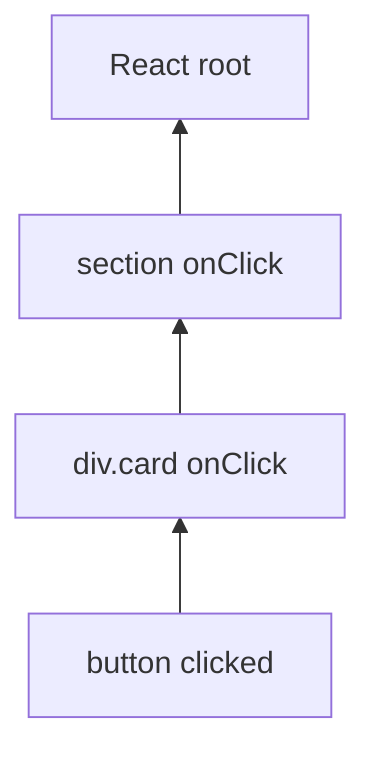

# Session 05: Event Handling in React

> Module: Frontend Web Development with React · Term 4 (HDSE) · ⏱ ~2 hours

Users click, type, hover and submit. This session teaches how React listens to those actions, how its event system differs from plain DOM events, and the most useful event types.

## 🎯 Learning Objectives

- Explain how event handling works in React and what a synthetic event is
- Write event handlers with the correct syntax and pass arguments to them
- Use the event object: `target`, `preventDefault()` and `stopPropagation()`
- Handle mouse, keyboard, form, focus and clipboard events
- Compare React event handling with plain HTML/DOM event handling

## 📖 Concepts Explained

### 1. Events in React vs plain HTML

| Plain HTML / DOM | React |
|---|---|
| `<button onclick="save()">` | `<button onClick={save}>` |
| lowercase attribute names | camelCase prop names |
| string of code | a function reference |
| `return false` stops default | must call `e.preventDefault()` |
| `addEventListener` on each element | React attaches listeners once at the root and delegates |

### 2. Synthetic events

React wraps the browser's native event in a **SyntheticEvent** object. It has the same interface (`target`, `type`, `preventDefault`, `stopPropagation`) and behaves the same in every browser. If you ever need the original, use `e.nativeEvent`.

### 3. Basic syntax

```jsx
function handleClick(e) { console.log("clicked", e.target); }
<button onClick={handleClick}>Save</button>          // pass the function
<button onClick={() => remove(id)}>Delete</button>   // pass arguments
```

Common mistake: `onClick={handleClick()}` calls the function during rendering.

### 4. Types of events

| Category | Events | Typical use |
|---|---|---|
| Mouse | `onClick`, `onDoubleClick`, `onMouseEnter`, `onMouseLeave`, `onContextMenu` | buttons, hover effects |
| Keyboard | `onKeyDown`, `onKeyUp` | shortcuts, Enter to submit |
| Form | `onChange`, `onSubmit`, `onInput`, `onReset` | inputs and forms |
| Focus | `onFocus`, `onBlur` | validation messages |
| Clipboard | `onCopy`, `onPaste`, `onCut` | paste handling |
| Touch / pointer | `onPointerDown`, `onTouchStart` | mobile gestures |
| Media / image | `onLoad`, `onError`, `onPlay` | fallback images, players |

### 5. Event propagation

Events **bubble** from the element that was clicked up through its ancestors.



- `e.stopPropagation()` stops the event from reaching parents (for example, a Delete button inside a clickable card).
- `e.preventDefault()` stops the browser's default action (page reload on form submit, link navigation).
- Add `Capture` to listen in the capture phase: `onClickCapture`.

### 6. Reading values

- Text input: `e.target.value`
- Checkbox: `e.target.checked`
- Key pressed: `e.key` (`"Enter"`, `"Escape"`, `"a"`)
- Mouse position: `e.clientX`, `e.clientY`

## 💻 Code Examples

### Example 1: Click, hover and arguments

📄 File: [`ClickDemo.jsx`](ClickDemo.jsx)

```jsx
import { useState } from "react";

export default function ClickDemo() {
  const [message, setMessage] = useState("Nothing yet");
  const [hover, setHover] = useState(false);

  function greet(name) {
    setMessage(`Hello ${name}! Clicked at ${new Date().toLocaleTimeString()}`);
  }

  return (
    <section>
      <h2>Mouse events</h2>
      <button onClick={() => greet("Ahmed")}>Greet Ahmed</button>
      <button onDoubleClick={() => setMessage("Double click detected")}>Double-click me</button>
      <div
        onMouseEnter={() => setHover(true)}
        onMouseLeave={() => setHover(false)}
        style={{ marginTop: 12, padding: 20, background: hover ? "#ffe08a" : "#eee" }}
      >
        {hover ? "Mouse is over me" : "Hover over this box"}
      </div>
      <p>{message}</p>
    </section>
  );
}
```

**How it works**

- An arrow function `() => greet("Ahmed")` passes an argument without calling `greet` during render.
- `onMouseEnter` / `onMouseLeave` toggle a boolean that changes the box colour and text.
- Each handler updates state, which re-renders the component.

### Example 2: Keyboard and form events

📄 File: [`KeyboardForm.jsx`](KeyboardForm.jsx)

```jsx
import { useState } from "react";

export default function KeyboardForm() {
  const [text, setText] = useState("");
  const [todos, setTodos] = useState([]);
  const [focused, setFocused] = useState(false);

  function addTodo() {
    if (!text.trim()) return;
    setTodos((prev) => [...prev, { id: Date.now(), text: text.trim() }]);
    setText("");
  }

  function handleKeyDown(e) {
    if (e.key === "Enter") addTodo();
    if (e.key === "Escape") setText("");
  }

  function handleSubmit(e) {
    e.preventDefault(); // stop the page from reloading
    addTodo();
  }

  return (
    <form onSubmit={handleSubmit}>
      <h2>Keyboard & form events</h2>
      <input
        value={text}
        onChange={(e) => setText(e.target.value)}
        onKeyDown={handleKeyDown}
        onFocus={() => setFocused(true)}
        onBlur={() => setFocused(false)}
        placeholder="Type a task and press Enter"
        style={{ outline: focused ? "2px solid #0d6efd" : "none" }}
      />
      <button type="submit">Add</button>
      <small> {text.length}/50 characters</small>
      <ul>{todos.map((t) => <li key={t.id}>{t.text}</li>)}</ul>
    </form>
  );
}
```

**How it works**

- `onChange` copies every keystroke into state (`e.target.value`).
- `onKeyDown` checks `e.key` to support Enter and Escape shortcuts. Inside a form, Enter would also trigger submit; `addTodo` ignores an empty field, so the duplicate call does nothing.
- `e.preventDefault()` in `onSubmit` prevents the browser's full page reload.
- `onFocus` / `onBlur` show a visual focus ring.

### Example 3: Propagation and clipboard

📄 File: [`App.jsx`](App.jsx)

```jsx
import ClickDemo from "./ClickDemo.jsx";
import KeyboardForm from "./KeyboardForm.jsx";

export default function App() {
  return (
    <main style={{ fontFamily: "system-ui", padding: 24 }}>
      <ClickDemo />
      <KeyboardForm />

      <h2>Propagation</h2>
      <div onClick={() => alert("Card opened")} style={{ border: "1px solid #999", padding: 16, cursor: "pointer" }}>
        <p>Click the card to open it.</p>
        <button
          onClick={(e) => {
            e.stopPropagation();
            alert("Only the delete button handled this");
          }}
        >
          Delete
        </button>
      </div>

      <h2>Clipboard</h2>
      <textarea
        rows={3}
        onPaste={(e) => {
          const pasted = e.clipboardData.getData("text");
          if (pasted.length > 100) {
            e.preventDefault();
            alert("Paste blocked: more than 100 characters");
          }
        }}
        placeholder="Try pasting a long text here"
      />
    </main>
  );
}
```

**How it works**

- Without `stopPropagation()`, clicking Delete would also trigger the card's `onClick`.
- `onPaste` reads the clipboard text and can cancel the paste with `preventDefault()`.
- Composition: `App` simply renders the two demo components plus extra examples.

### ▶️ How to run

1. One-time setup of a playground (Node 20+ required):
   ```bash
   npm create vite@latest react-lab -- --template react
   cd react-lab
   npm install
   ```
2. Copy the `.jsx` / `.css` files from this folder into `react-lab/src/` (replace `App.jsx` when asked).
3. Start the dev server with `npm run dev` and open the URL shown (usually http://localhost:5173).

## 🧪 Lab Practice

1. Build a counter with `+1`, `-1` and Reset buttons. Prevent the value from going below zero.
2. Create a box that shows the mouse coordinates (`e.clientX`, `e.clientY`) while you move over it with `onMouseMove`.
3. Make a search input that logs the value on every `onChange` and clears itself when Escape is pressed.
4. Build a login form; on submit, call `preventDefault()` and show the entered email below the form.
5. Put a Like button inside a clickable card and use `stopPropagation()` so liking does not open the card.

## 📝 Assignment

Create a **Quiz Buzzer** app: show one question with four option buttons. Clicking an option highlights it green (correct) or red (wrong). Keyboard keys `1`-`4` must also select options, and `N` loads the next question from an array of five questions. Show the final score at the end.

## ❓ Quick Quiz

**Q1.** What is the React equivalent of `onclick="go()"`?

**Q2.** What is a SyntheticEvent?

**Q3.** How do you stop a form from reloading the page?

**Q4.** Which property gives the key pressed in a keyboard event?

**Q5.** What does `stopPropagation()` do?

<details>
<summary>Show answers</summary>

1. `onClick={go}` - camelCase name and a function reference.
2. React's cross-browser wrapper around the native browser event, with the same interface.
3. Call `e.preventDefault()` in the `onSubmit` handler.
4. `e.key`
5. Stops the event from bubbling up to parent elements' handlers.

</details>

## 💼 Interview Questions

**1. Why does React use event delegation?**

> Attaching one listener per event type at the root is cheaper than many listeners on individual nodes and works automatically for elements added later.

**2. How do you pass an extra argument to an event handler?**

> Wrap it in an arrow function, e.g. `onClick={() => remove(id)}`, or use a curried function that returns the handler.

**3. What is the difference between `onChange` in React and the native `change` event?**

> React's `onChange` fires on every keystroke for text inputs (like native `input`), while the native `change` fires only when the input loses focus.

## ✅ Summary

- React events use camelCase props and receive function references.
- Handlers get a SyntheticEvent with `target`, `key`, `preventDefault()` and more.
- Use arrow functions to pass arguments without calling the handler on render.
- Know the main categories: mouse, keyboard, form, focus, clipboard.
- Control bubbling with `stopPropagation()` and default behaviour with `preventDefault()`.

---

[⬅ Previous](../Session-04-Practice-Lab-Components-and-JSX/README.md) · [🏠 Module Home](../README.md) · [Next ➡](../Session-06-Event-Best-Practices-and-Hooks/README.md)

Prepared by Zeeshan Abbas · Aptech Learning North Nazimabad
