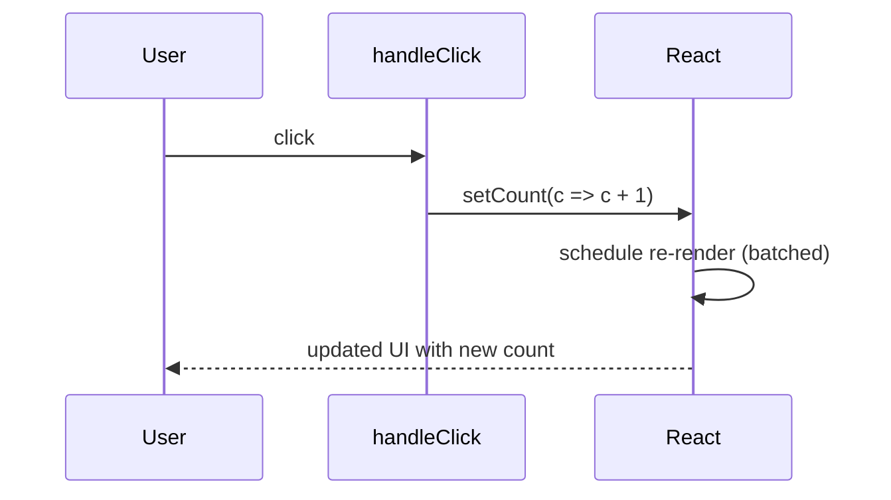

# Session 06: Event Handling Best Practices and Hooks

> Module: Frontend Web Development with React · Term 4 (HDSE) · ⏱ ~2 hours

Now that you can respond to events, we will learn to do it *well*: clean handler patterns, the hooks that store and react to data, and how a user action can trigger a request to an AI service.

## 🎯 Learning Objectives

- Apply best practices for naming, organising and optimising event handlers
- Explain what hooks are and follow the Rules of Hooks
- Use `useState`, `useRef` and `useCallback` in event-driven components
- Write a simple custom hook to reuse logic
- Trigger an AI API request from a user event with loading, error and debounce handling

## 📖 Concepts Explained

### 1. Event handling best practices

| Practice | Example |
|---|---|
| Name handlers `handleX`, props `onX` | `handleSubmit` inside, `onSubmit` as a prop |
| Keep JSX clean: move logic into named functions | `onClick={handleSave}` not 10 lines inline |
| One handler for many inputs using `name` | `setForm({...form, [e.target.name]: e.target.value})` |
| Update state from previous state | `setCount(c => c + 1)` |
| Disable buttons while working | `disabled={loading}` prevents double submits |
| Debounce expensive work (API calls on typing) | wait 500 ms after the last keystroke |
| Clean up listeners added to `window` | return a cleanup function from `useEffect` |
| Accessibility | use `<button>` for actions, not clickable `<div>`s |

### 2. What are hooks?

Hooks are special functions (names start with `use`) that let function components **remember data** and **hook into React features**.

| Hook | Purpose |
|---|---|
| `useState` | store a value that triggers re-render when changed |
| `useEffect` | run side effects after render (Session 9) |
| `useRef` | keep a mutable value or a DOM reference *without* re-rendering |
| `useCallback` | keep the same function reference between renders |
| `useMemo` | cache an expensive calculation |
| `useContext` | read shared data without prop drilling |

### 3. Rules of Hooks

1. Call hooks **only at the top level** of a component or custom hook - never inside loops, conditions or nested functions.
2. Call hooks **only from React functions** (components or custom hooks).

React identifies each hook by its call order, so the order must be the same on every render.

### 4. How `useState` updates work



State updates are **asynchronous and batched**. Reading `count` right after `setCount` still gives the old value inside that handler.

### 5. Custom hooks

A custom hook is a function starting with `use` that calls other hooks. It lets you reuse stateful logic, e.g. `useToggle`, `useLocalStorage`, `useDebounce`.

### 6. User events that trigger AI requests

Typical flow for an "Ask AI" button or live suggestions:

1. User types or clicks → handler runs.
2. Validate input; set `loading = true`; disable the button.
3. Send the request to **your backend endpoint** (never put a secret API key in frontend code).
4. Show the response, or a friendly error; set `loading = false`.
5. For typing-based suggestions, **debounce** so you do not send a request on every keystroke (this saves money and rate limits).

In this session we simulate the AI call with a fake async function so the code runs without any key. In Session 11 you will connect a real AI API through a secure proxy.

## 💻 Code Examples

### Example 1: One handler for many inputs + useRef

📄 File: [`SignupForm.jsx`](SignupForm.jsx)

```jsx
import { useRef, useState } from "react";

export default function SignupForm() {
  const [form, setForm] = useState({ name: "", email: "", course: "React" });
  const nameRef = useRef(null);
  const submitCount = useRef(0); // survives re-renders, does not cause one

  function handleChange(e) {
    const { name, value } = e.target;
    setForm((prev) => ({ ...prev, [name]: value }));
  }

  function handleSubmit(e) {
    e.preventDefault();
    submitCount.current += 1;
    if (!form.name) {
      nameRef.current.focus(); // jump the cursor to the empty field
      return;
    }
    alert(`Saved ${form.name} (${form.course}). Attempts: ${submitCount.current}`);
  }

  return (
    <form onSubmit={handleSubmit}>
      <h2>Sign up</h2>
      <input ref={nameRef} name="name" value={form.name} onChange={handleChange} placeholder="Name" />
      <input name="email" type="email" value={form.email} onChange={handleChange} placeholder="Email" />
      <select name="course" value={form.course} onChange={handleChange}>
        <option>React</option>
        <option>Node.js</option>
        <option>MongoDB</option>
      </select>
      <button type="submit">Register</button>
    </form>
  );
}
```

**How it works**

- Each input has a `name` that matches a key in `form`, so **one** `handleChange` updates all fields with a computed property `[name]`.
- `useRef(null)` attached via `ref={nameRef}` gives direct access to the DOM input to call `.focus()`.
- `submitCount` is a ref: changing `.current` does not re-render, ideal for counters you only read later.

### Example 2: A reusable custom hook

📄 File: [`useDebounce.js`](useDebounce.js)

```js
import { useEffect, useState } from "react";

// Returns `value` only after it has stopped changing for `delay` ms
export function useDebounce(value, delay = 500) {
  const [debounced, setDebounced] = useState(value);

  useEffect(() => {
    const timer = setTimeout(() => setDebounced(value), delay);
    return () => clearTimeout(timer); // cancel if value changes again quickly
  }, [value, delay]);

  return debounced;
}
```

**How it works**

- Every time `value` changes, a new timer starts and the previous one is cleared.
- Only when the user pauses typing for `delay` ms does `debounced` update.
- Because it starts with `use` and calls hooks, it is a custom hook usable in any component.

### Example 3: User event triggering an (simulated) AI request

📄 File: [`AskAI.jsx`](AskAI.jsx)

```jsx
import { useCallback, useEffect, useState } from "react";
import { useDebounce } from "./useDebounce.js";

// Fake AI service so the demo runs without a key. Replace with fetch("/api/ai") later.
function fakeAI(prompt) {
  return new Promise((resolve, reject) => {
    setTimeout(() => {
      if (prompt.toLowerCase().includes("error")) reject(new Error("AI service unavailable"));
      else resolve(`Suggestion for "${prompt}": try breaking it into smaller components.`);
    }, 900);
  });
}

export default function AskAI() {
  const [prompt, setPrompt] = useState("");
  const [answer, setAnswer] = useState("");
  const [loading, setLoading] = useState(false);
  const [error, setError] = useState("");
  const debouncedPrompt = useDebounce(prompt, 600);

  const ask = useCallback(async (text) => {
    if (text.trim().length < 3) return;
    setLoading(true);
    setError("");
    try {
      setAnswer(await fakeAI(text));
    } catch (err) {
      setError(err.message);
    } finally {
      setLoading(false);
    }
  }, []);

  // live suggestion: fires only after the user stops typing
  useEffect(() => {
    ask(debouncedPrompt);
  }, [debouncedPrompt, ask]);

  return (
    <section>
      <h2>Ask the AI helper</h2>
      <input value={prompt} onChange={(e) => setPrompt(e.target.value)} placeholder="Describe your UI problem" />
      <button onClick={() => ask(prompt)} disabled={loading}>
        {loading ? "Thinking..." : "Ask now"}
      </button>
      {error && <p style={{ color: "crimson" }}>{error}</p>}
      {answer && !error && <blockquote>{answer}</blockquote>}
    </section>
  );
}
```

**How it works**

- Typing updates `prompt`; `useDebounce` waits 600 ms before `debouncedPrompt` changes, which triggers `ask`.
- The "Ask now" button triggers the same function immediately and is disabled while loading.
- `useCallback(..., [])` keeps `ask` stable so it can safely be listed as an effect dependency.
- Type the word *error* to see the error path.

### Example 4: Putting it together

📄 File: [`App.jsx`](App.jsx)

```jsx
import SignupForm from "./SignupForm.jsx";
import AskAI from "./AskAI.jsx";

export default function App() {
  return (
    <main style={{ fontFamily: "system-ui", padding: 24, display: "grid", gap: 24 }}>
      <SignupForm />
      <AskAI />
    </main>
  );
}
```

**How it works**

- `App` composes the two demos. Copy all four files into `src/` of your playground.

### ▶️ How to run

1. One-time setup of a playground (Node 20+ required):
   ```bash
   npm create vite@latest react-lab -- --template react
   cd react-lab
   npm install
   ```
2. Copy the `.jsx` / `.css` files from this folder into `react-lab/src/` (replace `App.jsx` when asked).
3. Start the dev server with `npm run dev` and open the URL shown (usually http://localhost:5173).

## 🧪 Lab Practice

1. Write a `useToggle(initial)` custom hook that returns `[value, toggle]` and use it for a Show/Hide password button.
2. Refactor a three-field form to use one `handleChange` function with the `name` attribute.
3. Use `useRef` to auto-focus a search box when the page loads, and to count how many times a button was clicked without re-rendering.
4. Add a 300 ms debounce to a search input and log only the debounced value to the console.
5. Extend `AskAI` to keep a history list of the last 5 prompts and answers.

## 📝 Assignment

Build a **Smart Feedback Form** with fields name, rating (1-5) and comments. Use a single change handler, a `useRef` to focus the first invalid field, and a custom hook `useCharacterCount(text, max)` that returns remaining characters. When the user clicks "Improve with AI", call a simulated async AI function that returns a polished version of the comment, with a loading state and error handling.

## ❓ Quick Quiz

**Q1.** State the two Rules of Hooks.

**Q2.** What is the difference between `useState` and `useRef`?

**Q3.** Why do we debounce an input that calls an API?

**Q4.** Where should a secret AI API key live?

**Q5.** What must a custom hook's name start with?

<details>
<summary>Show answers</summary>

1. Call hooks only at the top level (not in loops/conditions), and only from React function components or custom hooks.
2. Updating state triggers a re-render; changing `ref.current` does not.
3. To avoid sending a request on every keystroke, saving cost, bandwidth and rate limits.
4. On a backend server or serverless function, never in frontend code.
5. `use`

</details>

## 💼 Interview Questions

**1. Why are state updates batched?**

> Batching groups several updates into one re-render, which improves performance and avoids showing intermediate UI states.

**2. When would you use `useCallback`?**

> When passing a function to a memoised child or as a dependency of an effect, to keep the same reference between renders and avoid unnecessary work.

**3. How do you prevent a user from submitting a form twice?**

> Track a loading/submitting state, disable the submit button while it is true, and ignore new submissions until the request finishes.

## ✅ Summary

- Name handlers clearly, keep JSX lean and update state from previous state.
- Hooks give function components memory and lifecycle features; obey the Rules of Hooks.
- `useRef` stores values or DOM nodes without re-rendering.
- Custom hooks package reusable logic such as debouncing.
- AI requests triggered by events need validation, loading state, errors, debounce and a backend for keys.

---

[⬅ Previous](../Session-05-Event-Handling-in-React/README.md) · [🏠 Module Home](../README.md) · [Next ➡](../Session-07-React-Router/README.md)

Prepared by Zeeshan Abbas · Aptech Learning North Nazimabad
