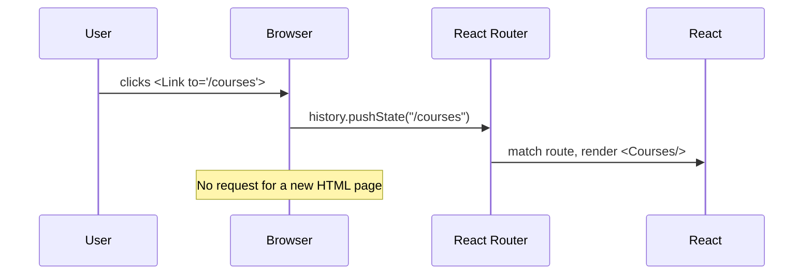

# Session 07: React Router

> Module: Frontend Web Development with React · Term 4 (HDSE) · ⏱ ~2 hours

Real applications have many "pages": home, products, product details, login. React Router lets a single-page app show different components for different URLs without reloading the browser.

## 🎯 Learning Objectives

- Explain what React Router is and install it in a Vite project
- Use the core pieces: `BrowserRouter`, `Routes`, `Route`, `Link`, `NavLink`, `Outlet`
- Read URL parameters with `useParams` and navigate in code with `useNavigate`
- Distinguish single-page applications (SPA) from multi-page applications (MPA)
- Evaluate the advantages and drawbacks of SPAs and MPAs

## 📖 Concepts Explained

### 1. SPA vs MPA

| | Multi-Page Application (MPA) | Single-Page Application (SPA) |
|---|---|---|
| How pages load | Server sends a new HTML page for every URL | One HTML page; JavaScript swaps components |
| Feel | Full reload, white flash | Instant, app-like |
| Examples | Classic PHP/Laravel sites, news portals | Gmail, Trello, most React apps |
| SEO | Excellent out of the box | Needs extra work (SSR, pre-rendering, meta tags) |
| First load | Fast, small pages | Larger JS bundle to download first |
| Server load | Renders every page | Mostly serves static files + APIs |
| Complexity | Simpler mental model | Client-side routing, state and caching to manage |

**Rule of thumb:** content sites that depend on search traffic often suit an MPA or a server-rendered framework; interactive dashboards and tools suit an SPA.

### 2. How client-side routing works



### 3. Core building blocks (React Router v6/v7)

| Piece | Job |
|---|---|
| `BrowserRouter` | Wraps the app and listens to the URL |
| `Routes` | Picks the best matching `Route` |
| `Route path="/x" element={<X/>}` | Maps a URL pattern to a component |
| `Link to="/x"` | Navigation without page reload (use instead of `<a href>`) |
| `NavLink` | Like `Link` but knows if it is active (for menu highlighting) |
| `Outlet` | Placeholder where child routes render inside a layout |
| `path=":id"` + `useParams()` | Dynamic segments such as `/courses/3` |
| `useNavigate()` | Redirect from code (after login or save) |
| `path="*"` | Catch-all 404 page |

### 4. Nested routes and layouts

A layout route renders shared UI (navbar, footer) and an `<Outlet />`. Child routes appear inside the outlet, so the navbar is written once.

### 5. Deployment note

On a real server, every SPA URL must return `index.html`, otherwise refreshing `/courses/3` gives a 404. Hosting platforms provide a "rewrite all to index.html" setting.

## 💻 Code Examples

### Example 1: Routes, layout and 404

📄 File: [`App.jsx`](App.jsx)

```jsx
import { BrowserRouter, Routes, Route, NavLink, Outlet, Link } from "react-router-dom";
import { Courses, CourseDetail } from "./Courses.jsx";

function Layout() {
  const linkStyle = ({ isActive }) => ({ marginRight: 12, fontWeight: isActive ? "bold" : "normal" });
  return (
    <>
      <nav style={{ padding: 12, background: "#f1f3f5" }}>
        <NavLink to="/" end style={linkStyle}>Home</NavLink>
        <NavLink to="/courses" style={linkStyle}>Courses</NavLink>
        <NavLink to="/about" style={linkStyle}>About</NavLink>
      </nav>
      <main style={{ padding: 16 }}>
        <Outlet />
      </main>
    </>
  );
}

const Home = () => <h1>Welcome to the Term 4 portal</h1>;
const About = () => <p>Built with React Router.</p>;
const NotFound = () => (
  <>
    <h1>404 - Page not found</h1>
    <Link to="/">Go home</Link>
  </>
);

export default function App() {
  return (
    <BrowserRouter>
      <Routes>
        <Route element={<Layout />}>
          <Route path="/" element={<Home />} />
          <Route path="/courses" element={<Courses />} />
          <Route path="/courses/:id" element={<CourseDetail />} />
          <Route path="/about" element={<About />} />
          <Route path="*" element={<NotFound />} />
        </Route>
      </Routes>
    </BrowserRouter>
  );
}
```

**How it works**

- `Layout` is a parent route without a path; its children render inside `<Outlet />`.
- `NavLink` passes `isActive` to the style function to bold the current page; `end` makes Home active only on exactly `/`.
- `path="*"` catches any unknown URL.

### Example 2: Dynamic routes and programmatic navigation

📄 File: [`Courses.jsx`](Courses.jsx)

```jsx
import { Link, useNavigate, useParams } from "react-router-dom";

const data = [
  { id: "1", name: "React", sessions: 12 },
  { id: "2", name: "Node.js", sessions: 12 },
  { id: "3", name: "MongoDB", sessions: 16 },
];

export function Courses() {
  return (
    <>
      <h1>Courses</h1>
      <ul>
        {data.map((c) => (
          <li key={c.id}>
            <Link to={`/courses/${c.id}`}>{c.name}</Link>
          </li>
        ))}
      </ul>
    </>
  );
}

export function CourseDetail() {
  const { id } = useParams();
  const navigate = useNavigate();
  const course = data.find((c) => c.id === id);

  if (!course) return <p>Course {id} does not exist.</p>;

  return (
    <>
      <h1>{course.name}</h1>
      <p>{course.sessions} sessions</p>
      <button onClick={() => navigate(-1)}>⬅ Back</button>
      <button onClick={() => navigate("/courses", { replace: true })}>All courses</button>
    </>
  );
}
```

**How it works**

- `/courses/:id` matches `/courses/1`, `/courses/2`...; `useParams()` returns `{ id: "1" }` (always a string).
- `navigate(-1)` goes back in history; `navigate(path, { replace: true })` replaces the current entry.
- Unknown ids show a friendly message instead of crashing.

### ▶️ How to run

1. One-time setup of a playground (Node 20+ required):
   ```bash
   npm create vite@latest react-lab -- --template react
   cd react-lab
   npm install
   ```
2. Copy the `.jsx` / `.css` files from this folder into `react-lab/src/` (replace `App.jsx` when asked).
3. Start the dev server with `npm run dev` and open the URL shown (usually http://localhost:5173).
4. This session also needs React Router: run `npm install react-router-dom` inside `react-lab`.

## 🧪 Lab Practice

1. Install `react-router-dom` and create Home, Products and Contact pages with a shared navbar.
2. Highlight the active menu link using `NavLink` and a CSS class or style function.
3. Add a dynamic route `/products/:id` that shows details from an array, plus a not-found message for bad ids.
4. After a fake login form is submitted, redirect the user to `/dashboard` using `useNavigate`.
5. Add a catch-all 404 route with a link back to home, then try typing a random URL.

## 📝 Assignment

Create a **Mini Blog** SPA with routes: `/` (list of posts from `https://jsonplaceholder.typicode.com/posts?_limit=10`), `/posts/:id` (post detail with its comments from `/posts/:id/comments`), `/about`, and a 404 page. Use a layout route with a navbar and footer. Write 5-6 lines in the README explaining whether a blog is better as an SPA or MPA and why.

## ❓ Quick Quiz

**Q1.** Why use `<Link>` instead of `<a href>` in a React Router app?

**Q2.** Which hook reads `:id` from the URL?

**Q3.** What does `<Outlet />` do?

**Q4.** Give one drawback of SPAs.

**Q5.** How do you redirect a user after saving a form?

<details>
<summary>Show answers</summary>

1. `Link` changes the URL without a full page reload, keeping the SPA state.
2. `useParams()`
3. Marks where child routes render inside a parent layout route.
4. Weaker SEO by default / larger initial JavaScript download / more client-side complexity.
5. Call `const navigate = useNavigate()` and then `navigate('/path')`.

</details>

## 💼 Interview Questions

**1. Why do SPAs need a server rewrite rule?**

> Deep URLs exist only in the browser router; the server must return `index.html` for them so React Router can handle the path after a refresh.

**2. What is the difference between `Link` and `NavLink`?**

> `NavLink` knows whether its route is active and can apply active styles or classes; `Link` cannot.

**3. How would you protect a route that requires login?**

> Wrap it in a component that checks auth state and renders the page or `<Navigate to="/login" replace />`.

## ✅ Summary

- SPAs swap components in the browser; MPAs load new HTML pages from the server.
- `BrowserRouter`, `Routes` and `Route` map URLs to components.
- `Link`/`NavLink` navigate without reloads; `Outlet` enables shared layouts.
- `useParams` reads dynamic segments; `useNavigate` redirects in code.
- Choose SPA or MPA based on SEO needs, interactivity and complexity.

---

[⬅ Previous](../Session-06-Event-Best-Practices-and-Hooks/README.md) · [🏠 Module Home](../README.md) · [Next ➡](../Session-08-Styling-React-Elements/README.md)

Prepared by Zeeshan Abbas · Aptech Learning North Nazimabad
