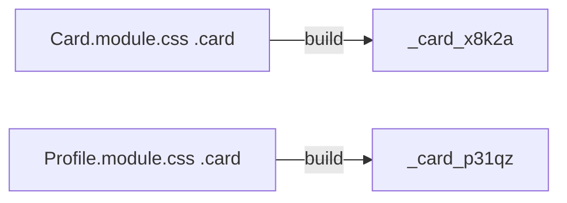

# Session 08: Styling React Elements

> Module: Frontend Web Development with React · Term 4 (HDSE) · ⏱ ~2 hours

A working app also has to look good. React does not force one styling method, so you need to know the options, their trade-offs and when to pick each.

## 🎯 Learning Objectives

- Distinguish inline, internal and external styles and how each maps to React
- Apply inline style objects and plain CSS files with `className`
- Use CSS Modules to scope styles to a component
- Apply conditional classes and dynamic styles based on state
- Compare other approaches: CSS frameworks (Bootstrap), utility CSS and CSS-in-JS

## 📖 Concepts Explained

### 1. Inline, internal and external styles (HTML refresher)

| Type | In plain HTML | In React |
|---|---|---|
| Inline | `style="color:red"` on the tag | `style={{ color: "red" }}` object |
| Internal | `<style>` block in the page `<head>` | rarely used; a `<style>` tag inside JSX works but is not recommended |
| External | `<link rel="stylesheet" href="site.css">` | `import "./App.css"` in a component |

### 2. Styling methods in React

| Method | How | Pros | Cons |
|---|---|---|---|
| Inline style object | `style={{ fontSize: 18 }}` | dynamic values easy, no class names | no `:hover`, no media queries, verbose |
| Plain CSS file | `import "./App.css"` + `className` | familiar, full CSS | global: class names can clash |
| **CSS Modules** | `Button.module.css` + `styles.primary` | scoped automatically, full CSS | slightly more syntax |
| CSS framework | Bootstrap classes `btn btn-primary` | fast, consistent, responsive grid | generic look, larger CSS |
| Utility-first | Tailwind `px-4 py-2 rounded` | fast styling in JSX | long class lists, needs setup |
| CSS-in-JS | styled-components, Emotion | styles next to logic, props-based | runtime cost, extra library |

### 3. Inline style rules

- Property names are **camelCase**: `backgroundColor`, `borderRadius`.
- Values are strings, numbers become `px` for most properties: `padding: 8` → `8px`.
- Good for values computed at runtime (a progress bar width, a user-chosen colour).

### 4. CSS Modules

Vite supports them out of the box. A file named `*.module.css` turns each class into a unique name like `_card_x8k2a`, so `.card` in one component never affects another.



### 5. Conditional classes

```jsx
<button className={`btn ${active ? "btn-active" : ""}`}>
```

Template literals work fine; for many conditions some teams use the small `clsx` package.

### 6. Responsive design

Use media queries in CSS files or modules, or framework grids (Bootstrap's `row`/`col-md-6`). Inline styles cannot contain media queries.

### 7. Choosing a method

For this course: **CSS Modules for component styles**, a global `index.css` for resets and fonts, inline styles only for truly dynamic values, and Bootstrap when you need a quick, responsive layout.

## 💻 Code Examples

### Example 1: Global (external) CSS

📄 File: [`App.css`](App.css)

```css
:root {
  --brand: #0d6efd;
  --radius: 10px;
}
body {
  margin: 0;
  font-family: system-ui, sans-serif;
  background: #f8f9fa;
}
.page {
  max-width: 900px;
  margin: 0 auto;
  padding: 24px;
}
.grid {
  display: grid;
  grid-template-columns: repeat(auto-fill, minmax(220px, 1fr));
  gap: 16px;
}
```

**How it works**

- Imported once in `App.jsx`, these rules apply to the whole app (global scope).
- CSS variables (`--brand`) keep colours consistent and are reused in the module file.
- The grid is responsive without any media query thanks to `auto-fill` + `minmax`.

### Example 2: Scoped styles with a CSS Module

📄 File: [`Card.module.css`](Card.module.css)

```css
.card {
  background: white;
  border-radius: var(--radius);
  padding: 16px;
  box-shadow: 0 2px 6px rgb(0 0 0 / 0.08);
  transition: transform 0.2s;
}
.card:hover {
  transform: translateY(-4px);
}
.featured {
  border: 2px solid var(--brand);
}
.title {
  margin: 0 0 8px;
  color: var(--brand);
}
@media (max-width: 500px) {
  .card { padding: 10px; }
}
```

**How it works**

- `.card`, `.featured` and `.title` are renamed to unique classes at build time, so they cannot clash.
- Hover effects and media queries work here, unlike inline styles.

### Example 3: Combining methods in components

📄 File: [`App.jsx`](App.jsx)

```jsx
import { useState } from "react";
import "./App.css";
import styles from "./Card.module.css";

function CourseCard({ title, progress, featured }) {
  return (
    <div className={`${styles.card} ${featured ? styles.featured : ""}`}>
      <h3 className={styles.title}>{title}</h3>
      <div style={{ background: "#e9ecef", borderRadius: 6, height: 10 }}>
        <div
          style={{
            width: `${progress}%`,
            height: "100%",
            borderRadius: 6,
            background: progress >= 75 ? "seagreen" : progress >= 40 ? "orange" : "crimson",
          }}
        />
      </div>
      <small>{progress}% complete</small>
    </div>
  );
}

export default function App() {
  const [dark, setDark] = useState(false);
  const theme = dark ? { background: "#212529", color: "#f8f9fa" } : {};

  return (
    <div className="page" style={theme}>
      <button onClick={() => setDark((d) => !d)}>{dark ? "☀️ Light" : "🌙 Dark"} mode</button>
      <div className="grid" style={{ marginTop: 16 }}>
        <CourseCard title="React" progress={80} featured />
        <CourseCard title="Node.js" progress={45} />
        <CourseCard title="MongoDB" progress={20} />
      </div>
    </div>
  );
}
```

**How it works**

- `className="page"` and `"grid"` come from the global stylesheet.
- `styles.card` / `styles.featured` come from the CSS Module; a template literal adds `featured` conditionally.
- The progress bar width and colour are computed at runtime, a perfect use of inline styles.
- The theme toggle merges an inline style object based on state.

### Example 4: Using Bootstrap 5 in React

📄 File: [`BootstrapDemo.jsx`](BootstrapDemo.jsx)

```jsx
// npm install bootstrap   then add once in main.jsx:
// import "bootstrap/dist/css/bootstrap.min.css";

export default function BootstrapDemo() {
  return (
    <div className="container py-4">
      <div className="row g-3">
        {["Azure", "React", "Node.js"].map((m) => (
          <div className="col-12 col-md-4" key={m}>
            <div className="card h-100 shadow-sm">
              <div className="card-body">
                <h5 className="card-title">{m}</h5>
                <button className="btn btn-primary btn-sm">Open</button>
              </div>
            </div>
          </div>
        ))}
      </div>
    </div>
  );
}
```

**How it works**

- Bootstrap classes are applied with `className`; the grid stacks on phones and shows three columns from `md` up.
- Use the CSS only; avoid mixing jQuery-based Bootstrap JS with React.

### ▶️ How to run

1. One-time setup of a playground (Node 20+ required):
   ```bash
   npm create vite@latest react-lab -- --template react
   cd react-lab
   npm install
   ```
2. Copy the `.jsx` / `.css` files from this folder into `react-lab/src/` (replace `App.jsx` when asked).
3. Start the dev server with `npm run dev` and open the URL shown (usually http://localhost:5173).

## 🧪 Lab Practice

1. Style a profile card three ways: inline object, global CSS file and CSS Module. Note which was easiest to maintain.
2. Create two components that both use a class called `.box` in their own CSS Modules and prove they do not clash.
3. Make a button that changes colour based on a `variant` prop (`primary`, `danger`, `success`) using conditional classes.
4. Build a progress bar whose width comes from an `<input type="range">` value.
5. Install Bootstrap and build a responsive 3-column card grid that becomes 1 column on mobile.

## 📝 Assignment

Redesign the **Product Catalogue** from Session 2 with a consistent design system: global CSS variables for colours and spacing, CSS Modules for `ProductCard` and `Navbar`, a dark/light theme toggle, hover effects and a responsive grid. Include before/after screenshots in your repository README.

## ❓ Quick Quiz

**Q1.** How do you write `background-color: yellow` as a React inline style?

**Q2.** Why can't inline styles contain `:hover`?

**Q3.** What naming convention activates CSS Modules in Vite?

**Q4.** What is the main risk of plain global CSS in a large app?

**Q5.** When are inline styles the best choice?

<details>
<summary>Show answers</summary>

1. `style={{ backgroundColor: "yellow" }}`
2. Inline styles apply to one element directly; pseudo-classes and media queries need a stylesheet.
3. File names ending in `.module.css`.
4. Class-name collisions: rules in one file unintentionally affect other components.
5. For values calculated at runtime, such as a width from state or a user-chosen colour.

</details>

## 💼 Interview Questions

**1. How do CSS Modules achieve scoping?**

> At build time each class name is transformed into a unique hashed name, and the module exports a mapping object used in JSX.

**2. Compare CSS-in-JS with CSS Modules.**

> CSS-in-JS keeps styles in JavaScript and can use props directly, but adds a library and often runtime cost; CSS Modules are plain CSS with build-time scoping and no runtime cost.

**3. How would you implement theming in React?**

> Use CSS variables switched by a class or data attribute on the root, controlled from React state or Context; components reference the variables.

## ✅ Summary

- React supports inline style objects, external CSS, CSS Modules, frameworks and CSS-in-JS.
- Inline styles use camelCase and suit dynamic values only.
- CSS Modules give component-level scoping with normal CSS features.
- Conditional classes and computed styles make UIs react to state.
- Pick a consistent approach per project; mixing too many methods causes confusion.

---

[⬅ Previous](../Session-07-React-Router/README.md) · [🏠 Module Home](../README.md) · [Next ➡](../Session-09-Component-Lifecycle-and-useEffect/README.md)

Prepared by Zeeshan Abbas · Aptech Learning North Nazimabad
