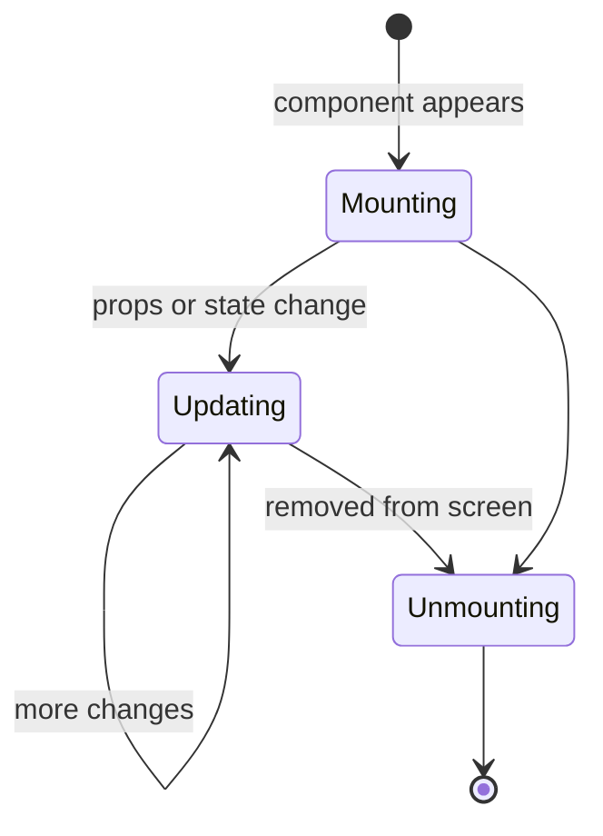

# Session 09: Component Lifecycle and useEffect

> Module: Frontend Web Development with React · Term 4 (HDSE) · ⏱ ~2 hours

Every component is born (mounted), changes (updated) and eventually disappears (unmounted). This session explains those phases and how the `useEffect` hook lets you run code at the right moment, especially to load external data.

## 🎯 Learning Objectives

- Describe the mounting, updating and unmounting phases of a component
- Map class lifecycle methods to the `useEffect` hook
- Control when an effect runs using the dependency array
- Write cleanup functions for timers, listeners and requests
- Fetch and display external data safely with async effects and `AbortController`

## 📖 Concepts Explained

### 1. The three lifecycle phases



| Phase | What happens | Class method | Hook equivalent |
|---|---|---|---|
| Mounting | first render, DOM created | `componentDidMount` | `useEffect(fn, [])` |
| Updating | re-render after state/props change | `componentDidUpdate` | `useEffect(fn, [dep])` |
| Unmounting | removed from the DOM | `componentWillUnmount` | cleanup returned from `useEffect` |

### 2. What is a side effect?

Rendering should be **pure**: same props/state → same JSX. Anything that reaches outside the component is a *side effect*: fetching data, timers, subscriptions, changing `document.title`, `localStorage`. Side effects go in `useEffect`, which runs **after** React has updated the screen.

### 3. The dependency array

| Code | Runs |
|---|---|
| `useEffect(fn)` | after **every** render (rarely what you want) |
| `useEffect(fn, [])` | once after the first render (mount) |
| `useEffect(fn, [a, b])` | after mount and whenever `a` or `b` changes |

List **every** reactive value your effect uses. The ESLint rule `react-hooks/exhaustive-deps` warns you when you forget one.

### 4. Cleanup

```jsx
useEffect(() => {
  const id = setInterval(tick, 1000);
  return () => clearInterval(id); // runs before the next effect and on unmount
}, []);
```

Without cleanup you get memory leaks, duplicate timers and "state update on unmounted component" bugs. In development, `StrictMode` mounts → unmounts → mounts components once to check your cleanup works, which is why effects may appear to run twice.

### 5. Fetching data the right way

1. The effect function itself cannot be `async`; define an async function inside and call it.
2. Track `loading` and `error` state.
3. Use an **AbortController** to cancel the request if the component unmounts or the dependency changes (prevents race conditions where an old response overwrites a newer one).

### 6. When you do *not* need an effect

- Calculating a value from props/state → compute it during render.
- Responding to a click → do it in the event handler.

Effects are for synchronising with **external systems**.

## 💻 Code Examples

### Example 1: Mount, update and unmount in action

📄 File: [`LifecycleDemo.jsx`](LifecycleDemo.jsx)

```jsx
import { useEffect, useState } from "react";

function Timer() {
  const [seconds, setSeconds] = useState(0);

  useEffect(() => {
    console.log("Timer mounted");
    const id = setInterval(() => setSeconds((s) => s + 1), 1000);
    return () => {
      clearInterval(id);
      console.log("Timer unmounted - interval cleared");
    };
  }, []);

  useEffect(() => {
    document.title = `⏱ ${seconds}s`;
  }, [seconds]);

  return <p>Running for {seconds} seconds</p>;
}

export default function LifecycleDemo() {
  const [show, setShow] = useState(true);
  return (
    <section>
      <h2>Lifecycle</h2>
      <button onClick={() => setShow((v) => !v)}>{show ? "Unmount" : "Mount"} timer</button>
      {show && <Timer />}
    </section>
  );
}
```

**How it works**

- The first effect (`[]`) starts an interval on mount and clears it on unmount.
- The second effect re-runs whenever `seconds` changes (updating phase) to sync the browser tab title.
- Toggling the button mounts/unmounts `Timer`; watch the console messages.

### Example 2: Fetching data that depends on a value

📄 File: [`PostsByUser.jsx`](PostsByUser.jsx)

```jsx
import { useEffect, useState } from "react";

export default function PostsByUser() {
  const [userId, setUserId] = useState(1);
  const [posts, setPosts] = useState([]);
  const [status, setStatus] = useState("idle"); // idle | loading | error | done

  useEffect(() => {
    const controller = new AbortController();

    async function load() {
      setStatus("loading");
      try {
        const res = await fetch(
          `https://jsonplaceholder.typicode.com/posts?userId=${userId}`,
          { signal: controller.signal }
        );
        if (!res.ok) throw new Error(res.statusText);
        setPosts(await res.json());
        setStatus("done");
      } catch (err) {
        if (err.name !== "AbortError") setStatus("error");
      }
    }

    load();
    return () => controller.abort(); // cancel old request if userId changes quickly
  }, [userId]);

  return (
    <section>
      <h2>Posts by user</h2>
      <select value={userId} onChange={(e) => setUserId(Number(e.target.value))}>
        {[1, 2, 3, 4, 5].map((id) => <option key={id} value={id}>User {id}</option>)}
      </select>
      {status === "loading" && <p>Loading...</p>}
      {status === "error" && <p style={{ color: "crimson" }}>Could not load posts.</p>}
      {status === "done" && (
        <ol>{posts.map((p) => <li key={p.id}>{p.title}</li>)}</ol>
      )}
    </section>
  );
}
```

**How it works**

- The effect depends on `userId`, so changing the dropdown triggers a new fetch.
- `AbortController` cancels the previous request in the cleanup; aborted requests throw `AbortError`, which we ignore.
- A single `status` string keeps the UI states mutually exclusive.

### Example 3: App

📄 File: [`App.jsx`](App.jsx)

```jsx
import LifecycleDemo from "./LifecycleDemo.jsx";
import PostsByUser from "./PostsByUser.jsx";

export default function App() {
  return (
    <main style={{ fontFamily: "system-ui", padding: 24 }}>
      <LifecycleDemo />
      <PostsByUser />
    </main>
  );
}
```

**How it works**

- Renders both demos. Open the browser console to watch lifecycle logs.

### ▶️ How to run

1. One-time setup of a playground (Node 20+ required):
   ```bash
   npm create vite@latest react-lab -- --template react
   cd react-lab
   npm install
   ```
2. Copy the `.jsx` / `.css` files from this folder into `react-lab/src/` (replace `App.jsx` when asked).
3. Start the dev server with `npm run dev` and open the URL shown (usually http://localhost:5173).

## 🧪 Lab Practice

1. Build a digital clock that updates every second and clears its interval on unmount.
2. Save a text input's value to `localStorage` in an effect, and load it back on mount.
3. Add a `resize` listener on `window` that shows the current window width; remove the listener in cleanup.
4. Fetch `https://jsonplaceholder.typicode.com/users/{id}` when a number input changes, with loading and error states.
5. Remove the `AbortController` from Example 2, switch users very quickly with throttled network (DevTools) and observe the race condition.

## 📝 Assignment

Build a **Weather-style Dashboard** using the free Open-Meteo API (no key required): `https://api.open-meteo.com/v1/forecast?latitude=24.86&longitude=67.01&current=temperature_2m,wind_speed_10m`. Let the user pick a city from a dropdown (Karachi, Lahore, Islamabad with their coordinates). Fetch in `useEffect` with the city as a dependency, show loading/error states, auto-refresh every 10 minutes with `setInterval`, and clean everything up properly.

## ❓ Quick Quiz

**Q1.** Which hook replaces `componentDidMount`, `componentDidUpdate` and `componentWillUnmount`?

**Q2.** What does an empty dependency array `[]` mean?

**Q3.** When does the cleanup function run?

**Q4.** Why can't the effect callback itself be `async`?

**Q5.** What problem does `AbortController` solve in data fetching?

<details>
<summary>Show answers</summary>

1. `useEffect` (with the appropriate dependency array and cleanup).
2. Run the effect once after the first render (mount).
3. Before the effect runs again and when the component unmounts.
4. It must return either nothing or a cleanup function, but an async function returns a Promise.
5. It cancels outdated requests, preventing race conditions and updates after unmount.

</details>

## 💼 Interview Questions

**1. Why do effects run twice in development?**

> React StrictMode intentionally mounts, unmounts and remounts components to reveal missing cleanup; it does not happen in production builds.

**2. What happens if you omit a dependency used inside an effect?**

> The effect captures a stale value (stale closure) and does not re-run when that value changes, causing bugs.

**3. Give an example where you should not use useEffect.**

> Deriving filtered data from props/state; compute it during render (optionally with useMemo) instead of syncing it into another state via an effect.

## ✅ Summary

- Components mount, update and unmount; effects let you act at each stage.
- Side effects belong in `useEffect`, which runs after render.
- The dependency array decides when the effect re-runs.
- Always clean up timers, listeners and requests.
- Fetch with async functions inside effects, track status and abort stale requests.

---

[⬅ Previous](../Session-08-Styling-React-Elements/README.md) · [🏠 Module Home](../README.md) · [Next ➡](../Session-10-CRUD-Application-with-React-Forms/README.md)

Prepared by Zeeshan Abbas · Aptech Learning North Nazimabad
