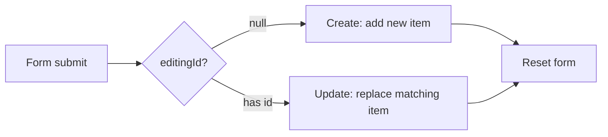

# Session 10: Creating a CRUD Application Using React Forms

> Module: Frontend Web Development with React · Term 4 (HDSE) · ⏱ ~2 hours

Almost every business app lets users **C**reate, **R**ead, **U**pdate and **D**elete records. In this session you will build a complete CRUD screen with controlled forms, validation and immutable state updates, then see how form data can be sent to an AI API.

## 🎯 Learning Objectives

- Explain CRUD and map each operation to UI actions and HTTP methods
- Build controlled forms with validation and helpful error messages
- Develop a simple CRUD app that stores data in component state
- Develop a more complex CRUD app that talks to a REST API with `fetch`
- Send form inputs to an AI endpoint and display the result

## 📖 Concepts Explained

### 1. What is CRUD?

| Operation | UI action | HTTP method | Array operation in React |
|---|---|---|---|
| Create | "Add" form submit | `POST` | `[...items, newItem]` |
| Read | list / table | `GET` | `items.map(...)` |
| Update | "Edit" then "Save" | `PUT` / `PATCH` | `items.map(i => i.id === id ? updated : i)` |
| Delete | "Delete" button | `DELETE` | `items.filter(i => i.id !== id)` |

### 2. Controlled vs uncontrolled inputs

| Controlled | Uncontrolled |
|---|---|
| value stored in React state (`value` + `onChange`) | value stored in the DOM, read with a `ref` |
| easy validation and live feedback | less code for simple forms |
| **recommended** for CRUD forms | useful for file inputs |

### 3. Form validation

- Validate on submit (and optionally on blur).
- Keep an `errors` object: `{ name: "Name is required" }`.
- Show errors next to fields; disable Save while submitting.
- Remember that **client-side validation is for user experience only**; the server must validate again.

### 4. Create and Edit with one form

Keep `editingId` in state. If it is `null` the form creates; otherwise it updates. A Cancel button resets the form.



### 5. Complex CRUD with a REST API

The flow is the same, but every change is first sent to the server, and the UI updates when the server responds. We use **json-server** to create a fake REST API from a JSON file in seconds:

```bash
npx json-server@0.17.4 --watch db.json --port 3001
```

This exposes `GET/POST /students` and `PUT/PATCH/DELETE /students/:id`.

### 6. Sending form inputs to an AI API

A form field (e.g. "student remarks") can be sent to an AI endpoint that returns a summary or improved text. The pattern: `POST` the input as JSON to your backend → backend calls the AI provider with its secret key → returns the result → you show it. Validate and trim the input first, and limit its length to control cost.

## 💻 Code Examples

### Example 1: Simple CRUD in local state

📄 File: [`StudentCrud.jsx`](StudentCrud.jsx)

```jsx
import { useState } from "react";

const empty = { name: "", email: "", course: "React" };

export default function StudentCrud() {
  const [students, setStudents] = useState([
    { id: 1, name: "Fatima", email: "fatima@example.com", course: "React" },
  ]);
  const [form, setForm] = useState(empty);
  const [editingId, setEditingId] = useState(null);
  const [errors, setErrors] = useState({});

  const handleChange = (e) => setForm({ ...form, [e.target.name]: e.target.value });

  function validate() {
    const errs = {};
    if (form.name.trim().length < 3) errs.name = "Name must be at least 3 characters";
    if (!/^\S+@\S+\.\S+$/.test(form.email)) errs.email = "Enter a valid email";
    setErrors(errs);
    return Object.keys(errs).length === 0;
  }

  function handleSubmit(e) {
    e.preventDefault();
    if (!validate()) return;
    if (editingId === null) {
      setStudents([...students, { id: Date.now(), ...form }]);              // CREATE
    } else {
      setStudents(students.map((s) => (s.id === editingId ? { ...form, id: editingId } : s))); // UPDATE
    }
    setForm(empty);
    setEditingId(null);
  }

  function startEdit(s) {
    setForm({ name: s.name, email: s.email, course: s.course });
    setEditingId(s.id);
  }

  const remove = (id) => {
    if (confirm("Delete this student?")) setStudents(students.filter((s) => s.id !== id)); // DELETE
  };

  return (
    <section>
      <h2>{editingId ? "Edit student" : "Add student"}</h2>
      <form onSubmit={handleSubmit} noValidate>
        <input name="name" value={form.name} onChange={handleChange} placeholder="Name" />
        {errors.name && <small style={{ color: "crimson" }}> {errors.name}</small>}
        <br />
        <input name="email" value={form.email} onChange={handleChange} placeholder="Email" />
        {errors.email && <small style={{ color: "crimson" }}> {errors.email}</small>}
        <br />
        <select name="course" value={form.course} onChange={handleChange}>
          <option>React</option><option>Node.js</option><option>MongoDB</option>
        </select>
        <button type="submit">{editingId ? "Save" : "Add"}</button>
        {editingId && <button type="button" onClick={() => { setForm(empty); setEditingId(null); }}>Cancel</button>}
      </form>

      <table border="1" cellPadding="6" style={{ marginTop: 12 }}>
        <thead><tr><th>Name</th><th>Email</th><th>Course</th><th>Actions</th></tr></thead>
        <tbody>
          {students.map((s) => (                                                // READ
            <tr key={s.id}>
              <td>{s.name}</td><td>{s.email}</td><td>{s.course}</td>
              <td>
                <button onClick={() => startEdit(s)}>Edit</button>
                <button onClick={() => remove(s.id)}>Delete</button>
              </td>
            </tr>
          ))}
        </tbody>
      </table>
    </section>
  );
}
```

**How it works**

- One form handles both Create and Update depending on `editingId`.
- `validate()` fills an `errors` object; the form shows messages beside fields.
- Every change produces a **new** array: spread for create, `map` for update, `filter` for delete.

### Example 2: Complex CRUD against a REST API

📄 File: [`ApiCrud.jsx`](ApiCrud.jsx)

```jsx
import { useEffect, useState } from "react";

const API = "http://localhost:3001/students";

export default function ApiCrud() {
  const [items, setItems] = useState([]);
  const [name, setName] = useState("");
  const [busy, setBusy] = useState(false);
  const [error, setError] = useState("");

  useEffect(() => {
    fetch(API).then((r) => r.json()).then(setItems).catch(() => setError("Is json-server running?"));
  }, []);

  async function request(url, options) {
    setBusy(true);
    setError("");
    try {
      const res = await fetch(url, { headers: { "Content-Type": "application/json" }, ...options });
      if (!res.ok) throw new Error(`Server replied ${res.status}`);
      return options?.method === "DELETE" ? null : await res.json();
    } catch (err) {
      setError(err.message);
      throw err;
    } finally {
      setBusy(false);
    }
  }

  async function add(e) {
    e.preventDefault();
    if (!name.trim()) return;
    const created = await request(API, { method: "POST", body: JSON.stringify({ name: name.trim() }) });
    setItems((prev) => [...prev, created]);
    setName("");
  }

  async function rename(item) {
    const newName = prompt("New name", item.name);
    if (!newName) return;
    const updated = await request(`${API}/${item.id}`, { method: "PATCH", body: JSON.stringify({ name: newName }) });
    setItems((prev) => prev.map((i) => (i.id === item.id ? updated : i)));
  }

  async function remove(id) {
    await request(`${API}/${id}`, { method: "DELETE" });
    setItems((prev) => prev.filter((i) => i.id !== id));
  }

  return (
    <section>
      <h2>Students (REST API)</h2>
      {error && <p style={{ color: "crimson" }}>{error}</p>}
      <form onSubmit={add}>
        <input value={name} onChange={(e) => setName(e.target.value)} placeholder="New student" />
        <button disabled={busy}>{busy ? "Saving..." : "Add"}</button>
      </form>
      <ul>
        {items.map((i) => (
          <li key={i.id}>
            {i.name} <button onClick={() => rename(i)}>Edit</button> <button onClick={() => remove(i.id)}>Delete</button>
          </li>
        ))}
      </ul>
    </section>
  );
}
```

**How it works**

- `request()` centralises headers, error handling and the `busy` flag for all calls.
- POST returns the created record (with its server id) which we append; PATCH returns the updated record.
- State changes only **after** the server confirms, so the UI never shows data the server rejected.

### Example 3: Fake REST database

📄 File: [`db.json`](db.json)

```json
{
  "students": [
    { "id": 1, "name": "Ali Raza" },
    { "id": 2, "name": "Hira Khan" }
  ]
}
```

**How it works**

- Run `npx json-server@0.17.4 --watch db.json --port 3001` in this folder; json-server writes changes back to this file.

### Example 4: Sending a form field to an AI endpoint

📄 File: [`RemarksAI.jsx`](RemarksAI.jsx)

```jsx
import { useState } from "react";

// Expects a backend route POST /api/improve -> { text } (built in Session 11)
export default function RemarksAI() {
  const [remarks, setRemarks] = useState("");
  const [result, setResult] = useState("");
  const [loading, setLoading] = useState(false);

  async function handleSubmit(e) {
    e.preventDefault();
    const text = remarks.trim().slice(0, 500); // validate + limit length
    if (!text) return;
    setLoading(true);
    try {
      const res = await fetch("/api/improve", {
        method: "POST",
        headers: { "Content-Type": "application/json" },
        body: JSON.stringify({ text }),
      });
      const data = await res.json();
      setResult(data.text ?? "No response");
    } catch {
      setResult("AI service not available. Start the proxy from Session 11.");
    } finally {
      setLoading(false);
    }
  }

  return (
    <form onSubmit={handleSubmit}>
      <h2>Improve teacher remarks with AI</h2>
      <textarea rows={3} value={remarks} onChange={(e) => setRemarks(e.target.value)} maxLength={500} />
      <br />
      <button disabled={loading}>{loading ? "Improving..." : "Improve"}</button>
      {result && <p><strong>AI:</strong> {result}</p>}
    </form>
  );
}
```

**How it works**

- The form input is trimmed and capped at 500 characters before sending.
- The request goes to *your* backend, which will hold the secret key (Session 11).
- Errors are handled gracefully so the form still works without the AI service.

### Example 5: App

📄 File: [`App.jsx`](App.jsx)

```jsx
import StudentCrud from "./StudentCrud.jsx";
import ApiCrud from "./ApiCrud.jsx";
import RemarksAI from "./RemarksAI.jsx";

export default function App() {
  return (
    <main style={{ fontFamily: "system-ui", padding: 24, display: "grid", gap: 32 }}>
      <StudentCrud />
      <ApiCrud />
      <RemarksAI />
    </main>
  );
}
```

**How it works**

- Renders the three demos together.

### ▶️ How to run

1. One-time setup of a playground (Node 20+ required):
   ```bash
   npm create vite@latest react-lab -- --template react
   cd react-lab
   npm install
   ```
2. Copy the `.jsx` / `.css` files from this folder into `react-lab/src/` (replace `App.jsx` when asked).
3. Start the dev server with `npm run dev` and open the URL shown (usually http://localhost:5173).
4. For `ApiCrud`, copy `db.json` somewhere and run `npx json-server@0.17.4 --watch db.json --port 3001` in a second terminal.

## 🧪 Lab Practice

1. Build the local-state CRUD for a **Book** list (title, author, year) with Add, Edit and Delete.
2. Add validation: title required, year must be between 1900 and the current year; show errors under each field.
3. Add a search box that filters the table by title (Read with a filter, no extra state copy).
4. Start json-server with your own `db.json` and convert the Book CRUD to use the API.
5. Show a toast/message for 2 seconds after every successful create, update or delete.

## 📝 Assignment

Build a **Contact Manager** connected to json-server with fields name, phone (Pakistani format `03XX-XXXXXXX` validated by a regex), email and group (Family/Friends/Work). Features: list, add, edit (same form), delete with confirmation, filter by group, sort by name, and loading/error states for every request.

## ❓ Quick Quiz

**Q1.** Which HTTP method is typically used for Update?

**Q2.** Write the array expression that deletes the item with id 5.

**Q3.** What makes an input 'controlled'?

**Q4.** Why is client-side validation not enough?

**Q5.** How can one form handle both create and edit?

<details>
<summary>Show answers</summary>

1. `PUT` (full replace) or `PATCH` (partial update).
2. `items.filter(i => i.id !== 5)`
3. Its `value` comes from React state and changes go through `onChange`.
4. Users can bypass the browser; the server must validate again for security and data integrity.
5. Store an `editingId`; if it is null create a new record, otherwise update the matching one.

</details>

## 💼 Interview Questions

**1. What is an optimistic update?**

> Updating the UI immediately before the server confirms, then rolling back if the request fails. It feels faster but needs error handling.

**2. Why must you avoid mutating state arrays in CRUD apps?**

> React detects changes by reference; mutation may not trigger re-renders and makes bugs hard to trace.

**3. How would you handle large forms with many fields?**

> Use a single state object with name-based handlers, or a form library such as React Hook Form with schema validation (e.g. Zod).

## ✅ Summary

- CRUD maps to Create/Read/Update/Delete UI actions and POST/GET/PUT-PATCH/DELETE requests.
- Controlled inputs plus an errors object give clear validation.
- Use spread, `map` and `filter` for immutable create, update and delete.
- With an API, update the UI after the server confirms and handle errors centrally.
- Form inputs can be sent to an AI endpoint through your backend, never directly with a secret key.

---

[⬅ Previous](../Session-09-Component-Lifecycle-and-useEffect/README.md) · [🏠 Module Home](../README.md) · [Next ➡](../Session-11-Integrating-AI-APIs-in-React/README.md)

Prepared by Zeeshan Abbas · Aptech Learning North Nazimabad
