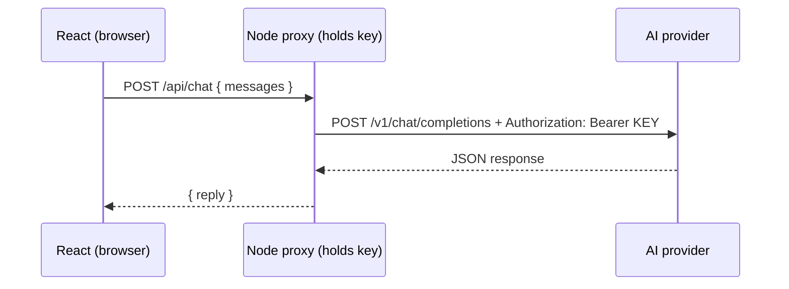

# Session 11: Integrating AI APIs in React Applications

> Module: Frontend Web Development with React · Term 4 (HDSE) · ⏱ ~2 hours

AI features such as chat assistants, summarisers and smart suggestions are now expected in modern apps. In this session you will connect a React app to a real AI API safely: the key stays on a small Node.js proxy and React talks only to that proxy.

## 🎯 Learning Objectives

- Define AI APIs and describe how they enhance React applications
- Obtain an API key and store it securely using environment variables
- Explain why secret keys must not be bundled into frontend code
- Make requests from a React component to an AI service through a backend proxy
- Render AI responses dynamically with loading, error and conversation history

## 📖 Concepts Explained

### 1. What is an AI API?

An AI API is a web service that runs a machine-learning model for you. You send a request (text, image, audio) and receive a prediction (an answer, a label, generated text).

| Use in a React app | Example |
|---|---|
| Chat assistant | course helpdesk bot |
| Summarisation | summarise long feedback |
| Classification | detect sentiment of reviews |
| Generation | product descriptions, email drafts |
| Vision | describe an uploaded image |

Popular providers: OpenAI, Google Gemini, Anthropic, Azure OpenAI, Hugging Face Inference.

### 2. API keys and environment variables

1. Create an account on the provider's developer portal and generate a key.
2. Store it in a `.env` file that is listed in `.gitignore`.
3. Read it in **server** code via `process.env.OPENAI_API_KEY`.

> ⚠️ In Vite, any variable starting with `VITE_` is **embedded into the JavaScript bundle** and visible to anyone using DevTools. Use `VITE_` only for public values like your backend URL, never for secret keys.

### 3. Secure architecture



The proxy can also enforce limits (max message length, rate limiting, logging) to control cost and abuse.

### 4. Request and response shape (chat completions style)

```json
{ "model": "gpt-4o-mini",
  "messages": [ { "role": "system", "content": "You are a tutor." },
                { "role": "user", "content": "What is JSX?" } ] }
```

The answer is in `choices[0].message.content`. Each provider has a similar structure; always check the official docs for current model names.

### 5. Rendering AI responses

- Keep a `messages` array in state; append the user message immediately and the AI reply when it arrives.
- Show a typing indicator while waiting; disable the send button.
- Render text safely as plain text (JSX escapes it). Do not use `dangerouslySetInnerHTML` with AI output.
- Auto-scroll to the newest message with a `ref`.

### 6. Good practices

| Practice | Why |
|---|---|
| Validate and limit input length | cost control, prevents abuse |
| Handle 401/429/500 errors | invalid key, rate limit, provider outage |
| Never trust AI output blindly | it can be wrong; show a disclaimer |
| Do not send personal data unnecessarily | privacy |

## 💻 Code Examples

### Example 1: Node.js proxy that keeps the key secret

📄 File: [`server/server.js`](server/server.js)

```js
// Node 20+. Run: cd server && npm init -y && npm install express dotenv && node server.js
import "dotenv/config";
import express from "express";

const app = express();
app.use(express.json({ limit: "20kb" }));

app.post("/api/chat", async (req, res) => {
  const { messages } = req.body;
  if (!Array.isArray(messages) || messages.length === 0) {
    return res.status(400).json({ error: "messages array required" });
  }
  const trimmed = messages.slice(-10).map((m) => ({
    role: m.role === "assistant" ? "assistant" : "user",
    content: String(m.content).slice(0, 1000),
  }));

  try {
    const r = await fetch("https://api.openai.com/v1/chat/completions", {
      method: "POST",
      headers: {
        "Content-Type": "application/json",
        Authorization: `Bearer ${process.env.OPENAI_API_KEY}`,
      },
      body: JSON.stringify({
        model: process.env.AI_MODEL || "gpt-4o-mini",
        messages: [{ role: "system", content: "You are a friendly React tutor. Answer briefly." }, ...trimmed],
      }),
    });
    if (!r.ok) return res.status(r.status).json({ error: `AI provider error ${r.status}` });
    const data = await r.json();
    res.json({ reply: data.choices[0].message.content });
  } catch (err) {
    res.status(500).json({ error: "Could not reach AI provider" });
  }
});

app.listen(5000, () => console.log("AI proxy on http://localhost:5000"));
```

**How it works**

- Reads the key from `process.env` (loaded from `.env` by `dotenv`), so it never reaches the browser.
- Keeps only the last 10 messages and limits each to 1000 characters to control cost.
- Passes back only the reply text, hiding provider details from the client.
- Add `"type": "module"` to `server/package.json` so `import` syntax works.

### Example 2: Environment file template

📄 File: [`server/.env.example`](server/.env.example)

```bash
# Copy to .env and add your real key. Never commit .env to Git.
OPENAI_API_KEY=sk-your-key-here
AI_MODEL=gpt-4o-mini
```

**How it works**

- Commit the `.example` file so teammates know which variables exist; add `.env` to `.gitignore`.

### Example 3: Vite dev proxy

📄 File: [`vite.config.js`](vite.config.js)

```js
import { defineConfig } from "vite";
import react from "@vitejs/plugin-react";

export default defineConfig({
  plugins: [react()],
  server: {
    proxy: { "/api": "http://localhost:5000" }, // forward /api/* to the Node proxy
  },
});
```

**How it works**

- During development, React can call `/api/chat` with no CORS issues; Vite forwards it to port 5000.

### Example 4: Chat component

📄 File: [`ChatBot.jsx`](ChatBot.jsx)

```jsx
import { useEffect, useRef, useState } from "react";

export default function ChatBot() {
  const [messages, setMessages] = useState([
    { role: "assistant", content: "Hi! Ask me anything about React." },
  ]);
  const [input, setInput] = useState("");
  const [loading, setLoading] = useState(false);
  const [error, setError] = useState("");
  const endRef = useRef(null);

  useEffect(() => {
    endRef.current?.scrollIntoView({ behavior: "smooth" });
  }, [messages, loading]);

  async function send(e) {
    e.preventDefault();
    const text = input.trim();
    if (!text || loading) return;
    const next = [...messages, { role: "user", content: text }];
    setMessages(next);
    setInput("");
    setLoading(true);
    setError("");
    try {
      const res = await fetch("/api/chat", {
        method: "POST",
        headers: { "Content-Type": "application/json" },
        body: JSON.stringify({ messages: next }),
      });
      const data = await res.json();
      if (!res.ok) throw new Error(data.error || "Request failed");
      setMessages((prev) => [...prev, { role: "assistant", content: data.reply }]);
    } catch (err) {
      setError(err.message);
    } finally {
      setLoading(false);
    }
  }

  return (
    <section style={{ maxWidth: 520, border: "1px solid #ddd", borderRadius: 12, padding: 12 }}>
      <h2>🤖 React Tutor</h2>
      <div style={{ height: 300, overflowY: "auto", background: "#f8f9fa", padding: 8 }}>
        {messages.map((m, i) => (
          <p key={i} style={{ textAlign: m.role === "user" ? "right" : "left" }}>
            <span style={{ display: "inline-block", padding: "6px 10px", borderRadius: 10,
              background: m.role === "user" ? "#0d6efd" : "#e9ecef", color: m.role === "user" ? "white" : "black" }}>
              {m.content}
            </span>
          </p>
        ))}
        {loading && <p><em>Tutor is typing...</em></p>}
        <div ref={endRef} />
      </div>
      {error && <p style={{ color: "crimson" }}>{error}</p>}
      <form onSubmit={send} style={{ display: "flex", gap: 8, marginTop: 8 }}>
        <input style={{ flex: 1 }} value={input} onChange={(e) => setInput(e.target.value)} maxLength={1000} placeholder="Type a question" />
        <button disabled={loading}>Send</button>
      </form>
      <small>AI answers can be wrong. Verify important information.</small>
    </section>
  );
}
```

**How it works**

- The user message is added immediately for a responsive feel; the reply is appended when it arrives.
- The full conversation (`next`) is sent so the AI has context; the proxy trims it.
- A ref on an empty `div` at the bottom lets the effect auto-scroll after each update.
- AI text is rendered as normal JSX text, which React escapes automatically.

### Example 5: App

📄 File: [`App.jsx`](App.jsx)

```jsx
import ChatBot from "./ChatBot.jsx";

export default function App() {
  return (
    <main style={{ fontFamily: "system-ui", padding: 24 }}>
      <ChatBot />
    </main>
  );
}
```

**How it works**

- Renders the chatbot. Start the proxy first, then `npm run dev`.

### ▶️ How to run

1. One-time setup of a playground (Node 20+ required):
   ```bash
   npm create vite@latest react-lab -- --template react
   cd react-lab
   npm install
   ```
2. Copy the `.jsx` / `.css` files from this folder into `react-lab/src/` (replace `App.jsx` when asked).
3. Start the dev server with `npm run dev` and open the URL shown (usually http://localhost:5173).
4. Replace your playground's `vite.config.js` with the one in this folder.
5. Start the proxy in a second terminal: `cd server`, create `.env` from `.env.example`, set `"type": "module"` in `package.json`, `npm install express dotenv`, `node server.js`.
6. No API key yet? Temporarily change the proxy to return `{ reply: "Echo: " + lastMessage }` to test the UI.

## 🧪 Lab Practice

1. Create an API key on your chosen AI provider's developer portal and store it in `server/.env`. Confirm `.env` is in `.gitignore`.
2. Run the proxy and test it with `curl -X POST localhost:5000/api/chat -H "Content-Type: application/json" -d '{"messages":[{"role":"user","content":"Hi"}]}'`.
3. Connect the `ChatBot` component and hold a short conversation.
4. Add a "Clear chat" button and a character counter under the input.
5. Change the system prompt so the bot answers in simple Urdu-English (Roman Urdu) and observe the difference.

## 📝 Assignment

Build an **AI Review Analyser**: a textarea where the user pastes a product review and clicks Analyse. Your Node proxy asks the AI to return JSON `{ "sentiment": "positive|neutral|negative", "summary": "...", "keywords": [] }`. React parses the JSON and shows a coloured sentiment badge, the summary and keyword chips. Handle invalid JSON and API errors gracefully.

## ❓ Quick Quiz

**Q1.** Why must you not put a secret key in a `VITE_` environment variable?

**Q2.** What is the role of the backend proxy?

**Q3.** Where is the generated text in a chat-completions response?

**Q4.** Which HTTP status usually means you hit a rate limit?

**Q5.** Why send previous messages with each request?

<details>
<summary>Show answers</summary>

1. Vite embeds `VITE_` variables in the browser bundle, so anyone can read them.
2. It holds the secret key, calls the AI provider, enforces limits and returns only what the frontend needs.
3. `choices[0].message.content`
4. 429 Too Many Requests
5. The API is stateless; context must be included for the model to remember the conversation.

</details>

## 💼 Interview Questions

**1. How would you reduce the cost of an AI feature?**

> Limit input/output length and history, use smaller models, cache repeated answers, debounce requests and rate-limit per user.

**2. How do you display streaming AI responses?**

> Use a streaming endpoint (server-sent events or a readable stream) and append chunks to the message state as they arrive.

**3. What are the risks of rendering AI output as HTML?**

> It may contain injected scripts or malicious links (XSS). Render as text or sanitise any markdown/HTML before display.

## ✅ Summary

- AI APIs add chat, summarisation, classification and generation to React apps.
- Keep keys in server-side `.env` files; `VITE_` variables are public.
- React calls your proxy; the proxy calls the AI provider.
- Manage messages, loading and errors in state and render replies as safe text.
- Control cost and risk with input limits, rate limiting and output validation.

---

[⬅ Previous](../Session-10-CRUD-Application-with-React-Forms/README.md) · [🏠 Module Home](../README.md) · [Next ➡](../Session-12-Practice-Lab-Router-Styling-Effects-CRUD-AI/README.md)

Prepared by Zeeshan Abbas · Aptech Learning North Nazimabad
