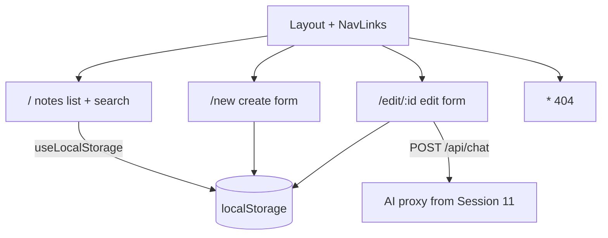

# Session 12: Practice Lab: Events, Router, Styling, Effects, CRUD and AI

> Module: Frontend Web Development with React · Term 4 (HDSE) · ⏱ ~2 hours

This final revision lab ties together everything from Sessions 5 to 11. You will build a small multi-page **Course Notes** app that uses events, hooks, routing, CSS Modules, effects, CRUD and an AI helper. Try each challenge before looking at the solution files.

## 🎯 Learning Objectives

- Combine routing, forms and effects in one application
- Persist CRUD data with `localStorage` through a custom hook
- Style the app with CSS Modules and an active-link navbar
- Add an AI 'summarise note' feature through a proxy endpoint
- Prepare for the module exam with a checklist of key concepts

## 📖 Concepts Explained

### 1. Concept checklist (tick each one you can explain)

| Area | Can you... |
|---|---|
| Events | pass arguments to handlers, use `preventDefault`, handle keyboard shortcuts? |
| Hooks | explain the Rules of Hooks and when to use `useRef` vs `useState`? |
| Router | build nested routes with `Outlet`, read `useParams`, redirect with `useNavigate`? |
| Styling | choose between inline styles, CSS Modules and frameworks? |
| Effects | write dependency arrays correctly and clean up timers/requests? |
| CRUD | perform immutable create/update/delete and validate forms? |
| AI | explain why keys stay on the server and handle loading/errors? |

### 2. The app you will build



### 3. Design decisions

- **State location:** notes are needed by every page, so they live in `App` and are passed down.
- **Persistence:** a `useLocalStorage` custom hook syncs state to the browser in an effect.
- **One form component** (`NoteForm`) is reused by the New and Edit routes.
- **AI** is optional: if the proxy is not running, the app still works and shows a friendly message.

### 4. Common mistakes to avoid

| Mistake | Consequence |
|---|---|
| Reading `localStorage` on every render | slow and unnecessary; read once in the initial state function |
| Forgetting `Number(id)` from `useParams` | strict comparison with numeric ids fails |
| Navigating before saving | data lost; save then `navigate("/")` |
| Missing `end` on the Home `NavLink` | Home looks active on every page |

## 💻 Code Examples

### Example 1: Custom hook for persistence

📄 File: [`useLocalStorage.js`](useLocalStorage.js)

```js
import { useEffect, useState } from "react";

export function useLocalStorage(key, initialValue) {
  const [value, setValue] = useState(() => {
    try {
      const saved = localStorage.getItem(key);
      return saved ? JSON.parse(saved) : initialValue;
    } catch {
      return initialValue;
    }
  });

  useEffect(() => {
    localStorage.setItem(key, JSON.stringify(value));
  }, [key, value]);

  return [value, setValue];
}
```

**How it works**

- The lazy initial state function reads storage only once on mount.
- The effect writes back every time `value` changes.
- It returns the same `[value, setValue]` shape as `useState`, so it is a drop-in replacement.

### Example 2: Reusable form with AI summary

📄 File: [`NoteForm.jsx`](NoteForm.jsx)

```jsx
import { useState } from "react";
import styles from "./Notes.module.css";

export default function NoteForm({ initial = { title: "", body: "" }, onSave }) {
  const [form, setForm] = useState(initial);
  const [error, setError] = useState("");
  const [aiText, setAiText] = useState("");
  const [loading, setLoading] = useState(false);

  const change = (e) => setForm({ ...form, [e.target.name]: e.target.value });

  function submit(e) {
    e.preventDefault();
    if (!form.title.trim()) return setError("Title is required");
    onSave({ ...form, title: form.title.trim() });
  }

  async function summarise() {
    setLoading(true);
    try {
      const res = await fetch("/api/chat", {
        method: "POST",
        headers: { "Content-Type": "application/json" },
        body: JSON.stringify({ messages: [{ role: "user", content: `Summarise in 2 lines: ${form.body}` }] }),
      });
      const data = await res.json();
      setAiText(res.ok ? data.reply : data.error);
    } catch {
      setAiText("AI proxy not running - start it from Session 11.");
    } finally {
      setLoading(false);
    }
  }

  return (
    <form onSubmit={submit} className={styles.form}>
      <input name="title" value={form.title} onChange={change} placeholder="Title" />
      {error && <small className={styles.error}>{error}</small>}
      <textarea name="body" rows={6} value={form.body} onChange={change} placeholder="Write your note" />
      <div>
        <button type="submit">Save</button>{" "}
        <button type="button" onClick={summarise} disabled={loading || form.body.length < 20}>
          {loading ? "Summarising..." : "✨ AI summary"}
        </button>
      </div>
      {aiText && <p className={styles.ai}>{aiText}</p>}
    </form>
  );
}
```

**How it works**

- The same component serves both create (empty `initial`) and edit (existing note).
- Validation stops saving without a title; `onSave` sends the cleaned data to the parent.
- The AI button is disabled until there is enough text, and failures are shown politely.

### Example 3: Routing and CRUD in App

📄 File: [`App.jsx`](App.jsx)

```jsx
import { useState } from "react";
import { BrowserRouter, Routes, Route, NavLink, Outlet, Link, useNavigate, useParams } from "react-router-dom";
import { useLocalStorage } from "./useLocalStorage.js";
import NoteForm from "./NoteForm.jsx";
import styles from "./Notes.module.css";

function Layout() {
  const cls = ({ isActive }) => (isActive ? styles.active : undefined);
  return (
    <>
      <nav className={styles.nav}>
        <NavLink to="/" end className={cls}>Notes</NavLink>
        <NavLink to="/new" className={cls}>+ New</NavLink>
      </nav>
      <main className={styles.main}><Outlet /></main>
    </>
  );
}

function NoteList({ notes, onDelete }) {
  const [q, setQ] = useState("");
  const shown = notes.filter((n) => n.title.toLowerCase().includes(q.toLowerCase()));
  return (
    <>
      <input placeholder="Search notes" value={q} onChange={(e) => setQ(e.target.value)} />
      {shown.length === 0 && <p>No notes yet.</p>}
      {shown.map((n) => (
        <article key={n.id} className={styles.card}>
          <h3>{n.title}</h3>
          <p>{n.body.slice(0, 80)}{n.body.length > 80 && "..."}</p>
          <Link to={`/edit/${n.id}`}>Edit</Link>{" "}
          <button onClick={() => onDelete(n.id)}>Delete</button>
        </article>
      ))}
    </>
  );
}

function NewNote({ onCreate }) {
  const navigate = useNavigate();
  return <NoteForm onSave={(data) => { onCreate(data); navigate("/"); }} />;
}

function EditNote({ notes, onUpdate }) {
  const { id } = useParams();
  const navigate = useNavigate();
  const note = notes.find((n) => n.id === Number(id));
  if (!note) return <p>Note not found. <Link to="/">Back</Link></p>;
  return <NoteForm initial={note} onSave={(data) => { onUpdate(note.id, data); navigate("/"); }} />;
}

export default function App() {
  const [notes, setNotes] = useLocalStorage("notes", []);
  const create = (data) => setNotes((prev) => [...prev, { id: Date.now(), ...data }]);
  const update = (id, data) => setNotes((prev) => prev.map((n) => (n.id === id ? { ...n, ...data } : n)));
  const remove = (id) => setNotes((prev) => prev.filter((n) => n.id !== id));

  return (
    <BrowserRouter>
      <Routes>
        <Route element={<Layout />}>
          <Route path="/" element={<NoteList notes={notes} onDelete={remove} />} />
          <Route path="/new" element={<NewNote onCreate={create} />} />
          <Route path="/edit/:id" element={<EditNote notes={notes} onUpdate={update} />} />
          <Route path="*" element={<p>404 - <Link to="/">Home</Link></p>} />
        </Route>
      </Routes>
    </BrowserRouter>
  );
}
```

**How it works**

- `App` owns the notes (persisted by the custom hook) and passes CRUD functions to each route.
- `EditNote` converts the URL id with `Number(id)` before comparing.
- After saving, `navigate("/")` returns to the list; search filters during render without extra state copies.

### Example 4: Scoped styles

📄 File: [`Notes.module.css`](Notes.module.css)

```css
.nav { display: flex; gap: 16px; padding: 12px 24px; background: #212529; }
.nav a { color: #adb5bd; text-decoration: none; }
.nav a.active { color: white; font-weight: 700; }
.main { max-width: 720px; margin: 0 auto; padding: 24px; font-family: system-ui; }
.card { background: #fff; border: 1px solid #dee2e6; border-radius: 10px; padding: 12px 16px; margin: 12px 0; }
.form { display: grid; gap: 10px; }
.error { color: crimson; }
.ai { background: #e7f1ff; padding: 10px; border-radius: 8px; }
```

**How it works**

- `.active` is applied by the `NavLink` class function; the module keeps it from leaking to other components.

### ▶️ How to run

1. One-time setup of a playground (Node 20+ required):
   ```bash
   npm create vite@latest react-lab -- --template react
   cd react-lab
   npm install
   ```
2. Copy the `.jsx` / `.css` files from this folder into `react-lab/src/` (replace `App.jsx` when asked).
3. Start the dev server with `npm run dev` and open the URL shown (usually http://localhost:5173).
4. This session also needs React Router: run `npm install react-router-dom` inside `react-lab`.
5. Optional: start the AI proxy from Session 11 and copy its `vite.config.js` so `/api` is forwarded.

## 🧪 Lab Practice

1. **Challenge 1:** Build the `useLocalStorage` hook and prove that data survives a page refresh.
2. **Challenge 2:** Create the three routes (list, new, edit) with a layout and active nav links.
3. **Challenge 3:** Implement create, edit and delete with immutable updates; add a confirmation before delete.
4. **Challenge 4:** Add a search box and a sort dropdown (newest/oldest/title) computed during render.
5. **Challenge 5:** Add the AI summary button; make sure the app still works when the proxy is offline.

## 📝 Assignment

Extend the Course Notes app into a **Study Planner**: each note gets a `module` (React, Node.js, MongoDB, Azure) and a `due` date. Add a `/module/:name` route that lists notes for one module, a dashboard card showing counts per module, overdue notes highlighted in red, and an "AI: make a 3-day revision plan" button that sends the note titles to your proxy. Deploy the frontend to a static host and submit the live link plus GitHub repo.

## ❓ Quick Quiz

**Q1.** Why use a function in `useState(() => ...)` when reading localStorage?

**Q2.** Why convert `useParams().id` with `Number()`?

**Q3.** Where should the shared notes array live in this app?

**Q4.** How does `NavLink` know which link to highlight?

**Q5.** What should happen in the UI if the AI request fails?

<details>
<summary>Show answers</summary>

1. The lazy initialiser runs only on the first render, avoiding repeated expensive reads.
2. URL params are strings; strict comparison with numeric ids would fail.
3. In `App`, the common parent of all routes that need it.
4. It compares its `to` with the current URL and passes `isActive` to the className/style function.
5. Show a friendly message, stop the loading state, and keep the rest of the app usable.

</details>

## 💼 Interview Questions

**1. How would you share state across many routes without passing props everywhere?**

> Use React Context (optionally with useReducer) or a state library like Redux Toolkit or Zustand.

**2. What would you change to store notes on a server instead of localStorage?**

> Replace the hook with fetch calls to a REST API (Node/Express + MongoDB), load in an effect, and update state after each successful request.

**3. How do you structure folders in a growing React project?**

> Group by feature (notes/, auth/) with components, hooks and styles together, plus shared ui/ and utils/ folders.

## ✅ Summary

- Real apps combine events, hooks, routing, styling, effects and CRUD.
- Custom hooks such as `useLocalStorage` keep components clean.
- A single reusable form can serve both create and edit routes.
- AI features must fail gracefully and keep keys on the server.
- Use the checklist to revise for the module exam.

---

[⬅ Previous](../Session-11-Integrating-AI-APIs-in-React/README.md) · [🏠 Module Home](../README.md) · [Next ➡](../README.md)

Prepared by Zeeshan Abbas · Aptech Learning North Nazimabad
