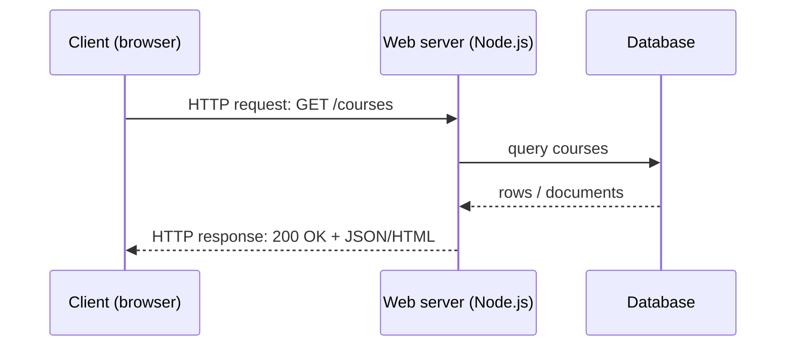

# Session 01: Client-Server Architecture and Introduction to Node.js

> Module: Server-side Programming with Node.js · Term 4 (HDSE) · ⏱ ~2 hours

Every website you use is a conversation between a **client** (your browser or phone app) and a **server**. This session explains that conversation, why we write code on the server, what a web server does, and introduces Node.js, the JavaScript runtime that powers the "N" in MERN.

## 🎯 Learning Objectives

- Outline the client-server architecture and the request-response cycle
- Explain why server-side programming is needed
- Describe what a web server is and how its architecture works
- Describe Node.js and its key features
- Install Node.js and run your first server-side script

## 📖 Concepts Explained

### 1. Client-server architecture



| Term | Meaning |
|---|---|
| Client | software that **asks** for resources (browser, mobile app, Postman) |
| Server | software that **listens** for requests and **responds** |
| Request | method (GET, POST...), URL, headers, optional body |
| Response | status code (200, 404, 500), headers, body |
| Protocol | rules of the conversation, usually HTTP/HTTPS |

Architectures: **2-tier** (client ↔ database server) and **3-tier** (client ↔ application server ↔ database). Modern web apps are usually 3-tier or more.

### 2. Why server-side programming?

Some work must never happen in the browser:

- **Security** - secret keys, passwords and business rules stay hidden on the server.
- **Data** - reading/writing a shared database for all users.
- **Authentication** - checking who the user is and what they may do.
- **Heavy work** - sending emails, generating PDFs, calling AI services, processing payments.
- **Single source of truth** - every client (web, Android, iOS) talks to the same API.

| Client-side (React) | Server-side (Node.js) |
|---|---|
| runs in the user's browser | runs on a machine you control |
| UI, animations, form feedback | data, security, integrations |
| code is visible to users | code is private |

### 3. Web servers and their architecture

A **web server** is a program that accepts HTTP requests on a port (80 for HTTP, 443 for HTTPS, 3000/5000 during development) and returns responses. Examples: Nginx, Apache, IIS, and Node.js apps themselves.

Two classic designs:

| Thread-per-request (traditional Apache/Java) | Event-driven, single thread (Node.js, Nginx) |
|---|---|
| a new thread for each connection | one main thread handles all connections |
| threads wait (block) during I/O | I/O is handed off; the thread keeps serving others |
| memory grows with users | low memory per connection |

### 4. What is Node.js?

Node.js is an **open-source, cross-platform JavaScript runtime** built on Google Chrome's **V8** engine. It lets JavaScript run outside the browser: on servers, laptops and IoT devices. It was created by Ryan Dahl in 2009.

**Key features**

- **Asynchronous and non-blocking I/O** - reading files or databases does not freeze the server.
- **Event-driven** - code reacts to events (a request arrived, a file finished reading).
- **Single-threaded event loop** with a background thread pool (libuv) for heavy I/O.
- **Fast** - V8 compiles JavaScript to machine code.
- **npm** - the world's largest package registry.
- **One language** for frontend and backend (full-stack JavaScript).

### 5. Installing Node.js

1. Download the **LTS** (Long-Term Support) version from nodejs.org (Windows `.msi`, macOS `.pkg`), or use a version manager (Session 2).
2. Verify: `node -v` and `npm -v`.
3. Try the **REPL** (Read-Eval-Print-Loop): type `node`, then `2 + 3`, then `.exit`.

## 💻 Code Examples

### Example 1: Your first Node.js script

📄 File: [`hello.js`](hello.js)

```js
// Run: node hello.js
const name = "Aptech North Nazimabad";
console.log(`Hello from Node.js ${process.version}!`);
console.log(`Platform: ${process.platform}, CPU arch: ${process.arch}`);
console.log(`Welcome, ${name}. Today is ${new Date().toDateString()}.`);
```

**How it works**

- Node runs JavaScript directly from the terminal, no browser needed.
- `process` is a global object with information about the running program and machine.

### Example 2: A minimal web server

📄 File: [`server.js`](server.js)

```js
// Run: node server.js  then open http://localhost:3000
import http from "node:http";

const server = http.createServer((req, res) => {
  console.log(`${req.method} ${req.url}`);

  if (req.url === "/") {
    res.writeHead(200, { "Content-Type": "text/html; charset=utf-8" });
    res.end("<h1>Welcome to my first Node server</h1><a href='/api/time'>Server time</a>");
  } else if (req.url === "/api/time") {
    res.writeHead(200, { "Content-Type": "application/json" });
    res.end(JSON.stringify({ serverTime: new Date().toISOString() }));
  } else {
    res.writeHead(404, { "Content-Type": "text/plain" });
    res.end("404 - Not found");
  }
});

server.listen(3000, () => console.log("Server running at http://localhost:3000"));
```

**How it works**

- `http.createServer` receives a callback that runs for **every** request.
- `req` describes the request (method, URL, headers); `res` builds the response.
- `writeHead` sets the status code and headers; `end` sends the body and finishes the response.
- The server keeps running and listening until you press `Ctrl + C`.

### ▶️ How to run

1. Install Node.js 20 LTS or newer and check with `node -v`.
2. Open a terminal in this session folder.
3. If a `package.json` is present, run `npm install` first.
4. Run a file with `node <filename>` (for example `node app.js`).

## 🧪 Lab Practice

1. Install Node.js LTS, then run `node -v`, `npm -v` and try `Math.max(4, 9, 2)` in the REPL.
2. Run `hello.js`, then add a line that prints `process.cwd()` (the current folder).
3. Run `server.js` and open `/`, `/api/time` and `/abc` in the browser. Watch the terminal log each request.
4. Add a `/about` route that returns your name and batch as HTML.
5. Open the browser DevTools **Network** tab and identify the status code and `Content-Type` header of each response.

## 📝 Assignment

Write a one-page note (in Markdown) comparing client-side and server-side programming with **five** real examples from an online shopping website (e.g. "Add to cart animation" vs "Placing the order"). Then extend `server.js` with a `/api/products` route that returns a JSON array of three products.

## ❓ Quick Quiz

**Q1.** What are the two parts of every HTTP exchange?

**Q2.** Which engine does Node.js use to run JavaScript?

**Q3.** Give two reasons for server-side programming.

**Q4.** What does non-blocking I/O mean?

**Q5.** What does the status code 404 mean?

<details>
<summary>Show answers</summary>

1. A request from the client and a response from the server.
2. Google's V8 engine.
3. Security of secrets/business logic and access to a shared database (also auth, heavy tasks).
4. The program does not wait for slow input/output; it continues serving other work and handles the result later.
5. The requested resource was not found.

</details>

## 💼 Interview Questions

**1. Is Node.js a language, a framework or a runtime?**

> A runtime environment that executes JavaScript outside the browser; frameworks like Express run on top of it.

**2. Why is Node.js good for I/O-heavy applications?**

> Its event-driven, non-blocking model handles many simultaneous connections with little memory because it does not wait on I/O.

**3. When is Node.js not a good choice?**

> For long CPU-heavy computations (video encoding, large number crunching) on the main thread, unless offloaded to worker threads or other services.

## ✅ Summary

- Clients send requests; servers process them and send responses over HTTP.
- Server-side code protects secrets, manages data and integrates services.
- Node.js runs JavaScript on the server using V8 and an event-driven, non-blocking design.
- Install the LTS version and verify with `node -v` and `npm -v`.
- The built-in `http` module can create a basic web server in a few lines.

---

[⬅ Previous](../README.md) · [🏠 Module Home](../README.md) · [Next ➡](../Session-02-Nodejs-Architecture-and-Programming-Basics/README.md)

Prepared by Zeeshan Abbas · Aptech Learning North Nazimabad
