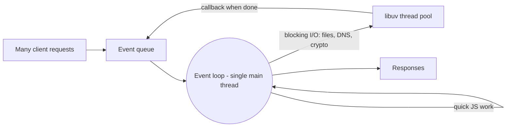

# Session 02: Node.js Architecture and Programming Basics

> Module: Server-side Programming with Node.js · Term 4 (HDSE) · ⏱ ~2 hours

In this session you look inside Node.js: how one thread serves thousands of users, where Node shines and where it struggles, and the everyday tools of a Node developer: console apps, npm, nvm and global objects.

## 🎯 Learning Objectives

- Describe the architecture of Node.js: V8, libuv, event loop and thread pool
- List the benefits and limitations of Node.js applications
- Build interactive console-based applications
- Use the major programming constructs in Node.js (modules, functions, control flow, errors)
- Compare the roles of npm and nvm, and use common global objects

## 📖 Concepts Explained

### 1. Node.js architecture



| Part | Role |
|---|---|
| **V8** | compiles and runs your JavaScript |
| **libuv** | C library providing the event loop, async I/O and a thread pool (4 threads by default) |
| **Event loop** | repeatedly takes finished events from the queue and runs their callbacks |
| **Node APIs / bindings** | `fs`, `http`, `crypto`, etc., connecting JavaScript to the operating system |

### 2. Benefits and limitations

| Benefits | Limitations |
|---|---|
| handles many concurrent connections cheaply | CPU-heavy tasks block the single thread |
| same language for frontend and backend | callback/async code is harder for beginners |
| huge npm ecosystem | package quality varies; supply-chain risk |
| great for real-time apps (chat, live dashboards) | not ideal for heavy computation without worker threads |
| fast startup, good for microservices and serverless | rapid ecosystem changes require upkeep |

### 3. Console-based applications

Command-line tools are a great way to practise Node. You can read **arguments** from `process.argv` and **interactive input** with the `readline` module.

### 4. Major programming constructs

Node uses standard modern JavaScript: variables (`let`/`const`), functions and arrow functions, objects and arrays, `if`/`switch`, loops, classes, `try...catch`. Node-specific points:

- **Modules:** every file is a module. Two systems exist: **CommonJS** (`require`, `module.exports`) and **ES Modules** (`import`/`export`, enabled with `"type": "module"` in `package.json` or `.mjs` files). New projects should use ES Modules.
- **Error-first callbacks** in older APIs: `fs.readFile(path, (err, data) => ...)`.
- **Promises and async/await** in modern APIs: `await fs.promises.readFile(path)`.

### 5. npm vs nvm

| | npm (Node Package Manager) | nvm (Node Version Manager) |
|---|---|---|
| Manages | **packages** (libraries) inside a project | **Node.js versions** on your computer |
| Installed with | Node itself | separately (`nvm` for macOS/Linux, `nvm-windows` for Windows) |
| Example | `npm install express` | `nvm install 20` then `nvm use 20` |
| Key files | `package.json`, `package-lock.json`, `node_modules/` | none in your project (optionally `.nvmrc`) |

Useful npm commands: `npm init -y`, `npm install <pkg>`, `npm install -D <pkg>` (dev dependency), `npm run <script>`, `npm uninstall <pkg>`, `npx <tool>`.

### 6. Global objects

Available everywhere without importing:

| Global | Use |
|---|---|
| `console` | logging (`log`, `error`, `table`, `time`) |
| `process` | env vars (`process.env`), args (`process.argv`), exit, memory |
| `globalThis` | the global object (like `window` in browsers) |
| `setTimeout`, `setInterval`, `setImmediate` | timers |
| `Buffer` | binary data |
| `URL`, `fetch`, `structuredClone` | modern web APIs built into Node 18+ |
| `__dirname`, `__filename` | CommonJS only; in ES Modules use `import.meta.dirname` (Node 20.11+) |

## 💻 Code Examples

### Example 1: Command-line calculator with arguments

📄 File: [`calc.js`](calc.js)

```js
// Run: node calc.js 12 + 5
const [, , a, op, b] = process.argv;
const x = Number(a);
const y = Number(b);

if (Number.isNaN(x) || Number.isNaN(y)) {
  console.error("Usage: node calc.js <number> <+|-|x|/> <number>");
  process.exit(1);
}

let result;
switch (op) {
  case "+": result = x + y; break;
  case "-": result = x - y; break;
  case "x": result = x * y; break;
  case "/": result = y === 0 ? "cannot divide by zero" : x / y; break;
  default:
    console.error(`Unknown operator: ${op}`);
    process.exit(1);
}
console.log(`${x} ${op} ${y} = ${result}`);
```

**How it works**

- `process.argv` is an array: `[nodePath, scriptPath, ...yourArgs]`; destructuring skips the first two.
- `process.exit(1)` ends the program with an error code, useful for scripts.
- We use `x` for multiply because `*` is expanded by many shells.

### Example 2: Interactive console app with readline

📄 File: [`grade-cli.js`](grade-cli.js)

```js
// Run: node grade-cli.js
import readline from "node:readline/promises";
import { stdin as input, stdout as output } from "node:process";

const rl = readline.createInterface({ input, output });

function grade(marks) {
  if (marks >= 75) return "Distinction";
  if (marks >= 60) return "Credit";
  if (marks >= 40) return "Pass";
  return "Referred";
}

const results = [];
try {
  const count = Number(await rl.question("How many students? "));
  for (let i = 1; i <= count; i++) {
    const name = await rl.question(`Name of student ${i}: `);
    const marks = Number(await rl.question(`Marks of ${name}: `));
    results.push({ name, marks, grade: grade(marks) });
  }
  console.table(results);
} catch (err) {
  console.error("Something went wrong:", err.message);
} finally {
  rl.close();
}
```

**How it works**

- `readline/promises` lets us `await` each answer (top-level `await` works in ES modules).
- A `for` loop collects data; a function returns the grade.
- `console.table` prints an array of objects as a neat table.
- `finally` always closes the interface so the program can exit.

### Example 3: Exploring global objects

📄 File: [`globals.js`](globals.js)

```js
// Run: APP_MODE=dev node globals.js   (Windows PowerShell: $env:APP_MODE="dev"; node globals.js)
console.log("Mode:", process.env.APP_MODE ?? "not set");
console.log("This file:", import.meta.filename);   // Node 20.11+
console.log("This folder:", import.meta.dirname);
console.log("Memory used (MB):", (process.memoryUsage().heapUsed / 1024 / 1024).toFixed(2));

console.time("loop");
let total = 0;
for (let i = 0; i < 1e6; i++) total += i;
console.timeEnd("loop");

setTimeout(() => console.log("2. setTimeout after 0 ms"), 0);
setImmediate(() => console.log("3. setImmediate"));
console.log("1. synchronous code runs first");
```

**How it works**

- `process.env` reads environment variables, the standard way to configure apps.
- `import.meta.filename/dirname` replace CommonJS `__filename/__dirname` in ES modules.
- `console.time/timeEnd` measure how long code takes.
- Timers run **after** the synchronous code; that is the event loop in action (detailed in Session 7).

### Example 4: npm and nvm cheat sheet

📄 File: [`npm-nvm-cheatsheet.sh`](npm-nvm-cheatsheet.sh)

```bash
# ---- nvm: manage Node versions ----
nvm install 20        # install Node 20 LTS
nvm install 22
nvm use 20            # switch the active version
nvm ls                # list installed versions

# ---- npm: manage project packages ----
npm init -y                 # create package.json
npm install chalk           # add a dependency
npm install -D nodemon      # add a development-only dependency
npm ls --depth=0            # list top-level packages
npm outdated                # see which packages have updates
npm uninstall chalk         # remove a package
npx cowsay "Hello Node"     # run a tool without installing it globally
```

**How it works**

- Use nvm when different projects need different Node versions.
- `package-lock.json` records exact versions; commit it, but never commit `node_modules/`.

### ▶️ How to run

1. Install Node.js 20 LTS or newer and check with `node -v`.
2. Open a terminal in this session folder.
3. If a `package.json` is present, run `npm install` first.
4. Run a file with `node <filename>` (for example `node app.js`).

## 🧪 Lab Practice

1. Run `calc.js` with different operators and invalid input; check the exit code with `echo $?` (or `$LASTEXITCODE` in PowerShell).
2. Extend `grade-cli.js` to print the class average and the topper at the end.
3. Create a new folder, run `npm init -y`, install `chalk` and print a coloured message.
4. Install nvm (or nvm-windows), install two Node versions and switch between them.
5. Predict the output order of `globals.js` before running it, then compare.

## 📝 Assignment

Build a **Unit Converter CLI** that asks the user (with `readline`) to choose a conversion (km↔miles, °C↔°F, PKR↔USD with a rate read from an environment variable `USD_RATE`), validates input, prints the result and asks whether to convert again. Include a `package.json` with a `start` script.

## ❓ Quick Quiz

**Q1.** Which library gives Node.js its event loop and thread pool?

**Q2.** What is the difference between npm and nvm?

**Q3.** How do you read command-line arguments in Node?

**Q4.** How do you enable ES Modules in a Node project?

**Q5.** Name one limitation of Node.js.

<details>
<summary>Show answers</summary>

1. libuv
2. npm manages packages in a project; nvm manages installed Node.js versions.
3. Through the `process.argv` array.
4. Add `"type": "module"` to `package.json` (or use `.mjs` files).
5. CPU-intensive tasks block the single main thread.

</details>

## 💼 Interview Questions

**1. If Node.js is single-threaded, how does it handle many requests at once?**

> The main thread runs JavaScript quickly and delegates slow I/O to the OS and libuv's thread pool; callbacks are queued and processed by the event loop when ready.

**2. What is the purpose of package-lock.json?**

> It locks the exact installed version of every dependency so installs are reproducible across machines.

**3. CommonJS vs ES Modules?**

> CommonJS uses require/module.exports and loads synchronously; ES Modules use import/export, are the JavaScript standard, support top-level await and static analysis.

## ✅ Summary

- Node = V8 + libuv + Node APIs, coordinated by a single-threaded event loop.
- Node excels at I/O-heavy, real-time apps but struggles with CPU-heavy work on the main thread.
- Console apps use `process.argv` and `readline` for input.
- npm manages packages; nvm manages Node versions.
- Globals like `process`, `console` and timers are available everywhere.

---

[⬅ Previous](../Session-01-Client-Server-Architecture-and-Introduction-to-Nodejs/README.md) · [🏠 Module Home](../README.md) · [Next ➡](../Session-03-Modules-Packages-and-Built-in-Modules/README.md)

Prepared by Zeeshan Abbas · Aptech Learning North Nazimabad
