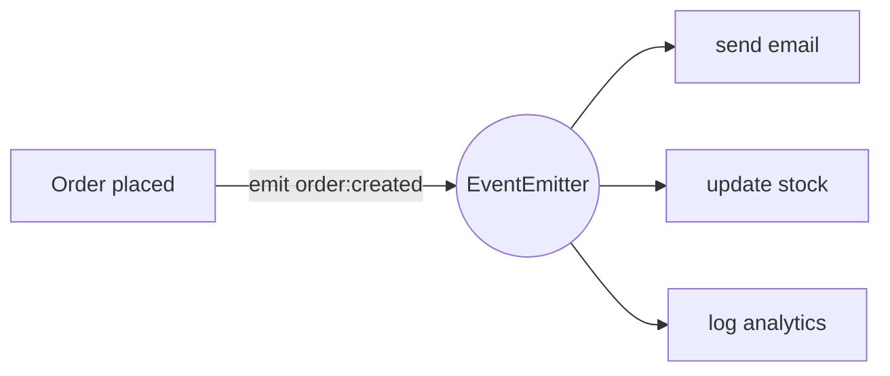

# Session 03: Modules, Packages and Built-in Modules

> Module: Server-side Programming with Node.js · Term 4 (HDSE) · ⏱ ~2 hours

Large programs are split into modules. This session covers the three kinds of modules in Node.js, what packages and frameworks are, and three essential built-in modules: `http`, `url` and `events`.

## 🎯 Learning Objectives

- Explain what modules are and identify the three types: core, local and third-party
- Explain the significance of packages and the role of `package.json`
- Describe the purpose of web frameworks and utility libraries
- Create an HTTP server with the `http` module and parse URLs with the `URL` API
- Handle custom asynchronous events with the `events` module

## 📖 Concepts Explained

### 1. What is a module?

A module is a file (or folder) with code that is **isolated** from other files. It chooses what to share with `export` and others bring it in with `import`. This avoids global-variable clashes and makes code reusable and testable.

### 2. The three types of modules

| Type | Where it comes from | Example import |
|---|---|---|
| **Core (built-in)** | ships with Node.js | `import fs from "node:fs"` |
| **Local (custom)** | files you write | `import { add } from "./math.js"` |
| **Third-party** | downloaded from npm into `node_modules` | `import express from "express"` |

The `node:` prefix makes it clear you mean a core module.

### 3. Packages and package.json

A **package** is a folder of modules described by a `package.json`. It lists the name, version, entry point, scripts and **dependencies**. Packages let teams share and version code. Versions follow **semantic versioning** `MAJOR.MINOR.PATCH`:

| Range | Accepts |
|---|---|
| `^4.19.2` | 4.x.x updates (no breaking major) |
| `~4.19.2` | 4.19.x patches only |
| `4.19.2` | exactly this version |

### 4. Web frameworks and utility functions

- A **web framework** (Express, Fastify, NestJS) handles routing, request parsing, middleware and responses so you do not repeat low-level `http` code.
- **Utility libraries** solve small common tasks: `dayjs` (dates), `lodash` (collections), `uuid` (ids), `zod` (validation). Node's own `node:util` has helpers such as `util.format` and `util.promisify`.

### 5. Built-in modules overview

| Module | Purpose |
|---|---|
| `http` / `https` | create servers, make requests |
| `fs` | read/write files |
| `path` | join and resolve file paths safely |
| `os` | information about the machine |
| `events` | event emitter pattern |
| `url` | URL parsing (`URL`, `URLSearchParams`) |
| `crypto` | hashing, random values |

### 6. The `url` module and `URL` class

```text
https://shop.pk:8080/products/search?q=laptop&page=2#top
└protocol┘ └host─┘└port┘└──pathname──────┘└──search────┘└hash┘
```

`new URL(req.url, "http://localhost")` turns a request URL into an object with `pathname` and `searchParams`. (The older `url.parse()` is legacy.)

### 7. The `events` module

Many Node objects (servers, streams) are **EventEmitters**. You can create your own: `emitter.on("name", handler)` subscribes, `emitter.emit("name", data)` publishes, `once` listens a single time.



## 💻 Code Examples

### Example 1: A local module

📄 File: [`math.js`](math.js)

```js
// Local module: exports functions for other files
export const add = (a, b) => a + b;
export const percentage = (part, total) => Number(((part / total) * 100).toFixed(2));

export default function average(numbers) {
  if (numbers.length === 0) return 0;
  return numbers.reduce((s, n) => s + n, 0) / numbers.length;
}
```

**How it works**

- Named exports (`add`, `percentage`) and one default export (`average`).
- Other files import exactly what they need.

### Example 2: HTTP server with URL parsing

📄 File: [`app.js`](app.js)

```js
// Run: node app.js  ->  http://localhost:3000/api/marks?values=70,85,90
import http from "node:http";
import os from "node:os";
import average, { percentage } from "./math.js";

const server = http.createServer((req, res) => {
  const url = new URL(req.url, `http://${req.headers.host}`);
  const send = (status, data) => {
    res.writeHead(status, { "Content-Type": "application/json" });
    res.end(JSON.stringify(data));
  };

  if (req.method === "GET" && url.pathname === "/api/marks") {
    const values = (url.searchParams.get("values") ?? "")
      .split(",")
      .map(Number)
      .filter((n) => !Number.isNaN(n));
    return send(200, {
      values,
      average: average(values),
      percentOfMax: percentage(average(values), 100),
    });
  }

  if (url.pathname === "/api/system") {
    return send(200, { host: os.hostname(), cpus: os.cpus().length, freeMemMB: Math.round(os.freemem() / 1e6) });
  }

  send(404, { error: `No route for ${req.method} ${url.pathname}` });
});

server.listen(3000, () => console.log("http://localhost:3000"));
```

**How it works**

- Uses a **core** module (`http`, `os`) and a **local** module (`math.js`) together.
- `new URL(...)` gives `pathname` and `searchParams`, so `?values=70,85,90` becomes an array of numbers.
- A small `send` helper avoids repeating headers for every JSON response.

### Example 3: Custom events

📄 File: [`events-demo.js`](events-demo.js)

```js
// Run: node events-demo.js
import { EventEmitter } from "node:events";

class OrderService extends EventEmitter {
  place(order) {
    console.log(`Order #${order.id} placed`);
    this.emit("order:created", order);
    if (order.total > 10000) this.emit("order:big", order);
  }
}

const shop = new OrderService();

shop.on("order:created", (o) => console.log(` 📧 Email sent to ${o.email}`));
shop.on("order:created", (o) => console.log(` 📦 Stock reduced for ${o.items.length} item(s)`));
shop.once("order:big", (o) => console.log(` 🎉 First big order: Rs. ${o.total}`));
shop.on("error", (err) => console.error("Handled error:", err.message));

shop.place({ id: 1, email: "a@example.com", items: ["mouse"], total: 2500 });
shop.place({ id: 2, email: "b@example.com", items: ["laptop", "bag"], total: 185000 });
shop.place({ id: 3, email: "c@example.com", items: ["monitor"], total: 52000 });
shop.emit("error", new Error("payment gateway timeout"));
```

**How it works**

- `OrderService` inherits `on`, `once` and `emit` from `EventEmitter`.
- Several listeners can react to one event; they run in the order they were added.
- `once` fires only for the first big order (order 3 is ignored).
- Always add an `error` listener; an unhandled `error` event crashes the process.

### ▶️ How to run

1. Install Node.js 20 LTS or newer and check with `node -v`.
2. Open a terminal in this session folder.
3. If a `package.json` is present, run `npm install` first.
4. Run a file with `node <filename>` (for example `node app.js`).

## 🧪 Lab Practice

1. Create a local module `strings.js` exporting `capitalize` and `slugify`, and use it from another file.
2. Add a route `/api/greet?name=Ali` to `app.js` that returns a greeting; return 400 if `name` is missing.
3. Install the third-party package `dayjs` and print today's date in `DD-MM-YYYY` format.
4. Extend `events-demo.js` with an `order:cancelled` event and a listener that logs a refund message.
5. Use the `path` module to print the full path of `math.js` using `path.join(import.meta.dirname, 'math.js')`.

## 📝 Assignment

Build a **Mini Library API** using only core modules and one local module `library.js` (array of books with functions `list`, `findById`, `search`). Routes: `GET /books`, `GET /books/:id` (parse the id from `pathname`), `GET /books/search?q=`. Emit a `book:viewed` event every time a book is fetched and log a running view count.

## ❓ Quick Quiz

**Q1.** Name the three types of Node.js modules.

**Q2.** What does the caret in `^4.19.2` allow?

**Q3.** Which class parses a URL and its query string?

**Q4.** Which two methods subscribe to and trigger an event?

**Q5.** Why use a web framework instead of the raw `http` module?

<details>
<summary>Show answers</summary>

1. Core (built-in), local (your own files) and third-party (from npm).
2. Any 4.x.x version that is 4.19.2 or newer, but not 5.0.0.
3. `URL` (with `searchParams`).
4. `on` (or `once`) subscribes; `emit` triggers.
5. It provides routing, body parsing, middleware and helpers, reducing repetitive low-level code.

</details>

## 💼 Interview Questions

**1. What happens if an EventEmitter emits 'error' with no listener?**

> Node throws the error and the process crashes unless it is caught elsewhere.

**2. How does Node resolve `import x from 'express'`?**

> It looks for the package in node_modules folders up the directory tree and uses the entry declared in its package.json.

**3. Why should you commit package.json but not node_modules?**

> package.json and the lock file describe dependencies so anyone can reinstall them; node_modules is large and platform-specific.

## ✅ Summary

- Modules isolate code; share with `export`, reuse with `import`.
- Core, local and third-party modules cover most needs.
- `package.json` and semantic versioning manage packages.
- `http` builds servers, `URL` parses requests, `events` decouples features.
- Frameworks and utility libraries save time on common tasks.

---

[⬅ Previous](../Session-02-Nodejs-Architecture-and-Programming-Basics/README.md) · [🏠 Module Home](../README.md) · [Next ➡](../Session-04-Querystring-Email-File-Uploads-and-Local-Modules/README.md)

Prepared by Zeeshan Abbas · Aptech Learning North Nazimabad
