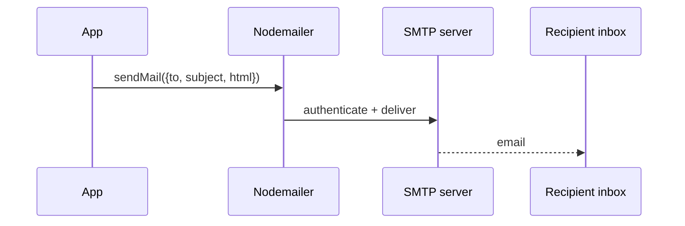

# Session 04: Query Strings, Email, File Uploads and Local Modules

> Module: Server-side Programming with Node.js · Term 4 (HDSE) · ⏱ ~2 hours

Real servers read form data, send emails and accept file uploads. In this session you will do all three with Node.js and organise the code into clean local modules.

## 🎯 Learning Objectives

- Explain the purpose of query strings and parse them with `URLSearchParams` (and the legacy `querystring` module)
- Send emails from Node.js using Nodemailer and a test SMTP account
- Accept and validate file uploads with Express and Multer
- Organise code into local modules (config, services, routes)
- Apply basic security checks for uploads and email input

## 📖 Concepts Explained

### 1. Query strings

A query string carries small pieces of data in the URL after `?`: `/search?city=Karachi&page=2`. HTML forms using `method="GET"` send data this way; `POST` forms send the same `key=value&key2=value2` format in the **request body** (`application/x-www-form-urlencoded`).

| Tool | Status | Example |
|---|---|---|
| `URLSearchParams` | **modern**, also works in browsers | `new URLSearchParams("a=1&b=2").get("a")` |
| `querystring` module | legacy but still available | `querystring.parse("a=1&b=2")` |

Values arrive as **strings** and are URL-encoded (`%20` for a space). Always convert and validate them.

### 2. Sending email

Node does not send email by itself; it connects to an **SMTP server** (Gmail, Outlook, SendGrid, Mailgun...). The popular **Nodemailer** package handles this.



- Keep SMTP credentials in **environment variables**.
- For learning, use **Ethereal** (a free fake SMTP service from the Nodemailer team): emails are captured and viewable via a preview link, never delivered.
- Gmail requires an *App Password* with 2-step verification enabled.

### 3. File uploads

Browsers send files with `enctype="multipart/form-data"`. Parsing that format by hand is complex, so we use **Multer** (Express middleware).

| Security check | Why |
|---|---|
| limit file size | prevents filling the disk / denial of service |
| allow only certain MIME types/extensions | blocks executable files |
| rename files (random names) | prevents overwriting and path tricks |
| store outside public code folders or in cloud storage | avoids executing uploaded files |

### 4. Local modules for clean structure

As apps grow, split by responsibility:

```text
session-04/
├── app.js             # starts the server, wires routes
├── config.js          # reads environment variables
├── services/
│   └── mailer.js      # email logic
└── routes/
    └── upload.js      # upload route + multer config
```

Each module has one job, which makes testing and teamwork easier.

## 💻 Code Examples

### Example 1: Parsing query strings

📄 File: [`query-demo.js`](query-demo.js)

```js
// Run: node query-demo.js
import querystring from "node:querystring";

const raw = "name=Ali%20Khan&course=MERN&skills=react&skills=node";

// Modern way
const params = new URLSearchParams(raw);
console.log(params.get("name"));          // "Ali Khan"
console.log(params.getAll("skills"));     // ["react", "node"]
params.append("city", "Karachi");
console.log(params.toString());

// Legacy module (still found in older code)
const parsed = querystring.parse(raw);
console.log(parsed);                       // { name: 'Ali Khan', course: 'MERN', skills: [ 'react', 'node' ] }
console.log(querystring.stringify({ q: "node js", page: 2 })); // q=node%20js&page=2
```

**How it works**

- `URLSearchParams` decodes `%20` automatically and supports repeated keys with `getAll`.
- `querystring.parse` returns a plain object; repeated keys become arrays.
- `toString()` / `stringify()` build properly encoded query strings.

### Example 2: Configuration module

📄 File: [`config.js`](config.js)

```js
import "dotenv/config";

export const config = {
  port: Number(process.env.PORT) || 3000,
  smtp: {
    host: process.env.SMTP_HOST,
    port: Number(process.env.SMTP_PORT) || 587,
    user: process.env.SMTP_USER,
    pass: process.env.SMTP_PASS,
  },
};
```

**How it works**

- `dotenv/config` loads variables from a `.env` file into `process.env`.
- Every other module imports `config` instead of reading `process.env` directly.

### Example 3: Email service (local module)

📄 File: [`services/mailer.js`](services/mailer.js)

```js
import nodemailer from "nodemailer";
import { config } from "../config.js";

let transporter;

async function getTransporter() {
  if (transporter) return transporter;
  if (config.smtp.host) {
    transporter = nodemailer.createTransport({
      host: config.smtp.host,
      port: config.smtp.port,
      auth: { user: config.smtp.user, pass: config.smtp.pass },
    });
  } else {
    // No SMTP configured: create a free Ethereal test account automatically
    const test = await nodemailer.createTestAccount();
    transporter = nodemailer.createTransport({
      host: "smtp.ethereal.email",
      port: 587,
      auth: { user: test.user, pass: test.pass },
    });
  }
  return transporter;
}

export async function sendWelcomeEmail(to, name) {
  const t = await getTransporter();
  const info = await t.sendMail({
    from: '"Course Portal" <no-reply@example.com>',
    to,
    subject: "Welcome to the MERN course",
    text: `Hi ${name}, your registration is confirmed.`,
    html: `<p>Hi <b>${name}</b>, your registration is confirmed.</p>`,
  });
  return nodemailer.getTestMessageUrl(info) || info.messageId; // preview link for Ethereal
}
```

**How it works**

- The transporter is created once and reused.
- Without SMTP settings it falls back to Ethereal, so the demo works with zero setup.
- `getTestMessageUrl` returns a browser link where you can view the captured email.
- In real code, escape user input before placing it in HTML emails.

### Example 4: Upload route with Multer (local module)

📄 File: [`routes/upload.js`](routes/upload.js)

```js
import { Router } from "express";
import multer from "multer";
import path from "node:path";
import crypto from "node:crypto";

const storage = multer.diskStorage({
  destination: "uploads/",
  filename: (req, file, cb) => {
    const ext = path.extname(file.originalname).toLowerCase();
    cb(null, `${crypto.randomUUID()}${ext}`); // random safe name
  },
});

const upload = multer({
  storage,
  limits: { fileSize: 2 * 1024 * 1024 }, // 2 MB
  fileFilter: (req, file, cb) => {
    const ok = ["image/png", "image/jpeg", "application/pdf"].includes(file.mimetype);
    cb(ok ? null : new Error("Only PNG, JPG or PDF allowed"), ok);
  },
});

const router = Router();

router.post("/upload", upload.single("document"), (req, res) => {
  if (!req.file) return res.status(400).json({ error: "No file received" });
  res.json({ saved: req.file.filename, sizeKB: Math.round(req.file.size / 1024) });
});

export default router;
```

**How it works**

- `upload.single("document")` reads one file from the form field named `document`.
- Size limit, MIME filter and random file names implement the security checks from the table.
- Multer errors (too large, wrong type) reach the error handler in `app.js`.

### Example 5: Main application

📄 File: [`app.js`](app.js)

```js
import express from "express";
import fs from "node:fs";
import { config } from "./config.js";
import { sendWelcomeEmail } from "./services/mailer.js";
import uploadRouter from "./routes/upload.js";

fs.mkdirSync("uploads", { recursive: true });
const app = express();
app.use(express.urlencoded({ extended: false })); // parse form posts

app.get("/", (req, res) => {
  res.send(`
    <h2>Register</h2>
    <form method="POST" action="/register">
      <input name="name" placeholder="Name" required>
      <input name="email" type="email" placeholder="Email" required>
      <button>Register</button>
    </form>
    <h2>Upload document</h2>
    <form method="POST" action="/upload" enctype="multipart/form-data">
      <input type="file" name="document" required>
      <button>Upload</button>
    </form>`);
});

app.post("/register", async (req, res, next) => {
  try {
    const { name, email } = req.body;
    if (!name || !email) return res.status(400).send("Name and email required");
    const preview = await sendWelcomeEmail(email, name);
    res.send(`Email sent. Preview: <a href="${preview}" target="_blank">${preview}</a>`);
  } catch (err) {
    next(err);
  }
});

app.use(uploadRouter);

app.use((err, req, res, next) => {
  res.status(400).json({ error: err.message });
});

app.listen(config.port, () => console.log(`http://localhost:${config.port}`));
```

**How it works**

- `express.urlencoded` parses the POST form body (query-string format) into `req.body`.
- The register route calls the mailer module; the upload route lives in its own router module.
- A final error-handling middleware (four parameters) returns friendly JSON for Multer and email errors.

### ▶️ How to run

1. Install Node.js 20 LTS or newer and check with `node -v`.
2. Open a terminal in this session folder.
3. If a `package.json` is present, run `npm install` first.
4. Run a file with `node <filename>` (for example `node app.js`).
5. For the web demo: `npm install`, then `npm start` and open http://localhost:3000. Copy `.env.example` to `.env` if you want to use a real SMTP server.

## 🧪 Lab Practice

1. Run `query-demo.js` and add code that converts `page=2` to a number and validates it is between 1 and 50.
2. Start `app.js`, register with any email and open the Ethereal preview link to see the message.
3. Upload a PNG, then try a `.exe` or a 5 MB file and observe the error messages.
4. Add a `services/logger.js` local module that appends each registration to `registrations.log` using `fs.appendFile`.
5. Change the upload route to accept up to 3 images with `upload.array('photos', 3)`.

## 📝 Assignment

Create a **Job Application Portal**: a form with name, email, position (dropdown) and CV upload (PDF only, max 1 MB). On submit, save the CV with a random name, store the application in `applications.json`, and send a confirmation email (Ethereal is fine) that mentions the position. Organise the code into `config.js`, `services/`, and `routes/` modules.

## ❓ Quick Quiz

**Q1.** What is the modern replacement for the `querystring` module?

**Q2.** Which `enctype` must a form use to upload files?

**Q3.** What does Nodemailer need to send email?

**Q4.** Name two security checks for file uploads.

**Q5.** Why keep SMTP passwords in environment variables?

<details>
<summary>Show answers</summary>

1. `URLSearchParams`
2. `multipart/form-data`
3. An SMTP server (transport) with host, port and credentials.
4. File size limit, allowed MIME types (also random file names, safe storage location).
5. So secrets are not committed to source code and can differ per environment.

</details>

## 💼 Interview Questions

**1. Why shouldn't you trust the file extension or MIME type sent by the browser?**

> Both are controlled by the client and can be faked; for sensitive cases also check file signatures (magic bytes) and scan files.

**2. How would you send thousands of emails efficiently?**

> Use a transactional email service/API, queue jobs (e.g. BullMQ with Redis), send in batches and respect provider rate limits.

**3. Where would you store uploaded files in production?**

> In object storage such as Azure Blob Storage or Amazon S3, saving only the URL/metadata in the database.

## ✅ Summary

- Query strings carry key-value data; parse with `URLSearchParams` and validate types.
- Nodemailer sends email through SMTP; Ethereal is perfect for testing.
- Multer parses multipart uploads; always limit size and type and rename files.
- Local modules (config, services, routes) keep apps organised.
- Secrets live in `.env`, never in code.

---

[⬅ Previous](../Session-03-Modules-Packages-and-Built-in-Modules/README.md) · [🏠 Module Home](../README.md) · [Next ➡](../Session-05-Practice-Lab-Nodejs-Fundamentals/README.md)

Prepared by Zeeshan Abbas · Aptech Learning North Nazimabad
