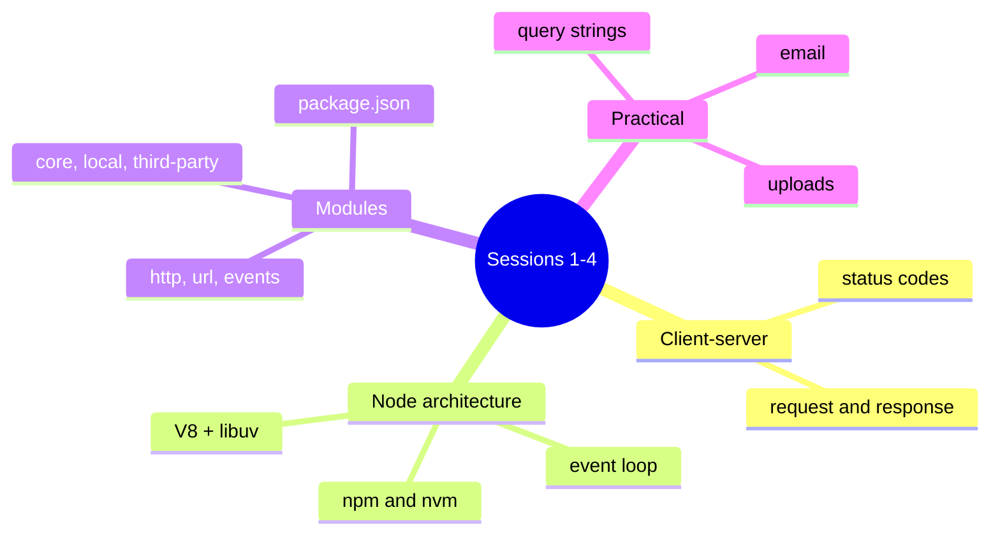

# Session 05: Practice Lab: Node.js Fundamentals

> Module: Server-side Programming with Node.js · Term 4 (HDSE) · ⏱ ~2 hours

A hands-on revision of Sessions 1 to 4. You will build a small **Notes CLI and API** with core modules only, then compare your work with the solution files here.

## 🎯 Learning Objectives

- Revise client-server concepts, Node architecture and the event loop basics
- Use the `fs/promises`, `path` and `http` core modules together
- Organise code into local modules with clear responsibilities
- Parse URLs, query strings and JSON request bodies without a framework
- Recognise and fix common beginner errors in Node.js

## 📖 Concepts Explained

### 1. Revision map



### 2. Reading a JSON body with the raw `http` module

Without Express, the request body arrives in **chunks** (a stream). You collect the chunks, join them and `JSON.parse` the result, inside a `try...catch` because the client might send invalid JSON.

### 3. Common errors

| Error | Cause | Fix |
|---|---|---|
| `Cannot use import statement outside a module` | ES `import` without `"type": "module"` | add it to `package.json` |
| `ERR_MODULE_NOT_FOUND` for `./utils` | ES modules need the extension | import `./utils.js` |
| `EADDRINUSE: address already in use :::3000` | another server still running | stop it or change the port |
| `ENOENT: no such file or directory` | wrong relative path | build paths with `path.join(import.meta.dirname, ...)` |
| Browser spins forever | response never ended | always call `res.end()` |
| `Unexpected token in JSON` | invalid body | wrap `JSON.parse` in `try...catch` and return 400 |

### 4. Lab structure

```text
notes-lab/
├── store.js    # read/write notes.json (fs/promises)
├── cli.js      # node cli.js add "text" | list | remove <id>
└── server.js   # GET/POST/DELETE /notes over http
```

Both the CLI and the server reuse **the same** `store.js` module. That is the power of local modules.

## 💻 Code Examples

### Example 1: Solution: storage module

📄 File: [`store.js`](store.js)

```js
import { readFile, writeFile } from "node:fs/promises";
import path from "node:path";

const FILE = path.join(import.meta.dirname, "notes.json");

export async function loadNotes() {
  try {
    return JSON.parse(await readFile(FILE, "utf8"));
  } catch (err) {
    if (err.code === "ENOENT") return []; // file not created yet
    throw err;
  }
}

async function save(notes) {
  await writeFile(FILE, JSON.stringify(notes, null, 2));
}

export async function addNote(text) {
  const notes = await loadNotes();
  const note = { id: Date.now(), text, createdAt: new Date().toISOString() };
  notes.push(note);
  await save(notes);
  return note;
}

export async function removeNote(id) {
  const notes = await loadNotes();
  const remaining = notes.filter((n) => n.id !== id);
  await save(remaining);
  return remaining.length !== notes.length; // true if something was removed
}
```

**How it works**

- `fs/promises` gives `await`-able file functions.
- A missing file (`ENOENT`) simply means "no notes yet".
- `JSON.stringify(notes, null, 2)` writes nicely indented JSON.

### Example 2: Solution: command-line interface

📄 File: [`cli.js`](cli.js)

```js
// node cli.js add "Revise event loop" | node cli.js list | node cli.js remove 1712345678901
import { addNote, loadNotes, removeNote } from "./store.js";

const [, , command, ...rest] = process.argv;

switch (command) {
  case "add": {
    const text = rest.join(" ").trim();
    if (!text) { console.error("Please provide note text"); process.exit(1); }
    const n = await addNote(text);
    console.log(`Added note ${n.id}`);
    break;
  }
  case "list": {
    const notes = await loadNotes();
    if (notes.length === 0) console.log("No notes yet.");
    else console.table(notes.map(({ id, text }) => ({ id, text })));
    break;
  }
  case "remove": {
    const ok = await removeNote(Number(rest[0]));
    console.log(ok ? "Removed." : "No note with that id.");
    break;
  }
  default:
    console.log("Commands: add <text> | list | remove <id>");
}
```

**How it works**

- The first argument chooses the command; the rest form the note text.
- Curly braces inside each `case` give each block its own `const` scope.

### Example 3: Solution: HTTP API without a framework

📄 File: [`server.js`](server.js)

```js
// node server.js   then: curl localhost:3000/notes
import http from "node:http";
import { addNote, loadNotes, removeNote } from "./store.js";

function readJson(req) {
  return new Promise((resolve, reject) => {
    let body = "";
    req.on("data", (chunk) => (body += chunk));
    req.on("end", () => {
      try { resolve(body ? JSON.parse(body) : {}); }
      catch { reject(new Error("Invalid JSON")); }
    });
  });
}

function send(res, status, data) {
  res.writeHead(status, { "Content-Type": "application/json" });
  res.end(JSON.stringify(data));
}

http.createServer(async (req, res) => {
  const { pathname, searchParams } = new URL(req.url, "http://localhost");
  try {
    if (req.method === "GET" && pathname === "/notes") {
      const q = (searchParams.get("q") || "").toLowerCase();
      const notes = await loadNotes();
      return send(res, 200, notes.filter((n) => n.text.toLowerCase().includes(q)));
    }
    if (req.method === "POST" && pathname === "/notes") {
      const { text } = await readJson(req);
      if (!text) return send(res, 400, { error: "text is required" });
      return send(res, 201, await addNote(text));
    }
    const match = pathname.match(/^\/notes\/(\d+)$/);
    if (req.method === "DELETE" && match) {
      const ok = await removeNote(Number(match[1]));
      return send(res, ok ? 200 : 404, ok ? { deleted: true } : { error: "Not found" });
    }
    send(res, 404, { error: "Route not found" });
  } catch (err) {
    send(res, 400, { error: err.message });
  }
}).listen(3000, () => console.log("Notes API on http://localhost:3000"));
```

**How it works**

- `readJson` collects body chunks from the request stream and parses them safely.
- Routing is done manually with `method`, `pathname` and a regular expression for `/notes/:id`.
- `201 Created` is returned for new notes; errors become JSON with a 400 status.
- Notice how much code this takes; Session 6 shows how Express simplifies it.

### ▶️ How to run

1. Install Node.js 20 LTS or newer and check with `node -v`.
2. Open a terminal in this session folder.
3. If a `package.json` is present, run `npm install` first.
4. Run a file with `node <filename>` (for example `node app.js`).
5. Test the API: `curl -X POST localhost:3000/notes -H "Content-Type: application/json" -d '{"text":"hello"}'` then `curl localhost:3000/notes`.

## 🧪 Lab Practice

1. **Challenge 1:** Write `store.js` with `loadNotes`, `addNote` and `removeNote` using `fs/promises`.
2. **Challenge 2:** Build `cli.js` with `add`, `list` and `remove` commands.
3. **Challenge 3:** Build `server.js` with GET (with `?q=` search), POST and DELETE routes using only `http`.
4. **Challenge 4:** Reproduce three errors from the table in Concepts and fix them.
5. **Challenge 5:** Emit a `note:added` event from the store using `EventEmitter` and log it in the server.

## 📝 Assignment

Build an **Expense Tracker** CLI + API sharing one `expenses.js` module. Each expense has id, title, amount (PKR), category and date. CLI commands: `add`, `list`, `total [category]`. API routes: `GET /expenses?category=`, `POST /expenses` (validate amount > 0), `DELETE /expenses/:id`, `GET /expenses/summary` (totals per category). No frameworks allowed.

## ❓ Quick Quiz

**Q1.** How is a request body received in the raw `http` module?

**Q2.** Which status code should a successful create return?

**Q3.** What causes `EADDRINUSE`?

**Q4.** Why must ES module imports include `.js` for local files?

**Q5.** What happens if you forget `res.end()`?

<details>
<summary>Show answers</summary>

1. As a stream of chunks via `data` events, completed by the `end` event.
2. 201 Created
3. Another process is already listening on the same port.
4. ES module resolution in Node does not guess file extensions.
5. The client waits until it times out because the response never finishes.

</details>

## 💼 Interview Questions

**1. How would you prevent two requests from overwriting the JSON file at the same time?**

> Serialise writes through a queue/lock, or better, use a real database that handles concurrency.

**2. Why reuse one store module for CLI and server?**

> It keeps business logic in one place (DRY), so both interfaces behave the same and are easier to test.

**3. What is a stream in Node.js?**

> An interface for processing data piece by piece (readable, writable, duplex, transform), avoiding loading everything into memory.

## ✅ Summary

- Core modules alone can build CLIs and APIs.
- Request bodies are streams; parse JSON carefully.
- Local modules let multiple interfaces share logic.
- Most beginner errors involve module settings, paths, ports and unfinished responses.
- Frameworks exist to remove the repetitive code you wrote here.

---

[⬅ Previous](../Session-04-Querystring-Email-File-Uploads-and-Local-Modules/README.md) · [🏠 Module Home](../README.md) · [Next ➡](../Session-06-Expressjs-Framework/README.md)

Prepared by Zeeshan Abbas · Aptech Learning North Nazimabad
