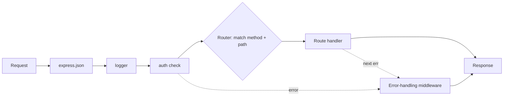

# Session 06: The Express.js Framework

> Module: Server-side Programming with Node.js · Term 4 (HDSE) · ⏱ ~2 hours

Express is the most popular web framework for Node.js and the "E" in MERN. It turns the long manual routing code from the previous lab into short, readable routes, and introduces the powerful idea of **middleware**.

## 🎯 Learning Objectives

- Describe the Express.js framework and its role in the MERN stack
- Explain the architecture of an Express app: app, router, middleware, handlers
- List the advantages of using Express over the raw `http` module
- Explain how a request flows through Express from arrival to response
- Build an Express server with routes, parameters, middleware and static files

## 📖 Concepts Explained

### 1. What is Express?

Express is a **minimal and flexible web framework** for Node.js. It adds routing, request/response helpers and middleware on top of the `http` module, without forcing a particular folder structure.

### 2. Advantages

| Raw `http` | Express |
|---|---|
| manual `if (req.url === ...)` routing | `app.get("/users/:id", handler)` |
| manual body parsing | `express.json()`, `express.urlencoded()` |
| `res.writeHead` + `JSON.stringify` | `res.status(201).json(data)` |
| no plug-in system | thousands of middleware packages (cors, helmet, morgan) |
| serve files yourself | `express.static("public")` |

Other strengths: huge community, easy learning curve, works with any template engine and database.

### 3. Architecture



| Piece | Description |
|---|---|
| `app` | the application object created by `express()` |
| **Middleware** | function `(req, res, next)` that can read/modify the request, end the response, or call `next()` |
| **Router** | mini-app grouping related routes (`express.Router()`) mounted on a path |
| **Route handler** | final function that sends the response |
| **Error middleware** | function with four parameters `(err, req, res, next)` |

### 4. How Express works

1. A request arrives; Express creates enhanced `req` and `res` objects.
2. Middleware runs **in the order it was registered** (`app.use`).
3. Each middleware either responds or calls `next()` to pass control on.
4. The first route that matches the method and path handles it.
5. If nothing matches, your 404 middleware runs; if an error is passed to `next(err)`, the error middleware runs.

### 5. Request and response helpers

| `req` | `res` |
|---|---|
| `req.params` - `/users/:id` values | `res.json(obj)` |
| `req.query` - `?page=2` values | `res.status(code)` |
| `req.body` - parsed JSON/form data | `res.send(text/html)` |
| `req.headers`, `req.method`, `req.ip` | `res.redirect(url)`, `res.sendFile(path)` |

## 💻 Code Examples

### Example 1: An Express app with middleware and routers

📄 File: [`app.js`](app.js)

```js
import express from "express";
import coursesRouter from "./routes/courses.js";

const app = express();

// 1. Built-in middleware
app.use(express.json());                 // parse JSON bodies into req.body
app.use(express.static("public"));       // serve files from /public

// 2. Custom middleware: request logger with timing
app.use((req, res, next) => {
  const start = Date.now();
  res.on("finish", () => console.log(`${req.method} ${req.originalUrl} ${res.statusCode} ${Date.now() - start}ms`));
  next();
});

// 3. Routes
app.get("/api/health", (req, res) => res.json({ status: "ok", time: new Date() }));
app.use("/api/courses", coursesRouter);

// 4. 404 handler (no route matched)
app.use((req, res) => res.status(404).json({ error: `Cannot ${req.method} ${req.originalUrl}` }));

// 5. Error handler (four parameters)
app.use((err, req, res, next) => {
  console.error(err);
  res.status(err.status || 500).json({ error: err.message || "Server error" });
});

const PORT = process.env.PORT || 3000;
app.listen(PORT, () => console.log(`Express running on http://localhost:${PORT}`));
```

**How it works**

- Middleware order matters: body parsing and logging run before any route.
- The router for courses is mounted at `/api/courses`, so its `/` route becomes `/api/courses`.
- Unmatched requests fall through to the 404 middleware; errors go to the final error handler.

### Example 2: A router with params, query and validation middleware

📄 File: [`routes/courses.js`](routes/courses.js)

```js
import { Router } from "express";

const router = Router();
let courses = [
  { id: 1, title: "React", sessions: 12 },
  { id: 2, title: "Node.js", sessions: 12 },
  { id: 3, title: "MongoDB", sessions: 16 },
];

function validateCourse(req, res, next) {
  const { title, sessions } = req.body;
  if (!title || !Number.isInteger(sessions) || sessions < 1) {
    return res.status(400).json({ error: "title (string) and sessions (positive integer) are required" });
  }
  next();
}

// GET /api/courses?minSessions=13
router.get("/", (req, res) => {
  const min = Number(req.query.minSessions) || 0;
  res.json(courses.filter((c) => c.sessions >= min));
});

// GET /api/courses/2
router.get("/:id", (req, res, next) => {
  const course = courses.find((c) => c.id === Number(req.params.id));
  if (!course) {
    const err = new Error("Course not found");
    err.status = 404;
    return next(err);
  }
  res.json(course);
});

// POST /api/courses
router.post("/", validateCourse, (req, res) => {
  const course = { id: Date.now(), title: req.body.title, sessions: req.body.sessions };
  courses.push(course);
  res.status(201).json(course);
});

// DELETE /api/courses/2
router.delete("/:id", (req, res) => {
  const before = courses.length;
  courses = courses.filter((c) => c.id !== Number(req.params.id));
  res.status(before === courses.length ? 404 : 204).end();
});

export default router;
```

**How it works**

- `req.params.id` comes from `/:id`; `req.query.minSessions` from the query string.
- `validateCourse` is **route-level middleware**: it runs only for POST and stops bad requests with 400.
- `next(err)` hands a 404 error to the central error handler in `app.js`.
- `204 No Content` is the conventional reply for a successful delete.

### Example 3: A static page served by Express

📄 File: [`public/index.html`](public/index.html)

```html
<!DOCTYPE html>
<html lang="en">
<head>
  <meta charset="UTF-8" />
  <title>Courses</title>
</head>
<body>
  <h1>Term 4 Courses</h1>
  <ul id="list"></ul>
  <script>
    fetch("/api/courses")
      .then((r) => r.json())
      .then((data) => {
        document.getElementById("list").innerHTML = data
          .map((c) => `<li>${c.title} - ${c.sessions} sessions</li>`)
          .join("");
      });
  </script>
</body>
</html>
```

**How it works**

- Because of `express.static("public")`, opening http://localhost:3000 serves this file automatically.
- The page calls the API on the same server, so no CORS setup is needed.

### ▶️ How to run

1. Install Node.js 20 LTS or newer and check with `node -v`.
2. Open a terminal in this session folder.
3. If a `package.json` is present, run `npm install` first.
4. Run a file with `node <filename>` (for example `node app.js`).
5. `npm install` then `npm run dev` (Node's built-in `--watch` restarts on file changes). Test with a browser, Postman or the VS Code *Thunder Client* extension.

## 🧪 Lab Practice

1. Run the app and call every route with Postman/Thunder Client, including a POST with invalid data.
2. Add a `PUT /api/courses/:id` route that updates title/sessions with validation.
3. Write a middleware that rejects requests without the header `x-api-key: aptech123` for `/api/courses` only.
4. Install and use `morgan` (logging) and `cors` middleware; compare morgan's output with the custom logger.
5. Create `routes/students.js` with GET/POST and mount it at `/api/students`.

## 📝 Assignment

Rebuild the **Expense Tracker API** from the last lab using Express: routers in a `routes/` folder, a validation middleware, query filters (`?category=&from=&to=`), a summary route, consistent JSON errors via a central error handler, and a static `public/index.html` page that lists expenses using `fetch`.

## ❓ Quick Quiz

**Q1.** What three parameters does a normal middleware receive?

**Q2.** How does Express recognise error-handling middleware?

**Q3.** Which built-in middleware parses JSON bodies?

**Q4.** Where do `/users/:id` values appear?

**Q5.** Why does the order of `app.use` calls matter?

<details>
<summary>Show answers</summary>

1. `req`, `res`, `next`
2. It has four parameters: `(err, req, res, next)`.
3. `express.json()`
4. `req.params`
5. Middleware and routes run in registration order; a handler registered too late may never run.

</details>

## 💼 Interview Questions

**1. What happens if a middleware neither responds nor calls next()?**

> The request hangs until it times out because control never moves on.

**2. How do you handle errors from async route handlers in Express 4?**

> Wrap logic in try/catch and call next(err), or use a wrapper/helper; Express 5 forwards rejected promises automatically.

**3. What is the difference between app.use and app.get?**

> app.use mounts middleware for all methods on a path prefix; app.get handles only GET requests matching the exact route pattern.

## ✅ Summary

- Express adds routing, helpers and middleware on top of Node's `http` module.
- Middleware functions form a pipeline controlled by `next()`.
- Routers group related routes; error middleware centralises failures.
- `req.params`, `req.query` and `req.body` carry request data; `res.status().json()` replies.
- Express is the standard backend layer of the MERN stack.

---

[⬅ Previous](../Session-05-Practice-Lab-Nodejs-Fundamentals/README.md) · [🏠 Module Home](../README.md) · [Next ➡](../Session-07-Asynchronous-Programming-and-the-Event-Loop/README.md)

Prepared by Zeeshan Abbas · Aptech Learning North Nazimabad
