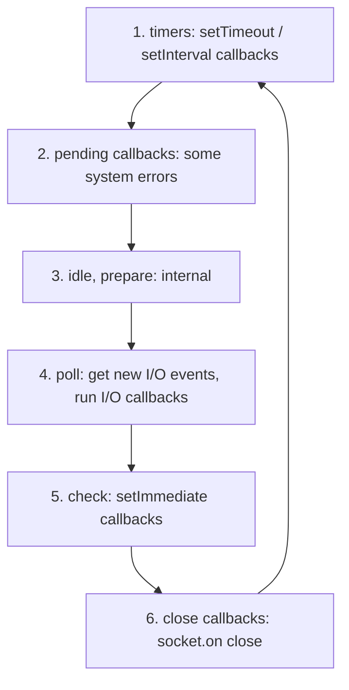

# Session 07: Asynchronous Programming and the Event Loop

> Module: Server-side Programming with Node.js · Term 4 (HDSE) · ⏱ ~2 hours

Node.js is fast because it never waits idly. To write correct Node code you must understand the difference between synchronous and asynchronous code, the three async styles (callbacks, Promises, async/await) and the event loop that schedules everything.

## 🎯 Learning Objectives

- Compare synchronous and asynchronous programming models
- Write asynchronous code using callbacks, Promises and async/await
- Describe when synchronous code is acceptable in Node.js
- Explain the phases of the Node.js event loop and the microtask queue
- Run tasks in parallel with `Promise.all` and handle errors correctly

## 📖 Concepts Explained

### 1. Synchronous vs asynchronous

> **Analogy:** In a *synchronous* restaurant the waiter takes your order, stands in the kitchen until it is cooked, serves you, and only then goes to the next table. In an *asynchronous* restaurant the waiter passes your order to the kitchen and serves other tables; when the bell rings, they bring your food. Node.js is the asynchronous waiter.

| | Synchronous (blocking) | Asynchronous (non-blocking) |
|---|---|---|
| Execution | one line at a time; waits for each to finish | starts the task, continues, handles the result later |
| Example | `fs.readFileSync()` | `fs.promises.readFile()` |
| Effect on server | blocks every other user | other requests keep being served |
| Good for | startup scripts, CLI tools, config loading | request handlers, DB queries, network calls |

### 2. Three styles of async code

| Style | Example | Notes |
|---|---|---|
| **Callback** | `fs.readFile(p, (err, data) => {...})` | error-first convention; nesting leads to *callback hell* |
| **Promise** | `readFile(p).then(...).catch(...)` | chainable; states: pending → fulfilled / rejected |
| **async/await** | `const data = await readFile(p)` | reads like synchronous code; use `try...catch` |

`util.promisify` converts callback-style functions to Promise-based ones.

### 3. The event loop

When Node starts it runs your script, then enters the event loop, which cycles through phases:



Between each callback Node empties two **microtask** queues, in this order:
1. `process.nextTick` callbacks
2. Promise callbacks (`.then`, code after `await`)

So the typical order is: synchronous code → `nextTick` → Promise microtasks → timers → I/O → `setImmediate`.

### 4. Parallel vs sequential awaits

```js
const a = await getA(); const b = await getB();            // sequential: time = A + B
const [a, b] = await Promise.all([getA(), getB()]);         // parallel: time = max(A, B)
```

| Combinator | Resolves when |
|---|---|
| `Promise.all` | all succeed (rejects on first failure) |
| `Promise.allSettled` | all finish, with each result's status |
| `Promise.race` | the first settles |
| `Promise.any` | the first succeeds |

### 5. Never block the event loop

A long synchronous loop or `JSON.parse` of a huge file freezes the whole server. Move CPU-heavy work to **worker threads**, a separate service, or break it into chunks.

## 💻 Code Examples

### Example 1: Three styles side by side

📄 File: [`styles.js`](styles.js)

```js
// Run: node styles.js
import fs from "node:fs";
import { readFile } from "node:fs/promises";

const file = new URL("./sample.txt", import.meta.url);

// 1) Synchronous - blocks until done
const syncText = fs.readFileSync(file, "utf8");
console.log("SYNC:", syncText.trim());

// 2) Callback - error-first
fs.readFile(file, "utf8", (err, data) => {
  if (err) return console.error("Callback error:", err.message);
  console.log("CALLBACK:", data.trim());
});

// 3) Promise with then/catch
readFile(file, "utf8")
  .then((data) => console.log("PROMISE:", data.trim()))
  .catch((err) => console.error(err));

// 4) async/await
async function main() {
  try {
    const data = await readFile(file, "utf8");
    console.log("ASYNC/AWAIT:", data.trim());
  } catch (err) {
    console.error("Await error:", err.message);
  }
}
main();
console.log("This line prints right after SYNC - before the async results!");
```

**How it works**

- The synchronous read finishes before anything else runs.
- The callback, Promise and async/await reads all start, then the last `console.log` runs immediately.
- Their results arrive later, through the event loop.

### Example 2: Predict the event loop order

📄 File: [`event-loop.js`](event-loop.js)

```js
// Run: node event-loop.js  - try to predict the order first!
import fs from "node:fs";

console.log("1 sync start");

setTimeout(() => console.log("6 timeout"), 0);
setImmediate(() => console.log("7 immediate"));

fs.readFile(import.meta.filename, () => {
  console.log("8 I/O callback");
  setTimeout(() => console.log("10 timeout inside I/O"), 0);
  setImmediate(() => console.log("9 immediate inside I/O (always before the timeout here)"));
});

Promise.resolve().then(() => console.log("4 promise microtask"));
process.nextTick(() => console.log("3 nextTick"));
queueMicrotask(() => console.log("5 queueMicrotask"));

console.log("2 sync end");
```

**How it works**

- Synchronous lines (1, 2) run first, then `nextTick` (3), then Promise microtasks (4, 5).
- At the top level, `setTimeout(0)` vs `setImmediate` order can vary slightly between runs; inside an I/O callback, `setImmediate` always runs first because the *check* phase comes right after *poll*.

### Example 3: Parallel work, timeouts and error handling

📄 File: [`parallel.js`](parallel.js)

```js
// Run: node parallel.js
const wait = (ms, value, fail = false) =>
  new Promise((resolve, reject) => setTimeout(() => (fail ? reject(new Error(value)) : resolve(value)), ms));

async function sequential() {
  console.time("sequential");
  const a = await wait(500, "users");
  const b = await wait(500, "courses");
  console.timeEnd("sequential"); // ~1000 ms
  return [a, b];
}

async function parallel() {
  console.time("parallel");
  const result = await Promise.all([wait(500, "users"), wait(500, "courses")]);
  console.timeEnd("parallel");   // ~500 ms
  return result;
}

async function withTimeout(promise, ms) {
  const timeout = wait(ms, "Timed out", true);
  return Promise.race([promise, timeout]);
}

await sequential();
await parallel();

const settled = await Promise.allSettled([wait(100, "ok"), wait(100, "db down", true)]);
console.log(settled.map((r) => r.status)); // [ 'fulfilled', 'rejected' ]

try {
  await withTimeout(wait(2000, "slow API"), 300);
} catch (err) {
  console.log("Caught:", err.message);
}
```

**How it works**

- Independent tasks should run with `Promise.all`; it halves the time here.
- `allSettled` never rejects; it reports each result, useful for dashboards with several data sources.
- `Promise.race` builds a simple timeout guard.

### Example 4: Blocking vs non-blocking server

📄 File: [`blocking-server.js`](blocking-server.js)

```js
// Run: node blocking-server.js, open /block in one tab and / in another
import http from "node:http";

http.createServer((req, res) => {
  if (req.url === "/block") {
    const end = Date.now() + 5000;
    while (Date.now() < end) {} // CPU-bound loop blocks the event loop for 5 s
    return res.end("Finished blocking work\n");
  }
  if (req.url === "/nonblock") {
    return setTimeout(() => res.end("Finished after 5 s without blocking\n"), 5000);
  }
  res.end("Hello! (Was I slow? Then someone hit /block)\n");
}).listen(3000, () => console.log("http://localhost:3000"));
```

**How it works**

- While `/block` runs, **every** other request waits, even `/`.
- `/nonblock` also takes 5 s, but other requests are served instantly in the meantime.

### ▶️ How to run

1. Install Node.js 20 LTS or newer and check with `node -v`.
2. Open a terminal in this session folder.
3. If a `package.json` is present, run `npm install` first.
4. Run a file with `node <filename>` (for example `node app.js`).

## 🧪 Lab Practice

1. Write a function `delay(ms)` that returns a Promise, then print "Ready" after 2 seconds using async/await.
2. Rewrite a nested three-level callback (read file → transform → write file) using async/await.
3. Predict and then verify the output order of `event-loop.js`; add a second `process.nextTick` inside the Promise callback and explain the result.
4. Fetch three URLs from `https://jsonplaceholder.typicode.com` sequentially and in parallel; measure the difference with `console.time`.
5. Run `blocking-server.js`, open `/block` and `/` together, then repeat with `/nonblock`. Write down what you observe.

## 📝 Assignment

Create a **Report Generator** script: read three JSON files (`students.json`, `marks.json`, `attendance.json`) **in parallel**, merge them by student id, calculate each student's grade and attendance percentage, and write `report.json`. Use async/await with proper error handling, a 3-second timeout guard using `Promise.race`, and log the total time taken.

## ❓ Quick Quiz

**Q1.** What are the three states of a Promise?

**Q2.** Which runs first: `process.nextTick` or a resolved Promise's `.then`?

**Q3.** How do you run two independent async tasks at the same time?

**Q4.** Why is `fs.readFileSync` bad inside a request handler?

**Q5.** In which event-loop phase do `setImmediate` callbacks run?

<details>
<summary>Show answers</summary>

1. Pending, fulfilled, rejected.
2. `process.nextTick`.
3. `await Promise.all([taskA(), taskB()])`
4. It blocks the event loop so no other requests can be processed meanwhile.
5. The check phase.

</details>

## 💼 Interview Questions

**1. What is callback hell and how do you avoid it?**

> Deeply nested callbacks that are hard to read and handle errors in; avoid with Promises, async/await, and small named functions.

**2. Difference between Promise.all and Promise.allSettled?**

> all rejects as soon as one promise rejects; allSettled waits for all and returns each outcome with its status.

**3. How can you run CPU-intensive tasks in Node without blocking?**

> Use worker_threads, child processes, a job queue with separate workers, or offload to another service.

## ✅ Summary

- Synchronous code waits; asynchronous code continues and handles results later.
- Callbacks → Promises → async/await: same idea, increasingly readable.
- The event loop cycles timers, poll (I/O) and check phases; microtasks run between callbacks.
- Use `Promise.all` for parallel work and `try...catch` around awaits.
- Never block the event loop with long synchronous work.

---

[⬅ Previous](../Session-06-Expressjs-Framework/README.md) · [🏠 Module Home](../README.md) · [Next ➡](../Session-08-RESTful-and-HTTP-APIs/README.md)

Prepared by Zeeshan Abbas · Aptech Learning North Nazimabad
