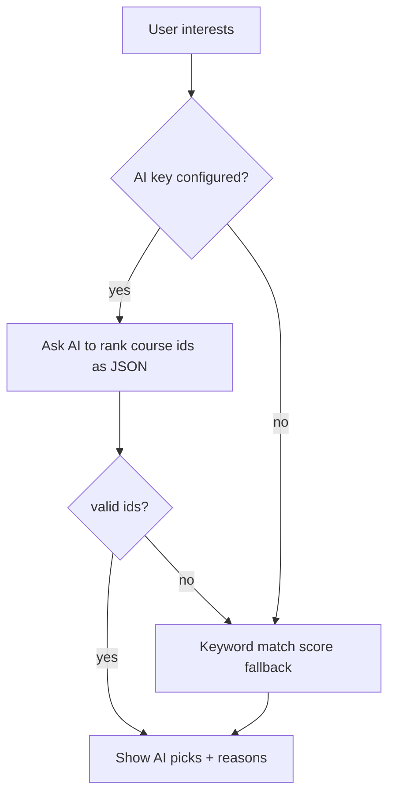

# Session 10: Node.js in Action: Cloud App with AI Recommendations

> Module: Server-side Programming with Node.js · Term 4 (HDSE) · ⏱ ~2 hours

Time to build and ship a complete application. You will create a **Course Recommender** web app with Express and EJS views, store data in **MongoDB Atlas** (cloud), generate AI-based recommendations, push the code to **GitHub** and deploy it on **Render**.

## 🎯 Learning Objectives

- Plan and create a structured Node.js web application (MVC folders, views, routes)
- Connect the application to a MongoDB Atlas cloud database
- Generate AI-based recommendations with a fallback when AI is unavailable
- Upload the application to a GitHub repository with a proper `.gitignore`
- Deploy the application on Render from GitHub with environment variables

## 📖 Concepts Explained

### 1. Application plan

| Feature | Route | View |
|---|---|---|
| list all courses | `GET /` | `index.ejs` |
| add a course | `POST /courses` | form on `index.ejs` |
| get recommendations from interests | `POST /recommend` | `recommend.ejs` |
| health check for hosting | `GET /health` | JSON |

### 2. Folder structure (MVC-style)

```text
course-recommender/
├── app.js               # app setup, routes, start
├── models/Course.js     # Mongoose model (M)
├── views/*.ejs          # templates (V)
├── services/recommend.js# business logic incl. AI
├── package.json
├── .env.example
└── .gitignore
```

### 3. MongoDB Atlas setup (summary)

1. Sign up at mongodb.com/atlas and create a free **M0** cluster.
2. **Database Access** → add a database user with a strong password.
3. **Network Access** → allow your IP (and `0.0.0.0/0` for Render's dynamic IPs, protected by the strong password).
4. **Connect → Drivers** → copy the `mongodb+srv://` string, insert the password and a database name.
5. Put it in `.env` as `MONGODB_URI`.

### 4. AI recommendations with a fallback



The app always works: if the AI call fails, a simple keyword-matching algorithm still returns results.

### 5. GitHub

```bash
git init
git add .
git commit -m "Course recommender: initial version"
git branch -M main
git remote add origin https://github.com/<you>/course-recommender.git
git push -u origin main
```

`.gitignore` must contain `node_modules/` and `.env`.

### 6. Deploying on Render

1. Sign in to render.com with GitHub → **New → Web Service** → pick the repository.
2. Runtime **Node**, Build command `npm install`, Start command `npm start`.
3. Add **Environment Variables**: `MONGODB_URI`, `OPENAI_API_KEY` (optional), `NODE_VERSION=20`.
4. Deploy. Render gives a URL like `https://course-recommender.onrender.com`. Every `git push` to `main` redeploys automatically.
5. The app must listen on `process.env.PORT`. Free instances sleep when idle, so the first request may be slow.

## 💻 Code Examples

### Example 1: Course model

📄 File: [`models/Course.js`](models/Course.js)

```js
import mongoose from "mongoose";

const courseSchema = new mongoose.Schema({
  title: { type: String, required: true, trim: true },
  level: { type: String, enum: ["beginner", "intermediate", "advanced"], default: "beginner" },
  tags: { type: [String], default: [] }, // e.g. ["react", "frontend"]
});

export default mongoose.model("Course", courseSchema);
```

**How it works**

- `tags` power both the keyword fallback and the AI prompt.

### Example 2: Recommendation service with AI and fallback

📄 File: [`services/recommend.js`](services/recommend.js)

```js
function keywordRecommend(courses, interests) {
  const words = interests.toLowerCase().split(/[\s,]+/).filter(Boolean);
  return courses
    .map((c) => ({
      course: c,
      score: c.tags.filter((t) => words.includes(t)).length,
      reason: "Matched your keywords",
    }))
    .filter((r) => r.score > 0)
    .sort((a, b) => b.score - a.score)
    .slice(0, 3);
}

async function aiRecommend(courses, interests) {
  const catalogue = courses.map((c) => ({ id: String(c._id), title: c.title, tags: c.tags }));
  const res = await fetch("https://api.openai.com/v1/chat/completions", {
    method: "POST",
    headers: { "Content-Type": "application/json", Authorization: `Bearer ${process.env.OPENAI_API_KEY}` },
    body: JSON.stringify({
      model: process.env.AI_MODEL || "gpt-4o-mini",
      response_format: { type: "json_object" },
      messages: [
        { role: "system", content: 'Recommend up to 3 courses from the catalogue. Reply JSON: {"picks":[{"id":"...","reason":"..."}]}. Use only ids from the catalogue.' },
        { role: "user", content: `Interests: ${interests.slice(0, 300)}\nCatalogue: ${JSON.stringify(catalogue)}` },
      ],
    }),
    signal: AbortSignal.timeout(15000),
  });
  if (!res.ok) throw new Error(`AI error ${res.status}`);
  const { picks } = JSON.parse((await res.json()).choices[0].message.content);
  const byId = new Map(catalogue.map((c, i) => [c.id, courses[i]]));
  const valid = (picks || []).filter((p) => byId.has(p.id)).slice(0, 3);
  if (valid.length === 0) throw new Error("AI returned no valid ids");
  return valid.map((p) => ({ course: byId.get(p.id), reason: p.reason }));
}

export async function recommend(courses, interests) {
  if (process.env.OPENAI_API_KEY) {
    try {
      return { source: "AI", results: await aiRecommend(courses, interests) };
    } catch (err) {
      console.warn("AI failed, using fallback:", err.message);
    }
  }
  return { source: "keywords", results: keywordRecommend(courses, interests) };
}
```

**How it works**

- The AI receives only course ids, titles and tags (no personal data) and must answer in JSON.
- Returned ids are checked against the real catalogue, so the AI cannot invent courses.
- Any failure falls back to keyword scoring, keeping the feature reliable.

### Example 3: Application entry point

📄 File: [`app.js`](app.js)

```js
import "dotenv/config";
import express from "express";
import mongoose from "mongoose";
import Course from "./models/Course.js";
import { recommend } from "./services/recommend.js";

const app = express();
app.set("view engine", "ejs");
app.use(express.urlencoded({ extended: false }));

app.get("/health", (req, res) => res.json({ ok: true, db: mongoose.connection.readyState === 1 }));

app.get("/", async (req, res) => {
  const courses = await Course.find().sort({ title: 1 });
  res.render("index", { courses });
});

app.post("/courses", async (req, res) => {
  const { title, level, tags } = req.body;
  if (title) {
    await Course.create({ title, level, tags: (tags || "").toLowerCase().split(",").map((t) => t.trim()).filter(Boolean) });
  }
  res.redirect("/");
});

app.post("/recommend", async (req, res) => {
  const interests = (req.body.interests || "").trim();
  const courses = await Course.find();
  const { source, results } = await recommend(courses, interests);
  res.render("recommend", { interests, source, results });
});

const PORT = process.env.PORT || 3000;
await mongoose.connect(process.env.MONGODB_URI);
console.log("Connected to MongoDB");
app.listen(PORT, () => console.log(`Running on http://localhost:${PORT}`));
```

**How it works**

- EJS renders HTML on the server (`res.render`), a classic server-side web app.
- `/health` lets Render and you check that the app and database are alive.
- `PORT` comes from the environment, which Render requires.

### Example 4: Home view

📄 File: [`views/index.ejs`](views/index.ejs)

```html
<!DOCTYPE html>
<html lang="en">
<head>
  <meta charset="UTF-8" /><meta name="viewport" content="width=device-width, initial-scale=1" />
  <title>Course Recommender</title>
  <link href="https://cdn.jsdelivr.net/npm/bootstrap@5.3.3/dist/css/bootstrap.min.css" rel="stylesheet" />
</head>
<body class="container py-4">
  <h1 class="mb-3">🎓 Course Recommender</h1>
  <form method="POST" action="/recommend" class="card card-body mb-4">
    <label class="form-label">Your interests (e.g. react, cloud, data)</label>
    <input name="interests" class="form-control mb-2" required />
    <button class="btn btn-primary">Recommend</button>
  </form>

  <h2 class="h4">Catalogue (<%= courses.length %>)</h2>
  <ul class="list-group mb-4">
    <% courses.forEach(c => { %>
      <li class="list-group-item"><%= c.title %> <span class="badge bg-secondary"><%= c.level %></span>
        <small class="text-muted"><%= c.tags.join(", ") %></small></li>
    <% }) %>
  </ul>

  <form method="POST" action="/courses" class="card card-body">
    <h3 class="h5">Add course</h3>
    <input name="title" class="form-control mb-2" placeholder="Title" required />
    <select name="level" class="form-select mb-2">
      <option>beginner</option><option>intermediate</option><option>advanced</option>
    </select>
    <input name="tags" class="form-control mb-2" placeholder="tags, comma, separated" />
    <button class="btn btn-success">Save</button>
  </form>
</body>
</html>
```

**How it works**

- `<%= %>` prints escaped values (safe against HTML injection); `<% %>` runs JavaScript such as loops.
- Bootstrap 5 from a CDN gives a clean responsive layout.

### Example 5: Recommendation view

📄 File: [`views/recommend.ejs`](views/recommend.ejs)

```html
<!DOCTYPE html>
<html lang="en">
<head>
  <meta charset="UTF-8" />
  <title>Recommendations</title>
  <link href="https://cdn.jsdelivr.net/npm/bootstrap@5.3.3/dist/css/bootstrap.min.css" rel="stylesheet" />
</head>
<body class="container py-4">
  <h1 class="h3">Recommendations for "<%= interests %>"</h1>
  <p class="text-muted">Source: <%= source %></p>
  <% if (results.length === 0) { %>
    <div class="alert alert-warning">No matching courses found. Try other keywords.</div>
  <% } %>
  <% results.forEach(r => { %>
    <div class="card mb-2"><div class="card-body">
      <h2 class="h5"><%= r.course.title %></h2>
      <p class="mb-0"><%= r.reason %></p>
    </div></div>
  <% }) %>
  <a href="/" class="btn btn-link">⬅ Back</a>
</body>
</html>
```

**How it works**

- Shows whether results came from AI or from the keyword fallback, which is useful when testing.

### ▶️ How to run

1. Install Node.js 20 LTS or newer and check with `node -v`.
2. Open a terminal in this session folder.
3. If a `package.json` is present, run `npm install` first.
4. Run a file with `node <filename>` (for example `node app.js`).
5. Create your Atlas cluster, copy `.env.example` to `.env` and fill `MONGODB_URI`. Run `npm install` then `npm run dev`.
6. Add a few courses with tags (e.g. `react, frontend`), then ask for recommendations with and without an AI key.

## 🧪 Lab Practice

1. Create a free Atlas cluster, database user and network rule; connect the app and add five courses.
2. Test recommendations with the keyword fallback (no AI key), then add a key and compare results.
3. Initialise Git, check that `.env` is NOT staged (`git status`), and push to a new GitHub repository.
4. Deploy to Render with your environment variables and open the live `/health` URL.
5. Make a small change (e.g. page title), push it, and watch Render redeploy automatically.

## 📝 Assignment

Turn the recommender into a **Book Recommender** for a library: model with title, author, genres and summary; AI recommendations with reasons and a fallback; a page listing the user's last five searches (stored in MongoDB). Deploy to Render with Atlas and submit both the GitHub URL and the live URL. Your README must include setup steps and a screenshot.

## ❓ Quick Quiz

**Q1.** Which environment variable must a Node app listen on when hosted on Render?

**Q2.** Name two entries every Node project's `.gitignore` should contain.

**Q3.** Why does the app validate AI-returned ids?

**Q4.** What is the difference between `<%= %>` and `<% %>` in EJS?

**Q5.** Why might the first request to a free Render app be slow?

<details>
<summary>Show answers</summary>

1. `PORT` (`process.env.PORT`).
2. `node_modules/` and `.env`.
3. To ensure the AI only recommends real courses and to ignore invented or malformed ids.
4. `<%= %>` outputs an escaped value; `<% %>` runs code without output.
5. Free instances sleep when idle and need to start up again.

</details>

## 💼 Interview Questions

**1. How do you manage configuration between local and production?**

> Use environment variables (.env locally, the host's settings in production) and never hard-code secrets or URLs.

**2. Why include a health-check endpoint?**

> Hosting platforms and monitors can verify the app and its dependencies (like the database) are working and restart or alert if not.

**3. What does a graceful fallback mean in AI features?**

> If the AI call fails or returns bad data, the app still delivers a reasonable result through simpler logic instead of crashing.

## ✅ Summary

- Structure apps with models, views, routes and services.
- MongoDB Atlas gives a free cloud database reachable with a `mongodb+srv` URI.
- AI recommendations need validation and a non-AI fallback.
- Push to GitHub without secrets, then deploy on Render with environment variables.
- Every push to `main` can redeploy automatically.

---

[⬅ Previous](../Session-09-MongoDB-CRUD-APIs-and-AI-Integration/README.md) · [🏠 Module Home](../README.md) · [Next ➡](../Session-11-Nodejs-in-Action-Full-Application-and-Deployment/README.md)

Prepared by Zeeshan Abbas · Aptech Learning North Nazimabad
