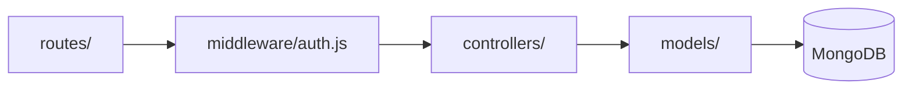

# Session 11: Node.js in Action: Full Application Development and Deployment

> Module: Server-side Programming with Node.js · Term 4 (HDSE) · ⏱ ~2 hours

In this second "in action" session you build a production-style **REST API** - a Task Manager with user accounts - using a layered structure, password hashing, JWT authentication and a local MongoDB database. You will then publish it to GitHub and deploy it on Render.

## 🎯 Learning Objectives

- Build a layered Node.js application (routes, controllers, models, middleware)
- Connect the application to a MongoDB database and model related data
- Implement registration and login with hashed passwords and JWT tokens
- Protect routes so users can only access their own data
- Upload the project to GitHub and deploy it on Render from the repository

## 📖 Concepts Explained

### 1. Layered architecture



| Layer | Responsibility |
|---|---|
| routes | map URLs and methods to controller functions |
| middleware | cross-cutting checks: authentication, errors |
| controllers | request/response logic for each feature |
| models | data shape, validation, database access |

### 2. Relationships in MongoDB

Each task stores the `_id` of its owner: `owner: { type: ObjectId, ref: "User" }`. Queries always filter by `owner: req.user.id` so users never see each other's tasks.

### 3. Authentication with JWT

| Step | What happens |
|---|---|
| Register | password is hashed with **bcrypt** and saved (never store plain text) |
| Login | bcrypt compares the password; if correct, the server signs a **JSON Web Token** |
| Requests | client sends `Authorization: Bearer <token>` |
| Middleware | verifies the token signature and expiry, sets `req.user` |

A JWT has three parts `header.payload.signature`. The payload is readable by anyone (base64), so never put secrets in it; the signature only proves it was not altered.

### 4. Security basics for APIs

- `helmet` sets secure HTTP headers; `cors` controls which websites may call the API.
- Validate input; limit body size.
- Keep `JWT_SECRET` long and random, in environment variables.
- Return generic messages on login failure ("Invalid email or password").

### 5. GitHub and Render (recap with a checklist)

| ✔ | Item |
|---|---|
| ☐ | `.gitignore` has `node_modules/` and `.env` |
| ☐ | `package.json` has `"start": "node src/server.js"` and `engines.node` |
| ☐ | app listens on `process.env.PORT` |
| ☐ | Render env vars: `MONGODB_URI` (Atlas in production), `JWT_SECRET`, `NODE_VERSION=20` |
| ☐ | README explains endpoints and setup |

Locally we use `mongodb://127.0.0.1:27017/taskmanager`; in production on Render you must use a cloud database such as Atlas because Render cannot reach your laptop.

## 💻 Code Examples

### Example 1: Models: User and Task

📄 File: [`src/models.js`](src/models.js)

```js
import mongoose from "mongoose";
import bcrypt from "bcryptjs";

const userSchema = new mongoose.Schema({
  name: { type: String, required: true, trim: true },
  email: { type: String, required: true, unique: true, lowercase: true, trim: true },
  password: { type: String, required: true, minlength: 8, select: false },
});

userSchema.pre("save", async function () {
  if (this.isModified("password")) this.password = await bcrypt.hash(this.password, 10);
});

userSchema.methods.checkPassword = function (plain) {
  return bcrypt.compare(plain, this.password);
};

const taskSchema = new mongoose.Schema(
  {
    title: { type: String, required: true, trim: true, maxlength: 120 },
    done: { type: Boolean, default: false },
    dueDate: Date,
    owner: { type: mongoose.Schema.Types.ObjectId, ref: "User", required: true, index: true },
  },
  { timestamps: true }
);

export const User = mongoose.model("User", userSchema);
export const Task = mongoose.model("Task", taskSchema);
```

**How it works**

- A `pre("save")` hook hashes the password automatically whenever it changes.
- `select: false` hides the password hash from normal queries.
- Each task references its owner's id and is indexed for fast per-user queries.

### Example 2: Auth middleware

📄 File: [`src/auth.js`](src/auth.js)

```js
import jwt from "jsonwebtoken";

export function signToken(user) {
  return jwt.sign({ id: user._id, name: user.name }, process.env.JWT_SECRET, { expiresIn: "2h" });
}

export function requireAuth(req, res, next) {
  const header = req.headers.authorization || "";
  const token = header.startsWith("Bearer ") ? header.slice(7) : null;
  if (!token) return res.status(401).json({ error: "Login required" });
  try {
    req.user = jwt.verify(token, process.env.JWT_SECRET);
    next();
  } catch {
    res.status(401).json({ error: "Invalid or expired token" });
  }
}
```

**How it works**

- `signToken` creates a token valid for 2 hours.
- `requireAuth` reads the Bearer token, verifies it and attaches the payload as `req.user`.

### Example 3: Controllers

📄 File: [`src/controllers.js`](src/controllers.js)

```js
import { User, Task } from "./models.js";
import { signToken } from "./auth.js";

export async function register(req, res) {
  const { name, email, password } = req.body;
  if (!name || !email || !password || password.length < 8) {
    return res.status(422).json({ error: "name, email and a password of 8+ characters are required" });
  }
  if (await User.exists({ email })) return res.status(409).json({ error: "Email already registered" });
  const user = await User.create({ name, email, password });
  res.status(201).json({ token: signToken(user), user: { id: user._id, name, email: user.email } });
}

export async function login(req, res) {
  const user = await User.findOne({ email: (req.body.email || "").toLowerCase() }).select("+password");
  if (!user || !(await user.checkPassword(req.body.password || ""))) {
    return res.status(401).json({ error: "Invalid email or password" });
  }
  res.json({ token: signToken(user) });
}

export async function listTasks(req, res) {
  const filter = { owner: req.user.id };
  if (req.query.done) filter.done = req.query.done === "true";
  res.json(await Task.find(filter).sort({ createdAt: -1 }));
}

export async function createTask(req, res) {
  const task = await Task.create({ title: req.body.title, dueDate: req.body.dueDate, owner: req.user.id });
  res.status(201).json(task);
}

export async function updateTask(req, res) {
  const { title, done, dueDate } = req.body;
  const task = await Task.findOneAndUpdate(
    { _id: req.params.id, owner: req.user.id },
    { title, done, dueDate },
    { new: true, runValidators: true } // Mongoose ignores undefined fields
  );
  task ? res.json(task) : res.status(404).json({ error: "Task not found" });
}

export async function deleteTask(req, res) {
  const task = await Task.findOneAndDelete({ _id: req.params.id, owner: req.user.id });
  task ? res.status(204).end() : res.status(404).json({ error: "Task not found" });
}
```

**How it works**

- Every task query includes `owner: req.user.id`, so a user can never read or change another user's tasks.
- Login uses a generic error message to avoid revealing which emails exist.
- Only whitelisted fields (`title`, `done`, `dueDate`) can be updated.

### Example 4: Server, routes and error handling

📄 File: [`src/server.js`](src/server.js)

```js
import "dotenv/config";
import express from "express";
import mongoose from "mongoose";
import helmet from "helmet";
import cors from "cors";
import { requireAuth } from "./auth.js";
import * as c from "./controllers.js";

const app = express();
app.use(helmet());
app.use(cors({ origin: process.env.CLIENT_ORIGIN || "*" }));
app.use(express.json({ limit: "10kb" }));

// wrap async controllers so errors reach the error handler (Express 4)
const wrap = (fn) => (req, res, next) => fn(req, res, next).catch(next);

app.get("/health", (req, res) => res.json({ ok: true }));
app.post("/api/auth/register", wrap(c.register));
app.post("/api/auth/login", wrap(c.login));

const tasks = express.Router();
tasks.use(requireAuth);
tasks.get("/", wrap(c.listTasks));
tasks.post("/", wrap(c.createTask));
tasks.patch("/:id", wrap(c.updateTask));
tasks.delete("/:id", wrap(c.deleteTask));
app.use("/api/tasks", tasks);

app.use((req, res) => res.status(404).json({ error: "Not found" }));
app.use((err, req, res, next) => {
  if (err.name === "ValidationError" || err.name === "CastError") return res.status(422).json({ error: err.message });
  console.error(err);
  res.status(500).json({ error: "Something went wrong" });
});

await mongoose.connect(process.env.MONGODB_URI || "mongodb://127.0.0.1:27017/taskmanager");
const PORT = process.env.PORT || 3000;
app.listen(PORT, () => console.log(`Task API on http://localhost:${PORT}`));
```

**How it works**

- `helmet` and `cors` add basic security; the body size is limited.
- The `wrap` helper forwards rejected promises to the error handler.
- All `/api/tasks` routes share the `requireAuth` middleware through a router.

### Example 5: Try it

📄 File: [`requests.http`](requests.http)

```http
### Register
POST http://localhost:3000/api/auth/register
Content-Type: application/json

{ "name": "Sara", "email": "sara@example.com", "password": "StrongPass1" }

### Login (copy the token)
POST http://localhost:3000/api/auth/login
Content-Type: application/json

{ "email": "sara@example.com", "password": "StrongPass1" }

### Create a task (replace TOKEN)
POST http://localhost:3000/api/tasks
Authorization: Bearer TOKEN
Content-Type: application/json

{ "title": "Finish Node.js assignment", "dueDate": "2026-12-01" }

### List my tasks
GET http://localhost:3000/api/tasks
Authorization: Bearer TOKEN
```

**How it works**

- Use the REST Client extension or Postman. Requests without a valid token get 401.

### ▶️ How to run

1. Install Node.js 20 LTS or newer and check with `node -v`.
2. Open a terminal in this session folder.
3. If a `package.json` is present, run `npm install` first.
4. Run a file with `node <filename>` (for example `node app.js`).
5. Start local MongoDB, copy `.env.example` to `.env`, `npm install`, `npm run dev`, then send the requests in `requests.http`.
6. To deploy: push to GitHub, create a Render Web Service (build `npm install`, start `npm start`) and set `MONGODB_URI` to an **Atlas** URI plus a strong `JWT_SECRET`.

## 🧪 Lab Practice

1. Register two users, create tasks for each, and prove that user A cannot see or delete user B's tasks.
2. Decode a JWT at a JWT debugger site and identify the header, payload and expiry; explain why the payload is not secret.
3. Add a `GET /api/me` route that returns the logged-in user's profile (without the password).
4. Add `?sort=dueDate` and `?overdue=true` filters to the task list.
5. Push to GitHub and deploy to Render using an Atlas database; test the live API with Postman.

## 📝 Assignment

Extend the Task Manager with **projects**: a `Project` model (name, colour, owner) and tasks that optionally belong to a project. Add CRUD for projects, `GET /api/projects/:id/tasks`, and a summary endpoint returning counts of done/pending tasks per project using an aggregation. Deploy to Render and include a Postman collection export in the repository.

## ❓ Quick Quiz

**Q1.** Why hash passwords with bcrypt instead of storing them?

**Q2.** Where does the client send the JWT on each request?

**Q3.** How do you ensure users only access their own tasks?

**Q4.** Why can't the deployed Render app use `mongodb://127.0.0.1`?

**Q5.** What does `helmet` do?

<details>
<summary>Show answers</summary>

1. If the database leaks, attackers cannot read the original passwords; bcrypt is slow and salted to resist cracking.
2. In the `Authorization: Bearer <token>` header.
3. Filter every query by `owner: req.user.id`.
4. That address points to the Render server itself, not your laptop; production needs a cloud DB such as Atlas.
5. Sets secure HTTP response headers.

</details>

## 💼 Interview Questions

**1. What is the difference between authentication and authorisation?**

> Authentication verifies who the user is; authorisation decides what that user is allowed to do.

**2. Where should a frontend store a JWT?**

> Options are memory or an httpOnly secure cookie; localStorage is simple but exposed to XSS. httpOnly cookies with CSRF protection are generally safer.

**3. Why separate controllers from routes?**

> It keeps routing declarative and business logic testable and reusable, and makes large codebases easier to navigate.

## ✅ Summary

- A layered structure (routes, middleware, controllers, models) scales well.
- Reference documents by id to model relationships such as task → owner.
- Hash passwords with bcrypt and authenticate with signed, expiring JWTs.
- Protect routes with middleware and filter data by the current user.
- Deploy from GitHub to Render with a cloud database and secret env vars.

---

[⬅ Previous](../Session-10-Nodejs-in-Action-Cloud-App-with-AI-Recommendations/README.md) · [🏠 Module Home](../README.md) · [Next ➡](../Session-12-Practice-Lab-Express-APIs-and-Deployment/README.md)

Prepared by Zeeshan Abbas · Aptech Learning North Nazimabad
