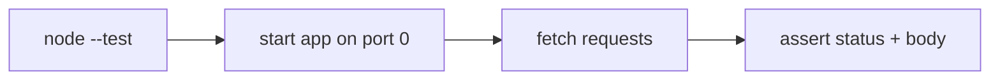

# Session 12: Practice Lab: Express, Async, APIs, MongoDB and Deployment

> Module: Server-side Programming with Node.js · Term 4 (HDSE) · ⏱ ~2 hours

The final revision lab for Sessions 6 to 11. You will build and test a small **Event Booking API** that uses Express, async/await, REST design, Mongoose, an AI helper and deployment readiness. Attempt each challenge first, then compare with the solution.

## 🎯 Learning Objectives

- Design REST endpoints for a new problem domain
- Implement CRUD with Mongoose including validation and business rules
- Handle asynchronous errors centrally
- Write automated API tests with Node's built-in test runner
- Prepare the project for GitHub and Render deployment

## 📖 Concepts Explained

### 1. Revision checklist

| Topic | You should be able to... |
|---|---|
| Express | explain middleware order, routers, error middleware |
| Async | choose between sequential and parallel awaits; avoid blocking |
| REST | pick methods, URLs and status codes for any resource |
| MongoDB | define schemas, validate, query with filters and `$inc` |
| AI | call an AI API safely and validate its output |
| Deployment | configure env vars, `.gitignore`, `PORT`, health checks |

### 2. The problem

An events team needs an API: create events with a capacity, let attendees book seats, prevent overbooking, and generate a short AI promo text.

| Method | Endpoint | Rule |
|---|---|---|
| GET | `/api/events?upcoming=true` | list, optional filter |
| POST | `/api/events` | title, date (future), capacity ≥ 1 |
| POST | `/api/events/:id/book` | 409 if full |
| DELETE | `/api/events/:id` | 204 |
| POST | `/api/events/:id/promo` | AI text, fallback template |

### 3. Preventing overbooking safely

Reading `booked`, checking it and then saving is **not safe** when two requests arrive together (race condition). Instead use a single atomic update with a condition:

```js
Event.findOneAndUpdate({ _id: id, $expr: { $lt: ["$booked", "$capacity"] } }, { $inc: { booked: 1 } }, { new: true })
```

If no document matches, the event is full.

### 4. Testing with `node:test`

Node 20 includes a test runner. Exporting the `app` (without calling `listen`) lets tests start it on a random port and use `fetch`.



## 💻 Code Examples

### Example 1: Solution: model and app

📄 File: [`app.js`](app.js)

```js
import express from "express";
import mongoose from "mongoose";

const eventSchema = new mongoose.Schema({
  title: { type: String, required: true, trim: true },
  date: {
    type: Date,
    required: true,
    validate: { validator: (d) => d > new Date(), message: "Date must be in the future" },
  },
  capacity: { type: Number, required: true, min: 1 },
  booked: { type: Number, default: 0, min: 0 },
});
export const Event = mongoose.models.Event || mongoose.model("Event", eventSchema);

export const app = express();
app.use(express.json());
const wrap = (fn) => (req, res, next) => fn(req, res, next).catch(next);

app.get("/api/events", wrap(async (req, res) => {
  const filter = req.query.upcoming === "true" ? { date: { $gte: new Date() } } : {};
  res.json(await Event.find(filter).sort({ date: 1 }));
}));

app.post("/api/events", wrap(async (req, res) => {
  res.status(201).json(await Event.create(req.body));
}));

app.post("/api/events/:id/book", wrap(async (req, res) => {
  const updated = await Event.findOneAndUpdate(
    { _id: req.params.id, $expr: { $lt: ["$booked", "$capacity"] } },
    { $inc: { booked: 1 } },
    { new: true }
  );
  if (updated) return res.json({ message: "Seat booked", seatsLeft: updated.capacity - updated.booked });
  const exists = await Event.exists({ _id: req.params.id });
  res.status(exists ? 409 : 404).json({ error: exists ? "Event is full" : "Event not found" });
}));

app.post("/api/events/:id/promo", wrap(async (req, res) => {
  const ev = await Event.findById(req.params.id);
  if (!ev) return res.status(404).json({ error: "Event not found" });
  let text = `Join us for ${ev.title} on ${ev.date.toDateString()}! Only ${ev.capacity - ev.booked} seats left.`;
  if (process.env.OPENAI_API_KEY) {
    try {
      const r = await fetch("https://api.openai.com/v1/chat/completions", {
        method: "POST",
        headers: { "Content-Type": "application/json", Authorization: `Bearer ${process.env.OPENAI_API_KEY}` },
        body: JSON.stringify({
          model: process.env.AI_MODEL || "gpt-4o-mini",
          max_tokens: 80,
          messages: [{ role: "user", content: `Write a 2-sentence promo for: ${text}` }],
        }),
        signal: AbortSignal.timeout(10000),
      });
      if (r.ok) text = (await r.json()).choices[0].message.content.trim();
    } catch { /* keep the template text */ }
  }
  res.json({ promo: text });
}));

app.delete("/api/events/:id", wrap(async (req, res) => {
  const ev = await Event.findByIdAndDelete(req.params.id);
  ev ? res.status(204).end() : res.status(404).json({ error: "Event not found" });
}));

app.use((err, req, res, next) => {
  const status = ["ValidationError", "CastError"].includes(err.name) ? 422 : 500;
  res.status(status).json({ error: err.message });
});
```

**How it works**

- The schema validator rejects past dates; `min` rules protect capacity.
- Booking uses one atomic `findOneAndUpdate` with `$expr` and `$inc`, so concurrent requests cannot overbook.
- The promo route uses AI when available and a template otherwise.
- `app` is exported without `listen`, so it can be tested.

### Example 2: Solution: server entry

📄 File: [`server.js`](server.js)

```js
import "dotenv/config";
import mongoose from "mongoose";
import { app } from "./app.js";

app.get("/health", (req, res) => res.json({ ok: true }));
await mongoose.connect(process.env.MONGODB_URI || "mongodb://127.0.0.1:27017/events");
app.listen(process.env.PORT || 3000, () => console.log("Events API running"));
```

**How it works**

- Keeping `listen` in a separate file is a common pattern that makes testing easier.

### Example 3: Solution: automated tests

📄 File: [`app.test.js`](app.test.js)

```js
// Run: node --test   (needs local MongoDB running)
import { test, before, after } from "node:test";
import assert from "node:assert/strict";
import mongoose from "mongoose";
import { app } from "./app.js";

let server, base;

before(async () => {
  await mongoose.connect("mongodb://127.0.0.1:27017/events_test");
  await mongoose.connection.dropDatabase();
  server = app.listen(0);
  base = `http://localhost:${server.address().port}`;
});

after(async () => {
  server.close();
  await mongoose.disconnect();
});

const post = (url, body) =>
  fetch(base + url, { method: "POST", headers: { "Content-Type": "application/json" }, body: JSON.stringify(body) });

test("rejects events in the past", async () => {
  const res = await post("/api/events", { title: "Old", date: "2020-01-01", capacity: 5 });
  assert.equal(res.status, 422);
});

test("prevents overbooking", async () => {
  const future = new Date(Date.now() + 86400000).toISOString();
  const ev = await (await post("/api/events", { title: "Workshop", date: future, capacity: 2 })).json();
  const results = await Promise.all([1, 2, 3].map(() => post(`/api/events/${ev._id}/book`, {})));
  const codes = results.map((r) => r.status).sort();
  assert.deepEqual(codes, [200, 200, 409]);
});
```

**How it works**

- `app.listen(0)` picks a free port; `before`/`after` set up and clean the test database.
- The second test fires three bookings **in parallel** at an event with two seats and expects exactly one 409.

### ▶️ How to run

1. Install Node.js 20 LTS or newer and check with `node -v`.
2. Open a terminal in this session folder.
3. If a `package.json` is present, run `npm install` first.
4. Run a file with `node <filename>` (for example `node app.js`).
5. Start local MongoDB, `npm install`, then `npm run dev` for the API and `npm test` for the tests.

## 🧪 Lab Practice

1. **Challenge 1:** Write the endpoint table for the Event Booking API before coding (methods, URLs, status codes).
2. **Challenge 2:** Implement the model and CRUD routes with validation and a central error handler.
3. **Challenge 3:** Implement booking with an atomic update and prove it cannot overbook.
4. **Challenge 4:** Add the AI promo endpoint with a template fallback.
5. **Challenge 5:** Write at least three `node:test` tests, push to GitHub and deploy to Render with Atlas.

## 📝 Assignment

Build a **Clinic Appointment API**: doctors (name, specialty, daily slots) and appointments (patient name, phone, doctor, date, slot). Rules: no double-booking of a doctor's slot (use a unique compound index), no appointments in the past, cancel via DELETE. Add an AI endpoint that turns a patient's symptom text into a suggested specialty (with a clear disclaimer and no personal data sent). Include tests and deploy it.

## ❓ Quick Quiz

**Q1.** Why is 'read, check, then save' unsafe for seat booking?

**Q2.** Which MongoDB operator increments a number atomically?

**Q3.** Why export `app` separately from `listen`?

**Q4.** What status code fits 'event is full'?

**Q5.** How do you run tests with Node's built-in runner?

<details>
<summary>Show answers</summary>

1. Two requests can read the same value at the same time and both save, causing overbooking (race condition).
2. `$inc`
3. So tests can start the app on a random port without running the production server.
4. 409 Conflict.
5. `node --test`

</details>

## 💼 Interview Questions

**1. How would you guarantee unique bookings in MongoDB?**

> Use atomic conditional updates or a unique (compound) index so the database rejects duplicates even under concurrency.

**2. What is the benefit of a central error handler?**

> Consistent error responses, less duplicated code and one place for logging.

**3. What would you monitor after deploying an API?**

> Uptime/health checks, error rates, response times, logs, database performance and external API (AI) failures or costs.

## ✅ Summary

- Design endpoints and rules before writing code.
- Use atomic database operations to avoid race conditions.
- Async errors should flow to one error handler.
- Node's built-in test runner plus `fetch` can test APIs end to end.
- Deployment readiness: env vars, `.gitignore`, `PORT`, health check, README.

---

[⬅ Previous](../Session-11-Nodejs-in-Action-Full-Application-and-Deployment/README.md) · [🏠 Module Home](../README.md) · [Next ➡](../README.md)

Prepared by Zeeshan Abbas · Aptech Learning North Nazimabad
