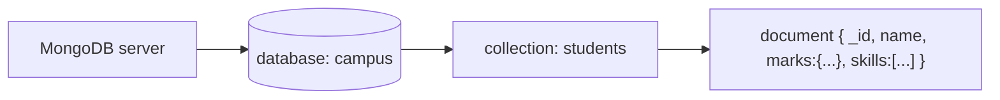

# Session 01: Introduction to MongoDB and Working with Databases

> Module: Managing Large Datasets with MongoDB · Term 4 (HDSE) · ⏱ ~2 hours

MongoDB is a document database that stores data as flexible JSON-like documents. In this session you install it, load data and perform your first create, read, update and delete operations.

## 🎯 Learning Objectives

- Explain the main types of databases and where MongoDB fits
- Describe how MongoDB stores data as BSON documents in collections
- Install MongoDB Server, mongosh and MongoDB Database Tools and set the PATH
- Load a sample dataset and use MongoDB data types
- Create databases and collections and insert, query, update and delete documents

## 📖 Concepts Explained

### 1. Types of databases

| Type | Data model | Examples | Good for |
|---|---|---|---|
| Relational (SQL) | tables, rows, fixed schema | MySQL, SQL Server | transactions, strict structure |
| Document | JSON-like documents | **MongoDB**, Cosmos DB | flexible, evolving data, web apps |
| Key-value | key → value | Redis | caching, sessions |
| Column-family | wide columns | Cassandra | huge write volumes |
| Graph | nodes and edges | Neo4j | relationships, recommendations |

### 2. How MongoDB stores data



- Documents are stored in **BSON** (binary JSON) which adds types such as `Date`, `ObjectId`, `Decimal128`.
- Every document has a unique `_id` (auto-generated `ObjectId` if you do not provide one).
- Documents in the same collection can have different fields (**flexible schema**), and can embed objects and arrays.
- Maximum document size: 16 MB.

| SQL | MongoDB |
|---|---|
| database | database |
| table | collection |
| row | document |
| column | field |
| JOIN | embedding or `$lookup` |

### 3. Installation

1. **MongoDB Community Server** (runs as a Windows service on port 27017).
2. **mongosh** - the MongoDB Shell, a JavaScript REPL.
3. **MongoDB Database Tools** - `mongoimport`, `mongoexport`, `mongodump`, `mongorestore`. Add their `bin` folder to the **PATH** environment variable (Windows: *System Properties → Environment Variables → Path → New*), then test `mongoimport --version`.

### 4. Common data types

| Type | Example |
|---|---|
| String | `"Karachi"` |
| Int32 / Int64 / Double | `NumberInt(5)`, `NumberLong(5)`, `3.14` |
| Decimal128 | `NumberDecimal("199.99")` (money) |
| Boolean | `true` |
| Date | `new Date()` / `ISODate("2026-01-01")` |
| ObjectId | `ObjectId()` |
| Array / Object | `["a","b"]`, `{ city: "Lahore" }` |
| Null | `null` |

### 5. Basic shell operations

| Task | Command |
|---|---|
| list / switch database | `show dbs`, `use campus` (created on first insert) |
| create collection | `db.createCollection("courses")` or just insert |
| insert | `insertOne({...})`, `insertMany([...])` |
| query | `find(filter, projection)`, `findOne()` |
| update | `updateOne(filter, { $set: {...} })`, `updateMany`, `replaceOne` |
| delete | `deleteOne(filter)`, `deleteMany(filter)` |
| drop | `db.courses.drop()`, `db.dropDatabase()` |

Load a sample dataset with: `mongoimport --db campus --collection courses --file courses.json --jsonArray`

## 💻 Code Examples

### Example 1: Seed data for the whole module

📄 File: [`seed.js`](seed.js)

```js
// Seed data used across this module. Run: mongosh --file seed.js
db = db.getSiblingDB("campus");
db.students.drop();
db.students.insertMany([
  { name: "Ali Raza",   city: "Karachi",   age: 21, batch: "T4-A", marks: { react: 82, node: 74, mongo: 90 }, skills: ["react", "node"], fee: 45000, active: true },
  { name: "Hira Khan",  city: "Lahore",    age: 23, batch: "T4-A", marks: { react: 65, node: 88, mongo: 70 }, skills: ["node", "mongo", "azure"], fee: 45000, active: true },
  { name: "Usman Ali",  city: "Karachi",   age: 20, batch: "T4-B", marks: { react: 45, node: 52, mongo: 38 }, skills: ["react"], fee: 40000, active: false },
  { name: "Sana Malik", city: "Islamabad", age: 22, batch: "T4-B", marks: { react: 91, node: 79, mongo: 85 }, skills: ["react", "mongo"], fee: 40000, active: true },
  { name: "Bilal Ahmed",city: "Karachi",   age: 24, batch: "T4-A", marks: { react: 58, node: 61, mongo: 77 }, skills: ["azure", "node"], fee: 45000, active: true }
]);
print(`Inserted ${db.students.countDocuments()} students into campus.students`);
```

**How it works**

- `getSiblingDB("campus")` selects (and lazily creates) the database.
- `insertMany` adds five documents with embedded objects (`marks`) and arrays (`skills`).
- You will reuse this script in later sessions.

### Example 2: CRUD basics

📄 File: [`crud-basics.js`](crud-basics.js)

```js
// Run: mongosh --file crud-basics.js  (after seed.js)
db = db.getSiblingDB("campus");

// CREATE
const res = db.students.insertOne({ name: "Ayesha Noor", city: "Karachi", age: 19, batch: "T4-B",
  marks: { react: 70, node: 66, mongo: 81 }, skills: ["react"], fee: 40000, active: true, joined: new Date() });
print("New id:", res.insertedId);

// READ
printjson(db.students.find({ city: "Karachi" }, { name: 1, age: 1, _id: 0 }).toArray());
printjson(db.students.findOne({ name: "Hira Khan" }));
print("Active students:", db.students.countDocuments({ active: true }));

// UPDATE
db.students.updateOne({ name: "Usman Ali" }, { $set: { active: true, city: "Hyderabad" } });
db.students.updateMany({ batch: "T4-B" }, { $set: { room: "Lab 3" } });

// DELETE
db.students.deleteOne({ name: "Ayesha Noor" });
print("Remaining:", db.students.countDocuments());
```

**How it works**

- `find(filter, projection)`: the projection `{ name: 1, age: 1, _id: 0 }` returns only those fields.
- `$set` changes the listed fields and leaves the rest untouched.
- `updateMany` and `deleteMany` affect every matching document, so test the filter with `find` first.

### Example 3: Sample dataset for mongoimport

📄 File: [`courses.json`](courses.json)

```json
[
  { "code": "REACT", "title": "Frontend Web Development with React", "sessions": 12 },
  { "code": "NODE", "title": "Server-side Programming with Node.js", "sessions": 12 },
  { "code": "MONGO", "title": "Managing Large Datasets with MongoDB", "sessions": 16 },
  { "code": "AZURE", "title": "Developing Microsoft Azure Applications", "sessions": 12 }
]
```

**How it works**

- Import with `mongoimport --db campus --collection courses --file courses.json --jsonArray`.

### ▶️ How to run

1. Install MongoDB Community Server 8 and `mongosh` (or use a free Atlas cluster).
2. Open a terminal in this folder and run a script with `mongosh --file <script>.js` (add your connection string before `--file` for Atlas).
3. Python files need Python 3.12 and `pip install pymongo`; run with `python <file>.py`.

## 🧪 Lab Practice

1. Install MongoDB Server, mongosh and Database Tools; confirm `mongosh --version` and `mongoimport --version` work.
2. Run `seed.js`, then use `show dbs`, `use campus`, `show collections` and `db.students.find()`.
3. Import `courses.json` with mongoimport and list all courses with more than 12 sessions.
4. Insert yourself as a student with every data type from the table (Date, Decimal128 fee, array, embedded object).
5. Update all Karachi students to add `province: "Sindh"`, then delete inactive students.

## 📝 Assignment

Create a `library` database with a `books` collection of 10 documents (title, author, year, price as Decimal128, genres array, available). Write a script that inserts them, lists books after 2015, marks two books unavailable, increases all prices by setting new values, and deletes one book. Submit the script and its output.

## ❓ Quick Quiz

**Q1.** What format does MongoDB use to store documents internally?

**Q2.** What is the MongoDB equivalent of a SQL table?

**Q3.** Which field must every document have?

**Q4.** Which tool imports a JSON file into a collection?

**Q5.** What does `$set` do in an update?

<details>
<summary>Show answers</summary>

1. BSON (binary JSON).
2. A collection.
3. `_id`
4. `mongoimport` (MongoDB Database Tools).
5. Sets/changes only the specified fields, keeping the rest of the document.

</details>

## 💼 Interview Questions

**1. When would you choose MongoDB over a relational database?**

> When data is hierarchical or evolves often, needs flexible schema, horizontal scaling and fast development with JSON APIs.

**2. What is an ObjectId made of?**

> A 12-byte value: a 4-byte timestamp, a 5-byte random value and a 3-byte counter, so it is unique and roughly time-ordered.

**3. Embedding vs referencing?**

> Embed data that is read together and bounded in size; reference (store ids) when data is shared, large or grows without limit.

## ✅ Summary

- MongoDB is a document database storing BSON documents in collections.
- Install Server, mongosh and Database Tools, and add tools to PATH.
- Use rich types like Date, ObjectId, Decimal128, arrays and embedded objects.
- CRUD: insertOne/Many, find/findOne, updateOne/Many with `$set`, deleteOne/Many.

---

[⬅ Previous](../README.md) · [🏠 Module Home](../README.md) · [Next ➡](../Session-02-Practice-Lab-MongoDB-Basics/README.md)

Prepared by Zeeshan Abbas · Aptech Learning North Nazimabad
