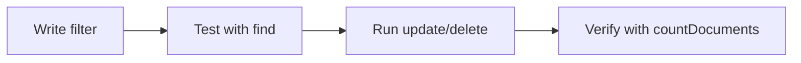

# Session 02: Practice Lab: MongoDB Basics

> Module: Managing Large Datasets with MongoDB · Term 4 (HDSE) · ⏱ ~2 hours

Hands-on practice session for Session 1. Try every task yourself first, then compare with the solution script in this folder.

## 🎯 Learning Objectives

- Create databases and collections confidently
- Write filters and projections
- Update and delete safely
- Use mongoimport and mongoexport

## 📖 Concepts Explained

### Tasks

| # | Task | Hint |
|---|---|---|
| 1 | Create database `shop` and collection `products` with 8 products | `insertMany` |
| 2 | Show only `name` and `price` of products under Rs. 5,000 | projection |
| 3 | Find products in category `"mobile"` that are in stock | two conditions in one filter |
| 4 | Rename field `qty` to `stock` in all documents | `$rename` |
| 5 | Delete products with `stock: 0` | `deleteMany` |
| 6 | Export the collection to `products-export.json` | `mongoexport` |

### Safe-update habit



## 💻 Code Examples

### Example 1: Solution script

📄 File: [`solution.js`](solution.js)

```js
db = db.getSiblingDB("shop");
db.products.drop();
db.products.insertMany([
  { name: "Galaxy A15", category: "mobile", price: 42000, qty: 12, inStock: true },
  { name: "Redmi 13C", category: "mobile", price: 31000, qty: 0, inStock: false },
  { name: "USB Cable", category: "accessory", price: 650, qty: 200, inStock: true },
  { name: "Power Bank", category: "accessory", price: 4200, qty: 35, inStock: true },
  { name: "ThinkPad E14", category: "laptop", price: 215000, qty: 4, inStock: true },
  { name: "Earbuds", category: "accessory", price: 3500, qty: 0, inStock: false },
  { name: "iPhone 15", category: "mobile", price: 289000, qty: 3, inStock: true },
  { name: "Mouse", category: "accessory", price: 1200, qty: 60, inStock: true }
]);
print("Task 2:"); printjson(db.products.find({ price: { $lt: 5000 } }, { _id: 0, name: 1, price: 1 }).toArray());
print("Task 3:"); printjson(db.products.find({ category: "mobile", inStock: true }, { _id: 0, name: 1 }).toArray());
db.products.updateMany({}, { $rename: { qty: "stock" } });
const r = db.products.deleteMany({ stock: 0 });
print("Task 5 deleted:", r.deletedCount, "remaining:", db.products.countDocuments());
// Task 6 (run in a normal terminal, not mongosh):
// mongoexport --db shop --collection products --out products-export.json --jsonArray
```

**How it works**

- Two fields in one filter object are combined with AND.
- `$rename` changes a field name across all documents.
- `deletedCount` confirms how many documents were removed.

### ▶️ How to run

1. Install MongoDB Community Server 8 and `mongosh` (or use a free Atlas cluster).
2. Open a terminal in this folder and run a script with `mongosh --file <script>.js` (add your connection string before `--file` for Atlas).
3. Python files need Python 3.12 and `pip install pymongo`; run with `python <file>.py`.

## 🧪 Lab Practice

1. Complete tasks 1-6 without looking at the solution.
2. Export, drop and re-import the collection to prove your backup works.
3. Write three queries of your own and explain them to a classmate.

## 📝 Assignment

Create a `hospital` database with `doctors` (6) and `patients` (10) collections. Write and run queries to list doctors by specialty, patients older than 60, rename one field in all patients, and export both collections to JSON files.

## ❓ Quick Quiz

**Q1.** How do you AND two conditions?

**Q2.** Which operator renames a field?

**Q3.** How do you return only some fields?

**Q4.** Which command backs up a collection to JSON?

**Q5.** What should you do before `deleteMany`?

<details>
<summary>Show answers</summary>

1. Put both fields in the same filter object.
2. `$rename`
3. Pass a projection as the second argument to `find`.
4. `mongoexport`
5. Run `find` with the same filter to check what will be deleted.

</details>

## 💼 Interview Questions

**1. What is the difference between mongoexport and mongodump?**

> mongoexport writes JSON/CSV (human-readable, may lose some type info); mongodump writes BSON for exact backups restored with mongorestore.

**2. Does `use shop` create a database?**

> Only when data is first written to it.

**3. How do you count matching documents efficiently?**

> `countDocuments(filter)`, or `estimatedDocumentCount()` for a fast whole-collection estimate.

## ✅ Summary

- Practise the find → modify → verify cycle.
- Projections reduce data transferred.
- mongoimport/mongoexport move JSON in and out.

---

[⬅ Previous](../Session-01-Introduction-to-MongoDB-and-Working-with-Databases/README.md) · [🏠 Module Home](../README.md) · [Next ➡](../Session-03-MongoDB-Operators-and-Aggregation-Pipeline/README.md)

Prepared by Zeeshan Abbas · Aptech Learning North Nazimabad
