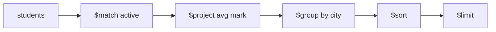

# Session 03: MongoDB Operators and the Aggregation Pipeline

> Module: Managing Large Datasets with MongoDB · Term 4 (HDSE) · ⏱ ~2 hours

Operators make queries powerful: comparisons, logic, arrays and updates. The aggregation pipeline then turns raw documents into reports, like GROUP BY in SQL but more flexible.

## 🎯 Learning Objectives

- Describe the types of MongoDB operators
- Use query and projection operators to filter and shape results
- Modify fields and arrays with update operators
- Explain the aggregation pipeline and its main stages
- Use expressions such as `$sum`, `$avg`, `$cond` and `$concat` in pipelines

## 📖 Concepts Explained

### 1. Operator families

| Family | Operators |
|---|---|
| Comparison | `$eq $ne $gt $gte $lt $lte $in $nin` |
| Logical | `$and $or $not $nor` |
| Element | `$exists $type` |
| Evaluation | `$regex $expr $mod` |
| Array (query) | `$all $size $elemMatch` |
| Projection | `$slice $elemMatch`, `$` (first match) |
| Update (field) | `$set $unset $inc $mul $rename $min $max $currentDate` |
| Update (array) | `$push $addToSet $pull $pop $each`, `$[]` |

### 2. Aggregation pipeline

Documents flow through stages; each stage transforms them.



| Stage | Purpose | SQL idea |
|---|---|---|
| `$match` | filter | WHERE |
| `$project` / `$addFields` | reshape, compute fields | SELECT expressions |
| `$group` | group and accumulate | GROUP BY |
| `$sort`, `$limit`, `$skip` | order and page | ORDER BY, LIMIT |
| `$unwind` | one document per array element | - |
| `$lookup` | join another collection | LEFT JOIN |
| `$count`, `$facet`, `$bucket` | counts, multiple reports, ranges | - |
| `$out` / `$merge` | save results | INSERT INTO |

**Expressions:** arithmetic (`$add $multiply $divide $round`), string (`$concat $toUpper $substr`), conditional (`$cond $switch $ifNull`), date (`$year $dateToString`), accumulators (`$sum $avg $min $max $push $addToSet`). Field values are referenced with `"$fieldName"`.

**Tip:** put `$match` as early as possible so fewer documents flow through (and indexes can be used).

## 💻 Code Examples

### Example 1: Query, projection and update operators

📄 File: [`operators.js`](operators.js)

```js
// Run seed.js from Session 1 first
db = db.getSiblingDB("campus");

// Comparison + logical
printjson(db.students.find({ $or: [{ city: "Lahore" }, { age: { $gte: 23 } }] }, { _id: 0, name: 1, city: 1, age: 1 }).toArray());
// $in and nested field
printjson(db.students.find({ city: { $in: ["Karachi", "Islamabad"] }, "marks.mongo": { $gt: 80 } }, { _id: 0, name: 1 }).toArray());
// Array operators
printjson(db.students.find({ skills: { $all: ["react", "node"] } }, { _id: 0, name: 1 }).toArray());
printjson(db.students.find({ skills: { $size: 3 } }, { _id: 0, name: 1 }).toArray());
// Regex + $expr (compare two fields)
printjson(db.students.find({ name: { $regex: /^S/ } }, { _id: 0, name: 1 }).toArray());
printjson(db.students.find({ $expr: { $gt: ["$marks.node", "$marks.react"] } }, { _id: 0, name: 1 }).toArray());

// Update operators
db.students.updateOne({ name: "Ali Raza" }, { $inc: { "marks.react": 5 }, $push: { skills: "azure" } });
db.students.updateMany({}, { $addToSet: { skills: "git" } });          // no duplicates
db.students.updateOne({ name: "Hira Khan" }, { $pull: { skills: "azure" } });
db.students.updateMany({ active: false }, { $unset: { fee: "" }, $currentDate: { updatedAt: true } });
db.students.updateMany({ batch: "T4-B" }, { $mul: { fee: 0.9 } });      // 10% discount
printjson(db.students.find({}, { _id: 0, name: 1, skills: 1, fee: 1 }).toArray());
```

**How it works**

- `$or`, `$in`, dotted paths (`"marks.mongo"`) and array operators filter precisely.
- `$expr` lets you compare two fields of the same document.
- `$inc`, `$push`, `$addToSet`, `$pull`, `$unset`, `$mul` modify values without replacing the document.

### Example 2: Aggregation reports

📄 File: [`aggregation.js`](aggregation.js)

```js
db = db.getSiblingDB("campus");

print("Average marks per city (active students):");
printjson(db.students.aggregate([
  { $match: { active: true } },
  { $addFields: { avg: { $avg: ["$marks.react", "$marks.node", "$marks.mongo"] } } },
  { $group: { _id: "$city", students: { $sum: 1 }, avgMark: { $avg: "$avg" }, names: { $push: "$name" } } },
  { $project: { _id: 0, city: "$_id", students: 1, avgMark: { $round: ["$avgMark", 1] }, names: 1 } },
  { $sort: { avgMark: -1 } }
]).toArray());

print("Grade per student:");
printjson(db.students.aggregate([
  { $project: {
      _id: 0,
      label: { $concat: [{ $toUpper: "$name" }, " (", "$batch", ")"] },
      mongo: "$marks.mongo",
      grade: { $switch: { branches: [
        { case: { $gte: ["$marks.mongo", 75] }, then: "Distinction" },
        { case: { $gte: ["$marks.mongo", 60] }, then: "Credit" },
        { case: { $gte: ["$marks.mongo", 40] }, then: "Pass" } ], default: "Referred" } } } }
]).toArray());

print("Most common skills:");
printjson(db.students.aggregate([
  { $unwind: "$skills" },
  { $group: { _id: "$skills", count: { $sum: 1 } } },
  { $sort: { count: -1 } },
  { $limit: 3 }
]).toArray());
```

**How it works**

- Report 1: `$match` → compute an average with `$addFields` → `$group` by city → tidy with `$project` → `$sort`.
- Report 2: `$concat`, `$toUpper` and `$switch` build labels and grades.
- Report 3: `$unwind` splits arrays so skills can be counted.

### ▶️ How to run

1. Install MongoDB Community Server 8 and `mongosh` (or use a free Atlas cluster).
2. Open a terminal in this folder and run a script with `mongosh --file <script>.js` (add your connection string before `--file` for Atlas).
3. Python files need Python 3.12 and `pip install pymongo`; run with `python <file>.py`.

## 🧪 Lab Practice

1. Find students aged 21-23 from Karachi using `$gte`/`$lte`.
2. Find students who have a `fee` field (`$exists`) and whose name contains "Ali" (case-insensitive regex).
3. Give every student in T4-A 3 bonus marks in Node using `$inc`.
4. Write a pipeline that shows the total fee collected per batch.
5. Use `$lookup` to join `students` with a new `batches` collection (`{ code, teacher }`) on `batch`.

## 📝 Assignment

Using the `shop` database from the practice lab, write an aggregation report that shows, per category: number of products, total stock value (price × stock), cheapest and most expensive product. Save the result into a `category_report` collection with `$out`.

## ❓ Quick Quiz

**Q1.** Which operator matches any value in a list?

**Q2.** How do you add a value to an array only if it is not already there?

**Q3.** What does `$unwind` do?

**Q4.** Which stage is like SQL GROUP BY?

**Q5.** Why place `$match` early in a pipeline?

<details>
<summary>Show answers</summary>

1. `$in`
2. `$addToSet`
3. Outputs one document per element of an array field.
4. `$group`
5. It reduces the documents processed by later stages and can use indexes.

</details>

## 💼 Interview Questions

**1. Difference between `$push` and `$addToSet`?**

> `$push` always appends; `$addToSet` appends only if the value is not present.

**2. How do you join collections in MongoDB?**

> With the `$lookup` aggregation stage, or by designing documents to embed related data.

**3. What is `$facet` used for?**

> Running several sub-pipelines on the same input in one query, e.g. results plus counts for a search page.

## ✅ Summary

- Query operators filter by comparison, logic, element type, regex and arrays.
- Update operators change fields and arrays in place.
- Aggregation pipelines chain stages like `$match`, `$group`, `$project`, `$sort`.
- Expressions compute new values inside pipelines.

---

[⬅ Previous](../Session-02-Practice-Lab-MongoDB-Basics/README.md) · [🏠 Module Home](../README.md) · [Next ➡](../Session-04-Practice-Lab-Queries-and-Aggregation/README.md)

Prepared by Zeeshan Abbas · Aptech Learning North Nazimabad
