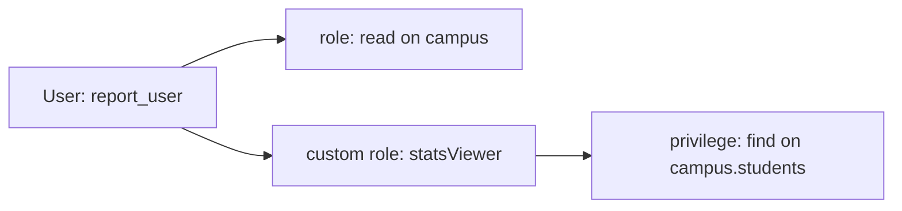

# Session 05: Database Commands and MongoDB Shell Methods

> Module: Managing Large Datasets with MongoDB · Term 4 (HDSE) · ⏱ ~2 hours

Beyond CRUD, administrators use database commands and shell helper methods to inspect servers, manage collections and control who can access what.

## 🎯 Learning Objectives

- Explain the importance of database commands in MongoDB
- Run common diagnostic and administrative commands with `db.runCommand()`
- Use collection and database methods in mongosh
- Create custom roles and manage privileges with role management methods
- Create, update and remove users with user management methods

## 📖 Concepts Explained

### 1. Database commands

Every shell helper is really a **command** sent to the server. `db.runCommand({ ... })` sends any command directly; `db.adminCommand()` sends it to the `admin` database.

| Category | Examples |
|---|---|
| Diagnostic | `ping`, `serverStatus`, `dbStats`, `collStats` (`$collStats`), `buildInfo`, `currentOp` |
| Administration | `create`, `drop`, `renameCollection`, `compact`, `killOp` |
| CRUD as commands | `insert`, `find`, `update`, `delete`, `count`, `distinct` |
| Users and roles | `createUser`, `grantRolesToUser`, `createRole` |
| Replication | `hello`, `replSetGetStatus` |

### 2. Shell methods

| Collection methods | Database methods |
|---|---|
| `db.c.find/insertOne/updateMany/...` | `db.getName()`, `db.getCollectionNames()` |
| `db.c.countDocuments()`, `distinct()` | `db.createCollection(name, options)` |
| `db.c.createIndex()`, `getIndexes()` | `db.stats()`, `db.dropDatabase()` |
| `db.c.renameCollection()`, `drop()` | `db.getSiblingDB(name)`, `db.version()` |
| `db.c.bulkWrite([...])` | `db.currentOp()`, `db.serverStatus()` |

Collections can be created with options such as **capped** size (fixed-size, oldest documents removed - useful for logs) or a **JSON Schema validator**.

### 3. Security: users and roles

MongoDB uses **Role-Based Access Control (RBAC)**. A user gets roles; a role is a set of privileges (actions on resources).



| Built-in role | Allows |
|---|---|
| `read` / `readWrite` | read / read and write a database |
| `dbAdmin` | schema, indexes, stats |
| `userAdmin` | manage users and roles of a database |
| `clusterAdmin` | manage the cluster |
| `root` | everything |

Role methods: `db.createRole`, `db.grantPrivilegesToRole`, `db.grantRolesToRole`, `db.getRoles`, `db.dropRole`.
User methods: `db.createUser`, `db.getUsers`, `db.updateUser`, `db.changeUserPassword`, `db.grantRolesToUser`, `db.revokeRolesFromUser`, `db.dropUser`.

Users only take effect when **authorisation is enabled** (`security.authorization: enabled` in `mongod.cfg`), which is always on in Atlas.

## 💻 Code Examples

### Example 1: Commands and helper methods

📄 File: [`commands.js`](commands.js)

```js
db = db.getSiblingDB("campus");

printjson(db.runCommand({ ping: 1 }));
printjson(db.runCommand({ dbStats: 1, scale: 1024 }));           // sizes in KB
print("Server version:", db.version());
print("Collections:", db.getCollectionNames().join(", "));
printjson(db.runCommand({ distinct: "students", key: "city" }));
printjson(db.runCommand({ count: "students", query: { active: true } }));

// capped collection for logs (max 1 MB or 1000 docs)
db.logs.drop();
db.createCollection("logs", { capped: true, size: 1024 * 1024, max: 1000 });
db.logs.insertOne({ level: "info", msg: "Server started", at: new Date() });

// collection with schema validation
db.feedback.drop();
db.createCollection("feedback", {
  validator: { $jsonSchema: {
    bsonType: "object", required: ["student", "rating"],
    properties: { student: { bsonType: "string" }, rating: { bsonType: "int", minimum: 1, maximum: 5 } } } }
});
db.feedback.insertOne({ student: "Ali", rating: NumberInt(5) });
try { db.feedback.insertOne({ student: "Sana", rating: NumberInt(9) }); }
catch (e) { print("Rejected by validator:", e.message); }

// bulkWrite: several operations in one round trip
printjson(db.students.bulkWrite([
  { updateOne: { filter: { name: "Ali Raza" }, update: { $set: { mentor: true } } } },
  { deleteMany: { filter: { active: false } } }
]));
```

**How it works**

- `runCommand` sends raw commands such as `ping`, `dbStats`, `distinct` and `count`.
- A capped collection keeps only the newest data within its size limit.
- `$jsonSchema` validation rejects documents that break the rules.
- `bulkWrite` batches operations to reduce network round trips.

### Example 2: Roles and users

📄 File: [`users-roles.js`](users-roles.js)

```js
// Run as an admin user. On a local server, enable authorization afterwards to enforce these users.
const campus = db.getSiblingDB("campus");

campus.createRole({
  role: "studentViewer",
  privileges: [{ resource: { db: "campus", collection: "students" }, actions: ["find"] }],
  roles: []
});

campus.createUser({ user: "report_user", pwd: passwordPrompt(), roles: ["studentViewer"] });
campus.createUser({ user: "app_user", pwd: passwordPrompt(), roles: [{ role: "readWrite", db: "campus" }] });

campus.grantRolesToUser("report_user", [{ role: "read", db: "campus" }]);
printjson(campus.getUsers());
printjson(campus.getRole("studentViewer", { showPrivileges: true }));

campus.revokeRolesFromUser("report_user", [{ role: "read", db: "campus" }]);
// campus.changeUserPassword("app_user", passwordPrompt());
// campus.dropUser("report_user"); campus.dropRole("studentViewer");
```

**How it works**

- The custom role allows only `find` on one collection (least privilege).
- `passwordPrompt()` asks for the password instead of writing it in the script.
- Grant and revoke methods change permissions without recreating users.
- Connect as the new user with `mongosh "mongodb://report_user@localhost/campus"` to test.

### ▶️ How to run

1. Install MongoDB Community Server 8 and `mongosh` (or use a free Atlas cluster).
2. Open a terminal in this folder and run a script with `mongosh --file <script>.js` (add your connection string before `--file` for Atlas).
3. Python files need Python 3.12 and `pip install pymongo`; run with `python <file>.py`.

## 🧪 Lab Practice

1. Run `serverStatus` and find the uptime and current connections.
2. Create a capped collection of max 5 documents, insert 8 and observe which remain.
3. Add a schema validator to a `courses` collection requiring `code` (string) and `sessions` (int ≥ 1).
4. Create a read-only user for `campus`, log in as that user and confirm inserts fail.
5. Use `bulkWrite` to insert 2 students, update 1 and delete 1 in one call.

## 📝 Assignment

Write an `admin-setup.js` script for a school database: create roles `teacher` (read/write on `marks`, read on `students`) and `auditor` (read on all collections), create one user for each, a validated `marks` collection, and print a summary using `getUsers()` and `dbStats`.

## ❓ Quick Quiz

**Q1.** Which method sends any command to the server?

**Q2.** What is a capped collection?

**Q3.** What does RBAC stand for?

**Q4.** Which built-in role allows reading and writing a database?

**Q5.** Why use `passwordPrompt()`?

<details>
<summary>Show answers</summary>

1. `db.runCommand()`
2. A fixed-size collection that automatically removes the oldest documents when full.
3. Role-Based Access Control.
4. `readWrite`
5. To avoid writing passwords in scripts or shell history.

</details>

## 💼 Interview Questions

**1. What is the principle of least privilege?**

> Give each user/app only the permissions it needs, reducing damage if credentials leak.

**2. How do you enforce structure in a schemaless database?**

> JSON Schema validators on collections, plus application-level validation (e.g. Mongoose).

**3. How do you find and stop a slow running operation?**

> Use `db.currentOp()` to find it and `db.killOp(opid)` to stop it.

## ✅ Summary

- Helpers wrap database commands; `runCommand` reaches all of them.
- Collection and database methods manage data, indexes and stats.
- Capped collections and schema validators control storage and structure.
- RBAC with custom roles and users secures your data.

---

[⬅ Previous](../Session-04-Practice-Lab-Queries-and-Aggregation/README.md) · [🏠 Module Home](../README.md) · [Next ➡](../Session-06-Practice-Lab-Commands-Users-and-Roles/README.md)

Prepared by Zeeshan Abbas · Aptech Learning North Nazimabad
