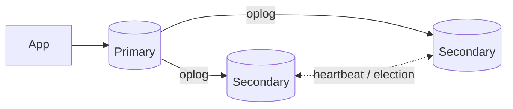

# Session 07: MongoDB Indexing, Replication and Sharding

> Module: Managing Large Datasets with MongoDB · Term 4 (HDSE) · ⏱ ~2 hours

Large datasets need speed, safety and scale. Indexes make queries fast, replication keeps copies for high availability, and sharding spreads data across machines.

## 🎯 Learning Objectives

- Explain indexes and list their advantages and costs
- Describe index types: single, compound, multikey, text, unique, TTL, partial
- Create, inspect and drop indexes and read `explain()` output
- Explain replication with replica sets and how failover works
- Explain sharding, shard keys and the components of a sharded cluster

## 📖 Concepts Explained

### 1. Indexes

Without an index MongoDB scans every document (**COLLSCAN**). An index is a sorted structure (B-tree) of field values pointing to documents (**IXSCAN**), like the index at the back of a book.

| Type | Example | Use |
|---|---|---|
| Single field | `{ city: 1 }` | filter/sort on one field |
| Compound | `{ batch: 1, age: -1 }` | multi-field filters; follows the **ESR** rule (Equality, Sort, Range) |
| Multikey | `{ skills: 1 }` | array fields (automatic) |
| Text | `{ bio: "text" }` | keyword search |
| Unique | `{ email: 1 }, { unique: true }` | prevent duplicates |
| TTL | `{ createdAt: 1 }, { expireAfterSeconds: 3600 }` | auto-delete old data (sessions, OTPs) |
| Partial | `{ partialFilterExpression: { active: true } }` | index only some documents |
| Hashed / 2dsphere | `{ userId: "hashed" }`, `{ location: "2dsphere" }` | sharding / geo queries |

**Advantages:** much faster reads and sorts, uniqueness enforcement. **Costs:** extra storage and RAM, slower writes. Index what your queries use - not everything.

### 2. Replication

A **replica set** is a group of `mongod` servers holding the same data: one **primary** (accepts writes) and **secondaries** (copy the primary's operation log, the *oplog*).



If the primary fails, the secondaries **elect** a new primary automatically (usually within seconds). Benefits: high availability, data redundancy, optional reads from secondaries (`readPreference`). Use an odd number of voting members (3 is typical). *Master-slave* was the older model; replica sets replaced it.

### 3. Sharding

Sharding splits a collection across multiple **shards** (each a replica set) to scale beyond one machine.

| Component | Role |
|---|---|
| shards | store portions (chunks) of the data |
| `mongos` router | receives queries and routes them to the right shards |
| config servers | store cluster metadata (which chunk lives where) |

The **shard key** decides distribution. Good keys have high cardinality and spread writes evenly (e.g. hashed `userId`); a monotonically increasing key (like a timestamp) creates a "hot" shard. Strategies: **ranged** and **hashed** sharding.

| Replication | Sharding |
|---|---|
| copies the same data | splits different data |
| availability and durability | capacity and throughput |

## 💻 Code Examples

### Example 1: Indexes and explain()

📄 File: [`indexes.js`](indexes.js)

```js
db = db.getSiblingDB("campus");
db.bigdata.drop();
const cities = ["Karachi", "Lahore", "Islamabad", "Quetta", "Peshawar"];
const docs = [];
for (let i = 0; i < 50000; i++) {
  docs.push({ email: `user${i}@example.com`, city: cities[i % 5], age: 18 + (i % 30), score: i % 100, createdAt: new Date() });
}
db.bigdata.insertMany(docs);

const query = { city: "Lahore", age: { $gte: 25 } };
const before = db.bigdata.find(query).sort({ score: -1 }).explain("executionStats");
print("Before:", before.queryPlanner.winningPlan.stage, "docs examined:", before.executionStats.totalDocsExamined);

db.bigdata.createIndex({ city: 1, score: -1, age: 1 });   // ESR: equality, sort, range
db.bigdata.createIndex({ email: 1 }, { unique: true });
db.bigdata.createIndex({ createdAt: 1 }, { expireAfterSeconds: 7 * 24 * 3600, name: "ttl_week" });

const after = db.bigdata.find(query).sort({ score: -1 }).explain("executionStats");
print("After docs examined:", after.executionStats.totalDocsExamined, "keys examined:", after.executionStats.totalKeysExamined);
printjson(db.bigdata.getIndexes().map((i) => i.name));

try { db.bigdata.insertOne({ email: "user1@example.com" }); } catch (e) { print("Unique index blocked duplicate"); }
db.bigdata.dropIndex("ttl_week");
```

**How it works**

- `explain("executionStats")` shows how many documents were examined; compare before and after the index.
- The compound index follows ESR: equality (`city`), sort (`score`), range (`age`).
- The unique index rejects duplicate emails; the TTL index would delete documents a week after `createdAt`.

### Example 2: A local 3-member replica set

📄 File: [`replica-set.sh`](replica-set.sh)

```bash
# Create data folders and start three mongod processes (each in its own terminal, or add --fork on Linux/macOS)
mkdir -p rs/1 rs/2 rs/3
mongod --replSet rs0 --port 27018 --dbpath rs/1 --bind_ip localhost
mongod --replSet rs0 --port 27019 --dbpath rs/2 --bind_ip localhost
mongod --replSet rs0 --port 27020 --dbpath rs/3 --bind_ip localhost

# Initiate the set from mongosh
mongosh --port 27018 --eval '
rs.initiate({ _id: "rs0", members: [
  { _id: 0, host: "localhost:27018" },
  { _id: 1, host: "localhost:27019" },
  { _id: 2, host: "localhost:27020" } ] })'

# Check status, then stop the primary and watch a new one being elected
mongosh --port 27018 --eval 'rs.status().members.forEach(m => print(m.name, m.stateStr))'

# Applications connect with all members listed:
# mongodb://localhost:27018,localhost:27019,localhost:27020/?replicaSet=rs0
```

**How it works**

- Each member uses its own port and data folder.
- `rs.initiate` forms the set; `rs.status()` shows PRIMARY/SECONDARY states.
- Killing the primary triggers an automatic election.

### Example 3: Sharding commands (reference)

📄 File: [`sharding.js`](sharding.js)

```js
// Run against a mongos router of a sharded cluster (e.g. created with Atlas or a lab setup)
sh.enableSharding("campus");
db.getSiblingDB("campus").events.createIndex({ userId: "hashed" });
sh.shardCollection("campus.events", { userId: "hashed" });
sh.status();
db.getSiblingDB("campus").events.getShardDistribution();
```

**How it works**

- A hashed shard key spreads documents evenly across shards.
- `getShardDistribution()` shows how much data each shard holds.

### ▶️ How to run

1. Install MongoDB Community Server 8 and `mongosh` (or use a free Atlas cluster).
2. Open a terminal in this folder and run a script with `mongosh --file <script>.js` (add your connection string before `--file` for Atlas).
3. Python files need Python 3.12 and `pip install pymongo`; run with `python <file>.py`.
4. `replica-set.sh` shows commands to run step by step in separate terminals.

## 🧪 Lab Practice

1. Run `indexes.js` and record documents examined before and after indexing.
2. Create a text index on a `bio` field and search with `{ $text: { $search: "react developer" } }`.
3. Create a partial index on `{ score: 1 }` only for documents with `score >= 90`.
4. Start the local replica set, insert on the primary and read on a secondary with `db.getMongo().setReadPref('secondary')`.
5. Stop the primary and observe the election in `rs.status()`.

## 📝 Assignment

For a ride-hailing app with collections `rides` (riderId, driverId, city, fare, createdAt) and `drivers`, propose the indexes you would create for five common queries (write the queries), justify each using ESR, and suggest a shard key for `rides` with reasons.

## ❓ Quick Quiz

**Q1.** What does COLLSCAN in `explain()` mean?

**Q2.** What does a TTL index do?

**Q3.** What is the job of a replica set primary?

**Q4.** Which component routes queries in a sharded cluster?

**Q5.** Why is a timestamp a poor shard key?

<details>
<summary>Show answers</summary>

1. A full collection scan; no index was used.
2. Automatically deletes documents after a set time.
3. It accepts all writes and replicates them via the oplog to secondaries.
4. `mongos`
5. Inserts always go to the same (latest) range, creating a hot shard.

</details>

## 💼 Interview Questions

**1. Explain the ESR rule.**

> In compound indexes place Equality fields first, then Sort fields, then Range fields for the most efficient use.

**2. Replication vs sharding?**

> Replication copies data for availability; sharding partitions data to scale storage and throughput. Production clusters often use both.

**3. What is write concern `majority`?**

> The write is acknowledged only after most voting members have it, so it survives a primary failover.

## ✅ Summary

- Indexes turn collection scans into fast index scans; choose them by query.
- Many index types: compound, multikey, text, unique, TTL, partial, hashed.
- Replica sets provide automatic failover and redundancy.
- Sharding spreads data across shards using a well-chosen shard key.

---

[⬅ Previous](../Session-06-Practice-Lab-Commands-Users-and-Roles/README.md) · [🏠 Module Home](../README.md) · [Next ➡](../Session-08-Practice-Lab-Indexes-and-Replica-Sets/README.md)

Prepared by Zeeshan Abbas · Aptech Learning North Nazimabad
