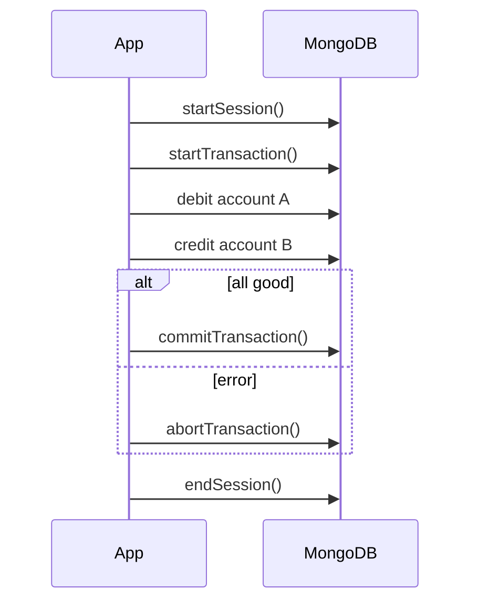
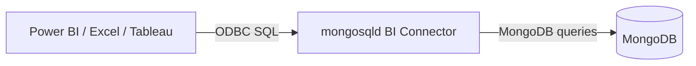

# Session 09: Transaction Management and MongoDB Tools

> Module: Managing Large Datasets with MongoDB · Term 4 (HDSE) · ⏱ ~2 hours

Some operations must succeed or fail together, like moving money between accounts. This session covers multi-document transactions and then the graphical and BI tools around MongoDB: Compass and the BI Connector.

## 🎯 Learning Objectives

- Explain transactions in MongoDB and the ACID properties
- Use the transaction API with sessions (core API and callback API)
- Interpret transaction error labels and retry correctly
- Connect MongoDB Compass and perform create, insert, update, query and drop operations
- Describe installing the MongoDB BI Connector and connecting BI tools through ODBC

## 📖 Concepts Explained

### 1. Why transactions?

Single-document writes in MongoDB are always atomic. When a change touches **several documents or collections**, use a multi-document transaction (available on replica sets and sharded clusters, MongoDB 4.0+).

| ACID property | Meaning |
|---|---|
| **A**tomicity | all operations commit, or none do |
| **C**onsistency | data moves from one valid state to another |
| **I**solation | others do not see partial changes (snapshot isolation) |
| **D**urability | committed data survives failures (with `w: "majority"`) |

### 2. Sessions and transaction APIs

A transaction lives inside a **session**.



| API | How |
|---|---|
| Core API | you call `startTransaction`, `commitTransaction`, `abortTransaction` and handle retries |
| Callback API | `session.withTransaction(fn)` runs your function and retries automatically on transient errors |

### 3. Error labels

| Label | Meaning | Action |
|---|---|---|
| `TransientTransactionError` | temporary problem (e.g. write conflict, election) | retry the **whole** transaction |
| `UnknownTransactionCommitResult` | commit outcome unknown (network issue) | retry the **commit** |

Good practice: keep transactions short (default limit 60 s), touch few documents, and prefer a good schema (embedding) so most updates are single-document.

### 4. MongoDB Compass

Compass is the official GUI. Connect with a URI (`mongodb://localhost:27017` or an Atlas string), then: create databases/collections, insert documents (JSON or form), filter with queries, edit or delete documents, build aggregations visually, view schema statistics, manage indexes and see `explain` plans. The built-in **mongosh** panel is at the bottom.

### 5. MongoDB BI Connector

The BI Connector (`mongosqld`) presents MongoDB collections as **SQL tables**, so tools such as Power BI, Tableau or Excel can query them through a **MySQL-compatible ODBC driver**.



Steps: install the BI Connector (Enterprise/Atlas feature), run `mongosqld --mongo-uri mongodb://localhost:27017`, install the MongoDB ODBC driver, create a DSN pointing to `mongosqld` (port 3307), then connect from the BI tool. Note: MongoDB has announced end-of-life for the BI Connector and recommends **Atlas SQL Interface** and the official Power BI/Tableau connectors for new projects.

## 💻 Code Examples

### Example 1: Transaction in mongosh (callback API)

📄 File: [`transaction.js`](transaction.js)

```js
// Needs a replica set or Atlas (transactions do not run on a standalone server)
const session = db.getMongo().startSession();
const bank = session.getDatabase("bank");
db.getSiblingDB("bank").accounts.drop();
db.getSiblingDB("bank").accounts.insertMany([{ _id: "A", owner: "Ali", balance: 10000 }, { _id: "B", owner: "Sana", balance: 2000 }]);

function transfer(from, to, amount) {
  session.withTransaction(() => {
    const src = bank.accounts.findOne({ _id: from });
    if (src.balance < amount) throw new Error("Insufficient balance");
    bank.accounts.updateOne({ _id: from }, { $inc: { balance: -amount } });
    bank.accounts.updateOne({ _id: to }, { $inc: { balance: amount } });
    bank.transfers.insertOne({ from, to, amount, at: new Date() });
  }, { readConcern: { level: "snapshot" }, writeConcern: { w: "majority" } });
}

transfer("A", "B", 3000);
try { transfer("B", "A", 999999); } catch (e) { print("Rolled back:", e.message); }
printjson(db.getSiblingDB("bank").accounts.find().toArray());
session.endSession();
```

**How it works**

- All operations use the session's database handle, so they belong to the transaction.
- Throwing inside the callback aborts everything; balances stay unchanged for the failed transfer.
- `withTransaction` retries automatically on transient errors.

### Example 2: Transaction from Node.js (core API with error labels)

📄 File: [`transfer.mjs`](transfer.mjs)

```js
// npm install mongodb   then: node transfer.mjs
import { MongoClient } from "mongodb";

const client = new MongoClient(process.env.MONGODB_URI || "mongodb://localhost:27018,localhost:27019,localhost:27020/?replicaSet=rs0");
await client.connect();
const accounts = client.db("bank").collection("accounts");

async function transfer(from, to, amount) {
  const session = client.startSession();
  try {
    for (let attempt = 1; attempt <= 3; attempt++) {
      session.startTransaction({ writeConcern: { w: "majority" } });
      try {
        const res = await accounts.updateOne({ _id: from, balance: { $gte: amount } }, { $inc: { balance: -amount } }, { session });
        if (res.modifiedCount === 0) throw new Error("Insufficient balance");
        await accounts.updateOne({ _id: to }, { $inc: { balance: amount } }, { session });
        await session.commitTransaction();
        return "committed";
      } catch (err) {
        await session.abortTransaction().catch(() => {});
        if (err.hasErrorLabel?.("TransientTransactionError") && attempt < 3) continue; // retry whole transaction
        throw err;
      }
    }
  } finally {
    await session.endSession();
  }
}

console.log(await transfer("A", "B", 500));
await client.close();
```

**How it works**

- The core API gives full control: start, commit, abort and a manual retry loop.
- The debit includes `balance: { $gte: amount }` so it fails safely if funds are low.
- Only `TransientTransactionError` is retried; other errors are reported.

### ▶️ How to run

1. Install MongoDB Community Server 8 and `mongosh` (or use a free Atlas cluster).
2. Open a terminal in this folder and run a script with `mongosh --file <script>.js` (add your connection string before `--file` for Atlas).
3. Python files need Python 3.12 and `pip install pymongo`; run with `python <file>.py`.
4. Transactions need a replica set: use the one from Session 7 or a free Atlas cluster.

## 🧪 Lab Practice

1. Start the local replica set and run `transaction.js`; verify the failed transfer left balances unchanged.
2. Connect Compass to your server; create database `compassdb`, collection `notes`, insert three documents with the GUI.
3. In Compass, filter `{ age: { $gt: 21 } }` on `campus.students`, edit one document and delete another.
4. Use Compass's Aggregations tab to rebuild the 'average marks per city' pipeline from Session 3 and export it to Node.js code.
5. Read the BI Connector documentation and draw the connection diagram for Power BI in your notebook.

## 📝 Assignment

Implement an **order placement** transaction in Node.js: reduce stock in `products` for every item, insert the order in `orders`, and abort if any product has insufficient stock. Demonstrate one successful and one rolled-back order, and include Compass screenshots of the data before and after.

## ❓ Quick Quiz

**Q1.** When do you need a multi-document transaction?

**Q2.** Which server setup is required for transactions?

**Q3.** What should you do on `TransientTransactionError`?

**Q4.** What does `withTransaction` add over the core API?

**Q5.** What does the BI Connector let BI tools do?

<details>
<summary>Show answers</summary>

1. When several documents/collections must change together atomically.
2. A replica set or sharded cluster (not a standalone).
3. Retry the entire transaction.
4. Automatic commit and retry handling.
5. Query MongoDB with SQL through an ODBC driver.

</details>

## 💼 Interview Questions

**1. Are single-document updates atomic in MongoDB?**

> Yes, including changes to embedded documents and arrays within that document.

**2. Why keep transactions short?**

> Long transactions hold resources, increase conflicts and hit the 60-second default limit.

**3. How would you design to avoid transactions?**

> Embed data that changes together in one document so a single atomic update suffices.

## ✅ Summary

- Transactions give ACID guarantees across multiple documents.
- Use sessions with the callback or core API, and retry on transient errors.
- Compass offers visual CRUD, aggregation, schema and index tools.
- The BI Connector exposes MongoDB to SQL-based BI tools via ODBC.

---

[⬅ Previous](../Session-08-Practice-Lab-Indexes-and-Replica-Sets/README.md) · [🏠 Module Home](../README.md) · [Next ➡](../Session-10-Practice-Lab-Transactions-and-Tools/README.md)

Prepared by Zeeshan Abbas · Aptech Learning North Nazimabad
