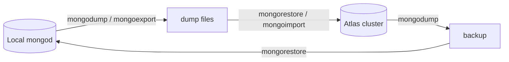

# Session 11: MongoDB in the Cloud with Atlas

> Module: Managing Large Datasets with MongoDB · Term 4 (HDSE) · ⏱ ~2 hours

MongoDB Atlas is the official fully managed cloud database. It handles servers, backups, replication and security so you can focus on your application.

## 🎯 Learning Objectives

- Create an Atlas account and deploy a free cluster
- Configure database users and network access, and connect from mongosh, Compass and code
- Import data into Atlas from a local MongoDB instance and manage it
- Export data from Atlas back to a local instance
- Perform administrative tasks: monitoring, backups, alerts and scaling

## 📖 Concepts Explained

### 1. What Atlas manages for you

| You would otherwise... | Atlas does it |
|---|---|
| install and patch servers | automatic |
| configure a replica set | every cluster is a 3-node replica set |
| set up backups | snapshots (paid tiers) |
| monitor performance | Metrics, Real-Time Panel, Performance Advisor |
| secure the network | TLS by default, IP access list, private endpoints |

Atlas runs on AWS, Azure or Google Cloud in many regions. Tiers: **M0 Free** (512 MB, learning), Flex/shared, and dedicated (M10+).

### 2. Setting up

1. Sign up at mongodb.com/atlas (Google sign-in works).
2. **Create a cluster** → M0 → provider and nearest region.
3. **Database Access** → add user (username/password, role e.g. *Read and write to any database*).
4. **Network Access** → *Add Current IP Address* (or a range).
5. **Connect** → choose mongosh, Compass or Drivers and copy the `mongodb+srv://` string.



### 3. Moving data

| Direction | Tool |
|---|---|
| local → Atlas (exact) | `mongodump` then `mongorestore --uri <atlas>` |
| local → Atlas (JSON) | `mongoexport` then `mongoimport --uri <atlas>` |
| Atlas → local | `mongodump --uri <atlas>` then `mongorestore` locally |
| large live migrations | Atlas *Live Migration* / `mongosync` |

Atlas UI also offers **Data Explorer** (browse/edit documents) and **Load Sample Dataset** (`sample_mflix`, `sample_airbnb`...).

### 4. Administrative tasks

- **Metrics**: operations/sec, connections, disk, CPU.
- **Performance Advisor**: suggests indexes for slow queries.
- **Alerts**: email when connections or disk exceed thresholds.
- **Backups and restores** (dedicated tiers), **scaling** tiers and storage, **pause** clusters (dedicated).
- **Project access**: invite teammates with project roles.
- **Atlas Search** and **Vector Search** for full-text and AI similarity search.

## 💻 Code Examples

### Example 1: Migrating data between local and Atlas

📄 File: [`migrate.sh`](migrate.sh)

```bash
# Set your Atlas URI once (replace user, password and cluster)
ATLAS="mongodb+srv://student:<password>@cluster0.xxxxx.mongodb.net"

# 1) Local -> Atlas, exact copy of the campus database
mongodump --db campus --out ./dump
mongorestore --uri "$ATLAS" --nsInclude "campus.*" ./dump

# 2) JSON route for one collection
mongoexport --db campus --collection students --out students.json --jsonArray
mongoimport --uri "$ATLAS/campus" --collection students_json --file students.json --jsonArray

# 3) Atlas -> local backup
mongodump --uri "$ATLAS/campus" --out ./atlas-backup
mongorestore --nsFrom "campus.*" --nsTo "campus_from_atlas.*" ./atlas-backup

# 4) Connect with the shell
mongosh "$ATLAS/campus" --username student
```

**How it works**

- `mongodump`/`mongorestore` keep exact BSON types and indexes.
- `--nsInclude` and `--nsFrom/--nsTo` choose and rename namespaces.
- Use quotes around URIs because they contain special characters.

### Example 2: Managing Atlas data from Node.js

📄 File: [`atlas-check.mjs`](atlas-check.mjs)

```js
// npm install mongodb   then: ATLAS_URI="mongodb+srv://..." node atlas-check.mjs
import { MongoClient, ServerApiVersion } from "mongodb";

const client = new MongoClient(process.env.ATLAS_URI, { serverApi: { version: ServerApiVersion.v1, strict: true } });
try {
  await client.connect();
  await client.db("admin").command({ ping: 1 });
  console.log("Connected to Atlas");
  const db = client.db("campus");
  console.log("Collections:", (await db.listCollections().toArray()).map((c) => c.name));
  const top = await db.collection("students").find({}, { projection: { _id: 0, name: 1, city: 1 } }).limit(3).toArray();
  console.table(top);
} finally {
  await client.close();
}
```

**How it works**

- The `serverApi` option pins the Stable API version, as Atlas recommends.
- The URI comes from an environment variable, never hard-coded.

### ▶️ How to run

1. Install MongoDB Community Server 8 and `mongosh` (or use a free Atlas cluster).
2. Open a terminal in this folder and run a script with `mongosh --file <script>.js` (add your connection string before `--file` for Atlas).
3. Python files need Python 3.12 and `pip install pymongo`; run with `python <file>.py`.
4. `migrate.sh` contains commands to run one at a time; replace the URI first.

## 🧪 Lab Practice

1. Create an M0 cluster, a database user and an IP access rule.
2. Load the Atlas sample dataset and run three queries on `sample_mflix.movies` in Data Explorer.
3. Copy your local `campus` database to Atlas with mongodump/mongorestore and verify document counts.
4. Export `students` from Atlas and import it into a new local database.
5. Explore Metrics and the Performance Advisor; create an alert for connections above 100.

## 📝 Assignment

Migrate a local database of your choice (at least 3 collections, 500+ documents) to Atlas, create a read-only Atlas user for a teammate, add one recommended index from the Performance Advisor (or your own analysis), and write a short report with screenshots of metrics before and after.

## ❓ Quick Quiz

**Q1.** What is the free Atlas tier called?

**Q2.** Which two settings must be configured before connecting?

**Q3.** Which tools keep exact types when moving data?

**Q4.** What prefix does an Atlas connection string use?

**Q5.** Which Atlas feature suggests indexes?

<details>
<summary>Show answers</summary>

1. M0.
2. A database user and network (IP) access.
3. `mongodump` and `mongorestore`.
4. `mongodb+srv://`
5. Performance Advisor.

</details>

## 💼 Interview Questions

**1. Why is allowing 0.0.0.0/0 risky?**

> Anyone on the internet can attempt to connect; security then depends only on credentials. Prefer specific IPs or private endpoints.

**2. What does `+srv` do in a connection string?**

> It uses DNS SRV records to discover all replica set members and TLS settings automatically.

**3. How do you back up an M0 cluster?**

> M0 lacks managed backups, so use mongodump/mongoexport on a schedule.

## ✅ Summary

- Atlas is managed MongoDB on AWS, Azure or GCP.
- Configure users and network access, then connect with a `+srv` URI.
- Move data with dump/restore or export/import.
- Use Metrics, Performance Advisor, alerts and backups to administer clusters.

---

[⬅ Previous](../Session-10-Practice-Lab-Transactions-and-Tools/README.md) · [🏠 Module Home](../README.md) · [Next ➡](../Session-12-Practice-Lab-Atlas/README.md)

Prepared by Zeeshan Abbas · Aptech Learning North Nazimabad
