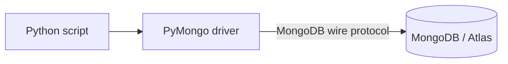

# Session 13: MongoDB Database Connectivity with Python

> Module: Managing Large Datasets with MongoDB · Term 4 (HDSE) · ⏱ ~2 hours

Python is the language of data science and AI, so connecting it to MongoDB is a key skill. You will use PyMongo, the official driver, to create, query, sort, update and delete data.

## 🎯 Learning Objectives

- Describe how Python connects to MongoDB through a driver
- Install the PyMongo driver in a virtual environment
- Create databases and collections from Python
- Query, sort, limit, update and delete documents with PyMongo
- Handle errors and use environment variables for connection strings

## 📖 Concepts Explained

### 1. How it works



PyMongo converts Python dictionaries to BSON and back. Documents are `dict`s; `ObjectId` and `datetime` map to BSON types.

### 2. Setup

```bash
python -m venv .venv
.venv\Scripts\activate        # Windows  (source .venv/bin/activate on macOS/Linux)
pip install "pymongo[srv]" python-dotenv
```

### 3. Shell vs PyMongo

| mongosh | PyMongo |
|---|---|
| `db.students.insertOne({...})` | `db.students.insert_one({...})` |
| `insertMany` | `insert_many` |
| `find({}, {name:1})` | `find({}, {"name": 1})` |
| `.sort({age:-1})` | `.sort("age", -1)` or `.sort([("age", -1)])` |
| `updateOne` / `updateMany` | `update_one` / `update_many` |
| `deleteOne` / `deleteMany` | `delete_one` / `delete_many` |
| `countDocuments` | `count_documents` |

Python method names use **snake_case**, keys are strings in quotes, and `True/False/None` replace `true/false/null`.

### 4. Databases and collections

They are created lazily: `client["school"]["students"]` creates nothing until the first insert. `list_database_names()` and `list_collection_names()` show what exists.

### 5. Good practices

- One `MongoClient` per application (it manages a connection pool).
- Read the URI from environment variables.
- Catch `pymongo.errors` such as `DuplicateKeyError`, `ServerSelectionTimeoutError`.
- Use `with MongoClient(...) as client:` in scripts so connections close.

## 💻 Code Examples

### Example 1: Full CRUD with PyMongo

📄 File: [`crud.py`](crud.py)

```python
"""Run: pip install "pymongo[srv]" python-dotenv  then  python crud.py"""
import os
from datetime import datetime, timezone

from dotenv import load_dotenv
from pymongo import MongoClient, ASCENDING, DESCENDING
from pymongo.errors import DuplicateKeyError, ServerSelectionTimeoutError

load_dotenv()
URI = os.getenv("MONGODB_URI", "mongodb://localhost:27017")


def main() -> None:
    with MongoClient(URI, serverSelectionTimeoutMS=5000) as client:
        client.admin.command("ping")
        db = client["school"]
        students = db["students"]
        students.drop()
        students.create_index([("roll_no", ASCENDING)], unique=True)

        # CREATE
        students.insert_many([
            {"roll_no": 1, "name": "Ali", "city": "Karachi", "marks": 78, "joined": datetime.now(timezone.utc)},
            {"roll_no": 2, "name": "Hira", "city": "Lahore", "marks": 91},
            {"roll_no": 3, "name": "Usman", "city": "Karachi", "marks": 55},
            {"roll_no": 4, "name": "Sana", "city": "Islamabad", "marks": 84},
        ])
        try:
            students.insert_one({"roll_no": 1, "name": "Duplicate"})
        except DuplicateKeyError:
            print("Roll number 1 already exists")

        print("Databases:", client.list_database_names())
        print("Collections:", db.list_collection_names())

        # READ: filter, projection, sort, limit
        for s in students.find({"marks": {"$gte": 60}}, {"_id": 0, "name": 1, "marks": 1}).sort("marks", DESCENDING).limit(3):
            print(s)
        print("Karachi students:", students.count_documents({"city": "Karachi"}))

        # UPDATE
        r = students.update_one({"name": "Usman"}, {"$inc": {"marks": 10}})
        print("Modified:", r.modified_count)
        students.update_many({"city": "Karachi"}, {"$set": {"province": "Sindh"}})

        # AGGREGATE
        for row in students.aggregate([{"$group": {"_id": "$city", "avg": {"$avg": "$marks"}}}, {"$sort": {"avg": -1}}]):
            print(f"{row['_id']}: {row['avg']:.1f}")

        # DELETE
        print("Deleted:", students.delete_many({"marks": {"$lt": 60}}).deleted_count)


if __name__ == "__main__":
    try:
        main()
    except ServerSelectionTimeoutError:
        print("Could not reach MongoDB. Is the server running / is MONGODB_URI correct?")
```

**How it works**

- `with MongoClient(...)` closes the connection automatically; `ping` checks connectivity early.
- A unique index on `roll_no` makes duplicate inserts raise `DuplicateKeyError`.
- `find` returns a cursor you can iterate; `.sort()` and `.limit()` chain like in the shell.
- The aggregation pipeline is written as a list of Python dicts.

### Example 2: Load a CSV into MongoDB

📄 File: [`import_csv.py`](import_csv.py)

```python
"""Import results.csv into MongoDB with type conversion. Run: python import_csv.py"""
import csv
from pathlib import Path
from pymongo import MongoClient

rows = []
with open(Path(__file__).with_name("results.csv"), newline="", encoding="utf-8") as f:
    for r in csv.DictReader(f):
        rows.append({"name": r["name"], "module": r["module"], "marks": int(r["marks"])})

with MongoClient("mongodb://localhost:27017") as client:
    col = client.school.results
    col.delete_many({})
    col.insert_many(rows)
    print("Imported", col.count_documents({}), "rows")
    print("Pass rate:", round(100 * col.count_documents({"marks": {"$gte": 40}}) / len(rows), 1), "%")
```

**How it works**

- `csv.DictReader` reads each row as a dict; marks are converted to `int` before insertion.

### ▶️ How to run

1. Install MongoDB Community Server 8 and `mongosh` (or use a free Atlas cluster).
2. Open a terminal in this folder and run a script with `mongosh --file <script>.js` (add your connection string before `--file` for Atlas).
3. Python files need Python 3.12 and `pip install pymongo`; run with `python <file>.py`.
4. `pip install -r requirements.txt`, optionally create `.env` with `MONGODB_URI=...`, then `python crud.py`.

## 🧪 Lab Practice

1. Create a virtual environment, install PyMongo and run `crud.py` against local MongoDB.
2. Point `MONGODB_URI` to your Atlas cluster and run the script again.
3. Write a function `top_students(city, n)` that returns the top n students of a city sorted by marks.
4. Import `results.csv` and print the average marks per module with an aggregation.
5. Add a menu-driven console app (add/list/update/delete student) using `input()`.

## 📝 Assignment

Build a **Python Library Manager** console app using PyMongo: add book, search by title (case-insensitive regex), issue/return book (update `available`), list overdue issues (date comparison), and delete book. Store the URI in `.env` and handle connection and duplicate-key errors gracefully.

## ❓ Quick Quiz

**Q1.** What is the official MongoDB driver for Python?

**Q2.** Which method inserts several documents?

**Q3.** How do you sort descending by marks in PyMongo?

**Q4.** What Python type represents a document?

**Q5.** Which exception is raised for a duplicate unique key?

<details>
<summary>Show answers</summary>

1. PyMongo.
2. `insert_many()`
3. `.sort("marks", -1)` or `DESCENDING`.
4. A `dict`.
5. `pymongo.errors.DuplicateKeyError`

</details>

## 💼 Interview Questions

**1. Why reuse one MongoClient?**

> It is thread-safe and maintains a connection pool; creating many clients wastes connections and time.

**2. How do you work with MongoDB asynchronously in Python?**

> Use the async API (PyMongo's AsyncMongoClient or the Motor driver) with asyncio.

**3. How do you convert query results to a pandas DataFrame?**

> `pd.DataFrame(list(collection.find(filter, projection)))`.

## ✅ Summary

- PyMongo connects Python to MongoDB and maps dicts to BSON.
- Method names are snake_case versions of shell methods.
- Databases and collections are created on first insert.
- Use environment variables, one client and proper exception handling.

---

[⬅ Previous](../Session-12-Practice-Lab-Atlas/README.md) · [🏠 Module Home](../README.md) · [Next ➡](../Session-14-Practice-Lab-Python-and-MongoDB/README.md)

Prepared by Zeeshan Abbas · Aptech Learning North Nazimabad
