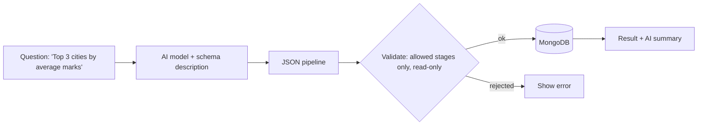

# Session 15: AI-Powered MongoDB

> Module: Managing Large Datasets with MongoDB · Term 4 (HDSE) · ⏱ ~2 hours

AI can help you design schemas, write queries, find anomalies and build smarter search. In this session you combine MongoDB with AI tools such as ChatGPT and run data analysis in Google Colab.

## 🎯 Learning Objectives

- Explain the role of AI tools in database development and management
- Integrate an AI model with MongoDB to generate queries and insights
- Use MongoDB from Google Colab notebooks for analysis
- Detect simple anomalies and generate automated insights
- Apply best practices for safety, privacy and verification when using AI with databases

## 📖 Concepts Explained

### 1. Where AI helps

| Task | How AI helps |
|---|---|
| Schema design | suggests document structures and indexes from a description |
| Query writing | converts plain English into MQL or aggregation pipelines |
| Explaining | explains complex pipelines or `explain()` output |
| Data quality | finds outliers, missing values and inconsistent formats |
| Insights | summarises trends in plain language |
| Semantic search | stores **embeddings** and searches by meaning (Atlas Vector Search) |

Tools: ChatGPT and other chat assistants, MongoDB's built-in AI features in Compass and Atlas (natural-language query generation), and AI APIs called from code.

### 2. Natural language → query pattern



Never execute AI-generated pipelines blindly: allow only read stages (`$match`, `$group`, `$sort`, `$project`, `$limit`...), block `$out`/`$merge`, use a read-only user, and limit results.

### 3. Google Colab

Colab is a free hosted Jupyter notebook. `!pip install pymongo`, connect to **Atlas** (Colab cannot reach your local server), load results into pandas and chart them. Store the URI with Colab **Secrets** (key icon), not in the notebook text.

### 4. Anomaly detection basics

A simple statistical method: compute mean and standard deviation; values with |z-score| > 3 are unusual. MongoDB can compute `$avg` and `$stdDevPop` in an aggregation, then flag outliers.

### 5. Best practices

- Share **schema and sample shapes**, not real personal data, with AI tools.
- Verify every AI-generated query on test data first; AI can invent field names.
- Keep humans responsible for destructive operations.
- Log prompts and generated queries for auditing.
- Respect your organisation's data and privacy policies.

## 💻 Code Examples

### Example 1: Natural-language questions to safe aggregation

📄 File: [`nl_query.py`](nl_query.py)

```python
"""pip install pymongo openai   set OPENAI_API_KEY   then: python nl_query.py "average marks per city" """
import json
import os
import sys

from openai import OpenAI
from pymongo import MongoClient

ALLOWED = {"$match", "$group", "$sort", "$project", "$limit", "$count", "$unwind", "$addFields"}
SCHEMA = "Collection students: {name: str, city: str, age: int, batch: str, marks: {react: int, node: int, mongo: int}, skills: [str], active: bool}"


def generate_pipeline(question: str) -> list:
    client = OpenAI()
    resp = client.chat.completions.create(
        model=os.getenv("AI_MODEL", "gpt-4o-mini"),
        response_format={"type": "json_object"},
        messages=[
            {"role": "system", "content": f"You write MongoDB aggregation pipelines. {SCHEMA}. "
                                          'Reply only as JSON: {"pipeline": [...]}. Use only read-only stages.'},
            {"role": "user", "content": question[:300]},
        ],
    )
    return json.loads(resp.choices[0].message.content)["pipeline"]


def validate(pipeline: list) -> list:
    if not isinstance(pipeline, list) or not pipeline:
        raise ValueError("Pipeline must be a non-empty list")
    for stage in pipeline:
        if len(stage) != 1 or next(iter(stage)) not in ALLOWED:
            raise ValueError(f"Stage not allowed: {stage}")
    return pipeline + [{"$limit": 50}]


if __name__ == "__main__":
    question = " ".join(sys.argv[1:]) or "average mongo marks per city, highest first"
    pipeline = validate(generate_pipeline(question))
    print("Pipeline:", json.dumps(pipeline, indent=2))
    with MongoClient(os.getenv("MONGODB_URI", "mongodb://localhost:27017")) as c:
        for row in c.campus.students.aggregate(pipeline):
            print(row)
```

**How it works**

- Only the **schema** is sent to the AI, not real student data.
- The model must answer in JSON; `validate` allows read-only stages and appends a `$limit`.
- Use a read-only database user for extra safety.

### Example 2: Anomaly detection with aggregation

📄 File: [`anomalies.js`](anomalies.js)

```js
// mongosh --file anomalies.js
db = db.getSiblingDB("campus");
db.payments.drop();
const amounts = [4500, 4700, 4400, 4600, 4550, 4800, 4650, 45000, 4500, 4720, 300, 4610];
db.payments.insertMany(amounts.map((a, i) => ({ student: `S${i + 1}`, amount: a, at: new Date() })));

const [stats] = db.payments.aggregate([{ $group: { _id: null, mean: { $avg: "$amount" }, sd: { $stdDevPop: "$amount" } } }]).toArray();
print(`mean=${stats.mean.toFixed(0)} sd=${stats.sd.toFixed(0)}`);

printjson(db.payments.aggregate([
  { $addFields: { z: { $divide: [{ $subtract: ["$amount", stats.mean] }, stats.sd] } } },
  { $match: { $expr: { $gt: [{ $abs: "$z" }, 2] } } },
  { $project: { _id: 0, student: 1, amount: 1, z: { $round: ["$z", 2] } } }
]).toArray());
```

**How it works**

- `$avg` and `$stdDevPop` compute statistics on the server.
- Payments with |z| > 2 are flagged (2 is used here because the sample is small; 3 is common for large data).
- The 45,000 entry is detected as an outlier.

### Example 3: Colab notebook cells

📄 File: [`colab_cells.py`](colab_cells.py)

```python
# Cell 1 - install
# !pip install -q "pymongo[srv]" pandas matplotlib

# Cell 2 - connect using Colab Secrets (add MONGODB_URI via the key icon)
from google.colab import userdata
from pymongo import MongoClient
client = MongoClient(userdata.get("MONGODB_URI"))
db = client["sample_mflix"]

# Cell 3 - analyse
import pandas as pd
rows = db.movies.aggregate([
    {"$match": {"year": {"$gte": 2000}, "imdb.rating": {"$type": "number"}}},
    {"$group": {"_id": "$year", "avgRating": {"$avg": "$imdb.rating"}, "movies": {"$sum": 1}}},
    {"$sort": {"_id": 1}},
])
df = pd.DataFrame(list(rows)).rename(columns={"_id": "year"})
df.plot(x="year", y="avgRating", title="Average IMDb rating by year")
```

**How it works**

- Colab Secrets keep the Atlas URI out of the notebook.
- Aggregation does the heavy work; pandas and matplotlib chart the results.

### ▶️ How to run

1. Install MongoDB Community Server 8 and `mongosh` (or use a free Atlas cluster).
2. Open a terminal in this folder and run a script with `mongosh --file <script>.js` (add your connection string before `--file` for Atlas).
3. Python files need Python 3.12 and `pip install pymongo`; run with `python <file>.py`.
4. `nl_query.py` needs `pip install pymongo openai` and an `OPENAI_API_KEY`. `colab_cells.py` is meant to be pasted into Google Colab cell by cell.

## 🧪 Lab Practice

1. Ask an AI assistant to design a schema for a hostel management system; review it and list two improvements you would make.
2. Run `anomalies.js` and change the threshold to 3; explain the difference.
3. Run `nl_query.py` with three questions and check whether each pipeline is correct.
4. Try a malicious question ("delete all students") and confirm validation blocks it.
5. Open Google Colab, connect to your Atlas cluster and chart one sample dataset.

## 📝 Assignment

Build an **AI Insights Notebook** in Colab: connect to Atlas, compute three aggregations on a sample dataset, detect anomalies in one numeric field, then send only the aggregated numbers to an AI API to generate a five-bullet plain-English summary. Share the notebook link (with secrets removed).

## ❓ Quick Quiz

**Q1.** Name two database tasks AI tools can help with.

**Q2.** Why validate AI-generated pipelines?

**Q3.** Why can Colab not connect to `localhost` MongoDB on your PC?

**Q4.** Which aggregation operator computes standard deviation?

**Q5.** What should you share with an AI tool instead of real data?

<details>
<summary>Show answers</summary>

1. Query writing, schema design (also explaining plans, data quality, insights).
2. They may be wrong or destructive (e.g. `$out`), so only safe, verified stages should run.
3. Colab runs on Google's servers; it needs a reachable cloud database such as Atlas.
4. `$stdDevPop` (or `$stdDevSamp`).
5. The schema and anonymised/sample shapes.

</details>

## 💼 Interview Questions

**1. What are vector embeddings and how does MongoDB use them?**

> Numeric representations of meaning; Atlas Vector Search stores them and finds documents with similar meaning using `$vectorSearch`.

**2. How do you prevent an AI query assistant from damaging data?**

> Read-only credentials, stage allow-lists, result limits, timeouts and human review for writes.

**3. What is RAG?**

> Retrieval-Augmented Generation: retrieve relevant documents (e.g. via vector search) and include them in the prompt so the AI answers from your data.

## ✅ Summary

- AI assists with schemas, queries, explanations, quality checks and insights.
- Generated queries must be validated and run with least privilege.
- Colab + Atlas + pandas is a quick analysis environment.
- Statistical aggregations can flag anomalies automatically.

---

[⬅ Previous](../Session-14-Practice-Lab-Python-and-MongoDB/README.md) · [🏠 Module Home](../README.md) · [Next ➡](../Session-16-Practice-Lab-AI-and-Final-Review/README.md)

Prepared by Zeeshan Abbas · Aptech Learning North Nazimabad
