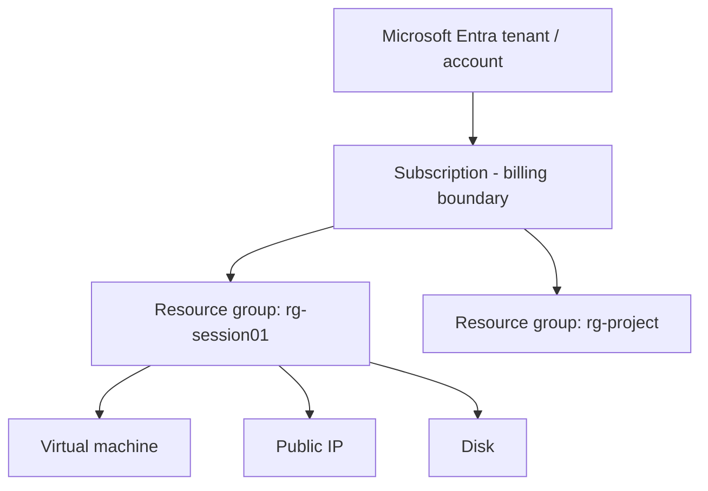

# Session 01: Introduction to Azure Cloud and Virtual Machines

> Module: Developing Microsoft Azure Applications · Term 4 (HDSE) · ⏱ ~2 hours

This session explains what cloud computing is, why companies rent computers from Microsoft instead of buying them, and how Azure is organised. Then you create your first cloud server, a virtual machine, and turn it into a working web server.

## 🎯 Learning Objectives

- Explain cloud computing and its benefits in simple words
- Compare IaaS, PaaS and SaaS, and public, private and hybrid clouds
- Describe Azure regions, availability zones and SLAs
- Understand the Azure hierarchy: account → subscription → resource group → resource
- Create, connect to, stop and delete a virtual machine with the Azure CLI

## 📖 Concepts Explained

### 1. What is cloud computing?

Cloud computing means **renting computing power over the internet** and paying only for what you use. Think of electricity: you do not build a power station at home, you plug in and pay a monthly bill. Azure is Microsoft's "power station" for servers, storage, databases and AI.

| Benefit | What it means for you |
|---|---|
| Pay as you go | no big upfront cost; stop a server and stop paying |
| Scalability | add more power in minutes when users grow |
| Global reach | run your app close to users in 60+ regions |
| Reliability | Microsoft keeps copies and spare hardware |
| Security | built-in tools, firewalls and identity services |

### 2. Service models

| Model | You manage | Azure manages | Azure example |
|---|---|---|---|
| **IaaS** (Infrastructure) | OS, runtime, app, data | hardware, network | Virtual Machines |
| **PaaS** (Platform) | app and data | OS, patching, scaling | App Service, Azure SQL |
| **SaaS** (Software) | only your use of it | everything | Microsoft 365, Outlook |

Analogy: IaaS is renting an empty flat, PaaS is a furnished flat, SaaS is a hotel room.

### 3. Deployment models

- **Public cloud**: shared Microsoft data centres (what we use in this module).
- **Private cloud**: hardware used by one organisation only.
- **Hybrid cloud**: some systems on-premises, some in Azure, connected together.

### 4. How Azure is organised



- A **resource** is one thing you create (VM, database, web app).
- A **resource group** is a folder that holds related resources. Delete the group and everything inside goes away, which is perfect for labs.
- A **subscription** is where the bill goes. Students can use **Azure for Students** (free credit, no credit card).

### 5. Regions, availability zones and SLAs

- **Region**: a geographic area with data centres, e.g. `eastus`, `uaenorth`, `centralindia`.
- **Availability zone**: separate buildings inside a region with their own power and cooling. Spreading VMs across zones protects you if one building fails.
- **SLA (Service Level Agreement)**: Microsoft's written promise of uptime, e.g. 99.9%. Higher SLAs need more copies (two VMs across zones gives a higher SLA than one VM).

| Uptime | Allowed downtime per month (approx.) |
|---|---|
| 99.9% | 43 minutes |
| 99.95% | 22 minutes |
| 99.99% | 4 minutes |

### 6. Virtual machines (IaaS)

A VM is a computer made of software running on Microsoft hardware. You choose:

- **Image**: the operating system (Ubuntu, Windows Server).
- **Size**: CPU and RAM, e.g. `Standard_B1s` (1 vCPU, 1 GB), cheap for learning.
- **Disk**: where the OS and files live.
- **Network**: virtual network, public IP and open ports.

Billing tip: a *stopped* VM inside the OS still costs money. Use **deallocate** to stop compute charges.

### 7. Data in Azure (preview)

Azure offers many ways to store data: **Blob Storage** (files), **Azure SQL Database** (relational), **Cosmos DB** (NoSQL, MongoDB-compatible), and **Azure Cache for Redis** (fast cache). You will use them in Session 04.

## 💻 Code Examples

All examples use the **Azure CLI** (`az`). The easiest place to run them is **Azure Cloud Shell**: open the Azure Portal and click the `>_` icon. It already has `az` installed and signed in.

### Example 1: Sign in and explore

📄 File: [`01-login-and-explore.sh`](01-login-and-explore.sh)

```bash
#!/bin/bash
# Session 01 - Example 1: sign in and look around your Azure account
# Run in Azure Cloud Shell (Bash) or any terminal with Azure CLI installed.

# Step 1: sign in (Cloud Shell users are already signed in, so skip this)
az login

# Step 2: show which subscription you are using right now
az account show --output table

# Step 3: list the regions (data centre locations) you can use
az account list-locations --query "[].name" --output tsv

# Step 4: list resource groups you already have (probably none yet)
az group list --output table
```

**How it works**

- `az login` opens a browser to sign in.
- `--output table` prints neat columns; `--query` picks only the fields you want.

### Example 2: Create a VM

📄 File: [`02-create-vm.sh`](02-create-vm.sh)

```bash
#!/bin/bash
# Session 01 - Example 2: create a small Linux virtual machine

# Step 1: choose names once and reuse them
RESOURCE_GROUP="rg-session01"
LOCATION="eastus"          # pick a region that your subscription allows
VM_NAME="vm-web01"

# Step 2: create a resource group (a folder for related resources)
az group create --name $RESOURCE_GROUP --location $LOCATION

# Step 3: create the VM (Ubuntu, smallest burstable size, SSH keys auto-made)
az vm create \
  --resource-group $RESOURCE_GROUP \
  --name $VM_NAME \
  --image Ubuntu2204 \
  --size Standard_B1s \
  --admin-username azureuser \
  --generate-ssh-keys

# Step 4: print the public IP address of the VM
az vm show --resource-group $RESOURCE_GROUP --name $VM_NAME \
  --show-details --query publicIps --output tsv
```

**How it works**

- Variables keep names in one place, so you do not mistype them.
- `--generate-ssh-keys` creates a key pair in `~/.ssh` so you can log in without a password.
- Connect with `ssh azureuser@<public-ip>`.

### Example 3: Install a web server

📄 File: [`03-install-web-server.sh`](03-install-web-server.sh)

```bash
#!/bin/bash
# Session 01 - Example 3: turn the VM into a web server

RESOURCE_GROUP="rg-session01"
VM_NAME="vm-web01"

# Step 1: open port 80 so browsers can reach the VM
az vm open-port --resource-group $RESOURCE_GROUP --name $VM_NAME --port 80

# Step 2: run a command INSIDE the VM to install the nginx web server
az vm run-command invoke \
  --resource-group $RESOURCE_GROUP \
  --name $VM_NAME \
  --command-id RunShellScript \
  --scripts "sudo apt-get update && sudo apt-get install -y nginx"

# Step 3: get the IP again and open http://<ip> in your browser
az vm show --resource-group $RESOURCE_GROUP --name $VM_NAME \
  --show-details --query publicIps --output tsv
```

**How it works**

- `open-port` adds a rule to the VM's network security group allowing port 80.
- `run-command invoke` runs a script inside the VM without SSH. Visit the IP and you will see the nginx welcome page.

### Example 4: Manage costs and clean up

📄 File: [`04-manage-and-cleanup.sh`](04-manage-and-cleanup.sh)

```bash
#!/bin/bash
# Session 01 - Example 4: stop, start and delete to save money

RESOURCE_GROUP="rg-session01"
VM_NAME="vm-web01"

# Step 1: see the VM's current power state
az vm get-instance-view --resource-group $RESOURCE_GROUP --name $VM_NAME \
  --query "instanceView.statuses[1].displayStatus" --output tsv

# Step 2: deallocate = stop AND release the hardware (compute billing stops)
az vm deallocate --resource-group $RESOURCE_GROUP --name $VM_NAME

# Step 3: start it again when you need it
az vm start --resource-group $RESOURCE_GROUP --name $VM_NAME

# Step 4: when the lab is finished, delete the whole resource group
# (this deletes the VM, disk, IP and network in one go)
az group delete --name $RESOURCE_GROUP --yes --no-wait
```

**How it works**

- `deallocate` releases the hardware so compute billing stops (the disk is still billed).
- `az group delete` removes everything in the group. Always do this after a lab.

### ▶️ How to run

1. Open [Azure Cloud Shell](https://shell.azure.com) and choose **Bash**.
2. Upload the `.sh` files (Upload button) or paste them line by line.
3. Run `bash 02-create-vm.sh`, then the next scripts in order.

## 🧪 Lab Practice

1. Activate Azure for Students and open Cloud Shell.
2. Run Example 1 and write down your subscription name and three regions near Pakistan.
3. Create the VM with Example 2, then connect with `ssh` and run `uname -a` and `free -h`.
4. Install nginx with Example 3 and open the page in your browser. Replace the page text using `echo "Hello from <your name>" | sudo tee /var/www/html/index.html`.
5. Deallocate the VM, confirm its state in the Portal, then delete the resource group.

## 📝 Assignment

Create a one-page comparison (table) of IaaS, PaaS and SaaS with two Azure services for each, and a short note on which model you would choose for a small college result website, and why.

## ❓ Quick Quiz

**Q1.** Which service model is an Azure Virtual Machine?

**Q2.** What is the purpose of a resource group?

**Q3.** What is an availability zone?

**Q4.** Which command stops a VM *and* stops compute billing?

**Q5.** Roughly how much downtime does a 99.9% SLA allow per month?

<details>
<summary>Show answers</summary>

1. IaaS (Infrastructure as a Service).
2. To group related resources so they can be managed and deleted together.
3. A physically separate data centre inside one region with independent power, cooling and network.
4. `az vm deallocate`
5. About 43 minutes.

</details>

## 💼 Interview Questions

**1. Explain the difference between IaaS and PaaS with an example.**

> With IaaS (a VM) you patch the OS and install the runtime yourself. With PaaS (App Service) Azure handles the OS and you only deploy your code.

**2. How do you make an application on VMs highly available?**

> Run at least two VMs in different availability zones behind a load balancer, so one failure does not stop the app.

**3. Why do companies move to the cloud?**

> To avoid buying hardware, scale on demand, reach users globally, and pay only for what they use.

## ✅ Summary

- Cloud = renting computing over the internet, paying for what you use.
- IaaS, PaaS and SaaS differ in how much you manage.
- Azure is organised as subscription → resource group → resource, spread across regions and zones.
- You can create, use, deallocate and delete a VM with a few `az` commands.

---

[⬅ Previous](../README.md) · [🏠 Module Home](../README.md) · [Next ➡](../Session-02-Azure-CLI-PowerShell-ARM-Bicep-and-Monitor/README.md)

Prepared by Zeeshan Abbas · Aptech Learning North Nazimabad
