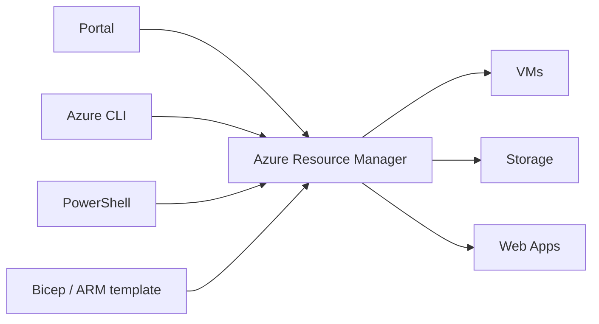

# Session 02: Azure CLI, PowerShell, ARM/Bicep and Azure Monitor

> Module: Developing Microsoft Azure Applications · Term 4 (HDSE) · ⏱ ~2 hours

Clicking in the Portal is fine for learning, but professionals automate. This session covers the four management tools (Portal, CLI, PowerShell, Cloud Shell), describing infrastructure as code with ARM and Bicep, and watching your apps with Azure Monitor and Application Insights.

## 🎯 Learning Objectives

- Choose between the Portal, Azure CLI, Azure PowerShell and Cloud Shell
- Create and query resources with `az` and with `Az` PowerShell cmdlets
- Explain Azure Resource Manager (ARM) and deploy a Bicep template
- Describe Azure Monitor: metrics, logs, alerts and Application Insights
- Write simple KQL queries to find failed requests and exceptions

## 📖 Concepts Explained

### 1. Four ways to manage Azure

| Tool | Best for | Example |
|---|---|---|
| Azure Portal | learning, visual checks | click **Create a resource** |
| Azure CLI (`az`) | Bash scripts, Linux/macOS, CI/CD | `az group create ...` |
| Azure PowerShell (`Az`) | Windows admins, object pipelines | `New-AzResourceGroup ...` |
| Cloud Shell | no install, browser terminal | Bash or PowerShell inside the Portal |

CLI and PowerShell do the same jobs; pick the one your team uses. The CLI returns JSON text; PowerShell returns objects you can pipe (`|`).

### 2. Azure Resource Manager (ARM)

Every tool above talks to one service: **Azure Resource Manager**. ARM checks your permissions, then creates, updates or deletes resources.



### 3. Infrastructure as Code (IaC)

Instead of running commands one by one, you **describe the final state** in a file and ARM makes it real.

| Format | Looks like | Notes |
|---|---|---|
| ARM template | JSON | original format, very verbose |
| **Bicep** | short, readable language | compiles to ARM JSON; recommended |
| Terraform | HCL | third-party, works with many clouds |

Benefits: repeatable (same result every time), reviewable in Git, and **idempotent**, meaning deploying twice does not create duplicates.

### 4. Azure Monitor

Azure Monitor collects two kinds of data:

- **Metrics**: numbers over time (CPU %, requests per second). Fast, good for charts and alerts.
- **Logs**: detailed records stored in a **Log Analytics workspace**, searched with **KQL** (Kusto Query Language).

Other parts: **Alerts** (email/SMS when a rule matches), **Activity log** (who changed what), and **Dashboards/Workbooks**.

### 5. Application Insights

Application Insights is the part of Azure Monitor for **your code**. Add its SDK and connection string to an app and it records requests, response times, dependencies (database calls) and **exceptions with stack traces**. To diagnose a run-time error: open *Failures*, pick the exception, and read the line where it was thrown.

## 💻 Code Examples

### Example 1: Azure CLI basics

📄 File: [`01-cli-basics.sh`](01-cli-basics.sh)

```bash
#!/bin/bash
# Session 02 - Example 1: everyday Azure CLI commands

RESOURCE_GROUP="rg-session02"
LOCATION="eastus"
# storage names must be globally unique, lowercase, 3-24 letters/numbers
STORAGE_NAME="stsession02$RANDOM"

# Step 1: create a resource group
az group create --name $RESOURCE_GROUP --location $LOCATION

# Step 2: create a storage account inside it
az storage account create \
  --name $STORAGE_NAME \
  --resource-group $RESOURCE_GROUP \
  --location $LOCATION \
  --sku Standard_LRS

# Step 3: list everything in the group as a table
az resource list --resource-group $RESOURCE_GROUP --output table

# Step 4: use --query (JMESPath) to print only the names
az resource list --resource-group $RESOURCE_GROUP --query "[].name" --output tsv

# Step 5: get help for any command
az storage account create --help
```

**How it works**: `$RANDOM` makes the storage name unique; `--query` filters JSON so you print only what you need.

### Example 2: Azure PowerShell basics

📄 File: [`02-powershell-basics.ps1`](02-powershell-basics.ps1)

```powershell
# Session 02 - Example 2: the same job with Azure PowerShell (Az module)
# One-time install on your PC:  Install-Module -Name Az -Scope CurrentUser
# (Cloud Shell in PowerShell mode already has it.)

# Step 1: sign in and check the subscription
Connect-AzAccount
Get-AzContext

# Step 2: variables
$resourceGroup = "rg-session02-ps"
$location      = "eastus"
$storageName   = "stps" + (Get-Random -Maximum 99999)

# Step 3: create a resource group
New-AzResourceGroup -Name $resourceGroup -Location $location

# Step 4: create a storage account
New-AzStorageAccount -ResourceGroupName $resourceGroup -Name $storageName `
  -Location $location -SkuName Standard_LRS -Kind StorageV2

# Step 5: list resources, then clean up
Get-AzResource -ResourceGroupName $resourceGroup | Select-Object Name, ResourceType
Remove-AzResourceGroup -Name $resourceGroup -Force
```

**How it works**: cmdlets follow *Verb-Noun* (`New-`, `Get-`, `Remove-`); the backtick `` ` `` continues a long line.

### Example 3: A Bicep template

📄 File: [`03-storage.bicep`](03-storage.bicep)

```bicep
// Session 02 - Example 3: a storage account described as code (Bicep)

// Parameters: values you can change at deploy time
param location string = resourceGroup().location
param storageName string = 'st${uniqueString(resourceGroup().id)}'

// The resource we want Azure to create
resource storage 'Microsoft.Storage/storageAccounts@2023-05-01' = {
  name: storageName
  location: location
  sku: {
    name: 'Standard_LRS'      // cheapest: 3 copies in one data centre
  }
  kind: 'StorageV2'
  properties: {
    minimumTlsVersion: 'TLS1_2'
  }
}

// Output: a value printed after deployment
output storageAccountName string = storage.name
```

**How it works**: `param` values can be overridden; `uniqueString()` builds a repeatable unique name from the resource group id.

### Example 4: Deploy the template

📄 File: [`04-deploy-bicep.sh`](04-deploy-bicep.sh)

```bash
#!/bin/bash
# Session 02 - Example 4: deploy the Bicep file with Azure Resource Manager

RESOURCE_GROUP="rg-session02"

# Step 1: preview what WOULD change (nothing is created yet)
az deployment group what-if \
  --resource-group $RESOURCE_GROUP \
  --template-file 03-storage.bicep

# Step 2: deploy for real
az deployment group create \
  --resource-group $RESOURCE_GROUP \
  --template-file 03-storage.bicep

# Step 3: run it again - ARM sees the resource already matches, nothing breaks
az deployment group create \
  --resource-group $RESOURCE_GROUP \
  --template-file 03-storage.bicep \
  --query properties.outputs
```

**How it works**: `what-if` is a safe preview. Deploying twice proves idempotency: the second run changes nothing.

### Example 5: Logs and Application Insights

📄 File: [`05-monitor.sh`](05-monitor.sh)

```bash
#!/bin/bash
# Session 02 - Example 5: set up Azure Monitor logs and Application Insights

RESOURCE_GROUP="rg-session02"
LOCATION="eastus"

# Step 1: create a Log Analytics workspace (the place where logs are stored)
az monitor log-analytics workspace create \
  --resource-group $RESOURCE_GROUP \
  --workspace-name law-session02 \
  --location $LOCATION

# Step 2: read the workspace's full id
WORKSPACE_ID=$(az monitor log-analytics workspace show \
  --resource-group $RESOURCE_GROUP --workspace-name law-session02 \
  --query id --output tsv)

# Step 3: create Application Insights that sends data to that workspace
az monitor app-insights component create \
  --app ai-session02 \
  --resource-group $RESOURCE_GROUP \
  --location $LOCATION \
  --workspace $WORKSPACE_ID

# Step 4: print the connection string (your app needs this value)
az monitor app-insights component show \
  --app ai-session02 --resource-group $RESOURCE_GROUP \
  --query connectionString --output tsv

# Step 5: see who did what in this resource group in the last hour
az monitor activity-log list --resource-group $RESOURCE_GROUP --offset 1h \
  --query "[].{operation:operationName.localizedValue, status:status.value}" --output table
```

**How it works**: the workspace stores logs; Application Insights writes into it. The connection string is what an app uses to send telemetry. (The CLI may ask to install the `application-insights` extension; answer yes.)

### Example 6: KQL queries

📄 File: [`06-queries.kql`](06-queries.kql)

```kql
// Session 02 - Example 6: Kusto (KQL) queries for Application Insights > Logs

// 1. Requests in the last hour, newest first
requests
| where timestamp > ago(1h)
| project timestamp, name, resultCode, duration
| order by timestamp desc

// 2. How many requests failed, per page/endpoint
requests
| where success == false
| summarize failures = count() by name

// 3. The five most common exceptions (run-time errors)
exceptions
| summarize total = count() by type, outerMessage
| top 5 by total
```

**How it works**: KQL reads top to bottom, each `|` passes rows to the next step, like a pipeline. Run these in **Application Insights → Logs**. (In the workspace itself the tables are named `AppRequests` and `AppExceptions`.)

### ▶️ How to run

Use Cloud Shell. Run `bash 01-cli-basics.sh`, then upload `03-storage.bicep` and run `bash 04-deploy-bicep.sh`. Finish with `az group delete --name rg-session02 --yes`.

## 🧪 Lab Practice

1. Run Example 1, then repeat the same task in PowerShell (Example 2) and compare the output style.
2. Edit the Bicep file to add a `tags` property (`course: 'ACCP'`), run `what-if`, then deploy.
3. Create the workspace and Application Insights with Example 5 and copy the connection string.
4. In the Portal, open your resource group's **Activity log** and find the deployment you made.
5. Delete the resource group.

## 📝 Assignment

Write a Bicep file that creates **two** storage accounts (one `Standard_LRS`, one `Standard_GRS`) using a parameter for the name prefix, deploy it, and submit the file plus a screenshot of the deployment outputs.

## ❓ Quick Quiz

**Q1.** Which service receives every request from the Portal, CLI and PowerShell?

**Q2.** What does "idempotent deployment" mean?

**Q3.** What is the difference between metrics and logs?

**Q4.** Which query language is used in Log Analytics?

**Q5.** Which command previews a Bicep deployment without changing anything?

<details>
<summary>Show answers</summary>

1. Azure Resource Manager (ARM).
2. Deploying the same template again gives the same result, with no duplicates.
3. Metrics are numbers over time; logs are detailed records you search with queries.
4. KQL (Kusto Query Language).
5. `az deployment group what-if`

</details>

## 💼 Interview Questions

**1. Why use Infrastructure as Code instead of the Portal?**

> It is repeatable, version-controlled, reviewable and can run automatically in CI/CD, so environments stay identical.

**2. Bicep or ARM JSON?**

> Bicep: shorter, easier to read and fully supported. It compiles to ARM JSON, so nothing is lost.

**3. How would you find why a web app returns HTTP 500?**

> Open Application Insights → Failures, check the top exceptions and stack traces, or query `exceptions` with KQL.

## ✅ Summary

- Portal, CLI, PowerShell and Cloud Shell all talk to ARM.
- Bicep describes infrastructure as repeatable code.
- Azure Monitor gives metrics, logs and alerts; Application Insights watches your code.
- KQL helps you find failures quickly.

---

[⬅ Previous](../Session-01-Introduction-to-Azure-Cloud-and-Virtual-Machines/README.md) · [🏠 Module Home](../README.md) · [Next ➡](../Session-03-Practice-Lab-Azure-Basics-and-Management-Tools/README.md)

Prepared by Zeeshan Abbas · Aptech Learning North Nazimabad
