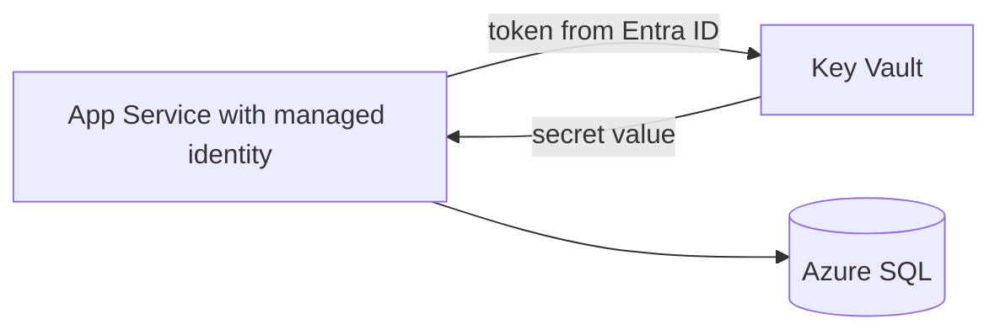

# Session 07: Azure Security and Hosting a Web API on App Service

> Module: Developing Microsoft Azure Applications · Term 4 (HDSE) · ⏱ ~2 hours

An API on your laptop helps nobody. This session first covers how Azure protects networks, secrets and identities, then puts your Students API online with Azure App Service and Azure Container Apps, and finally consumes it from a C# client.

## 🎯 Learning Objectives

- Explain defence in depth: identity, network, data and monitoring layers
- Control traffic with virtual networks, NSGs, Azure Firewall and DDoS Protection
- Store secrets in Key Vault and read them with a managed identity
- Describe MFA, Conditional Access and Microsoft Defender for Cloud
- Host a Web API on App Service and in a container, and consume it with `HttpClient`
- Protect a hosted API with Microsoft Entra ID

## 📖 Concepts Explained

### 1. Defence in depth

Security is layers, like a house with a gate, a locked door and a safe. If one layer fails, the next still protects you.

| Layer | Azure tools |
|---|---|
| Identity | Microsoft Entra ID, MFA, Conditional Access, RBAC |
| Perimeter | Azure DDoS Protection, Azure Firewall, Front Door WAF |
| Network | Virtual networks, NSGs, private endpoints |
| Compute | Defender for Cloud (malware and vulnerability alerts), patching |
| Data / secrets | Key Vault, encryption at rest, TLS in transit |
| Monitoring | Azure Monitor, Defender alerts, Key Vault logs |

### 2. Network security

- **Virtual network (VNet)**: your private network in Azure, split into **subnets**.
- **NSG**: allow/deny rules by port, protocol and address; lower priority numbers are checked first. Cheap and simple, works on subnets or network cards.
- **Azure Firewall**: a managed, central firewall for many VNets with application (domain name) rules and threat intelligence.
- **DDoS Protection**: Basic protection is always on; *DDoS Network Protection* adds tuning, alerts and reports for public IPs in your VNets.

### 3. Identity and access

- **Microsoft Entra ID** (formerly Azure AD) is Azure's identity service: users, groups and app registrations.
- **MFA** asks for a second proof (Authenticator app code). Turn on *security defaults* or create a **Conditional Access** policy such as "require MFA for all administrators".
- **Azure RBAC** gives the least permission needed: *Reader*, *Contributor*, *Key Vault Secrets User*, on a scope (subscription, group or one resource).
- **Managed identity**: an identity Azure creates for your app. The app can reach Key Vault or SQL **without any password in code**.

### 4. Azure Key Vault

A safe for **secrets** (connection strings, API keys), **keys** (encryption) and **certificates**. Every read is logged. App Service can use a **Key Vault reference**, so an app setting fetches the secret at start-up:

```text
ConnectionStrings__AzureSql = @Microsoft.KeyVault(VaultName=kv-demo;SecretName=SqlConnection)
```



### 5. Where to host a Web API

| Option | You give Azure | Good for |
|---|---|---|
| **App Service** | your code | most web apps and APIs; easy scaling, slots, HTTPS |
| **Container Apps** | a container image | microservices, scale to zero |
| Azure Container Instances | a container image | quick single containers, jobs |
| AKS (Kubernetes) | many containers | large platforms with ops teams |

An **App Service plan** is the set of servers (size and price); one plan can host several apps.

### 6. Consuming an API

Any client that speaks HTTP can use your API: React (`fetch`), Node (`axios`), or C# (`HttpClient`). In .NET, `GetFromJsonAsync` and `PostAsJsonAsync` convert between JSON and C# objects for you.

## 💻 Code Examples

Run the scripts in Cloud Shell (Bash).

### Example 1: VNet and NSG

📄 File: [`01-network-security.sh`](01-network-security.sh)

```bash
#!/bin/bash
# Session 07 - Example 1: a virtual network protected by a Network Security Group

RESOURCE_GROUP="rg-session07"
LOCATION="eastus"

az group create --name $RESOURCE_GROUP --location $LOCATION

# Step 1: a virtual network (private address space) with one subnet
az network vnet create --resource-group $RESOURCE_GROUP --name vnet-app \
  --address-prefix 10.0.0.0/16 --subnet-name snet-web --subnet-prefix 10.0.1.0/24

# Step 2: a Network Security Group = a list of allow/deny rules
az network nsg create --resource-group $RESOURCE_GROUP --name nsg-web

# Step 3: allow HTTPS (443) from the internet; lower number = checked first
az network nsg rule create --resource-group $RESOURCE_GROUP --nsg-name nsg-web \
  --name Allow-HTTPS --priority 100 --direction Inbound --access Allow \
  --protocol Tcp --destination-port-ranges 443

# Step 4: block SSH (22) from the internet
az network nsg rule create --resource-group $RESOURCE_GROUP --nsg-name nsg-web \
  --name Deny-SSH --priority 200 --direction Inbound --access Deny \
  --protocol Tcp --destination-port-ranges 22

# Step 5: attach the NSG to the subnet so every VM in it is protected
az network vnet subnet update --resource-group $RESOURCE_GROUP --vnet-name vnet-app \
  --name snet-web --network-security-group nsg-web
```

**How it works**: priority 100 allows HTTPS, priority 200 denies SSH; attaching the NSG to the subnet protects everything inside it.

### Example 2: Key Vault

📄 File: [`02-key-vault.sh`](02-key-vault.sh)

```bash
#!/bin/bash
# Session 07 - Example 2: keep secrets in Azure Key Vault, not in code

RESOURCE_GROUP="rg-session07"
LOCATION="eastus"
VAULT_NAME="kv-session07-$RANDOM"       # globally unique, 3-24 characters
echo "Vault name: $VAULT_NAME  (write it down for the next script)"

# Step 1: create the vault using Azure RBAC for permissions
az keyvault create --name $VAULT_NAME --resource-group $RESOURCE_GROUP \
  --location $LOCATION --enable-rbac-authorization true

# Step 2: give YOURSELF permission to manage secrets in this vault
MY_ID=$(az ad signed-in-user show --query id --output tsv)
VAULT_ID=$(az keyvault show --name $VAULT_NAME --query id --output tsv)
az role assignment create --role "Key Vault Secrets Officer" \
  --assignee $MY_ID --scope $VAULT_ID

# Step 3: store a secret (wait ~1 minute if you get "Forbidden": roles take time)
az keyvault secret set --vault-name $VAULT_NAME --name SqlConnection \
  --value "Server=tcp:demo.database.windows.net;Initial Catalog=SchoolDb;..."

# Step 4: read it back
az keyvault secret show --vault-name $VAULT_NAME --name SqlConnection --query value --output tsv
```

**How it works**: with RBAC mode, permissions are normal role assignments. *Secrets Officer* can write; *Secrets User* can only read.

### Example 3: Deploy to App Service with a managed identity

📄 File: [`03-deploy-app-service.sh`](03-deploy-app-service.sh)

```bash
#!/bin/bash
# Session 07 - Example 3: host the Session 06 Students API on Azure App Service
# Run this from INSIDE the Session-06 StudentsApi folder.

RESOURCE_GROUP="rg-session07"
APP_NAME="students-api-$RANDOM"     # becomes https://<APP_NAME>.azurewebsites.net
VAULT_NAME="kv-session07-XXXXX"     # the vault name printed by 02-key-vault.sh

# Step 1: build and deploy in one command (creates the plan and web app)
az webapp up --name $APP_NAME --resource-group $RESOURCE_GROUP \
  --runtime "DOTNETCORE:8.0" --os-type Linux --sku B1

# Step 2: allow HTTPS only
az webapp update --name $APP_NAME --resource-group $RESOURCE_GROUP --https-only true

# Step 3: give the web app its own identity (a managed identity, no password)
PRINCIPAL_ID=$(az webapp identity assign --name $APP_NAME \
  --resource-group $RESOURCE_GROUP --query principalId --output tsv)

# Step 4: let that identity READ secrets from the vault
VAULT_ID=$(az keyvault show --name $VAULT_NAME --query id --output tsv)
az role assignment create --role "Key Vault Secrets User" \
  --assignee-object-id $PRINCIPAL_ID --assignee-principal-type ServicePrincipal \
  --scope $VAULT_ID

# Step 5: an app setting that POINTS to the secret (a Key Vault reference)
# Uncomment when the secret holds a REAL Azure SQL connection string:
# az webapp config appsettings set --name $APP_NAME --resource-group $RESOURCE_GROUP \
#   --settings "ConnectionStrings__AzureSql=@Microsoft.KeyVault(VaultName=$VAULT_NAME;SecretName=SqlConnection)"

echo "Try: https://$APP_NAME.azurewebsites.net/api/students"
```

**How it works**: `az webapp up` builds and uploads your project. The managed identity gets read-only access to the vault, and the Key Vault reference keeps the real connection string out of code and out of settings.

### Example 4: Host as a container

📄 File: [`Dockerfile`](Dockerfile)

```dockerfile
# Session 07 - Example 4: container image for the Students API
# Copy this file into the Session-06 folder (next to StudentsApi.csproj).

# Stage 1: build with the full SDK
FROM mcr.microsoft.com/dotnet/sdk:8.0 AS build
WORKDIR /src
COPY . .
RUN dotnet publish StudentsApi.csproj -c Release -o /app

# Stage 2: run with the small runtime image
FROM mcr.microsoft.com/dotnet/aspnet:8.0
WORKDIR /app
COPY --from=build /app .
# .NET 8 images listen on port 8080 by default
EXPOSE 8080
ENTRYPOINT ["dotnet", "StudentsApi.dll"]
```

📄 Deploy script: [`04-deploy-container.sh`](04-deploy-container.sh) runs `az containerapp up --source .`, which builds the image in Azure and gives you a public HTTPS address.

**How it works**: the multi-stage build compiles with the SDK image but ships only the smaller runtime image.

### Example 5: Consume the API from C#

📄 File: [`ConsumeApi/Program.cs`](ConsumeApi/Program.cs)

```csharp
// Session 07 - Example 5: a C# client that consumes the hosted Web API
using System.Net.Http.Json;

// Step 1: the API address (pass your Azure URL as an argument)
string baseUrl = args.Length > 0 ? args[0] : "http://localhost:5000/";
var http = new HttpClient { BaseAddress = new Uri(baseUrl) };

// Step 2: GET - JSON is turned into C# objects automatically
List<Student>? students = await http.GetFromJsonAsync<List<Student>>("api/students");
Console.WriteLine($"The API returned {students?.Count ?? 0} students:");
foreach (Student s in students ?? new List<Student>())
    Console.WriteLine($"  {s.Name} ({s.Course}) - {s.Marks}");

// Step 3: POST - send a new student as JSON
var newStudent = new Student(0, "Zara", "Azure", 85);
HttpResponseMessage response = await http.PostAsJsonAsync("api/students", newStudent);
Console.WriteLine($"POST status: {(int)response.StatusCode} {response.StatusCode}");

// The shape of the data we expect from the API
public record Student(int Id, string Name, string Course, int Marks);
```

**How it works**: run `dotnet run -- https://<your-app>.azurewebsites.net/` inside `ConsumeApi`. The `record` describes the JSON shape.

### Example 6: Secure the API with Entra ID (snippet)

📄 File: [`entra-id-snippet.cs`](entra-id-snippet.cs) shows the `Microsoft.Identity.Web` lines that replace your own JWT setup, so users sign in with their organisation account and roles come from Entra ID *App roles*.

## 🧪 Lab Practice

1. Run Example 1 and view the NSG's **effective rules** in the Portal.
2. Create a Key Vault, store a secret and read it with the CLI.
3. Deploy the Session 06 API with Example 3 and open `/api/students` in the browser.
4. Run the `ConsumeApi` client against your Azure URL.
5. In Entra ID, check whether security defaults (MFA) are on for your tenant, then delete `rg-session07`.

## 📝 Assignment

Deploy your Session 06 assignment API to App Service with HTTPS only and a managed identity. Store any secret (e.g. an API key) in Key Vault, reference it from an app setting, and return `"secret loaded: true"` from a `/health` endpoint without printing the value. Submit the URL and screenshots.

## ❓ Quick Quiz

**Q1.** What does an NSG do?

**Q2.** Why use a managed identity?

**Q3.** Which Key Vault role can only read secrets?

**Q4.** What is the difference between App Service and Container Apps?

**Q5.** Which method in C# sends an object as JSON in a POST?

<details>
<summary>Show answers</summary>

1. Allows or denies network traffic by port, protocol and address.
2. The app can access Azure resources without storing any password or key.
3. Key Vault Secrets User.
4. App Service runs your code on a managed platform; Container Apps runs container images and can scale to zero.
5. `PostAsJsonAsync`

</details>

## 💼 Interview Questions

**1. How do you keep a connection string out of source code in Azure?**

> Store it in Key Vault, give the app a managed identity with read access, and use a Key Vault reference or the SDK to load it.

**2. NSG vs Azure Firewall?**

> NSGs are simple port/IP rules on subnets or NICs; Azure Firewall is a central, stateful firewall with domain rules, threat intelligence and logging across networks.

**3. What is least privilege?**

> Giving each user or app only the permissions it needs, on the smallest scope, for as long as needed.

## ✅ Summary

- Security works in layers: identity, network, compute, data, monitoring.
- NSGs and Azure Firewall filter traffic; DDoS Protection guards public IPs.
- Key Vault plus managed identity removes secrets from code.
- App Service and Container Apps host APIs; `HttpClient` consumes them.

---

[⬅ Previous](../Session-06-Practice-Lab-EF-Core-and-Web-API/README.md) · [🏠 Module Home](../README.md) · [Next ➡](../Session-08-Practice-Lab-Security-and-Hosting/README.md)

Prepared by Zeeshan Abbas · Aptech Learning North Nazimabad
