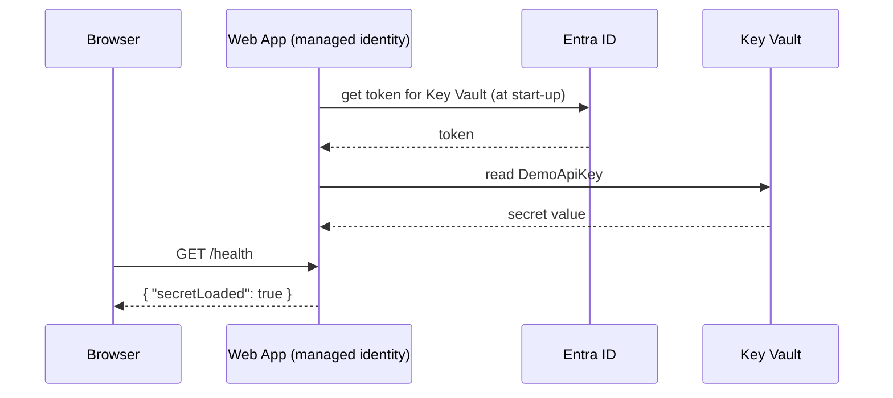

# Session 08: Practice Lab: Security and Hosting

> Module: Developing Microsoft Azure Applications · Term 4 (HDSE) · ⏱ ~2 hours

Hands-on practice for Session 07. You will create a secure web app with Bicep, store a secret in Key Vault, let the app read it through a managed identity and deploy code. Try every task yourself first, then compare with the solution files in this folder.

## 🎯 Learning Objectives

- Describe a secure App Service (HTTPS only, TLS 1.2, FTP off, managed identity) in Bicep
- Connect an app to Key Vault without any secret in code or settings
- Publish and zip-deploy a .NET 8 API from the command line
- Verify security settings with simple tests and an RBAC review

## 📖 Concepts Explained

### 1. Quick revision

| Topic | Remember |
|---|---|
| NSG | allow/deny by port; lower priority number wins |
| Managed identity | app identity without passwords |
| Key Vault roles | Officer writes, User reads |
| Key Vault reference | `@Microsoft.KeyVault(VaultName=...;SecretName=...)` |
| App Service plan | the servers; the web app runs on it |
| `httpsOnly` | http requests are redirected to https |

### 2. The flow you will build



### 3. Why order matters

1. The identity must exist before you grant it a role.
2. Role assignments can take a minute to apply.
3. The app setting is resolved when the app starts; after fixing permissions, **restart** the app (`az webapp restart`).

### 4. Zip deploy

`dotnet publish` creates a folder with everything needed to run. Zip **the contents** of that folder (not the folder itself) and send it with `az webapp deploy --type zip`.

## 💻 Code Examples

### Task 1: A health endpoint

📄 File: [`HealthApi/Program.cs`](HealthApi/Program.cs)

```csharp
// Lab 08 - Task 1: a tiny API that proves a Key Vault secret reached the app
var builder = WebApplication.CreateBuilder(args);
var app = builder.Build();

// Step 1: a home endpoint
app.MapGet("/", () => "Lab 08 API is running");

// Step 2: /health tells us IF the secret exists, but never shows its value
app.MapGet("/health", (IConfiguration config) =>
{
    string? apiKey = config["DemoApiKey"];      // filled from Key Vault on Azure
    return new
    {
        status = "healthy",
        secretLoaded = !string.IsNullOrEmpty(apiKey),
        serverTimeUtc = DateTime.UtcNow
    };
});

app.Run();
```

**How it works**: the endpoint reports only `true`/`false`, so the secret is never exposed. Project file: [`HealthApi/HealthApi.csproj`](HealthApi/HealthApi.csproj).

### Task 2: Secure web app in Bicep

📄 File: [`task2-webapp.bicep`](task2-webapp.bicep)

```bicep
// Lab 08 - Task 2: App Service plan + secure web app, as code

param location string = resourceGroup().location
param appName string = 'lab08-${uniqueString(resourceGroup().id)}'

// The plan = the servers that run the app (B1, Linux)
resource plan 'Microsoft.Web/serverfarms@2023-12-01' = {
  name: 'plan-${appName}'
  location: location
  sku: { name: 'B1' }
  kind: 'linux'
  properties: { reserved: true }      // "reserved: true" means Linux
}

// The web app with security switched on
resource webApp 'Microsoft.Web/sites@2023-12-01' = {
  name: appName
  location: location
  identity: { type: 'SystemAssigned' }      // managed identity
  properties: {
    serverFarmId: plan.id
    httpsOnly: true                         // redirect http to https
    siteConfig: {
      linuxFxVersion: 'DOTNETCORE|8.0'
      minTlsVersion: '1.2'
      ftpsState: 'Disabled'                 // no plain FTP uploads
    }
  }
}

output appName string = webApp.name
output url string = 'https://${webApp.properties.defaultHostName}'
output principalId string = webApp.identity.principalId
```

**How it works**: security settings are part of the template, so every environment is created the same safe way. The outputs are reused by the script.

### Task 3: End-to-end solution script

📄 File: [`task3-solution.sh`](task3-solution.sh)

```bash
#!/bin/bash
# Lab 08 - Task 3 solution: infrastructure, secret, permission, code - in order
# Run from this Session-08 folder in Cloud Shell.

RESOURCE_GROUP="rg-lab08"
LOCATION="eastus"
VAULT_NAME="kv-lab08-$RANDOM"

# Step 1: resource group + web app from Bicep; keep the outputs in variables
az group create --name $RESOURCE_GROUP --location $LOCATION
APP_NAME=$(az deployment group create --resource-group $RESOURCE_GROUP \
  --template-file task2-webapp.bicep --query properties.outputs.appName.value --output tsv)
PRINCIPAL_ID=$(az webapp identity show --name $APP_NAME --resource-group $RESOURCE_GROUP \
  --query principalId --output tsv)

# Step 2: Key Vault + a secret (you need Secrets Officer to write)
az keyvault create --name $VAULT_NAME --resource-group $RESOURCE_GROUP \
  --location $LOCATION --enable-rbac-authorization true
VAULT_ID=$(az keyvault show --name $VAULT_NAME --query id --output tsv)
az role assignment create --role "Key Vault Secrets Officer" \
  --assignee $(az ad signed-in-user show --query id --output tsv) --scope $VAULT_ID
sleep 60   # give the role assignment time to apply
az keyvault secret set --vault-name $VAULT_NAME --name DemoApiKey --value "lab08-demo-key-123"

# Step 3: the web app's identity may READ secrets
az role assignment create --role "Key Vault Secrets User" \
  --assignee-object-id $PRINCIPAL_ID --assignee-principal-type ServicePrincipal --scope $VAULT_ID

# Step 4: app setting that references the secret
az webapp config appsettings set --name $APP_NAME --resource-group $RESOURCE_GROUP \
  --settings "DemoApiKey=@Microsoft.KeyVault(VaultName=$VAULT_NAME;SecretName=DemoApiKey)"

# Step 5: publish the code as a zip and deploy it
cd HealthApi
dotnet publish -c Release -o publish
cd publish && zip -r ../app.zip . && cd ..
az webapp deploy --resource-group $RESOURCE_GROUP --name $APP_NAME --src-path app.zip --type zip

# Step 6: test - expect "secretLoaded": true
curl https://$APP_NAME.azurewebsites.net/health
```

**How it works**: the script follows the safe order: infrastructure → vault and secret → permission → setting → code → test.

### Task 4: Test the security

📄 File: [`task4-test-security.sh`](task4-test-security.sh) checks that `http` returns a 301 redirect, `https` returns 200, and lists every role assignment on the resource group.

### ▶️ How to run

Upload this folder to Cloud Shell (it has the .NET SDK and `zip`), then run `bash task3-solution.sh`. Local test: `cd HealthApi && dotnet run` and open `http://localhost:5000/health`.

## 🧪 Lab Practice

1. Run `HealthApi` locally; `secretLoaded` is `false`. Set an environment variable `DemoApiKey=test` and run again.
2. Deploy `task2-webapp.bicep` and confirm HTTPS only, TLS 1.2 and identity in the Portal.
3. Complete the Key Vault steps and deploy the code; open `/health`.
4. Remove the *Secrets User* role, restart the app and observe `secretLoaded: false`; add it back.
5. Run `task4-test-security.sh`, then delete `rg-lab08`.

## 📝 Assignment

Deploy the Session 06 Students API with this Bicep template, store an Azure SQL connection string in Key Vault, reference it as `ConnectionStrings__AzureSql`, and prove the API is using Azure SQL (rows visible in the Portal Query editor). Write a short security checklist of everything you enabled.

## ❓ Quick Quiz

**Q1.** Which Bicep property turns on a managed identity?

**Q2.** What should you do after fixing Key Vault permissions for a running app?

**Q3.** Which command deploys a zip file to App Service?

**Q4.** What status code does `http://` return when `httpsOnly` is true?

**Q5.** Why does `/health` not print the secret?

<details>
<summary>Show answers</summary>

1. `identity: { type: 'SystemAssigned' }`
2. Restart the app so the Key Vault reference is resolved again.
3. `az webapp deploy --type zip --src-path app.zip`
4. 301 (redirect to https).
5. Secrets must never appear in responses or logs; showing only true/false is safe.

</details>

## 💼 Interview Questions

**1. System-assigned vs user-assigned managed identity?**

> System-assigned is tied to one resource and deleted with it; user-assigned is a separate resource that several apps can share.

**2. How do you check who can access a resource?**

> Review role assignments (`az role assignment list` or the Portal's Access control (IAM) blade) on the resource and its parent scopes.

**3. What security settings would you enforce on every App Service?**

> HTTPS only, minimum TLS 1.2, FTP disabled, managed identity, secrets in Key Vault, and authentication where needed.

## ✅ Summary

- Security settings belong in Bicep so they are never forgotten.
- Managed identity + Key Vault reference = no secrets in code.
- Publish, zip and deploy with three commands.
- Always test and review access after deployment.

---

[⬅ Previous](../Session-07-Azure-Security-and-Hosting-Web-API-on-App-Service/README.md) · [🏠 Module Home](../README.md) · [Next ➡](../Session-09-Azure-Functions-API-Management-and-CI-CD/README.md)

Prepared by Zeeshan Abbas · Aptech Learning North Nazimabad
