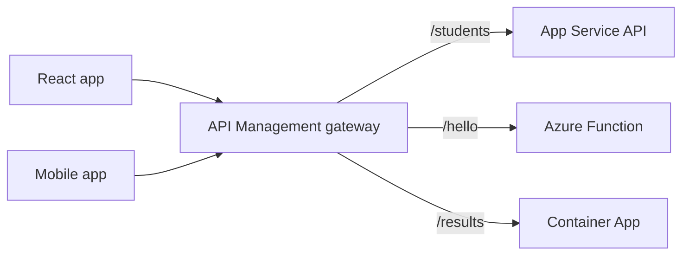
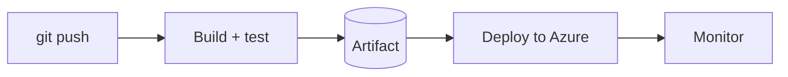

# Session 09: Serverless Azure Functions, API Management and CI/CD with GitHub Actions

> Module: Developing Microsoft Azure Applications · Term 4 (HDSE) · ⏱ ~2 hours

This session covers three ideas that modern cloud teams use every day: **serverless** code that runs only when something happens, an **API gateway** that protects and organises all your APIs, and **CI/CD** pipelines that build and deploy automatically on every push.

## 🎯 Learning Objectives

- Explain serverless computing, triggers and bindings in Azure Functions
- Write HTTP-triggered and queue-triggered functions in C# (.NET 8 isolated worker)
- Describe the API gateway pattern and use Azure API Management (APIM) with revisions and policies
- Explain policy scopes and how APIM secures APIs (subscription keys, OAuth, certificates)
- Build a CI/CD pipeline with GitHub Actions and explain artifacts and IaC in pipelines

## 📖 Concepts Explained

### 1. Serverless with Azure Functions

"Serverless" does not mean no servers; it means **you never manage them**. You write a small function, Azure runs it when an event happens and bills per execution.

| Term | Meaning | Example |
|---|---|---|
| **Trigger** | what starts the function (exactly one) | HTTP request, queue message, timer, blob upload |
| **Binding** | easy read/write to other services | write to Cosmos DB, send to a queue |
| **Plan** | how it is hosted and billed | Consumption (pay per run), Flex Consumption, Premium |

Event-driven example: a website drops an order into a queue → `ProcessOrder` runs → emails the customer. The website never waits.

### 2. The API gateway pattern

When you have many APIs (students, fees, results), clients should not call each one directly. A **gateway** is a single front door.



The gateway handles **security** (keys, JWT validation), **rate limits**, **caching**, **transformation** and **analytics** in one place.

### 3. Azure API Management (APIM) essentials

- **APIs and operations**: imported from OpenAPI (Swagger) or a Function App.
- **Products**: bundles of APIs that developers subscribe to; a **subscription key** is sent as the `Ocp-Apim-Subscription-Key` header.
- **Revisions**: safe, non-breaking changes you can test, then make *current*. **Versions** are for breaking changes (v1, v2).
- **Policies**: XML rules in four sections: `inbound`, `backend`, `outbound`, `on-error`.
- **Scopes**: policies apply at **global → product → API → operation**; `<base />` pulls in the parent scope's policies.
- **Security**: validate Entra ID tokens with `validate-jwt`, use client certificates, and keep backend secrets in named values linked to Key Vault.
- **Developer portal**: auto-generated documentation where developers try APIs (like Swagger).
- **Running services**: send logs to Application Insights; Premium tier supports multiple regions for disaster recovery.

### 4. CI/CD

- **Continuous Integration (CI)**: every push is built and tested automatically.
- **Continuous Delivery/Deployment (CD)**: the tested package is released to Azure automatically (or after an approval).
- **Artifact**: the built package (zip, container image) stored between jobs, in GitHub artifacts, GitHub Packages, Azure Artifacts or Azure Container Registry.
- **IaC in pipelines**: add a step like `az deployment group create --template-file main.bicep` so infrastructure is deployed with the code. Terraform is a popular alternative.



GitHub Actions and Azure DevOps Pipelines both do this; workflows are YAML files in `.github/workflows/`.

## 💻 Code Examples

The `HelloFunctions` folder is a complete Functions project ([`HelloFunctions.csproj`](HelloFunctions/HelloFunctions.csproj), [`Program.cs`](HelloFunctions/Program.cs), [`host.json`](HelloFunctions/host.json), [`local.settings.json`](HelloFunctions/local.settings.json)).

### Example 1: HTTP trigger

📄 File: [`HelloFunctions/HelloHttp.cs`](HelloFunctions/HelloHttp.cs)

```csharp
// Session 09 - HelloHttp.cs: a serverless API endpoint (HTTP trigger)
using System.Net;
using Microsoft.Azure.Functions.Worker;
using Microsoft.Azure.Functions.Worker.Http;
using Microsoft.Extensions.Logging;

public class HelloHttp
{
    private readonly ILogger<HelloHttp> _logger;

    public HelloHttp(ILogger<HelloHttp> logger)
    {
        _logger = logger;
    }

    // GET /api/Hello?name=Ali
    [Function("Hello")]
    public async Task<HttpResponseData> Run(
        [HttpTrigger(AuthorizationLevel.Function, "get")] HttpRequestData request)
    {
        // Step 1: read the name from the query string (default: "student")
        string name = request.Query["name"] ?? "student";
        _logger.LogInformation("Hello function called for {Name}", name);

        // Step 2: build a 200 OK response with plain text
        HttpResponseData response = request.CreateResponse(HttpStatusCode.OK);
        await response.WriteStringAsync($"Hello, {name}! This answer came from Azure Functions.");
        return response;
    }
}
```

**How it works**: `[Function("Hello")]` names the function; `AuthorizationLevel.Function` means callers need a function key on Azure (not locally).

### Example 2: Queue trigger (event-driven)

📄 File: [`HelloFunctions/OrderQueue.cs`](HelloFunctions/OrderQueue.cs)

```csharp
// Session 09 - OrderQueue.cs: event-driven code (runs when a queue message arrives)
using Microsoft.Azure.Functions.Worker;
using Microsoft.Extensions.Logging;

public class OrderQueue
{
    private readonly ILogger<OrderQueue> _logger;

    public OrderQueue(ILogger<OrderQueue> logger)
    {
        _logger = logger;
    }

    // Triggered automatically for every new message in the "orders" queue
    [Function("ProcessOrder")]
    public void Run([QueueTrigger("orders", Connection = "AzureWebJobsStorage")] string message)
    {
        // A real app might send an email, update a database or call an AI service here
        _logger.LogInformation("New order received: {Message}", message);
    }
}
```

**How it works**: the runtime watches the `orders` queue and calls `Run` once per message; failures are retried automatically.

### Example 3: Create the Function App

📄 File: [`01-create-function-app.sh`](01-create-function-app.sh)

```bash
#!/bin/bash
# Session 09 - Example 3: create a Function App and send it a queue message

RESOURCE_GROUP="rg-session09"
LOCATION="eastus"
STORAGE_NAME="stfunc09$RANDOM"
FUNC_APP="func-session09-$RANDOM"

# Step 1: resource group and the storage account Functions needs
az group create --name $RESOURCE_GROUP --location $LOCATION
az storage account create --name $STORAGE_NAME --resource-group $RESOURCE_GROUP \
  --location $LOCATION --sku Standard_LRS

# Step 2: a Function App on the Consumption (pay-per-run) plan
az functionapp create --name $FUNC_APP --resource-group $RESOURCE_GROUP \
  --storage-account $STORAGE_NAME --consumption-plan-location $LOCATION \
  --runtime dotnet-isolated --runtime-version 8 --functions-version 4 --os-type Linux

# Step 3: publish the code (run inside HelloFunctions; needs Azure Functions Core Tools)
# func azure functionapp publish $FUNC_APP

# Step 4: drop a message in the "orders" queue to trigger ProcessOrder
az storage queue create --name orders --account-name $STORAGE_NAME --auth-mode key
az storage message put --queue-name orders --account-name $STORAGE_NAME \
  --content "Order 101: 2 x Azure Fundamentals book" --auth-mode key
```

### Example 4: API Management

📄 File: [`02-api-management.sh`](02-api-management.sh)

```bash
#!/bin/bash
# Session 09 - Example 4: put API Management (a gateway) in front of your API

RESOURCE_GROUP="rg-session09"
APIM_NAME="apim-session09-$RANDOM"
BACKEND_URL="https://students-api-XXXX.azurewebsites.net"   # your Session 07 web app

# Step 1: create the gateway (Consumption tier is pay-per-call and quick to create)
az apim create --name $APIM_NAME --resource-group $RESOURCE_GROUP \
  --publisher-name "ACCP Student" --publisher-email student@example.com \
  --sku-name Consumption

# Step 2: import the API from its Swagger (OpenAPI) document
az apim api import --resource-group $RESOURCE_GROUP --service-name $APIM_NAME \
  --api-id students --path students --display-name "Students API" \
  --specification-format OpenApi \
  --specification-url "$BACKEND_URL/swagger/v1/swagger.json" \
  --service-url $BACKEND_URL

# Step 3: create revision 2 to test changes safely (clients still use revision 1)
az apim api revision create --resource-group $RESOURCE_GROUP --service-name $APIM_NAME \
  --api-id students --api-revision 2 --api-revision-description "Add rate limit policy"

echo "Gateway URL: https://$APIM_NAME.azure-api.net/students/api/students"
```

**How it works**: APIM reads your Swagger file and creates every operation. Revision 2 lets you test a change at `...;rev=2` before making it current.

### Example 5: A policy

📄 File: [`rate-limit-policy.xml`](rate-limit-policy.xml)

```xml
<!-- Session 09 - Example 5: an API Management policy (paste in the API's Policy editor) -->
<policies>
    <inbound>
        <base />
        <!-- allow at most 10 calls per 60 seconds per subscription key -->
        <rate-limit calls="10" renewal-period="60" />
    </inbound>
    <backend>
        <base />
    </backend>
    <outbound>
        <base />
        <!-- hide technology details from callers -->
        <set-header name="X-Powered-By" exists-action="delete" />
        <set-header name="X-Served-By" exists-action="override">
            <value>ACCP API Gateway</value>
        </set-header>
    </outbound>
    <on-error>
        <base />
    </on-error>
</policies>
```

**How it works**: callers above 10 calls a minute receive **429 Too Many Requests**. Check the APIM policy reference for which policies your tier supports.

### Example 6: GitHub Actions pipeline

📄 File: [`deploy-api.yml`](deploy-api.yml) has two jobs: **build** (checkout, set up .NET 8, build, publish, upload artifact) and **deploy** (download artifact, `azure/webapps-deploy`). The publish profile is stored as a GitHub **secret**, never in the file.

### ▶️ How to run locally

Install [Azure Functions Core Tools](https://learn.microsoft.com/azure/azure-functions/functions-run-local) and [Azurite](https://learn.microsoft.com/azure/storage/common/storage-use-azurite) (local storage emulator), start Azurite, then inside `HelloFunctions` run `func start` and open `http://localhost:7071/api/Hello?name=Ali`.

## 🧪 Lab Practice

1. Run the functions locally and call `Hello` with your name.
2. Add a **timer trigger** that logs a message every minute (`[TimerTrigger("0 */1 * * * *")]`).
3. Create the Function App, publish with `func azure functionapp publish <name>` and put a queue message; read the log in the Portal.
4. Import your Students API into APIM, add the rate-limit policy and call it 11 times quickly.
5. Push the Session 06 API to a GitHub repo with `deploy-api.yml` and watch the **Actions** tab deploy it.

## 📝 Assignment

Create a Function App with two functions: `POST /api/feedback` that writes the request body to a `feedback` queue (use a `[QueueOutput("feedback")]` output binding) and a queue-triggered function that logs it. Put the HTTP function behind APIM with a subscription key and deploy both with a GitHub Actions workflow.

## ❓ Quick Quiz

**Q1.** How many triggers can one function have?

**Q2.** In which APIM policy section would you check a JWT?

**Q3.** What is the difference between an APIM revision and a version?

**Q4.** What is an artifact in CI/CD?

**Q5.** Where should a publish profile or Azure credential be kept for GitHub Actions?

<details>
<summary>Show answers</summary>

1. Exactly one.
2. `inbound`
3. Revisions are non-breaking changes to the same API; versions are separate, possibly breaking, editions.
4. The built package passed from the build job to the deploy job.
5. In GitHub repository or environment **secrets**.

</details>

## 💼 Interview Questions

**1. When is Azure Functions a poor choice?**

> For long-running, constantly busy workloads or when cold starts are unacceptable; App Service, Container Apps or a Premium plan suit better.

**2. Why place APIM in front of microservices?**

> One entry point for security, throttling, versioning, monitoring and documentation, so each service stays simple.

**3. CI vs CD?**

> CI automatically builds and tests every change; CD automatically releases tested changes to an environment.

## ✅ Summary

- Functions run small pieces of code on triggers and bill per execution.
- APIM is a gateway with products, revisions and scoped XML policies.
- GitHub Actions builds, stores artifacts and deploys on every push.
- IaC steps in the pipeline keep infrastructure and code in step.

---

[⬅ Previous](../Session-08-Practice-Lab-Security-and-Hosting/README.md) · [🏠 Module Home](../README.md) · [Next ➡](../Session-10-Practice-Lab-Serverless-APIM-and-CI-CD/README.md)

Prepared by Zeeshan Abbas · Aptech Learning North Nazimabad
