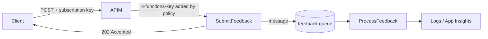

# Session 10: Practice Lab: Serverless, API Management and CI/CD

> Module: Developing Microsoft Azure Applications · Term 4 (HDSE) · ⏱ ~2 hours

Hands-on practice for Session 09. You will build an event-driven **Feedback** service with two functions, publish it through API Management with a subscription key, and deploy it with GitHub Actions. Try every task yourself first, then compare with the solution files in this folder.

## 🎯 Learning Objectives

- Use a multi-output function: HTTP response plus a queue message
- Chain functions through a queue (event-driven design)
- Expose a function through APIM products, subscriptions and policies
- Hide backend keys with APIM named values
- Automate Function App deployment with GitHub Actions

## 📖 Concepts Explained

### 1. Quick revision

| Topic | Remember |
|---|---|
| Trigger | exactly one per function |
| Output binding | write to a service by returning a value |
| APIM product | bundle of APIs + subscription keys |
| Policy sections | inbound, backend, outbound, on-error |
| Pipeline | build → artifact → deploy |

### 2. The design



Why a queue? The user gets an instant **202 Accepted**, while slower work (analysis, emails, AI) happens in the background. If `ProcessFeedback` fails, the message is retried and finally moved to a `feedback-poison` queue for inspection.

### 3. Two keys, two jobs

- **Subscription key** (`Ocp-Apim-Subscription-Key`): identifies the *caller* at the gateway.
- **Function key** (`x-functions-key`): protects the *backend*. APIM adds it from a **named value**, so callers never see it.

### 4. Multi-output functions

In the isolated worker model, return a class: properties with output-binding attributes are written to those services, and an `HttpResponseData` property becomes the HTTP reply.

## 💻 Code Examples

Project files (same as Session 09): [`FeedbackFunctions.csproj`](FeedbackFunctions/FeedbackFunctions.csproj), [`Program.cs`](FeedbackFunctions/Program.cs), [`host.json`](FeedbackFunctions/host.json), [`local.settings.json`](FeedbackFunctions/local.settings.json).

### Task 1: Submit feedback (HTTP + queue output)

📄 File: [`FeedbackFunctions/SubmitFeedback.cs`](FeedbackFunctions/SubmitFeedback.cs)

```csharp
// Lab 10 - Task 1: HTTP POST that saves feedback into a queue
using System.Net;
using Microsoft.Azure.Functions.Worker;
using Microsoft.Azure.Functions.Worker.Http;

// A function can return TWO things: a queue message AND an HTTP response
public class FeedbackOutput
{
    [QueueOutput("feedback", Connection = "AzureWebJobsStorage")]
    public string? QueueMessage { get; set; }     // null = nothing is written

    public HttpResponseData? HttpResponse { get; set; }
}

public class SubmitFeedback
{
    // POST /api/feedback   body: any text or JSON
    [Function("SubmitFeedback")]
    public async Task<FeedbackOutput> Run(
        [HttpTrigger(AuthorizationLevel.Function, "post", Route = "feedback")] HttpRequestData request)
    {
        // Step 1: read the request body as text
        string body = await new StreamReader(request.Body).ReadToEndAsync();

        // Step 2: reject empty feedback with 400
        if (string.IsNullOrWhiteSpace(body))
        {
            var bad = request.CreateResponse(HttpStatusCode.BadRequest);
            await bad.WriteStringAsync("Feedback cannot be empty");
            return new FeedbackOutput { HttpResponse = bad };
        }

        // Step 3: accept it - send to the queue and reply 202 Accepted
        var ok = request.CreateResponse(HttpStatusCode.Accepted);
        await ok.WriteStringAsync("Thank you! Your feedback was received.");
        return new FeedbackOutput { QueueMessage = body, HttpResponse = ok };
    }
}
```

**How it works**: when `QueueMessage` is `null` nothing is queued, so bad requests never reach the queue.

### Task 2: Process feedback (queue trigger)

📄 File: [`FeedbackFunctions/ProcessFeedback.cs`](FeedbackFunctions/ProcessFeedback.cs)

```csharp
// Lab 10 - Task 2: runs for every message that SubmitFeedback put in the queue
using Microsoft.Azure.Functions.Worker;
using Microsoft.Extensions.Logging;

public class ProcessFeedback
{
    private readonly ILogger<ProcessFeedback> _logger;

    public ProcessFeedback(ILogger<ProcessFeedback> logger)
    {
        _logger = logger;
    }

    [Function("ProcessFeedback")]
    public void Run([QueueTrigger("feedback", Connection = "AzureWebJobsStorage")] string feedback)
    {
        // Step 1: a very simple "analysis" - count words
        int wordCount = feedback.Split(' ', StringSplitOptions.RemoveEmptyEntries).Length;

        // Step 2: log the result (visible in Application Insights on Azure)
        _logger.LogInformation("Feedback with {Words} words: {Text}", wordCount, feedback);
    }
}
```

### Task 3: APIM product and policy

📄 File: [`task3-apim-product.sh`](task3-apim-product.sh)

```bash
#!/bin/bash
# Lab 10 - Task 3 solution: publish the function through APIM with a subscription key

RESOURCE_GROUP="rg-lab10"
APIM_NAME="apim-lab10-xxxx"            # your APIM instance
FUNC_APP="func-lab10-xxxx"             # your Function App
FUNC_KEY=$(az functionapp keys list --name $FUNC_APP --resource-group $RESOURCE_GROUP \
  --query functionKeys.default --output tsv)

# Step 1: an API that forwards to the Function App
az apim api create --resource-group $RESOURCE_GROUP --service-name $APIM_NAME \
  --api-id feedback --path feedback --display-name "Feedback API" \
  --service-url "https://$FUNC_APP.azurewebsites.net/api" --protocols https

# Step 2: one operation: POST /feedback
az apim api operation create --resource-group $RESOURCE_GROUP --service-name $APIM_NAME \
  --api-id feedback --operation-id submit --display-name "Submit feedback" \
  --method POST --url-template "/feedback"

# Step 3: a product that requires a subscription key, containing the API
az apim product create --resource-group $RESOURCE_GROUP --service-name $APIM_NAME \
  --product-id students --product-name "Students" --subscription-required true --state published
az apim product api add --resource-group $RESOURCE_GROUP --service-name $APIM_NAME \
  --product-id students --api-id feedback

echo "Function key for the backend (store it as an APIM named value): $FUNC_KEY"
echo "Next: Portal > APIM > Subscriptions > add one for the Students product, copy its key."
```

📄 File: [`backend-key-policy.xml`](backend-key-policy.xml)

```xml
<!-- Lab 10 - Task 3: inbound policy for the Feedback API -->
<!-- "func-key" is a Named value in APIM (ideally linked to Key Vault) -->
<policies>
    <inbound>
        <base />
        <!-- add the function key so callers never see it -->
        <set-header name="x-functions-key" exists-action="override">
            <value>{{func-key}}</value>
        </set-header>
        <rate-limit calls="5" renewal-period="60" />
    </inbound>
    <backend>
        <base />
    </backend>
    <outbound>
        <base />
    </outbound>
    <on-error>
        <base />
    </on-error>
</policies>
```

**How it works**: create a named value `func-key` (Portal → APIM → Named values) holding the function key, then paste the policy on the Feedback API. `{{func-key}}` is replaced at run time.

### Task 4: CI/CD

📄 File: [`deploy-functions.yml`](deploy-functions.yml) publishes the project and deploys it with `Azure/functions-action@v1` using a publish-profile secret.

### ▶️ How to run

Start Azurite, then `cd FeedbackFunctions && func start`. Send requests from [`feedback.http`](feedback.http) and watch both functions log in the terminal.

## 🧪 Lab Practice

1. Run locally; send valid and empty feedback and check the 202 and 400 replies.
2. Create `rg-lab10`, a Function App (Session 09 script) and publish with `func azure functionapp publish`.
3. Run Task 3, create the named value and a subscription, then call through APIM with and without the key (expect 401 without).
4. Push the project to GitHub with `deploy-functions.yml`; change the thank-you text and watch the pipeline redeploy.
5. Trigger the rate limit (6 calls in a minute → 429), then delete `rg-lab10`.

## 📝 Assignment

Add a **timer-triggered** function that runs every hour and logs how many messages are waiting in the `feedback` queue (use the `Azure.Storage.Queues` SDK). Extend the workflow with a `dotnet test` step for one unit test of the word-count logic.

## ❓ Quick Quiz

**Q1.** What HTTP status does `SubmitFeedback` return on success, and why?

**Q2.** Which header carries the APIM subscription key?

**Q3.** Where is the function key kept so callers never see it?

**Q4.** What happens to a message that keeps failing?

**Q5.** Which GitHub Action deploys a Function App?

<details>
<summary>Show answers</summary>

1. 202 Accepted, because the work continues in the background.
2. `Ocp-Apim-Subscription-Key`
3. In an APIM named value, added by an inbound `set-header` policy.
4. After the retry limit it moves to the `<queue>-poison` queue.
5. `Azure/functions-action`

</details>

## 💼 Interview Questions

**1. Why decouple with a queue instead of calling the next service directly?**

> The caller is not blocked, spikes are smoothed, and failures are retried without losing data.

**2. How do you protect a Function App behind APIM?**

> Require function keys (added by APIM), or restrict access to APIM's IP / a private endpoint, and validate tokens at the gateway.

**3. How would you roll back a bad deployment from a pipeline?**

> Redeploy the previous artifact, or swap back a deployment slot (next session).

## ✅ Summary

- Multi-output functions reply over HTTP and queue work in one step.
- Queues make systems resilient and responsive.
- APIM products, subscription keys and named values secure the service.
- GitHub Actions deploys functions on every push.

---

[⬅ Previous](../Session-09-Azure-Functions-API-Management-and-CI-CD/README.md) · [🏠 Module Home](../README.md) · [Next ➡](../Session-11-Traffic-Management-Monitoring-and-Deployment-Slots/README.md)

Prepared by Zeeshan Abbas · Aptech Learning North Nazimabad
