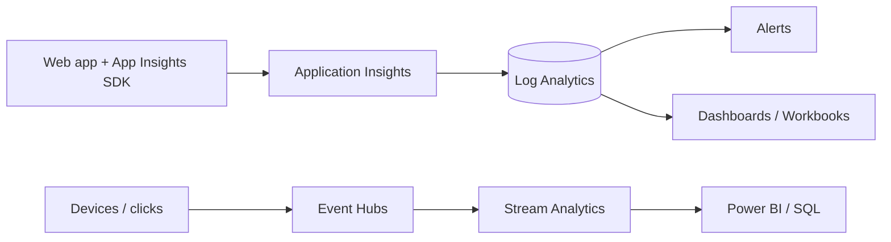
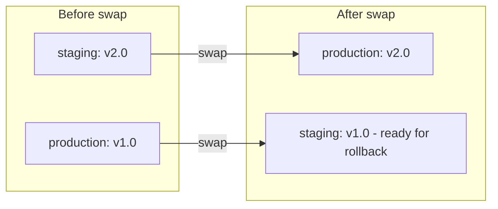

# Session 11: Traffic Management, Monitoring and Deployment Slots

> Module: Developing Microsoft Azure Applications · Term 4 (HDSE) · ⏱ ~2 hours

When an app has real users, three questions matter: *how do requests reach the right server?*, *how do we know it is healthy?* and *how do we release new versions without downtime?* This session answers all three with Azure's traffic services, Application Insights and App Service deployment slots.

## 🎯 Learning Objectives

- Compare Azure Load Balancer, Application Gateway, Traffic Manager and Front Door
- Configure Application Insights and Log Analytics for a web app and query telemetry
- Explain Event Hubs and Stream Analytics for real-time data
- Use Deployment Center sources: GitHub, Docker, Bitbucket and file publishing
- Release with deployment slots, sticky settings, traffic splitting and swap/rollback

## 📖 Concepts Explained

### 1. Four ways to distribute traffic

| Service | Works at | Scope | Best for |
|---|---|---|---|
| **Load Balancer** | Layer 4 (TCP/UDP) | one region | spreading traffic across VMs |
| **Application Gateway** | Layer 7 (HTTP) | one region | URL-path routing, TLS offload, **WAF** |
| **Traffic Manager** | DNS | global | sending users to a healthy/closest region |
| **Front Door** | Layer 7 (HTTP) | global edge | global routing + **caching** + WAF + fast TLS |

Analogy: Load Balancer is a queue manager inside one bank branch; Traffic Manager is the helpline that tells you which branch is open; Front Door is a nationwide chain of reception desks that also keeps popular forms (cached files) ready.

Routing methods (Traffic Manager / Front Door): **priority** (primary + backup), **weighted** (e.g. 90/10), **performance/latency** (closest region), **geographic**.

### 2. Front Door routing and caching

Front Door has **endpoints** (public address), **origin groups** (your app servers with health probes) and **routes** (which paths go where, HTTPS redirect, caching on/off). Caching static content at the edge reduces load on your app and speeds up pages for users far from your region.

### 3. Monitoring and telemetry

- **Application Insights**: requests, dependencies, exceptions, page views and live metrics for your code.
- **Log Analytics workspace**: the central log store (previously branded *OMS*); App Service logs, App Insights data and VM logs can all go there, queried with KQL.
- **Azure Monitor alerts**: e.g. *failed requests > 5 in 5 minutes* → email.
- **Event Hubs**: ingests millions of events per second (clicks, IoT readings). **Stream Analytics** runs SQL-like queries on that live stream and writes results to SQL, Power BI or storage.



### 4. Deployment Center

App Service → **Deployment Center** connects a source and deploys automatically:

| Source | How it deploys |
|---|---|
| GitHub | creates a GitHub Actions workflow |
| Bitbucket / Azure Repos / local Git | App Service build service (Kudu) |
| Docker Hub / Azure Container Registry | pulls an image, optional continuous deployment |
| Publish files (zip, FTP-S, Visual Studio) | manual uploads |

A **continuous deployment pipeline** usually looks like: push → build/test → deploy to **staging slot** → smoke test → **swap** to production.

### 5. Deployment slots

A slot is a live copy of your app with its own URL (`myapp-staging.azurewebsites.net`). Needs Standard tier or higher.

- **Swap**: staging and production exchange places after the new version has warmed up, so users see no downtime.
- **Rollback**: swap again.
- **Sticky (slot) settings**: stay with the slot (e.g. `ENVIRONMENT_NAME`, a staging database). Normal settings move with the code.
- **Traffic routing**: send a percentage of users to staging to test in production.



## 💻 Code Examples

### Example 1: An app that shows its version and slot

📄 File: [`SlotDemo/Program.cs`](SlotDemo/Program.cs)

```csharp
// Session 11 - SlotDemo: shows which version and slot is answering
var builder = WebApplication.CreateBuilder(args);

// Step 1: send requests, errors and timings to Application Insights
// (reads the APPLICATIONINSIGHTS_CONNECTION_STRING setting; does nothing if it is empty)
builder.Services.AddApplicationInsightsTelemetry();

var app = builder.Build();

// Step 2: values come from App Service settings (different per slot)
string version = app.Configuration["APP_VERSION"] ?? "1.0";
string environmentName = app.Configuration["ENVIRONMENT_NAME"] ?? "Local";

// Step 3: endpoints
app.MapGet("/", () => $"Version {version} running in {environmentName}");
app.MapGet("/health", () => Results.Ok(new { status = "healthy", version }));
app.MapGet("/error", () =>
{
    // used in the lab to create an exception you can find in Application Insights
    throw new InvalidOperationException("Test exception for monitoring practice");
});

app.Run();
```

**How it works**: `AddApplicationInsightsTelemetry()` sends telemetry when the connection-string setting exists; the settings differ per slot. Project: [`SlotDemo/SlotDemo.csproj`](SlotDemo/SlotDemo.csproj).

### Example 2: Create slots and deploy

📄 File: [`01-deployment-slots.sh`](01-deployment-slots.sh)

```bash
#!/bin/bash
# Session 11 - Example 1: zero-downtime releases with deployment slots
# Run from inside the SlotDemo folder.

RESOURCE_GROUP="rg-session11"
LOCATION="eastus"
APP_NAME="slotdemo-$RANDOM"

# Step 1: slots need the Standard (S1) tier or higher
az group create --name $RESOURCE_GROUP --location $LOCATION
az appservice plan create --name plan-slotdemo --resource-group $RESOURCE_GROUP --sku S1 --is-linux
az webapp create --name $APP_NAME --resource-group $RESOURCE_GROUP \
  --plan plan-slotdemo --runtime "DOTNETCORE:8.0"

# Step 2: deploy version 1.0 to production
dotnet publish -c Release -o publish && (cd publish && zip -r ../app.zip .)
az webapp config appsettings set --name $APP_NAME --resource-group $RESOURCE_GROUP \
  --settings APP_VERSION=1.0
az webapp deploy --name $APP_NAME --resource-group $RESOURCE_GROUP --src-path app.zip --type zip

# Step 3: create a "staging" slot and give it version 2.0
az webapp deployment slot create --name $APP_NAME --resource-group $RESOURCE_GROUP --slot staging
az webapp config appsettings set --name $APP_NAME --resource-group $RESOURCE_GROUP \
  --slot staging --settings APP_VERSION=2.0
az webapp deploy --name $APP_NAME --resource-group $RESOURCE_GROUP --slot staging \
  --src-path app.zip --type zip

# Step 4: a "sticky" slot setting stays with the slot during a swap
az webapp config appsettings set --name $APP_NAME --resource-group $RESOURCE_GROUP \
  --slot-settings ENVIRONMENT_NAME=Production
az webapp config appsettings set --name $APP_NAME --resource-group $RESOURCE_GROUP \
  --slot staging --slot-settings ENVIRONMENT_NAME=Staging

echo "Production: https://$APP_NAME.azurewebsites.net"
echo "Staging:    https://$APP_NAME-staging.azurewebsites.net"
```

### Example 3: Split traffic, swap, roll back

📄 File: [`02-swap-and-test-in-production.sh`](02-swap-and-test-in-production.sh)

```bash
#!/bin/bash
# Session 11 - Example 2: send some users to staging, then swap

RESOURCE_GROUP="rg-session11"
APP_NAME="slotdemo-XXXXX"     # the name printed by 01-deployment-slots.sh

# Step 1: "testing in production" - 20% of visitors go to the staging slot
az webapp traffic-routing set --name $APP_NAME --resource-group $RESOURCE_GROUP \
  --distribution staging=20

# Step 2: happy with it? stop the split and swap staging into production
az webapp traffic-routing clear --name $APP_NAME --resource-group $RESOURCE_GROUP
az webapp deployment slot swap --name $APP_NAME --resource-group $RESOURCE_GROUP \
  --slot staging --target-slot production

# Step 3: production now shows Version 2.0 (and still says "Production")
curl https://$APP_NAME.azurewebsites.net

# Step 4: problem found? swap again to roll back in seconds
# az webapp deployment slot swap --name $APP_NAME --resource-group $RESOURCE_GROUP \
#   --slot staging --target-slot production
```

**How it works**: after the swap, production shows *Version 2.0* but still says *Production*, because `ENVIRONMENT_NAME` is sticky while `APP_VERSION` moves with the code.

### Example 4: Deployment Center and Traffic Manager

📄 Files: [`03-deployment-center.sh`](03-deployment-center.sh) (GitHub, Docker and file sources) and [`04-traffic-manager.sh`](04-traffic-manager.sh) (two regions with priority failover).

### Example 5: Monitoring queries

📄 File: [`05-monitoring.kql`](05-monitoring.kql)

```kql
// Session 11 - Example 5: monitoring queries (Application Insights > Logs)

// 1. Requests per minute and average response time - spot traffic spikes
requests
| where timestamp > ago(30m)
| summarize calls = count(), avgMs = avg(duration) by bin(timestamp, 1m)
| render timechart

// 2. Which server instance answered (useful with several instances or slots)
requests
| summarize calls = count() by cloud_RoleName, cloud_RoleInstance

// 3. Exceptions from the /error test endpoint, with the failing method
exceptions
| where timestamp > ago(1h)
| project timestamp, type, outerMessage, method
| order by timestamp desc
```

**How it works**: `bin(timestamp, 1m)` groups by minute; `render timechart` draws a chart. To connect the app, create Application Insights (Session 02) and set `APPLICATIONINSIGHTS_CONNECTION_STRING` in the web app settings.

### ▶️ How to run

Locally: `cd SlotDemo && dotnet run`, then open `http://localhost:5000`. On Azure: run the scripts in Cloud Shell from the `SlotDemo` folder.

## 🧪 Lab Practice

1. Run Example 2 and open both URLs; confirm each shows a different version.
2. Route 50% to staging, refresh a few times in a private window, then swap and roll back.
3. Connect Application Insights, call `/error` a few times and find the exception with query 3.
4. Run the Traffic Manager script, stop `web-east` and watch the DNS name move to `web-west` (it can take a few minutes).
5. Delete `rg-session11` (S1 plans cost money every hour).

## 📝 Assignment

Draw an architecture diagram (Mermaid or draw.io) for a national exam-results website expecting huge traffic on result day. Choose and justify: Front Door or Traffic Manager, Application Gateway or not, caching rules, slots for releases, and three alerts you would set up.

## ❓ Quick Quiz

**Q1.** Which service balances traffic at the DNS level across regions?

**Q2.** Which services include a Web Application Firewall?

**Q3.** What is a sticky slot setting?

**Q4.** Which App Service tier is the minimum for deployment slots?

**Q5.** What does Event Hubs do?

<details>
<summary>Show answers</summary>

1. Traffic Manager.
2. Application Gateway and Front Door.
3. A setting that stays with its slot and does not move during a swap.
4. Standard (S1).
5. Ingests very large streams of events for real-time processing.

</details>

## 💼 Interview Questions

**1. How do you deploy with zero downtime on App Service?**

> Deploy to a staging slot, warm it up and test, then swap; roll back by swapping again.

**2. Front Door vs Application Gateway?**

> Front Door is global and runs at Microsoft's edge with caching; Application Gateway is regional and sits inside your virtual network.

**3. How would you detect a spike in errors after a release?**

> An Application Insights alert on failed requests or exception count, plus a dashboard comparing before and after the deployment.

## ✅ Summary

- Load Balancer (L4), Application Gateway (L7 regional), Traffic Manager (DNS global) and Front Door (L7 global edge) solve different routing problems.
- Application Insights + Log Analytics + alerts show app health.
- Deployment Center connects GitHub, Docker or files to App Service.
- Slots give zero-downtime releases, traffic splitting and instant rollback.

---

[⬅ Previous](../Session-10-Practice-Lab-Serverless-APIM-and-CI-CD/README.md) · [🏠 Module Home](../README.md) · [Next ➡](../Session-12-Practice-Lab-Traffic-Slots-and-Final-Review/README.md)

Prepared by Zeeshan Abbas · Aptech Learning North Nazimabad
