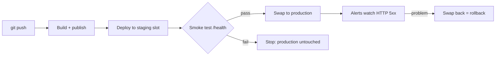

# Session 12: Practice Lab: Traffic, Slots and Final Review

> Module: Developing Microsoft Azure Applications · Term 4 (HDSE) · ⏱ ~2 hours

Hands-on practice for Session 11 and a review of the whole module. You will describe a production-ready setup in one Bicep file, release through a staging slot with a smoke test, and automate it with GitHub Actions. Try every task yourself first, then compare with the solution files in this folder.

## 🎯 Learning Objectives

- Combine monitoring, hosting, slots and alerts in one Bicep template
- Release safely: deploy to staging → smoke test → swap → rollback if needed
- Automate a slot-based release with GitHub Actions and a service principal
- Revise every major topic of the module for the exam

## 📖 Concepts Explained

### 1. Module checklist

| Session | Key skills |
|---|---|
| 01 | cloud models, regions/zones/SLA, create and manage VMs |
| 02 | Azure CLI, PowerShell, ARM/Bicep, Azure Monitor, KQL |
| 04 | EF Core 8, LINQ, Azure SQL, Cosmos DB, Redis, CDN |
| 05 | Web API routing, async actions, JWT, RBAC, versioning, HATEOAS |
| 07 | NSG, Firewall, DDoS, Key Vault, managed identity, App Service, containers |
| 09 | Azure Functions, API Management, GitHub Actions CI/CD |
| 11 | Load Balancer, App Gateway, Traffic Manager, Front Door, slots, App Insights |

### 2. The release flow you will build



### 3. Health checks

`healthCheckPath: '/health'` lets App Service stop sending traffic to an unhealthy instance. The same endpoint is used by the smoke test, Traffic Manager and Front Door probes.

### 4. Service principal for pipelines

A **service principal** is an identity for a robot (the pipeline). Give it **Contributor on one resource group only** (least privilege) and store its JSON as a GitHub secret. Even better: GitHub OIDC *federated credentials*, which need no secret at all.

## 💻 Code Examples

### Task 1: Production setup in Bicep

📄 File: [`main.bicep`](main.bicep)

```bicep
// Lab 12 - Task 1: the whole production setup as code
// Log Analytics + Application Insights + S1 plan + web app + staging slot + alert

param location string = resourceGroup().location
param appName string = 'final-${uniqueString(resourceGroup().id)}'

// 1. Where logs are stored
resource workspace 'Microsoft.OperationalInsights/workspaces@2023-09-01' = {
  name: 'law-${appName}'
  location: location
  properties: {
    sku: { name: 'PerGB2018' }
    retentionInDays: 30
  }
}

// 2. Application Insights, saving into the workspace
resource insights 'Microsoft.Insights/components@2020-02-02' = {
  name: 'ai-${appName}'
  location: location
  kind: 'web'
  properties: {
    Application_Type: 'web'
    WorkspaceResourceId: workspace.id
  }
}

// 3. Standard plan (needed for slots)
resource plan 'Microsoft.Web/serverfarms@2023-12-01' = {
  name: 'plan-${appName}'
  location: location
  sku: { name: 'S1' }
  kind: 'linux'
  properties: { reserved: true }
}

// 4. Production web app
resource webApp 'Microsoft.Web/sites@2023-12-01' = {
  name: appName
  location: location
  identity: { type: 'SystemAssigned' }
  properties: {
    serverFarmId: plan.id
    httpsOnly: true
    siteConfig: {
      linuxFxVersion: 'DOTNETCORE|8.0'
      minTlsVersion: '1.2'
      ftpsState: 'Disabled'
      healthCheckPath: '/health'
      appSettings: [
        { name: 'APPLICATIONINSIGHTS_CONNECTION_STRING', value: insights.properties.ConnectionString }
        { name: 'APP_VERSION', value: '1.0' }
        { name: 'ENVIRONMENT_NAME', value: 'Production' }
      ]
    }
  }
}

// 5. Staging slot with its own settings
resource stagingSlot 'Microsoft.Web/sites/slots@2023-12-01' = {
  parent: webApp
  name: 'staging'
  location: location
  properties: {
    serverFarmId: plan.id
    httpsOnly: true
    siteConfig: {
      linuxFxVersion: 'DOTNETCORE|8.0'
      appSettings: [
        { name: 'APPLICATIONINSIGHTS_CONNECTION_STRING', value: insights.properties.ConnectionString }
        { name: 'APP_VERSION', value: '2.0' }
        { name: 'ENVIRONMENT_NAME', value: 'Staging' }
      ]
    }
  }
}

// 6. Make ENVIRONMENT_NAME a sticky (slot) setting
resource stickySettings 'Microsoft.Web/sites/config@2023-12-01' = {
  parent: webApp
  name: 'slotConfigNames'
  properties: {
    appSettingNames: [ 'ENVIRONMENT_NAME' ]
  }
}

// 7. Alert: more than 5 server errors (HTTP 5xx) in 5 minutes
resource errorAlert 'Microsoft.Insights/metricAlerts@2018-03-01' = {
  name: 'alert-5xx-${appName}'
  location: 'global'
  properties: {
    severity: 2
    enabled: true
    scopes: [ webApp.id ]
    evaluationFrequency: 'PT1M'
    windowSize: 'PT5M'
    criteria: {
      'odata.type': 'Microsoft.Azure.Monitor.SingleResourceMultipleMetricCriteria'
      allOf: [
        {
          name: 'TooManyServerErrors'
          criterionType: 'StaticThresholdCriterion'
          metricName: 'Http5xx'
          operator: 'GreaterThan'
          threshold: 5
          timeAggregation: 'Total'
        }
      ]
    }
  }
}

output appName string = webApp.name
output productionUrl string = 'https://${webApp.properties.defaultHostName}'
output stagingUrl string = 'https://${stagingSlot.properties.defaultHostName}'
```

**How it works**: `slotConfigNames` marks `ENVIRONMENT_NAME` as sticky; the metric alert watches the built-in `Http5xx` metric. Add an action group to receive emails.

### Task 2: Deploy, test, swap

📄 File: [`task2-solution.sh`](task2-solution.sh)

```bash
#!/bin/bash
# Lab 12 - Task 2 solution: deploy infrastructure, then code to both slots
# Run from this folder; the app code is ../Session-11-.../SlotDemo

RESOURCE_GROUP="rg-lab12"
LOCATION="eastus"
APP_FOLDER="../Session-11-Traffic-Management-Monitoring-and-Deployment-Slots/SlotDemo"

# Step 1: infrastructure from Bicep
az group create --name $RESOURCE_GROUP --location $LOCATION
APP_NAME=$(az deployment group create --resource-group $RESOURCE_GROUP \
  --template-file main.bicep --query properties.outputs.appName.value --output tsv)
echo "App: $APP_NAME"

# Step 2: build the code once
dotnet publish $APP_FOLDER -c Release -o publish
(cd publish && zip -r ../app.zip .)

# Step 3: deploy the same package to production and to staging
az webapp deploy --resource-group $RESOURCE_GROUP --name $APP_NAME --src-path app.zip --type zip
az webapp deploy --resource-group $RESOURCE_GROUP --name $APP_NAME --slot staging --src-path app.zip --type zip

# Step 4: smoke test both, then swap
bash smoke-test.sh https://$APP_NAME-staging.azurewebsites.net && \
  az webapp deployment slot swap --resource-group $RESOURCE_GROUP --name $APP_NAME \
    --slot staging --target-slot production

curl https://$APP_NAME.azurewebsites.net
```

📄 File: [`smoke-test.sh`](smoke-test.sh)

```bash
#!/bin/bash
# Lab 12 - smoke test: is the site alive and healthy? Usage: bash smoke-test.sh <url>

URL=$1

# Step 1: call /health and keep only the HTTP status code
STATUS=$(curl -s -o /dev/null -w "%{http_code}" "$URL/health")

# Step 2: pass (exit 0) only on 200, otherwise fail (exit 1) and stop the release
if [ "$STATUS" = "200" ]; then
  echo "PASS: $URL/health returned 200"
  exit 0
else
  echo "FAIL: $URL/health returned $STATUS"
  exit 1
fi
```

**How it works**: the `&&` means the swap only runs if the smoke test exits with 0.

### Task 3: Automated release

📄 File: [`deploy-staging-then-swap.yml`](deploy-staging-then-swap.yml) signs in with `azure/login`, deploys to the **staging** slot, runs `curl --fail` against `/health` and swaps only if it passes.

### ▶️ How to run

In Cloud Shell, upload this folder and the Session 11 `SlotDemo` folder side by side, then run `bash task2-solution.sh`. Delete `rg-lab12` afterwards.

## 🧪 Lab Practice

1. Deploy `main.bicep` and open the production and staging URLs.
2. Run the smoke test against a wrong URL to see it fail and block the swap.
3. Call `/error` on production several times and check the alert in **Monitor → Alerts**.
4. Create the service principal, add the secret and variables, push `SlotDemo` with the workflow, and watch the swap happen.
5. Make a release that breaks `/health` (return 500) and confirm the pipeline stops before swapping.

## 📝 Assignment

Final mini-project: deploy your Session 06 Students API with this template, Azure SQL (connection string in Key Vault via managed identity), a staging slot and the GitHub Actions release pipeline. Put API Management in front of it with a rate limit. Submit the repo link, the live gateway URL and a one-page architecture diagram.

## ❓ Quick Quiz

**Q1.** Which Bicep resource marks a slot setting as sticky?

**Q2.** Why run a smoke test before swapping?

**Q3.** What role and scope should a pipeline's service principal have?

**Q4.** Which App Service feature stops traffic to an unhealthy instance?

**Q5.** How do you roll back a bad swap?

<details>
<summary>Show answers</summary>

1. `Microsoft.Web/sites/config` named `slotConfigNames`.
2. To catch a broken release while it is still in staging, so production is never affected.
3. Contributor on the single resource group it deploys to (least privilege).
4. Health check (`healthCheckPath`).
5. Swap the slots again.

</details>

## 💼 Interview Questions

**1. Walk me through a safe release process on Azure.**

> CI builds and tests; CD deploys the artifact to a staging slot, runs smoke tests, swaps to production, and alerts monitor errors so we can swap back quickly.

**2. How would you design a highly available API on Azure?**

> App Service (or Container Apps) in two regions with health checks, Front Door or Traffic Manager in front, a geo-replicated database, Key Vault for secrets and Application Insights with alerts.

**3. Which Azure skills from this module are most used in real jobs?**

> App Service deployments, Key Vault with managed identity, CI/CD pipelines, Application Insights monitoring and infrastructure as code.

## ✅ Summary

- One Bicep file can create monitoring, hosting, slots and alerts consistently.
- Staging → smoke test → swap gives safe, reversible releases.
- Pipelines use least-privilege identities stored as secrets.
- You can now build, secure, deploy, scale and monitor Azure applications.

---

[⬅ Previous](../Session-11-Traffic-Management-Monitoring-and-Deployment-Slots/README.md) · [🏠 Module Home](../README.md) · [Next ➡](../../eProject/README.md)

Prepared by Zeeshan Abbas · Aptech Learning North Nazimabad
