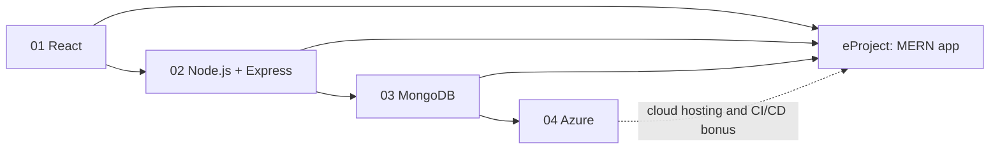

# Term 4: HDSE (Higher Diploma in Software Engineering)

     

> ACCP in AI · Term 4 · 52 module sessions + a ~20-hour eProject · ⏱ ~2 hours per session

Term 4 completes your Higher Diploma in Software Engineering by turning you into a **full-stack and cloud developer**. You build modern user interfaces with React, write back-end APIs with Node.js and Express, store and analyse data at scale with MongoDB, and learn to build, secure and deploy enterprise applications on Microsoft Azure. Together, React, Express, Node.js and MongoDB form the **MERN stack**, and the term ends with a team eProject: a complete MERN application.

## Modules

| No | Module | Sessions | Link |
|---|---|---|---|
| 01 | Frontend Web Development with React | 12 | [Open module](./01-Frontend-Web-Development-with-React/README.md) |
| 02 | Server-side Programming with Node.js | 12 | [Open module](./02-Server-side-Programming-with-Nodejs/README.md) |
| 03 | Managing Large Datasets with MongoDB | 16 | [Open module](./03-Managing-Large-Datasets-with-MongoDB/README.md) |
| 04 | Developing Microsoft Azure Applications | 12 | [Open module](./04-Developing-Microsoft-Azure-Applications/README.md) |
| — | eProject: Full Stack MERN Application | ~10 (20 hours) | [Open eProject](./eProject/README.md) |

## Learning Outcomes

After completing Term 4 you will be able to:

- Build fast, component-based user interfaces with React 18: JSX, hooks, events, routing, styling, forms and API calls
- Write server-side applications and REST APIs with Node.js 20 and Express, including file uploads, email, JWT security and deployment
- Design MongoDB data models and work with CRUD, operators, aggregation, indexes, replication, sharding, transactions and MongoDB Atlas
- Connect to MongoDB from Python and use AI to work smarter with data
- Build enterprise web applications on Microsoft Azure: VMs, Bicep, EF Core 8, ASP.NET Core Web API, Key Vault, App Service, Azure Functions, API Management, CI/CD and deployment slots
- Add AI features (OpenAI, TensorFlow.js) to web applications safely
- Plan, build, test, document and present a full-stack MERN application as part of a team

## Suggested Study Order

React, Node.js and MongoDB give you every layer of the MERN stack, so start thinking about your eProject as soon as you finish Module 03. The Azure module teaches cloud skills (hosting, secrets, pipelines, monitoring) that make your eProject production-ready.

## eProject

A group project of **up to 4 students**, about **20 hours per student**: a full-stack web application with React, Express, Node.js, MongoDB and Mongoose, with optional AI features using OpenAI or TensorFlow.js. You submit the **source code** and a **project report**, then present it in a **viva** (marks: 60% code, 20% report, 20% viva). Read the [eProject guide](./eProject/README.md) for phases, ideas, folder structure and tips.

## How to Study

1. **Set up once:** install VS Code, Node.js 20 LTS, Git, MongoDB Community Server + Compass, the .NET 8 SDK and the Azure CLI. Each module README lists its tools with official links.
2. **One session at a time:** read the concepts, then type (do not copy-paste) and run every example in the session folder.
3. **Never skip practice labs:** they are where the skills stick. Try each task before opening the solution file.
4. **Check yourself:** answer the quiz before opening the answers and practise the interview questions aloud.
5. **Grow one project:** reuse the same idea across modules (React UI → Node API → MongoDB data → Azure deployment) and it becomes your eProject and portfolio piece.
6. **Protect your cloud credit:** create one resource group per Azure lab and delete it the same day.
7. **Push to GitHub weekly** and keep secrets in `.env` files that are never committed.
8. **Ask early:** bring questions to class or open an Issue on this repository.

---

[🏠 Repository Home](../README.md) · [Start Module 01 ➡](./01-Frontend-Web-Development-with-React/README.md)

Prepared by Zeeshan Abbas · Aptech Learning North Nazimabad
