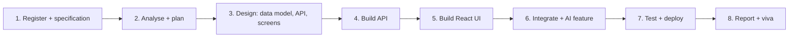

# Term 4 eProject: Full Stack MERN Application

      

> Term 4 (HDSE) · Group project (up to 4 students) · ~20 hours per student (about 10 sessions) · Build, document and present a complete MERN web application

## What is the eProject?

The eProject is where the whole term comes together. Your group receives a project specification after registration and builds a **real full-stack web application**: a React front end, an Express/Node.js REST API and a MongoDB database, with optional AI features. You plan it, build it, test it, document it and defend it in a viva, just like a small software team.

| Module | What you use from it |
|---|---|
| [01 Frontend Web Development with React](../01-Frontend-Web-Development-with-React/README.md) | components, hooks, React Router, forms, calling APIs |
| [02 Server-side Programming with Node.js](../02-Server-side-Programming-with-Nodejs/README.md) | Express, REST design, middleware, JWT, file uploads, deployment |
| [03 Managing Large Datasets with MongoDB](../03-Managing-Large-Datasets-with-MongoDB/README.md) | schema design, indexes, aggregation, Atlas |
| [04 Developing Microsoft Azure Applications](../04-Developing-Microsoft-Azure-Applications/README.md) | cloud hosting, secrets, CI/CD with GitHub Actions, monitoring (optional bonus) |

## Team rules

- Groups of **up to 4 students**; choose a **team leader** who communicates with the faculty project guide.
- Your centre registers the group; the detailed **project specification** is shared only after registration. The ideas below are for practice.
- Plan for about **20 hours of work per student**. Every member must write code (front end *and* back end exposure is ideal).
- Every member must be able to explain **any** part of the project in the viva.
- Use one GitHub repository; the commit history is your best proof of teamwork.

## Technology stack

| Layer | Required | Version guide |
|---|---|---|
| Editor | Visual Studio Code | 1.86 or later |
| Database | MongoDB (local or Atlas) | 8.x |
| ODM | Mongoose | 7.6 or later |
| API | Express on Node.js | Express 4.18+, Node 20 LTS |
| Front end | React (Vite) | 18.x |
| AI (optional) | OpenAI API (GPT-4 class model) or TensorFlow.js | TensorFlow.js 4.x |

**AI ideas that fit a MERN app:** a chatbot or FAQ helper (OpenAI, called **from the server** so the key stays secret), product or course recommendations, automatic summaries of reviews, image classification in the browser with a pre-trained TensorFlow.js model, or sentiment analysis of feedback. AI is a bonus; a solid, working core matters more.

## Phases (about 10 sessions)



| Session | Phase | Output |
|---|---|---|
| 1 | Kick-off: read the specification, split roles, create the GitHub repo with `client/` and `server/` | repo, task board |
| 2 | Requirements: user roles, features, user stories | requirements list |
| 3 | Design: MongoDB collections (embed vs reference), API endpoint table, wireframes | design document |
| 4 | Server setup: Express app, Mongoose models, `.env`, first CRUD routes tested with Postman/REST Client | working API |
| 5 | Authentication: register/login with hashed passwords and JWT, protected and admin-only routes | secure API |
| 6 | React: routing, layout, list/detail pages, forms with validation | UI skeleton |
| 7 | Integration: React calls the API, loading/error states, search, filters, pagination | working app |
| 8 | AI feature (optional), file/image upload, aggregation-based dashboard | extra features |
| 9 | Testing and deployment (e.g. Atlas + Render/Azure), fix bugs, write the report | live demo, report draft |
| 10 | Final submission and viva rehearsal | final package |

## Deliverables checklist

### 1. Project source code (60% of marks)
- [ ] Complete `client/` (React) and `server/` (Express) folders that run with `npm install` and `npm run dev`/`npm start`
- [ ] Every feature in the specification works end to end
- [ ] RESTful routes with correct methods and status codes; input validation and error handling
- [ ] Passwords hashed (bcrypt), JWT authentication, role-based access for admin pages
- [ ] Mongoose schemas with validation, sensible indexes, at least one aggregation report
- [ ] Secrets in `.env` (never committed); an `.env.example` file is included
- [ ] Clean code: folders by responsibility, meaningful names, comments where logic is not obvious
- [ ] `README.md` with setup steps, environment variables, seed data instructions and team members
- [ ] Optional: live deployment link and AI feature

### 2. Project report (20% of marks)
- [ ] Title page, acknowledgement, table of contents
- [ ] Problem definition, objectives and scope
- [ ] Requirements: functional, non-functional, user roles
- [ ] Architecture diagram (React ↔ Express API ↔ MongoDB, plus any AI service)
- [ ] Database design: collections, sample documents, relationships, indexes
- [ ] API documentation: method, URL, request body, response, who can access
- [ ] Screenshots of every screen
- [ ] Test cases table (input, expected, actual, pass/fail)
- [ ] Task sheet (who did what), limitations and future enhancements
- [ ] References (official documentation)

### 3. Viva (20% of marks)
- [ ] Short live demo of the main user journeys
- [ ] Each member explains their part and answers questions on any layer (UI, API, database)

## Suggested project ideas

| Idea | Core features | Optional AI feature |
|---|---|---|
| **Campus Event Hub** | events CRUD, registrations, organiser dashboard, QR ticket code | chatbot answering event FAQs |
| **Online Bookstore** | catalogue, cart, orders, admin stock management, reviews | recommendations from purchase history |
| **Clinic Appointment System** | doctors, time slots, booking, patient history, admin reports | symptom-to-department suggestion (with disclaimer) |
| **Job Portal for Fresh Graduates** | employer and candidate roles, job posts, applications, CV upload | CV-to-job match score |
| **Recipe Sharing Community** | recipes with images, likes, comments, search by ingredient | ingredient detection from a photo (TensorFlow.js) |
| **Smart Expense Tracker** | income/expense entries, categories, monthly charts via aggregation | AI summary of spending habits |
| **Learning Management Mini-LMS** | courses, lessons, enrolments, quizzes, progress tracking | AI-generated practice questions |
| **Property Rental Finder** | listings with filters and map, inquiries, owner dashboard | sentiment analysis of reviews |

## Suggested folder structure

```text
mern-eproject/
├── client/                      # React (Vite)
│   ├── src/
│   │   ├── api/                 # axios instance + API functions
│   │   ├── components/          # reusable UI pieces
│   │   ├── pages/               # one file per route
│   │   ├── context/             # auth context (logged-in user, token)
│   │   ├── App.jsx
│   │   └── main.jsx
│   ├── package.json
│   └── .env.example             # VITE_API_URL=http://localhost:5000/api
├── server/                      # Express + Mongoose
│   ├── src/
│   │   ├── config/db.js         # mongoose.connect
│   │   ├── models/              # User.js, Product.js ...
│   │   ├── routes/              # authRoutes.js, productRoutes.js ...
│   │   ├── controllers/         # route logic
│   │   ├── middleware/          # auth.js (JWT), isAdmin.js, errorHandler.js
│   │   ├── services/            # aiService.js (OpenAI calls), email ...
│   │   └── server.js
│   ├── seed/seed.js             # sample data script
│   ├── package.json
│   └── .env.example             # PORT, MONGODB_URI, JWT_SECRET, OPENAI_API_KEY
├── docs/
│   ├── Project-Report.docx
│   └── screenshots/
├── .gitignore                   # node_modules, .env, dist
└── README.md
```

Quick start for a new group:

```bash
# server
mkdir server && cd server && npm init -y
npm install express mongoose dotenv cors bcryptjs jsonwebtoken
npm install --save-dev nodemon
# client (from the project root)
npm create vite@latest client -- --template react
cd client && npm install axios react-router-dom
```

## Evaluation tips

1. **Specification first.** Turn every required feature into a checklist item; missing features cost more than missing polish.
2. **Build vertically.** Finish one feature end to end (model → route → React page) before starting the next, so you always have something that works.
3. **Seed realistic data.** A seed script with 20-50 realistic records makes demos and testing easy.
4. **Protect secrets.** No API keys or connection strings in GitHub; examiners check `.env` handling.
5. **Handle errors visibly.** Show friendly messages for wrong login, empty forms and server errors; return proper status codes from the API.
6. **Use MongoDB well.** Justify embed vs reference, add indexes for common queries, and include at least one aggregation (dashboard numbers).
7. **AI responsibly.** Call AI services from the server, limit input size, and handle failures gracefully; the app must still work if the AI call fails.
8. **Document as you go.** Take screenshots and record test cases during development, not the night before submission.
9. **Rehearse the viva.** Each member should explain the request flow (React → API → MongoDB → response), JWT login and one feature they built.
10. **Submit early.** Clone your repo into a fresh folder, follow your own README and make sure it runs before the deadline.

---

[⬅ Previous Module](../04-Developing-Microsoft-Azure-Applications/README.md) · [🏠 Term Home](../README.md)

Prepared by Zeeshan Abbas · Aptech Learning North Nazimabad
