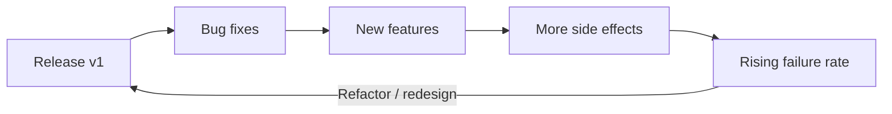

# Session 01: Software Characteristics

> Module: Agile and DevOps · Term 5 (ADSE) · ⏱ ~2 hours

Before we can talk about *how* teams build software (SDLC, Agile, DevOps), we need a clear picture of *what* software actually is.
This session builds that foundation using everyday examples from Pakistan — mobile banking apps, ride-hailing apps and university portals.

## 🎯 Learning Objectives

By the end of this session you will be able to:

- Define software and explain why organisations depend on it
- Describe software both as a **product** and as a **process**
- List the key quality characteristics of good software (ISO/IEC 25010 view)
- Classify software into its major types with real examples
- Explain why software does not 'wear out' but still deteriorates

## 📖 Concepts Explained

### 1. What is software?

Software is a set of **instructions (programs)**, the **data** they work on, and the **documentation** that explains how to use and maintain them.
Hardware is the body; software is the brain that tells the body what to do.

| Part | Example in a food-delivery app |
|------|-------------------------------|
| Programs | Code that calculates the delivery fee |
| Data | Restaurant menus, user addresses, order history |
| Documentation | API guide for restaurant partners, user help pages |

### 2. Why do we need software?

- **Automation** – a payroll system pays 5,000 employees in minutes instead of weeks.
- **Accuracy** – a pharmacy system warns about dangerous medicine combinations.
- **Reach** – one e-commerce website serves customers in Karachi, Lahore and abroad 24/7.
- **Decision making** – dashboards turn raw sales data into insight.

### 3. Software as a product vs. software as a process

| View | Meaning | Example |
|------|---------|---------|
| **Product** | The finished thing users install or open | WhatsApp, MS Excel, a school ERP |
| **Process** | The set of activities used to *create* and *maintain* the product | Gathering requirements, coding, testing, releasing updates |

Think of a wedding: the *event* is the product, the months of planning, booking and coordinating are the process. A good process makes a good product far more likely.

### 4. Characteristics of software

Software is different from physical goods:

1. **It is engineered, not manufactured.** Copying software costs almost nothing; the cost is in design and development.
2. **It does not wear out**, but it *deteriorates* — every change can introduce new defects, and the environment (OS, browsers, devices) keeps changing.
3. **It is mostly custom-built** even when it reuses libraries and frameworks.
4. **It is complex and invisible** — you cannot "see" progress like you can see a building rising.



### 5. Quality characteristics (what users and teams expect)

The international standard **ISO/IEC 25010** groups software quality into characteristics. The most useful ones for beginners:

| Characteristic | Simple question | Example |
|----------------|----------------|---------|
| Functional suitability | Does it do the right job? | Banking app transfers the correct amount |
| Performance efficiency | Is it fast and light? | Page loads in under 2 seconds on 4G |
| Usability | Is it easy to learn and use? | Clear buttons, Urdu/English options |
| Reliability | Does it keep working? | Portal stays up during result day |
| Security | Is data protected? | Passwords hashed, OTP for login |
| Maintainability | Is it easy to change? | Clean code, comments, tests |
| Portability | Can it run elsewhere? | Same app on Android, iOS and Web (Flutter!) |
| Compatibility | Does it work with other systems? | Exports to Excel, integrates with payment gateway |

### 6. Types of software

| Type | Purpose | Examples |
|------|---------|----------|
| System software | Runs and manages hardware | Windows, Linux, Android, device drivers |
| Application software | Helps users do tasks | MS Word, Chrome, Daraz app |
| Engineering / scientific | Heavy calculation & simulation | MATLAB, AutoCAD |
| Embedded software | Lives inside devices | Washing machine controller, car ABS |
| Web applications | Run in the browser | Online admission portal |
| AI / ML software | Learns from data | Recommendation engines, chatbots |
| Product-line / SaaS | Sold to many customers | Shopify, Google Workspace |
| Legacy software | Old but business-critical | A bank's 20-year-old core system |

> 💡 **Analogy:** System software is the road network; application software is the vehicles; embedded software is the engine control unit inside each vehicle.

## 💻 Code Examples

### Example 1: Quality review checklist (template)

📄 File: [`software-quality-checklist.md`](./software-quality-checklist.md)

```markdown
# Software Quality Checklist (ISO/IEC 25010 inspired)

Use this checklist to review any app you use or build. Mark each item ✅ / ⚠️ / ❌.

| # | Characteristic | Check | Result | Notes |
|---|----------------|-------|--------|-------|
| 1 | Functional suitability | Every main feature produces correct output | | |
| 2 | Performance | Main screen opens in < 2 s on a normal phone | | |
| 3 | Usability | A new user completes the main task without help | | |
| 4 | Reliability | No crash during 10 minutes of normal use | | |
| 5 | Security | Login protected; no sensitive data shown in URL | | |
| 6 | Maintainability | Code has comments / README / tests | | |
| 7 | Portability | Works on at least two platforms or screen sizes | | |
| 8 | Compatibility | Can import/export or share data with other apps | | |

**Overall rating (1–5):** ___

**Top 3 improvements I recommend:**
1.
2.
3.
```

**How it works**

- Each row maps to one ISO/IEC 25010 characteristic explained above.
- The **Result** column forces a clear verdict, and **Notes** captures evidence (e.g. "took 6 s to load").
- Use it in the Lab to review a real app — this is exactly how QA teams begin a quality audit.

### Example 2: Software classification worksheet

📄 File: [`software-classification.md`](./software-classification.md)

```markdown
# Software Classification Worksheet

| Software name | Type | Product or Service? | Main users | One quality it does well | One quality it lacks |
|---------------|------|---------------------|-----------|--------------------------|----------------------|
| Android OS | System | Product | Phone users | Portability | — |
| Daraz app | Application / Web | Product + Service | Shoppers | Usability | Performance on old phones |
| _(your example)_ | | | | | |
| _(your example)_ | | | | | |
| _(your example)_ | | | | | |
```

**How it works**

- Two sample rows show how to fill it in.
- Thinking about *who* uses the software and *which* quality matters most trains you to think like a product owner.

## 🧪 Lab Practice

### Task 1: Spot the parts of software

1. Pick any app on your phone (e.g., a banking or ride-hailing app).
2. Write down 3 examples each of its programs (features), data and documentation (help pages, FAQs).
3. Share your list with a classmate and compare.

### Task 2: Quality audit

1. Copy `software-quality-checklist.md` into your notes.
2. Use the chosen app for 10 minutes and fill every row with evidence.
3. Give an overall rating and list three improvements.

### Task 3: Classify 10 programs

1. Open `software-classification.md`.
2. Add 10 software products you use (OS, browser, games, university portal, etc.).
3. Fill each column; highlight any software that fits more than one type.

### Task 4: Deterioration discussion

1. Think of an app that became slower or buggier after updates.
2. Write 4–5 lines explaining *why* this happened using the 'software deteriorates' idea.

## 📝 Assignment

Write a one-page report (Markdown or Word) titled **"Software in My City"**. Choose **three** software systems used in Karachi
(e.g., a hospital system, a bank app, a transport app). For each, state its type, its most important quality characteristic
and one risk if that quality fails. Finish with a short paragraph on why software is "engineered, not manufactured".

## ❓ Quick Quiz

**Q1. Which three elements together make up software?**

- a) Code, hardware, users
- b) Programs, data, documentation
- c) CPU, RAM, disk
- d) Design, testing, deployment

<details><summary>Show answer</summary>

b) Programs, data, documentation

</details>

**Q2. Software 'deteriorates' mainly because of…**

- a) Physical wear
- b) Dust and heat
- c) Changes and a changing environment
- d) Low battery

<details><summary>Show answer</summary>

c) Changes and a changing environment

</details>

**Q3. A washing-machine controller is an example of…**

- a) System software
- b) Embedded software
- c) Web application
- d) Legacy software

<details><summary>Show answer</summary>

b) Embedded software

</details>

**Q4. Which ISO/IEC 25010 characteristic asks 'Is data protected?'**

- a) Usability
- b) Portability
- c) Security
- d) Compatibility

<details><summary>Show answer</summary>

c) Security

</details>

**Q5. Viewing software as a *process* focuses on…**

<details><summary>Show answer</summary>

The activities used to create and maintain the product — requirements, design, coding, testing, release and maintenance.

</details>

## 💼 Interview Questions

**1. How is software different from a manufactured product?**

<details><summary>Model answer</summary>

Software is engineered rather than manufactured: almost all cost is in design and development, while copies are nearly free.
It does not physically wear out, but it deteriorates as changes introduce defects and the environment evolves. It is also invisible, so progress and quality must be measured through reviews, tests and metrics.

</details>

**2. Name four software quality characteristics and give an example of each.**

<details><summary>Model answer</summary>

Reliability (a portal stays up on result day), usability (a new user can book a ride without help), security (passwords are hashed and OTP is used),
maintainability (code is modular and has tests so changes are cheap).

</details>

**3. What is legacy software and why do companies keep it?**

<details><summary>Model answer</summary>

Legacy software is old software still running critical business functions. Companies keep it because it works, replacing it is risky and expensive,
and it often contains years of business rules. Teams usually wrap it with APIs or migrate it gradually.

</details>

## ✅ Summary

- Software = programs + data + documentation.
- It can be seen as a **product** (what users get) and a **process** (how it is built and maintained).
- Software is engineered, does not wear out, but deteriorates with change.
- ISO/IEC 25010 gives a common language for quality: suitability, performance, usability, reliability, security, maintainability, portability, compatibility.
- Major types include system, application, embedded, web, scientific, AI and legacy software.

---

⬅ Previous · [🏠 Module Home](../README.md) · [Next ➡](../Session-02-Software-Development-Life-Cycle/README.md)

Prepared by Zeeshan Abbas · Aptech Learning North Nazimabad
