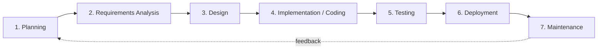

# Session 02: Software Development Life Cycle (SDLC)

> Module: Agile and DevOps · Term 5 (ADSE) · ⏱ ~2 hours

Building software without a plan is like constructing a house without a map — walls end up in the wrong place and the budget explodes.
The **Software Development Life Cycle (SDLC)** is that map.

## 🎯 Learning Objectives

By the end of this session you will be able to:

- Define SDLC and explain its purpose
- Describe how SDLC evolved from 'code and fix' to modern models
- Explain why organisations need a defined life cycle
- Identify and describe each SDLC phase with its inputs and outputs
- Apply SDLC phases to a small real-world case study

## 📖 Concepts Explained

### 1. What is SDLC?

The **SDLC** is a structured series of phases that a team follows to turn an idea into working software and keep it working after release.
Each phase has clear **inputs**, **activities** and **outputs (deliverables)**.

### 2. A short history

| Era | Approach | Problem |
|-----|----------|---------|
| 1950s–60s | *Code and fix* — write code, fix it when it breaks | Unpredictable, unmaintainable |
| 1968 | "Software crisis" declared at a NATO conference | Projects late, over budget, buggy |
| 1970s | Structured methods, Waterfall | Too rigid for changing needs |
| 1980s–90s | Spiral, prototyping, RAD, RUP | Better risk handling, still heavy |
| 2001 → today | Agile, then DevOps | Fast feedback, continuous delivery |

### 3. Why do we need SDLC?

- **Predictability** – estimates for time and cost become realistic.
- **Quality** – testing and reviews are planned, not an afterthought.
- **Communication** – everyone knows what happens next and who owns it.
- **Control** – progress can be measured at the end of each phase.
- **Lower risk** – problems are found earlier, when they are cheaper to fix.

> 📉 A defect found during requirements may cost 1 unit to fix; the same defect found after release can cost 50–100 units.

### 4. The phases of SDLC



| Phase | Key question | Main activities | Typical output |
|-------|--------------|-----------------|----------------|
| Planning | Should we build it? | Feasibility (technical, economic, schedule), scope, budget | Project plan, feasibility report |
| Requirements | *What* must it do? | Interviews, surveys, use cases, user stories | SRS (Software Requirements Specification) |
| Design | *How* will it work? | Architecture, database design, UI wireframes | Design document, ERD, mock-ups |
| Implementation | Build it | Coding, code reviews, version control | Source code, builds |
| Testing | Does it work correctly? | Unit, integration, system, acceptance testing | Test cases, bug reports, test summary |
| Deployment | Get it to users | Installation, data migration, training | Release notes, live system |
| Maintenance | Keep it useful | Bug fixes, updates, enhancements | Patches, new versions |

### 5. Types of maintenance

| Type | Reason | Example |
|------|--------|---------|
| Corrective | Fix defects | Login crashes on Android 14 |
| Adaptive | Environment changed | New tax rule, new OS version |
| Perfective | Improve / add features | Add dark mode |
| Preventive | Avoid future problems | Refactor messy code, update libraries |

### 6. Case study: Campus Library System

A college wants students to search and reserve books online.

1. **Planning** – budget PKR 800k, 4 months, 3 developers. Feasible.
2. **Requirements** – search by title/author, reserve for 48 hours, librarian approves returns, SMS reminder.
3. **Design** – web app + MySQL; tables `books`, `students`, `reservations`; wireframes for 6 screens.
4. **Implementation** – features coded in two-week chunks, stored in Git.
5. **Testing** – 120 test cases; a bug allowed double reservation of the same copy — fixed.
6. **Deployment** – imported 9,000 book records; trained 4 librarians.
7. **Maintenance** – added barcode scanning in month 3 (perfective).

## 💻 Code Examples

### Example 1: A lightweight SRS template

📄 File: [`srs-template.md`](./srs-template.md)

```markdown
# Software Requirements Specification (SRS) – Lightweight Template

## 1. Introduction
- **Project name:**
- **Purpose:** (one paragraph – why does this system exist?)
- **Stakeholders:** (who uses / pays for / maintains it)

## 2. Scope
- In scope:
- Out of scope:

## 3. Functional Requirements
| ID | Requirement | Priority (Must/Should/Could) |
|----|-------------|------------------------------|
| FR-01 | The system shall allow a student to search books by title. | Must |
| FR-02 | | |

## 4. Non-Functional Requirements
| ID | Category | Requirement |
|----|----------|-------------|
| NFR-01 | Performance | Search results appear within 2 seconds. |
| NFR-02 | Security | Passwords are stored as salted hashes. |

## 5. Constraints & Assumptions
-

## 6. Acceptance Criteria
-

## 7. Glossary
| Term | Meaning |
|------|---------|
```

**How it works**

- Requirement IDs (`FR-01`, `NFR-01`) make each requirement traceable to design, code and test cases.
- The word **"shall"** signals a mandatory requirement — a common convention in SRS writing.
- Splitting **functional** (what it does) and **non-functional** (how well it does it) requirements avoids missing qualities such as speed and security.

### Example 2: Phase–deliverable map (CSV)

📄 File: [`phase-deliverables.csv`](./phase-deliverables.csv)

```csv
phase,key_question,main_output,owner
Planning,Should we build it?,Feasibility report & project plan,Project Manager
Requirements,What must it do?,SRS document,Business Analyst
Design,How will it work?,Architecture & database design,Solution Architect
Implementation,Build it,Source code in Git,Developers
Testing,Does it work?,Test report & bug list,QA Engineer
Deployment,Deliver it,Release notes & live system,DevOps Engineer
Maintenance,Keep it useful,Patches & new versions,Support Team
```

**How it works**

- A CSV file can be opened in Excel or Google Sheets — handy for a project wall chart.
- Each phase has one clear owner, which reduces "I thought you were doing that" confusion.

## 🧪 Lab Practice

### Task 1: Map the phases

1. Draw the 7-phase SDLC diagram from memory on paper.
2. Under each phase, write one deliverable and one person/role responsible.
3. Compare with `phase-deliverables.csv`.

### Task 2: Write requirements

1. Choose a small system: *Canteen Pre-Order App*.
2. Using `srs-template.md`, write 6 functional and 3 non-functional requirements.
3. Label each with MoSCoW priority (Must/Should/Could/Won't).

### Task 3: Classify maintenance

1. List 8 recent updates from any app's 'What's New' section on the Play Store.
2. Classify each as corrective, adaptive, perfective or preventive.

### Task 4: Cost of late defects

1. Pick one requirement you wrote. Imagine it was misunderstood.
2. Describe what would need to change if the mistake were found in design, testing, and after release.

## 📝 Assignment

Create a complete **mini-SRS** (2–3 pages) for a *Clinic Appointment Booking System* using the template.
Include at least 8 functional requirements, 4 non-functional requirements, scope, and acceptance criteria. Add a table that maps each SDLC phase to the deliverable your team would produce.

## ❓ Quick Quiz

**Q1. Which phase answers the question 'What must the system do?'**

- a) Planning
- b) Requirements analysis
- c) Design
- d) Testing

<details><summary>Show answer</summary>

b) Requirements analysis

</details>

**Q2. The main output of the requirements phase is usually…**

- a) ERD
- b) SRS
- c) Release notes
- d) Test summary

<details><summary>Show answer</summary>

b) SRS

</details>

**Q3. Updating an app because Android released a new version is ___ maintenance.**

- a) Corrective
- b) Adaptive
- c) Perfective
- d) Preventive

<details><summary>Show answer</summary>

b) Adaptive

</details>

**Q4. Why is fixing a defect after release more expensive?**

<details><summary>Show answer</summary>

Because the defect has already spread into design, code, tests, documentation and user data; fixing it requires rework in many places plus redeployment and possibly user support.

</details>

**Q5. What event in 1968 highlighted the 'software crisis'?**

<details><summary>Show answer</summary>

The NATO Software Engineering Conference, where experts discussed late, over-budget and unreliable software projects.

</details>

## 💼 Interview Questions

**1. Explain the SDLC phases in one minute.**

<details><summary>Model answer</summary>

Planning decides feasibility and scope; requirements capture what the system must do (SRS); design decides architecture, data and UI; implementation writes the code;
testing verifies it; deployment releases it to users; maintenance fixes and improves it, feeding back into planning.

</details>

**2. What is the difference between functional and non-functional requirements?**

<details><summary>Model answer</summary>

Functional requirements describe behaviour (e.g., "user can reset password"). Non-functional requirements describe qualities and constraints (e.g., "page loads in 2 seconds", "data encrypted at rest").

</details>

**3. Which SDLC phase do you think is most critical and why?**

<details><summary>Model answer</summary>

Requirements analysis — if you build the wrong thing, no amount of good coding or testing will save the project. Clear, testable requirements reduce rework in every later phase.

</details>

## ✅ Summary

- SDLC is a structured roadmap from idea to retirement of software.
- It evolved from code-and-fix through Waterfall to Agile and DevOps.
- Seven common phases: planning, requirements, design, implementation, testing, deployment, maintenance.
- Each phase has clear outputs (e.g., SRS, design document, test report).
- Maintenance can be corrective, adaptive, perfective or preventive.

---

[⬅ Previous](../Session-01-Software-Characteristics/README.md) · [🏠 Module Home](../README.md) · [Next ➡](../Session-03-Linear-Process-Models/README.md)

Prepared by Zeeshan Abbas · Aptech Learning North Nazimabad
