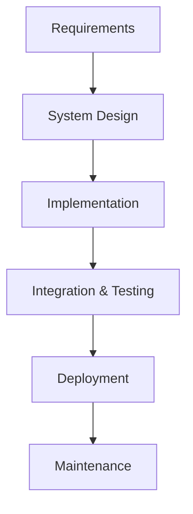
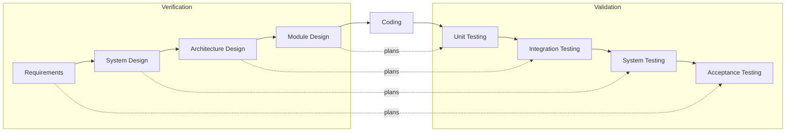

# Session 03: Linear Process Models: Waterfall and V-Model

> Module: Agile and DevOps · Term 5 (ADSE) · ⏱ ~2 hours

A **process model** is a specific way of arranging the SDLC phases. Linear models run the phases one after another, like a train passing stations in order.

## 🎯 Learning Objectives

By the end of this session you will be able to:

- Explain what a software process model is
- Describe the Waterfall model and its phases
- List the advantages and disadvantages of Waterfall
- Describe the V-Model and how it pairs development with testing
- Identify the shortfalls of linear models and when they still fit

## 📖 Concepts Explained

### 1. What is a software process model?

A **process model** is a simplified description of *how* the SDLC phases are ordered, repeated and overlapped.
Different projects need different models — a bridge-control system and a social media startup should not be run the same way.

### 2. Linear (sequential) models

In linear models each phase is completed **fully** before the next one begins. Output of one phase becomes input of the next.

### 3. The Waterfall model

Proposed in its classic form in 1970, Waterfall flows downwards like water over steps.



| Phase | What happens |
|-------|--------------|
| Requirements | All requirements gathered and signed off |
| System design | Architecture, modules, database, interfaces |
| Implementation | Developers code each module |
| Integration & testing | Modules combined and tested as a whole |
| Deployment | Released to the customer |
| Maintenance | Fixes and changes after release |

**Advantages**

- Simple to understand and manage; clear milestones.
- Strong documentation at every step — good for audits.
- Works well when requirements are **stable and well understood**.
- Easy to estimate cost and schedule at the start.

**Disadvantages**

- Changes are expensive once a phase is closed.
- Working software appears **very late** — the customer sees it only near the end.
- Testing late means defects are discovered late.
- Poor fit for complex, long or uncertain projects.

> 🏗 **Analogy:** Building a house — you would not pour the foundation again after the roof is on. Waterfall assumes software is like that.

### 4. The V-Model (Verification & Validation)

The V-Model is Waterfall bent into a **V**. Each development phase on the left has a matching testing phase on the right, and test planning starts early.



| Left side (verification) | Paired test (validation) |
|--------------------------|-------------------------|
| Requirements analysis | Acceptance testing |
| System design | System testing |
| Architecture / high-level design | Integration testing |
| Module / low-level design | Unit testing |

**Advantages:** testing is planned from day one; high discipline; excellent for safety-critical systems (medical devices, avionics, banking cores).

**Disadvantages:** still rigid; no early working prototype; costly to change requirements.

### 5. Shortfalls of linear models

- They assume users know **all** requirements up front — rarely true.
- Feedback loops are long; risk is discovered late.
- Market changes (new competitor, new regulation) are hard to absorb.

**When linear still fits:** fixed-price government contracts, regulatory/safety projects, small projects with crystal-clear scope, or migrations where the target is fully known.

## 💻 Code Examples

### Example 1: V-Model test planning sheet

📄 File: [`v-model-test-plan.md`](./v-model-test-plan.md)

```markdown
# V-Model Test Planning Sheet

Project: ______________________

| Development phase (left) | Artefact produced | Paired test level (right) | Test planned now (example) |
|--------------------------|-------------------|---------------------------|----------------------------|
| Requirements | SRS | Acceptance testing | "Customer can place an order and receive an SMS" |
| System design | System spec | System testing | "Checkout works end-to-end on Chrome & Android" |
| Architecture design | Component diagram | Integration testing | "Order service correctly calls Payment service" |
| Module design | Class/function specs | Unit testing | "calculateTotal() adds 13% tax correctly" |

Sign-off: QA Lead ________ Date ________
```

**How it works**

- Each row links a design artefact on the left to the test level that will validate it on the right.
- Writing tests during design (not after coding) is the V-Model's big idea — it catches unclear requirements early.

### Example 2: Model selection checklist

📄 File: [`model-selection-checklist.md`](./model-selection-checklist.md)

```markdown
# Is a Linear Model Right for This Project?

Answer Yes/No:

- [ ] Requirements are clear, complete and unlikely to change.
- [ ] Technology is familiar to the team.
- [ ] The customer does not need to see working software early.
- [ ] Heavy documentation / audit trail is required.
- [ ] The project is short or well-bounded.
- [ ] Safety or regulation demands strict verification.

**Score:** 5–6 Yes → Waterfall/V-Model is reasonable. 3–4 → consider iterative. 0–2 → prefer Agile.
```

**How it works**

- A quick scoring tool to decide whether a linear model suits a project.
- You will extend this checklist in later sessions when you learn iterative and Agile models.

## 🧪 Lab Practice

### Task 1: Draw both models

1. On A4 paper draw Waterfall and the V-Model.
2. Label each phase and, for the V-Model, connect each left phase to its test level.

### Task 2: Plan tests early

1. Take the Clinic Appointment system from Session 2.
2. Fill `v-model-test-plan.md` with one realistic test idea per row.

### Task 3: Decide the model

1. Apply `model-selection-checklist.md` to three projects: (a) NADRA-style ID card printing system, (b) a new social app for students, (c) migrating a payroll system to a new server.
2. Write one line justifying each decision.

### Task 4: Debate

1. In pairs, one argues *for* Waterfall and one *against* for 5 minutes.
2. Note the strongest argument on each side.

## 📝 Assignment

Write a 1–2 page comparison of **Waterfall vs. V-Model** using a table with at least 8 criteria (flexibility, testing time, documentation, risk, cost of change, customer involvement, suitable projects, team size).
End with a recommendation for a *hospital patient-monitoring system* and justify it.

## ❓ Quick Quiz

**Q1. In Waterfall, when does the customer usually see working software?**

- a) After requirements
- b) After design
- c) Near the end
- d) Every two weeks

<details><summary>Show answer</summary>

c) Near the end

</details>

**Q2. In the V-Model, acceptance testing is paired with…**

- a) Module design
- b) Coding
- c) Requirements analysis
- d) Architecture design

<details><summary>Show answer</summary>

c) Requirements analysis

</details>

**Q3. Which project best suits a linear model?**

- a) Startup app with unclear needs
- b) Safety-critical device firmware with fixed specs
- c) Experimental AI chatbot
- d) Social media MVP

<details><summary>Show answer</summary>

b) Safety-critical device firmware with fixed specs

</details>

**Q4. Name two disadvantages of Waterfall.**

<details><summary>Show answer</summary>

Any two: expensive to change, late working software, late testing, poor for uncertain/complex projects.

</details>

**Q5. What do 'verification' and 'validation' mean?**

<details><summary>Show answer</summary>

Verification: *are we building the product right?* (does it match the spec). Validation: *are we building the right product?* (does it meet user needs).

</details>

## 💼 Interview Questions

**1. When would you still choose Waterfall today?**

<details><summary>Model answer</summary>

When requirements are stable and contractually fixed, the domain is well known, heavy documentation is required (government, regulated industries), or the project is small and short.

</details>

**2. How does the V-Model improve on Waterfall?**

<details><summary>Model answer</summary>

It plans a test level for every development phase, so test design starts early. That exposes ambiguous requirements and design gaps before coding, improving quality in strict environments.

</details>

**3. Explain verification vs. validation with an example.**

<details><summary>Model answer</summary>

Verification checks the login screen matches the spec (e.g., locks after 3 failed attempts). Validation checks that users can actually log in easily and securely — that the feature meets the real need.

</details>

## ✅ Summary

- A process model arranges SDLC phases; linear models run them strictly in sequence.
- Waterfall: simple, well documented, predictable — but rigid and late to show results.
- V-Model pairs each design phase with a test level and starts test planning early.
- Linear models struggle with changing requirements and late feedback.
- They still fit stable, regulated or safety-critical projects.

---

[⬅ Previous](../Session-02-Software-Development-Life-Cycle/README.md) · [🏠 Module Home](../README.md) · [Next ➡](../Session-04-Iterative-Process-Models/README.md)

Prepared by Zeeshan Abbas · Aptech Learning North Nazimabad
