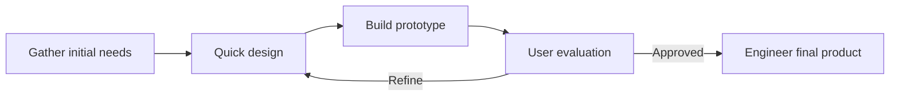
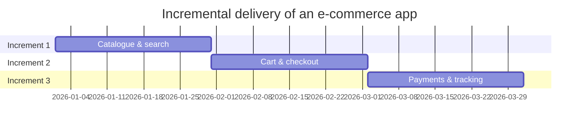
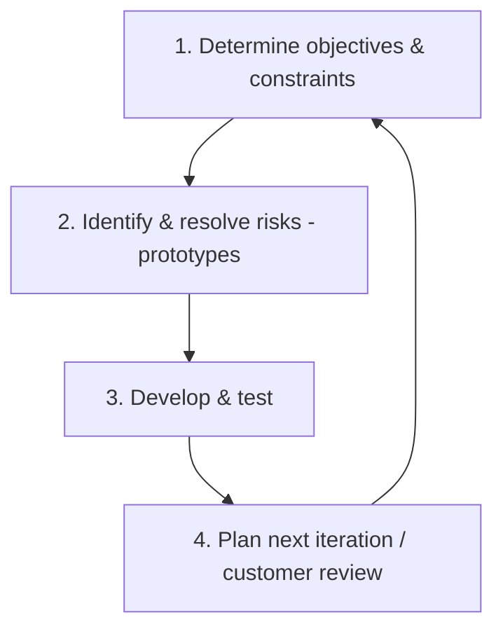

# Session 04: Iterative Process Models: Prototype, Incremental and Spiral

> Module: Agile and DevOps · Term 5 (ADSE) · ⏱ ~2 hours

Real users rarely know everything they want on day one. Iterative models accept this and deliver software in **repeated cycles**, learning as they go.

## 🎯 Learning Objectives

By the end of this session you will be able to:

- Explain the Prototype model and when prototyping is suitable
- Describe the Incremental model and how it delivers value in parts
- Contrast iterative and incremental development
- Explain the Spiral model, its four quadrants and its focus on risk
- List advantages, disadvantages and applications of each model

## 📖 Concepts Explained

### 1. Iterative vs. incremental — two different ideas

| Idea | Meaning | Analogy |
|------|---------|---------|
| **Iterative** | Build a rough version, then *refine* it again and again | Painting: sketch → base colours → details |
| **Incremental** | Build and deliver the system *piece by piece* | Lego: add one finished room at a time |

Most modern methods (including Agile) combine **both**.

### 2. Prototype model

A **prototype** is an early, simplified version of the system built to explore and clarify requirements.



| Type | Description |
|------|-------------|
| Throw-away | Built only to learn, then discarded |
| Evolutionary | Refined until it becomes the final product |
| Low-fidelity | Paper sketches, clickable Figma screens |
| High-fidelity | Looks and behaves almost like the real app |

**Advantages:** users see something early; misunderstandings are caught quickly; great for UI-heavy systems.
**Disadvantages:** users may think the prototype is "almost done"; scope creep; poor code if a throw-away is kept.
**Suitable when:** requirements are vague, UI/UX is critical, or the idea is new.

### 3. Incremental model

The system is split into **increments**. Each increment passes through design–code–test and is delivered to users.



**Advantages:** early working software; easier testing of smaller pieces; customers give feedback per increment; risk spread out.
**Disadvantages:** needs good overall architecture up front; integration issues; total cost can be higher.

### 4. Spiral model (Barry Boehm, 1986)

The Spiral model is **risk-driven**. The project loops through four quadrants; each loop produces a more complete version.



| Quadrant | Activities |
|----------|-----------|
| Objectives | Goals, alternatives, constraints for this loop |
| Risk analysis | Identify technical, cost, schedule risks; build prototypes or simulations to reduce them |
| Engineering | Design, code and test this loop's product |
| Evaluation & planning | Customer review, decide whether to continue and plan the next loop |

**Advantages:** strong risk management; flexible; suitable for large, expensive, high-risk projects.
**Disadvantages:** complex to manage; needs risk-analysis expertise; can be costly for small projects.
**Applications:** defence and aerospace systems, large banking platforms, new technology R&D.

### 5. Side-by-side comparison

| Criteria | Prototype | Incremental | Spiral |
|----------|-----------|-------------|--------|
| Main focus | Clarify requirements | Early partial delivery | Manage risk |
| Customer involvement | High | Medium–high | High at each loop |
| Best for | Unclear UI/requirements | Large systems with clear core | Large, high-risk projects |
| Main danger | Scope creep | Integration issues | Cost & complexity |

## 💻 Code Examples

### Example 1: A simple risk register (Spiral quadrant 2)

📄 File: [`risk-register.csv`](./risk-register.csv)

```csv
id,risk,category,probability(1-5),impact(1-5),score,mitigation,owner
R1,Payment gateway API changes,Technical,3,5,15,Wrap gateway in adapter class; monitor changelog,Tech Lead
R2,Key developer leaves,People,2,4,8,Pair programming; documentation,Project Manager
R3,Users reject new UI,Requirements,3,4,12,Build clickable prototype and test with 5 users,UX Designer
R4,Server cost exceeds budget,Cost,2,3,6,Load-test early; use auto-scaling limits,DevOps
```

**How it works**

- **score = probability × impact**; the highest scores are handled first.
- Every risk has a **mitigation** and an **owner** — a risk without an owner is just a worry.
- Open the CSV in Excel/Sheets and sort by score to prioritise.

### Example 2: Increment plan

📄 File: [`increment-plan.md`](./increment-plan.md)

```markdown
# Increment Plan – Campus Food Ordering App

| Increment | Features delivered | Users can… | Duration |
|-----------|-------------------|------------|----------|
| 1 | Menu browsing, search | See today's menu and prices | 3 weeks |
| 2 | Cart, order placement | Order food for pickup | 3 weeks |
| 3 | Online payment, order status | Pay by wallet and track order | 4 weeks |
| 4 | Ratings, admin reports | Rate food; canteen sees daily sales | 3 weeks |

**Definition of Done for each increment:** coded, unit-tested, reviewed, deployed to test server, demoed to canteen manager.
```

**How it works**

- Each increment delivers something users can actually *use*.
- The shared **Definition of Done** keeps quality the same in every increment.

## 🧪 Lab Practice

### Task 1: Paper prototype

1. Sketch 3 screens of a *Bus Pass Renewal* app on paper.
2. Show them to a classmate acting as a user; note 3 pieces of feedback.
3. Redraw one screen based on the feedback (one iteration!).

### Task 2: Plan increments

1. For a *Gym Membership App*, write a 4-increment plan using `increment-plan.md`.
2. Make sure increment 1 is usable on its own.

### Task 3: Risk analysis

1. Add 4 new risks to `risk-register.csv` for the gym app.
2. Calculate scores and sort; describe how a prototype could reduce the top risk.

### Task 4: Choose the model

1. For each scenario pick Prototype, Incremental or Spiral and justify: (a) satellite ground-control software, (b) new kids' learning game, (c) national e-commerce platform rolled out city by city.

## 📝 Assignment

Prepare a **Spiral model plan** for a *Mobile Banking App* with **three loops**. For each loop list objectives, top 3 risks (with mitigation), what will be built, and what the customer will review.
Present it as a table plus a short paragraph explaining why Spiral suits banking software.

## ❓ Quick Quiz

**Q1. Which model is primarily *risk-driven*?**

- a) Prototype
- b) Incremental
- c) Spiral
- d) Waterfall

<details><summary>Show answer</summary>

c) Spiral

</details>

**Q2. A throw-away prototype is…**

- a) Delivered to customers
- b) Built to learn and then discarded
- c) The final product
- d) Only used for testing

<details><summary>Show answer</summary>

b) Built to learn and then discarded

</details>

**Q3. Delivering 'catalogue first, then checkout, then payments' is…**

- a) Incremental
- b) Linear
- c) V-Model
- d) Big-bang

<details><summary>Show answer</summary>

a) Incremental

</details>

**Q4. What is one danger of showing users a polished prototype?**

<details><summary>Show answer</summary>

They may think the product is almost finished and expect immediate delivery, or keep adding requests (scope creep).

</details>

**Q5. Name the four activities in each Spiral loop.**

<details><summary>Show answer</summary>

Determine objectives; identify and resolve risks; develop and test; evaluate and plan the next iteration.

</details>

## 💼 Interview Questions

**1. What is the difference between iterative and incremental development?**

<details><summary>Model answer</summary>

Iterative means repeatedly refining the same product (rough → better → polished). Incremental means adding new finished pieces over time. Agile uses both: each sprint adds an increment and refines earlier work.

</details>

**2. Why is Spiral expensive for small projects?**

<details><summary>Model answer</summary>

Each loop requires formal risk analysis, prototyping and review. For small, low-risk projects that overhead costs more than the risks it prevents.

</details>

**3. How would you prevent scope creep in prototyping?**

<details><summary>Model answer</summary>

Set a time-box and a clear goal for each prototype round, keep a prioritised backlog, separate "nice to have" ideas, and make clear to stakeholders that the prototype is not production code.

</details>

## ✅ Summary

- Iterative = refine repeatedly; incremental = deliver in pieces; modern methods combine both.
- Prototype model clarifies vague requirements through early, cheap versions.
- Incremental model delivers usable parts early and spreads risk.
- Spiral model loops through objectives, risk analysis, engineering and evaluation.
- Choose by project need: unclear UI → prototype; large clear core → incremental; high risk → spiral.

---

[⬅ Previous](../Session-03-Linear-Process-Models/README.md) · [🏠 Module Home](../README.md) · [Next ➡](../Session-05-Specialized-Process-Models/README.md)

Prepared by Zeeshan Abbas · Aptech Learning North Nazimabad
