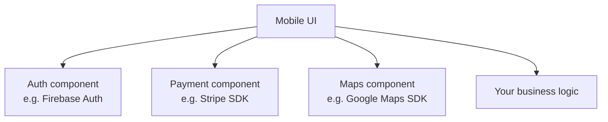

# Session 05: Specialized Process Models: RAD, CBD, AOSD and Web Engineering

> Module: Agile and DevOps · Term 5 (ADSE) · ⏱ ~2 hours

Some projects have special needs — extreme speed, heavy reuse, or cross-cutting concerns like security and logging. Specialized models address these needs.

## 🎯 Learning Objectives

By the end of this session you will be able to:

- Explain the RAD model and its phases
- Describe component-based development (CBD) with its pros and cons
- Explain Aspect-Oriented Software Development (AOSD) and cross-cutting concerns
- Describe the Web engineering process
- Select a suitable process model using clear criteria

## 📖 Concepts Explained

### 1. Rapid Application Development (RAD)

RAD (popularised by James Martin, 1991) focuses on **speed** through prototypes, reusable components and strong user involvement, usually in **60–90 day** time-boxes.


| Phase | What happens |
|-------|--------------|
| Requirements planning | Users, managers and developers agree on scope quickly in workshops |
| User design | Users and developers build and refine prototypes together (repeated) |
| Rapid construction | Code generated/assembled using reusable components and low-code tools |
| Cutover | Testing, data conversion, training, go-live |

**Pros:** very fast delivery; constant user feedback; reuse reduces cost.
**Cons:** needs skilled developers and committed users; weak for very large or high-performance systems; can sacrifice documentation.
**Modern relatives:** low-code platforms such as Power Apps or FlutterFlow.

### 2. Component-Based Development (CBD)

Build systems by **assembling pre-built, independent components** that communicate through well-defined interfaces.



Steps: identify needed components → search for existing ones (COTS / open-source) → evaluate & adapt → integrate → test the composed system.

**Pros:** faster development, proven quality, lower cost.
**Cons:** dependency on vendors; licence costs; components may not fit perfectly; version conflicts.

### 3. Aspect-Oriented Software Development (AOSD)

Some concerns appear **everywhere** in code — logging, security checks, transactions, caching. These are **cross-cutting concerns**. Putting them in every function causes duplication ("scattering") and mixes unrelated code ("tangling").

AOSD separates them into **aspects** that are applied automatically at chosen points.

| AOSD term | Meaning |
|-----------|---------|
| Aspect | A module for one cross-cutting concern (e.g., logging) |
| Join point | A point in program execution (e.g., a method call) |
| Pointcut | A rule selecting join points ("all methods in service layer") |
| Advice | Code that runs at those points (before / after / around) |
| Weaving | Combining aspects with main code |

**Pros:** cleaner code, easier changes to cross-cutting rules.
**Cons:** harder to debug ("where is this behaviour coming from?"), learning curve.
Python **decorators** give a lightweight taste of the same idea — see the code example.

### 4. Web engineering

Web apps have special traits: huge user numbers, frequent updates, many devices, security exposure. Web engineering adapts SDLC for them:

1. **Formulation** – goals, audience, business value.
2. **Planning** – estimates, risks, schedule.
3. **Analysis** – content, interaction, function and configuration needs.
4. **Engineering** – UI/UX design, content design, architecture.
5. **Page generation & testing** – coding, cross-browser and load testing.
6. **Customer evaluation** – feedback drives the next cycle.

### 5. Selecting a process model

| If your project has… | Consider |
|----------------------|----------|
| Fixed, clear requirements + regulation | Waterfall / V-Model |
| Unclear UI requirements | Prototype |
| Large scope, clear core, need early value | Incremental |
| High technical/business risk | Spiral |
| Tight deadline + available components | RAD / CBD |
| Many cross-cutting concerns | AOSD techniques |
| Frequent change, close customer collaboration | Agile (next sessions) |

## 💻 Code Examples

### Example 1: Cross-cutting logging with a decorator

📄 File: [`aspect_logging.py`](./aspect_logging.py)

```python
"""A tiny taste of Aspect-Oriented ideas using Python decorators.

The logging/timing concern is written ONCE and applied to many functions.
Run: python aspect_logging.py
"""
import functools
import time


def log_and_time(func):
    """'Advice' that runs around every decorated function (a join point)."""
    @functools.wraps(func)
    def wrapper(*args, **kwargs):
        print(f"[LOG] calling {func.__name__} args={args} kwargs={kwargs}")
        start = time.perf_counter()
        result = func(*args, **kwargs)
        elapsed = (time.perf_counter() - start) * 1000
        print(f"[LOG] {func.__name__} returned {result!r} in {elapsed:.2f} ms")
        return result
    return wrapper


@log_and_time
def calculate_fee(distance_km: float) -> float:
    return 120 + distance_km * 35          # base fare + per-km rate (PKR)


@log_and_time
def apply_discount(amount: float, percent: int) -> float:
    return round(amount * (1 - percent / 100), 2)


if __name__ == "__main__":
    fee = calculate_fee(8.5)
    apply_discount(fee, 10)
```

**Run it:**

```bash
python aspect_logging.py
```

**How it works**

- `log_and_time` is the **aspect**: logging and timing written once.
- Each `@log_and_time` line is a **pointcut** choosing which functions get the behaviour.
- `wrapper` is the **advice** that runs *around* the original call; Python performs the **weaving** when the decorator is applied.
- The business functions stay clean — they contain only fare logic.

### Example 2: Process model selector

📄 File: [`process-model-selector.md`](./process-model-selector.md)

```markdown
# Process Model Selector – Scoring Sheet

Rate each factor for your project from 1 (low) to 5 (high).

| Factor | Score |
|--------|-------|
| Requirement clarity | |
| Expected requirement change | |
| Technical risk | |
| Deadline pressure | |
| Availability of reusable components | |
| Need for documentation / audit | |
| Customer availability for feedback | |

Guidance:
- High clarity + high documentation + low change → **Waterfall / V-Model**
- High risk → **Spiral**
- High deadline pressure + high reuse → **RAD / CBD**
- High change + high customer availability → **Agile**
```

**How it works**

- Scoring factors makes model selection a reasoned decision rather than a habit.
- Use it again after you learn Agile to compare all options.

## 🧪 Lab Practice

### Task 1: RAD workshop simulation

1. In groups of 4, spend 15 minutes agreeing the scope of a *Blood Donor Finder* app (requirements planning).
2. Spend 20 minutes sketching and revising screens with one member acting as the user (user design).
3. List which reusable components you would use (maps, auth, SMS).

### Task 2: Component hunt

1. For a *Hotel Booking* app list 5 components you could reuse (e.g., payment SDK, maps, auth).
2. For each, note its licence/cost and one risk of depending on it.

### Task 3: Aspects in practice

1. Run `aspect_logging.py`.
2. Add a new function `calculate_tip(amount)` and decorate it — notice you wrote no logging code.
3. Write another decorator `require_admin` that prints 'Access denied' unless a global `CURRENT_ROLE == 'admin'`.

### Task 4: Pick a model

1. Use `process-model-selector.md` for two projects of your choice and justify the chosen model in 3 lines each.

## 📝 Assignment

Your college wants an **online admission portal in 8 weeks** using existing components (payment gateway, SMS service, document upload).
Write a 1–2 page proposal recommending a process model (RAD or CBD or a mix). Include phases with dates, components to reuse, two risks and how you will manage cross-cutting concerns such as logging and security.

## ❓ Quick Quiz

**Q1. RAD primarily optimises for…**

- a) Documentation
- b) Speed with user involvement
- c) Formal verification
- d) Hardware cost

<details><summary>Show answer</summary>

b) Speed with user involvement

</details>

**Q2. Logging that appears in every function is called a…**

- a) Component
- b) Cross-cutting concern
- c) Increment
- d) Prototype

<details><summary>Show answer</summary>

b) Cross-cutting concern

</details>

**Q3. In AOSD, the code that runs at a join point is called…**

- a) Pointcut
- b) Weaving
- c) Advice
- d) Aspect

<details><summary>Show answer</summary>

c) Advice

</details>

**Q4. Give one disadvantage of component-based development.**

<details><summary>Show answer</summary>

Vendor dependency, licence cost, imperfect fit, or version conflicts between components.

</details>

**Q5. List the four RAD phases.**

<details><summary>Show answer</summary>

Requirements planning, user design, rapid construction, cutover.

</details>

## 💼 Interview Questions

**1. What is a cross-cutting concern? Give examples.**

<details><summary>Model answer</summary>

A requirement that affects many modules rather than one — logging, authentication/authorisation, caching, error handling, transactions. Aspects or decorators/middleware keep them in one place.

</details>

**2. When is RAD a bad choice?**

<details><summary>Model answer</summary>

When the system is very large, needs high performance tuning, has strict safety requirements, or when users cannot commit time for frequent workshops.

</details>

**3. How does Web engineering differ from traditional SDLC?**

<details><summary>Model answer</summary>

It emphasises continuous evolution, content and UX design, multi-device compatibility, security and scalability, with very short release cycles and frequent customer evaluation.

</details>

## ✅ Summary

- RAD delivers quickly through workshops, prototypes and reusable components.
- CBD assembles systems from independent components via clear interfaces.
- AOSD isolates cross-cutting concerns (logging, security) into aspects; decorators show the idea in Python.
- Web engineering adapts SDLC for fast-changing, high-traffic web systems.
- Select a model by scoring requirement clarity, risk, deadline, reuse and change.

---

[⬅ Previous](../Session-04-Iterative-Process-Models/README.md) · [🏠 Module Home](../README.md) · [Next ➡](../Session-06-Agile-Software-Development-Part-1/README.md)

Prepared by Zeeshan Abbas · Aptech Learning North Nazimabad
