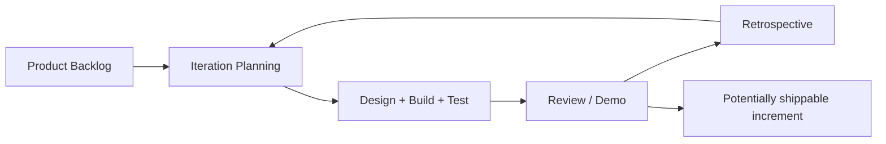

# Session 06: Agile Software Development – Part I

> Module: Agile and DevOps · Term 5 (ADSE) · ⏱ ~2 hours

In 2001, seventeen developers met in Utah and wrote the **Agile Manifesto**. It changed how most of the world builds software.

## 🎯 Learning Objectives

By the end of this session you will be able to:

- Describe Agile development and why it emerged
- Explain the four values and summarise the twelve principles of the Agile Manifesto
- Describe the Agile SDLC (iterations/sprints)
- Differentiate Agile from traditional SDLC models
- Name popular Agile methodologies and their applications

## 📖 Concepts Explained

### 1. What is Agile?

**Agile** is a mindset and family of methods for building software in **short iterations**, delivering **working increments** frequently, and **adapting** to feedback and change.

> Agile is not a single method — Scrum, Kanban, XP, DSDM, FDD and others are all *Agile methods*.

### 2. Why Agile emerged

Heavy, document-driven processes were slow. Markets changed faster than projects could finish. Teams needed a way to deliver value sooner and change direction cheaply.

### 3. The Agile Manifesto – four values (in our own words)

| We value more… | …than | Meaning |
|----------------|-------|---------|
| People and how they work together | Processes and tools | Good communication beats a perfect tool |
| Software that actually works | Long documents | Progress is measured by running features |
| Working *with* the customer | Arguing over the contract | Customers are partners, not opponents |
| Adapting to change | Sticking rigidly to the plan | Plans are useful, but reality wins |

The items on the right still matter — Agile simply values the left more.

### 4. The twelve principles (summarised)

1. Satisfy the customer through early and continuous delivery.
2. Welcome changing requirements, even late.
3. Deliver working software frequently (weeks, not months).
4. Business people and developers work together daily.
5. Build projects around motivated people and trust them.
6. Face-to-face conversation is the most effective communication.
7. Working software is the primary measure of progress.
8. Maintain a sustainable pace — no endless overtime.
9. Continuous attention to technical excellence and good design.
10. Simplicity — maximise the work *not* done.
11. Self-organising teams produce the best designs.
12. Reflect regularly and adjust behaviour (retrospectives).

### 5. The Agile SDLC



Each **iteration (sprint)** is usually **1–4 weeks** and produces a tested, usable increment.

### 6. Agile vs. traditional

| Aspect | Traditional (Waterfall) | Agile |
|--------|-------------------------|-------|
| Planning | Big plan up front | Rolling plan, refined each sprint |
| Requirements | Fixed early | Evolve via backlog |
| Delivery | One big release | Frequent small releases |
| Customer role | Sign-offs at milestones | Continuous collaboration |
| Testing | After coding | Continuous, inside every iteration |
| Change | Expensive | Expected and welcomed |
| Progress measure | Documents & phases completed | Working software |
| Team | Role silos | Cross-functional, self-organising |

### 7. Key features of Agile

- Time-boxed iterations
- Prioritised backlog of user stories
- Cross-functional team (dev, test, design)
- Continuous integration and testing
- Daily communication (stand-ups)
- Frequent demos and retrospectives

### 8. Popular Agile methodologies

| Method | One-line idea |
|--------|---------------|
| Scrum | Sprints with defined roles, events and artefacts |
| Kanban | Visualise work, limit work-in-progress, improve flow |
| Extreme Programming (XP) | Technical practices: TDD, pair programming, CI |
| Lean Software Development | Eliminate waste, deliver fast |
| DSDM | Time-boxing and MoSCoW prioritisation with business focus |
| FDD | Build feature by feature from a domain model |
| Crystal | Lightweight, people-centred, scaled by team size |

### 9. Case study: a fintech wallet

A Karachi fintech started with a 9-month Waterfall plan. After 4 months a competitor launched QR payments. The team switched to 2-week sprints, released a QR-pay MVP in 6 weeks, gathered user feedback and added bill payments next. Agile let them **respond to the market** instead of finishing an outdated plan.

### Applications of Agile

Web & mobile apps, SaaS products, startups, internal tools, AI/data products, and increasingly government digital services.

## 💻 Code Examples

### Example 1: User story card template

📄 File: [`user-story-template.md`](./user-story-template.md)

```markdown
# User Story Card

**ID:** US-___

**As a** <type of user>
**I want** <some goal>
**so that** <some benefit>

**Acceptance criteria**
- Given <context>, when <action>, then <expected result>
-

**Priority:** Must / Should / Could   **Estimate:** __ story points

---
## Examples
**US-01** As a *student*, I want to *see my attendance percentage* so that *I know if I am at risk*.
- Given I am logged in, when I open the dashboard, then I see attendance for every module.
- Given attendance is below 75%, then the value is shown in red.

**US-02** As a *canteen manager*, I want to *mark an order as ready* so that *students get notified*.
```

**How it works**

- The **As a / I want / so that** format keeps the focus on *who* benefits and *why*.
- **Given–When–Then** acceptance criteria make the story testable; they become test cases later.
- Story points estimate relative effort, not hours.

### Example 2: Agile values self-check

📄 File: [`agile-vs-waterfall-scorecard.md`](./agile-vs-waterfall-scorecard.md)

```markdown
# Agile Values Self-Check (rate your team 1–5)

| Statement | 1 | 2 | 3 | 4 | 5 |
|-----------|---|---|---|---|---|
| We talk daily instead of only emailing | | | | | |
| We show working software at least every 2 weeks | | | | | |
| The customer/user gives feedback regularly | | | | | |
| We change the plan when we learn something new | | | | | |
| We hold a retrospective after each iteration | | | | | |
| We keep a sustainable pace (no constant overtime) | | | | | |

Total ≥ 24 → strongly Agile · 15–23 → partly Agile · < 15 → mostly traditional
```

**How it works**

- Translates the manifesto values into observable team behaviours.
- Use it at the start and end of your mini-project to see how your team's habits change.

## 🧪 Lab Practice

### Task 1: Manifesto in your words

1. Without looking, write the four Agile values as you understand them.
2. Compare with the table above and correct any misunderstanding.

### Task 2: Write user stories

1. For a *Lost & Found app for the campus*, write 6 user stories using `user-story-template.md`.
2. Add 2 Given–When–Then acceptance criteria to each.

### Task 3: Plan a first sprint

1. Order your stories by value to the user (most valuable first).
2. Select what a 3-person team could finish in one 2-week sprint and explain why.

### Task 4: Compare

1. Fill a table comparing how the Lost & Found app would progress under Waterfall vs. Agile over 8 weeks.

## 📝 Assignment

Write a 1-page **Agile case study** about any app you use whose features change often (e.g., food delivery, ride-hailing).
Identify at least 3 manifesto principles visible in how the product evolves, and describe one feature you think was released as an MVP and later improved.

## ❓ Quick Quiz

**Q1. How many values does the Agile Manifesto state?**

- a) 2
- b) 4
- c) 7
- d) 12

<details><summary>Show answer</summary>

b) 4

</details>

**Q2. In Agile, the primary measure of progress is…**

- a) Lines of code
- b) Documents signed
- c) Working software
- d) Hours worked

<details><summary>Show answer</summary>

c) Working software

</details>

**Q3. A typical sprint length is…**

- a) 1–4 weeks
- b) 3–6 months
- c) 1 day
- d) 1 year

<details><summary>Show answer</summary>

a) 1–4 weeks

</details>

**Q4. Does Agile mean 'no documentation'?**

<details><summary>Show answer</summary>

No. Agile values working software *more* than comprehensive documentation, but useful, lightweight documentation is still produced.

</details>

**Q5. Name three Agile methodologies.**

<details><summary>Show answer</summary>

Any three: Scrum, Kanban, XP, Lean, DSDM, FDD, Crystal, ASD, AUP.

</details>

## 💼 Interview Questions

**1. Explain the Agile Manifesto values.**

<details><summary>Model answer</summary>

Individuals and interactions over processes and tools; working software over comprehensive documentation; customer collaboration over contract negotiation; responding to change over following a plan. The right-hand items still have value, but the left-hand items are valued more.

</details>

**2. How is Agile different from Waterfall?**

<details><summary>Model answer</summary>

Agile plans continuously, delivers small working increments every few weeks, tests throughout, and welcomes change with close customer collaboration. Waterfall plans everything up front and delivers once at the end.

</details>

**3. What makes a good user story?**

<details><summary>Model answer</summary>

It follows INVEST: Independent, Negotiable, Valuable, Estimable, Small and Testable, and it has clear acceptance criteria.

</details>

## ✅ Summary

- Agile is a mindset of short iterations, working increments and adaptation.
- Four manifesto values and twelve principles guide Agile teams.
- The Agile SDLC cycles through planning, building, review and retrospective.
- Agile differs from Waterfall in planning, delivery, testing and customer involvement.
- Scrum, Kanban, XP, Lean, DSDM, FDD and Crystal are popular Agile methods.

---

[⬅ Previous](../Session-05-Specialized-Process-Models/README.md) · [🏠 Module Home](../README.md) · [Next ➡](../Session-07-Agile-Software-Development-Part-2/README.md)

Prepared by Zeeshan Abbas · Aptech Learning North Nazimabad
