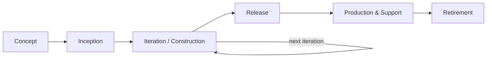
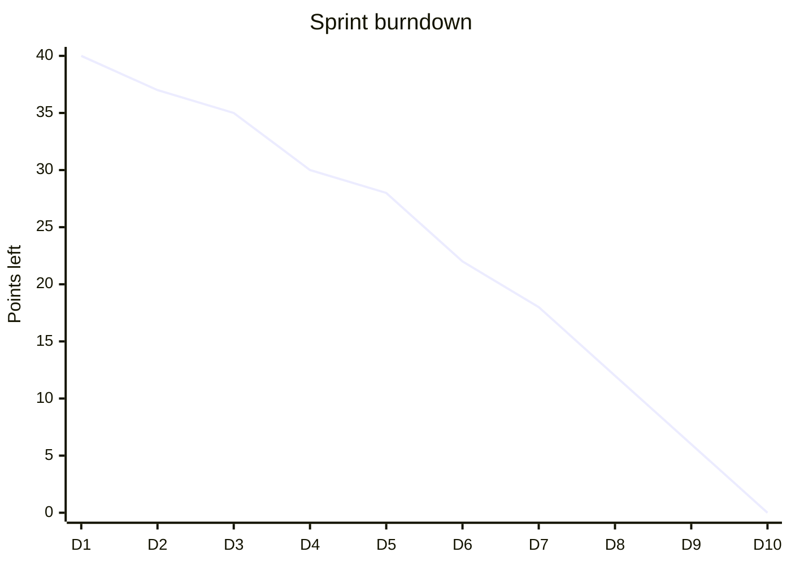

# Session 07: Agile Software Development – Part II: Phases, Artifacts and Tools

> Module: Agile and DevOps · Term 5 (ADSE) · ⏱ ~2 hours

Session 6 explained *why* Agile works. This session covers *how* an Agile project actually runs from start to finish.

## 🎯 Learning Objectives

By the end of this session you will be able to:

- Describe the phases of an Agile project from concept to retirement
- Explain common Agile artifacts: backlog, user stories, burndown chart, task board, Definition of Done
- List the advantages and disadvantages of Agile
- Use Agile tools such as Jira, Trello, Azure Boards and GitHub Projects
- Set up a simple Kanban/Scrum board for a team

## 📖 Concepts Explained

### 1. Phases of an Agile project



| Phase | Goal | Typical activities |
|-------|------|--------------------|
| Concept | Decide if the idea is worth pursuing | Vision, business case, rough cost |
| Inception | Get the team ready | Form team, initial backlog, architecture spike, tools set-up |
| Iteration | Build value in sprints | Plan → build → test → review → retrospective |
| Release | Put the increment in users' hands | Final testing, documentation, deployment |
| Production | Keep it running | Monitoring, support, small fixes |
| Retirement | End the system gracefully | Data migration, user notification, shutdown |

### 2. Agile artifacts

| Artifact | What it is | Who maintains it |
|----------|------------|------------------|
| Product backlog | Ordered list of everything the product might need | Product Owner |
| User story | Small requirement written from the user's view | Team + PO |
| Epic | A large story that will be split into smaller stories | PO |
| Sprint/iteration backlog | Stories selected for this iteration + their tasks | Development team |
| Task board | Visual board (To Do / In Progress / Done) | Team |
| Burndown chart | Remaining work vs. time in an iteration | Scrum Master / team |
| Velocity | Story points completed per iteration (used for forecasting) | Team |
| Definition of Done (DoD) | Shared checklist that every item must meet | Team |
| Increment | The working product at the end of the iteration | Team |

**Burndown example** — a 10-day sprint starting with 40 points:



If the line stays flat for days, the team is blocked — talk about it in the stand-up.

### 3. Advantages and disadvantages

| Advantages | Disadvantages |
|------------|---------------|
| Early and frequent value delivery | Harder to fix total cost/date up front |
| Adapts to change cheaply | Needs committed, available customer |
| Higher customer satisfaction | Can drift without a strong Product Owner |
| Problems surface early | Less upfront documentation |
| Motivated, self-organising teams | Scaling to many teams is challenging |

### 4. Agile tools

| Tool | Best for | Free tier |
|------|----------|-----------|
| Jira | Scrum/Kanban with reports, large teams | Yes (up to 10 users) |
| Trello | Simple Kanban boards | Yes |
| Azure Boards | Teams using Azure DevOps pipelines | Yes (small teams) |
| GitHub Projects | Linking issues and pull requests to a board | Yes |
| Miro | Online whiteboards for retros and story mapping | Yes |
| Slack / Teams | Daily communication | Yes |

### 5. Mechanisms that keep Agile teams healthy

- **WIP limits** – e.g., max 3 cards in "In Progress" to avoid multitasking.
- **Daily stand-up** – 15 minutes: done yesterday, plan today, blockers.
- **Backlog refinement** – weekly session to split, clarify and estimate upcoming stories.
- **Story points & planning poker** – relative estimation as a team.
- **Retrospective formats** – Start/Stop/Continue, Mad/Sad/Glad.

## 💻 Code Examples

### Example 1: Definition of Done checklist

📄 File: [`definition-of-done.md`](./definition-of-done.md)

```markdown
# Definition of Done (DoD) – Team Template

A story is **Done** only when ALL items are true:

- [ ] Code is written and pushed to the main branch through a reviewed pull request
- [ ] Unit tests written and passing (coverage of new code ≥ 70%)
- [ ] Acceptance criteria verified by a tester or the Product Owner
- [ ] No known critical or high-severity bugs
- [ ] UI checked on mobile and desktop sizes
- [ ] README / API docs updated if behaviour changed
- [ ] Deployed to the staging environment
```

**How it works**

- A shared DoD removes arguments about whether something is "finished".
- Every item is checkable — vague items like "good quality" are avoided.

### Example 2: Sprint board data

📄 File: [`sprint-board.csv`](./sprint-board.csv)

```csv
id,story,points,status,owner
US-01,Student can log in with college email,3,Done,Ali
US-02,Student can view timetable,5,In Progress,Sana
US-03,Student receives class-cancelled notification,8,To Do,
US-04,Admin can upload timetable CSV,5,In Progress,Usman
US-05,Student can switch Urdu/English,3,To Do,
```

**How it works**

- Import this CSV into Trello/Jira/GitHub Projects or a spreadsheet to create a quick board.
- Notice two cards are *In Progress* — with a WIP limit of 2 the team must finish one before starting another.

### Example 3: Text burndown and forecast

📄 File: [`burndown.py`](./burndown.py)

```python
"""Print a text burndown chart and today's status from sprint data.
Run: python burndown.py
"""
total_points = 40
sprint_days = 10
remaining = [40, 37, 35, 30, 28, 22, 18]          # recorded at end of each day so far

ideal_per_day = total_points / sprint_days
print("Day | Ideal | Actual | Chart")
for day, actual in enumerate(remaining, start=1):
    ideal = total_points - ideal_per_day * day
    bar = "#" * int(actual)
    flag = "  <-- behind" if actual > ideal else ""
    print(f"{day:>3} | {ideal:5.1f} | {actual:6} | {bar}{flag}")

days_used = len(remaining)
burned = total_points - remaining[-1]
velocity_per_day = burned / days_used
days_needed = remaining[-1] / velocity_per_day
print(f"\nAverage burn: {velocity_per_day:.1f} pts/day")
print(f"Forecast: {days_needed:.1f} more days needed, {sprint_days - days_used} days left")
```

**Run it:**

```bash
python burndown.py
```

**How it works**

- The **ideal** line drops evenly (4 points/day here); the **actual** values come from daily updates.
- Rows where actual > ideal are flagged as *behind*.
- Average burn rate gives a simple forecast — a conversation starter for the stand-up, not a judgment.

## 🧪 Lab Practice

### Task 1: Build a board

1. Create a free Trello board (or GitHub Project) with columns: Backlog, To Do, In Progress, Review, Done.
2. Add the 5 stories from `sprint-board.csv` as cards with labels for points.
3. Set a WIP limit of 2 on 'In Progress' (write it in the column name).

### Task 2: Write your DoD

1. Adapt `definition-of-done.md` for your mini-project team.
2. Remove one item you feel is unrealistic and add one that is missing; justify both.

### Task 3: Track a burndown

1. Run `burndown.py`, then change `remaining` to simulate a blocked sprint (flat values).
2. Explain in 3 lines what the team should do.

### Task 4: Run a retrospective

1. Use Start / Stop / Continue on your last group assignment.
2. Agree on one concrete action for next time.

## 📝 Assignment

Set up a complete Agile workspace for a *Library Book Reservation* project in Trello, Jira or GitHub Projects: a backlog of at least 12 user stories, 2 epics, story-point estimates, a 2-week sprint plan, a team DoD,
and a screenshot of the board. Submit screenshots plus a half-page explanation of your choices.

## ❓ Quick Quiz

**Q1. Who orders the product backlog?**

- a) Scrum Master
- b) Product Owner
- c) Tester
- d) Customer support

<details><summary>Show answer</summary>

b) Product Owner

</details>

**Q2. A burndown chart shows…**

- a) Bugs per module
- b) Remaining work over time
- c) Team salaries
- d) Server load

<details><summary>Show answer</summary>

b) Remaining work over time

</details>

**Q3. A large story that must be split is called…**

- a) Task
- b) Epic
- c) Spike
- d) Increment

<details><summary>Show answer</summary>

b) Epic

</details>

**Q4. What is a WIP limit and why use it?**

<details><summary>Show answer</summary>

A maximum number of items allowed in a workflow stage at once; it reduces multitasking, exposes bottlenecks and improves flow.

</details>

**Q5. Name the six phases of an Agile project.**

<details><summary>Show answer</summary>

Concept, inception, iteration/construction, release, production, retirement.

</details>

## 💼 Interview Questions

**1. What is a Definition of Done and why does it matter?**

<details><summary>Model answer</summary>

It is a shared checklist that every backlog item must satisfy before being called done — e.g., code reviewed, tests passing, deployed to staging. It keeps quality consistent and makes velocity meaningful.

</details>

**2. How do you use velocity?**

<details><summary>Model answer</summary>

Velocity is the average story points a team completes per sprint. It is used to forecast how much fits in future sprints or when a release might be ready — never to compare different teams.

</details>

**3. Your burndown has been flat for three days. What do you do?**

<details><summary>Model answer</summary>

Raise it at the stand-up, identify blockers (unclear story, dependency, environment issue), swarm on the blocked item, and if needed renegotiate scope with the Product Owner.

</details>

## ✅ Summary

- Agile projects move through concept, inception, iterations, release, production and retirement.
- Key artifacts: product backlog, user stories, epics, sprint backlog, task board, burndown, DoD, increment.
- Agile brings early value and adaptability but needs strong customer involvement.
- Tools like Jira, Trello, Azure Boards and GitHub Projects make work visible.
- WIP limits, stand-ups, refinement and retrospectives keep teams healthy.

---

[⬅ Previous](../Session-06-Agile-Software-Development-Part-1/README.md) · [🏠 Module Home](../README.md) · [Next ➡](../Session-08-Extreme-Programming/README.md)

Prepared by Zeeshan Abbas · Aptech Learning North Nazimabad
