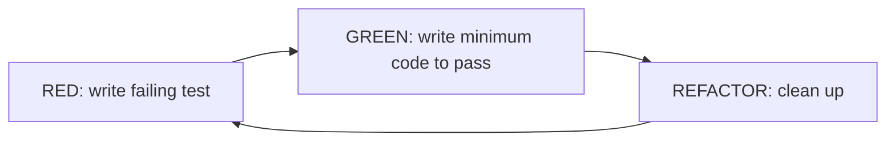

# Session 08: Extreme Programming (XP)

> Module: Agile and DevOps · Term 5 (ADSE) · ⏱ ~2 hours

Extreme Programming takes good engineering practices and turns them up to the maximum — if code review is good, review all the time (pair programming); if testing is good, test first (TDD).

## 🎯 Learning Objectives

By the end of this session you will be able to:

- Explain the basic concepts and values of XP
- Describe core XP practices such as TDD, pair programming, refactoring and continuous integration
- Describe the phases of an XP project and its key artifacts
- Identify the main roles in an XP team
- Evaluate advantages and disadvantages of XP with a case study

## 📖 Concepts Explained

### 1. What is XP?

**Extreme Programming (XP)** was created by Kent Beck in the late 1990s. It focuses on **technical excellence** and very short feedback loops so that software can change safely.

### 2. The five XP values

| Value | In practice |
|-------|-------------|
| Communication | Pairing, shared code, whole team in one place |
| Simplicity | Build the simplest thing that works today |
| Feedback | Tests in seconds, customer feedback each iteration |
| Courage | Refactor and throw away bad code without fear |
| Respect | Everyone's contribution matters |

### 3. Core XP practices

| Practice | Description |
|----------|-------------|
| Planning game | Customer writes stories; developers estimate; together they choose scope |
| Small releases | Release working software every 1–3 weeks |
| Test-Driven Development (TDD) | Write a failing test → make it pass → refactor (**Red–Green–Refactor**) |
| Pair programming | Two developers, one keyboard: *driver* types, *navigator* reviews and thinks ahead |
| Refactoring | Improve code structure without changing behaviour |
| Continuous integration | Integrate and run all tests many times a day |
| Collective code ownership | Anyone can improve any part of the code |
| Coding standards | Team-wide style so code looks like one person wrote it |
| Simple design | No speculative features (YAGNI – *You Aren't Gonna Need It*) |
| Sustainable pace | 40-hour weeks; tired people write bugs |
| On-site customer | A real user available to answer questions |
| System metaphor | A shared story of how the system works |



### 4. XP phases

1. **Exploration** – customer writes story cards; team experiments with technology (spikes).
2. **Planning** – stories prioritised and estimated; release plan agreed.
3. **Iterations to release** – 1–3 week iterations with TDD and CI.
4. **Productionising** – extra testing and performance checks before release.
5. **Maintenance** – keep delivering new iterations while supporting production.
6. **Death** – no more stories; final documentation and close-down.

### 5. XP artifacts and documents

Story cards · task cards · acceptance tests · unit tests (the living documentation) · release plan · iteration plan · CRC (Class–Responsibility–Collaborator) cards.

### 6. XP roles

| Role | Responsibility |
|------|----------------|
| Customer | Writes stories and acceptance tests, sets priorities |
| Programmer | Estimates, writes tests and code, pairs |
| Tester | Helps customer write acceptance tests, runs them |
| Coach | Guides the team in XP practices |
| Tracker | Measures progress, velocity, estimates vs. actuals |
| Big Boss / Manager | Removes obstacles, provides resources |

### 7. Advantages and disadvantages

| ✅ Advantages | ⚠️ Disadvantages |
|--------------|------------------|
| Very high code quality and fewer defects | Pairing feels costly to managers |
| Safe, frequent change thanks to tests | Requires disciplined, skilled developers |
| Fast feedback from customer and tests | On-site customer is hard to arrange |
| Knowledge spreads through pairing | Less formal documentation |

### 8. Mini case study

A small team building a pharmacy inventory app kept breaking stock calculations with each release. They adopted TDD and pair programming for three months: escaped defects fell sharply, new developers became productive faster, and releases moved from monthly to weekly.

## 💻 Code Examples

### Example 1: Tests first: test_cart.py

📄 File: [`test_cart.py`](./test_cart.py)

```python
"""Unit tests written FIRST (Red), then cart.py made them pass (Green).
Run: python -m unittest test_cart.py -v
"""
import unittest
from cart import Cart


class TestCart(unittest.TestCase):
    def setUp(self):
        self.cart = Cart()

    def test_new_cart_is_empty(self):
        self.assertEqual(self.cart.total(), 0)
        self.assertEqual(self.cart.count(), 0)

    def test_add_items_updates_total(self):
        self.cart.add("Biryani", 450, 2)
        self.cart.add("Raita", 80)
        self.assertEqual(self.cart.total(), 980)

    def test_adding_same_item_increases_quantity(self):
        self.cart.add("Tea", 60)
        self.cart.add("Tea", 60, 2)
        self.assertEqual(self.cart.count(), 3)

    def test_discount(self):
        self.cart.add("Pizza", 1000)
        self.assertEqual(self.cart.total(discount_percent=10), 900)

    def test_invalid_quantity_raises(self):
        with self.assertRaises(ValueError):
            self.cart.add("Juice", 150, 0)


if __name__ == "__main__":
    unittest.main()
```

**Run it:**

```bash
python -m unittest test_cart.py -v
```

**How it works**

- These tests were written **before** the cart existed — running them first gives **RED** (failures).
- Each test checks one behaviour and has a descriptive name, so the test file reads like a specification.
- `setUp` gives every test a fresh cart, keeping tests independent.

### Example 2: Minimum code to pass: cart.py

📄 File: [`cart.py`](./cart.py)

```python
"""Shopping cart built with TDD (see test_cart.py)."""


class Cart:
    def __init__(self):
        self._items = {}                      # name -> (price, qty)

    def add(self, name: str, price: float, qty: int = 1) -> None:
        if price < 0 or qty <= 0:
            raise ValueError("price must be >= 0 and qty > 0")
        old_price, old_qty = self._items.get(name, (price, 0))
        self._items[name] = (price, old_qty + qty)

    def total(self, discount_percent: float = 0) -> float:
        subtotal = sum(p * q for p, q in self._items.values())
        return round(subtotal * (1 - discount_percent / 100), 2)

    def count(self) -> int:
        return sum(q for _, q in self._items.values())
```

**How it works**

- Just enough code to turn every test **GREEN**.
- Input validation exists only because a test demanded it (`test_invalid_quantity_raises`).
- Now we can **refactor** safely: if a change breaks behaviour, a test fails immediately.

## 🧪 Lab Practice

### Task 1: Red–Green–Refactor

1. Run `python -m unittest test_cart.py -v` and confirm all 5 tests pass.
2. Write a new failing test `test_remove_item` (RED).
3. Add a `remove(name)` method to make it pass (GREEN), then tidy the code (REFACTOR).

### Task 2: Pair programming

1. Pair with a classmate. Driver types, navigator reviews. Swap every 10 minutes.
2. Together add a `most_expensive()` method using TDD.
3. Each partner writes 2 lines on what they learned from the other.

### Task 3: CRC cards

1. Create CRC cards for `Cart`, `Product` and `Order` in a food app: class name, responsibilities, collaborators.

### Task 4: Story to acceptance test

1. Write a story: 'As a customer I want free delivery above PKR 2000'.
2. Write 3 acceptance tests in Given–When–Then form for it.

## 📝 Assignment

Using TDD, build a `Gradebook` class in Python that stores student marks and returns the average, highest mark and letter grade (A ≥ 80, B ≥ 70, C ≥ 60, D ≥ 50, else F).
Submit `gradebook.py` and `test_gradebook.py` with at least 8 tests, plus a short note on one refactoring you made after the tests were green.

## ❓ Quick Quiz

**Q1. TDD follows which cycle?**

- a) Plan–Do–Check
- b) Red–Green–Refactor
- c) Code–Fix–Ship
- d) Design–Build–Test

<details><summary>Show answer</summary>

b) Red–Green–Refactor

</details>

**Q2. In pair programming, the person reviewing and thinking ahead is the…**

- a) Driver
- b) Navigator
- c) Coach
- d) Tracker

<details><summary>Show answer</summary>

b) Navigator

</details>

**Q3. YAGNI stands for…**

<details><summary>Show answer</summary>

*You Aren't Gonna Need It* — don't build features before they are needed.

</details>

**Q4. Which XP role measures progress and compares estimates with actuals?**

- a) Tracker
- b) Coach
- c) Customer
- d) Tester

<details><summary>Show answer</summary>

a) Tracker

</details>

**Q5. Name the five XP values.**

<details><summary>Show answer</summary>

Communication, simplicity, feedback, courage, respect.

</details>

## 💼 Interview Questions

**1. What is TDD and what are its benefits?**

<details><summary>Model answer</summary>

Test-Driven Development means writing a failing test first, writing the minimum code to pass, then refactoring. Benefits: high test coverage, better design (small, testable units), living documentation, and safe refactoring.

</details>

**2. Isn't pair programming a waste of a developer?**

<details><summary>Model answer</summary>

Studies and experience show pairs produce fewer defects, better designs and spread knowledge, which reduces rework and bus-factor risk. The total cost is often similar or lower than solo work plus later bug fixing.

</details>

**3. What is refactoring? Give an example.**

<details><summary>Model answer</summary>

Changing internal structure without changing external behaviour — e.g., extracting a repeated tax calculation into a `calculate_tax()` function, or renaming unclear variables. Tests confirm behaviour has not changed.

</details>

## ✅ Summary

- XP focuses on engineering excellence and rapid feedback.
- Values: communication, simplicity, feedback, courage, respect.
- Key practices: TDD, pair programming, refactoring, CI, small releases, collective ownership.
- Phases: exploration, planning, iterations, productionising, maintenance, death.
- Roles: customer, programmer, tester, coach, tracker, manager.

---

[⬅ Previous](../Session-07-Agile-Software-Development-Part-2/README.md) · [🏠 Module Home](../README.md) · [Next ➡](../Session-09-Scrum-and-Agile-Process-Models-1/README.md)

Prepared by Zeeshan Abbas · Aptech Learning North Nazimabad
